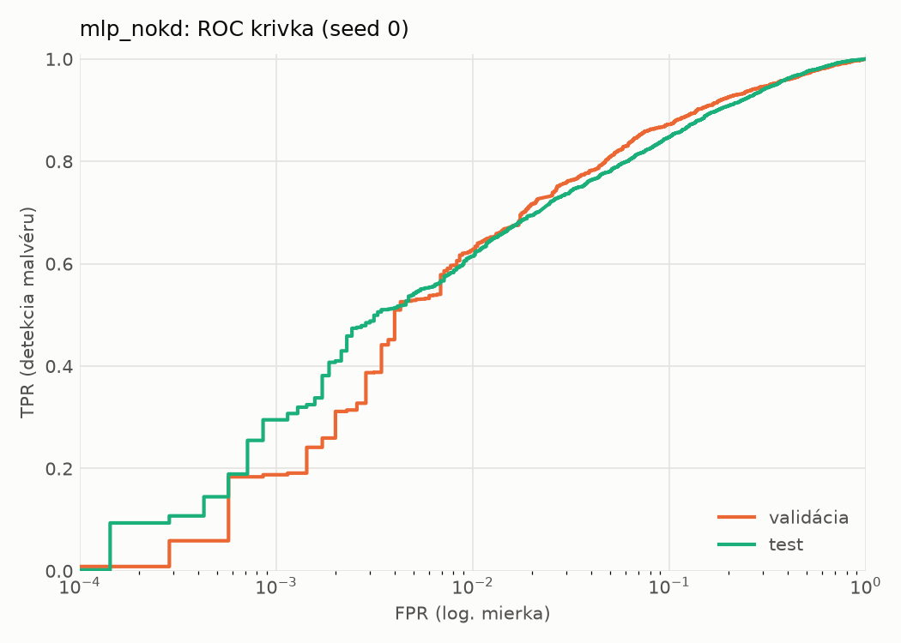
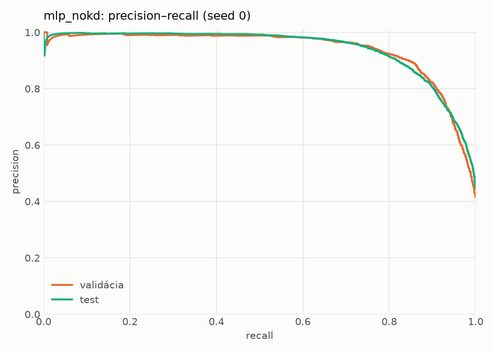
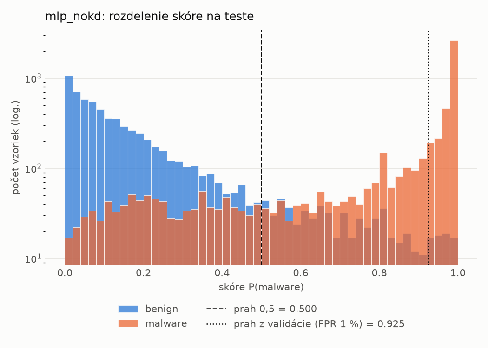
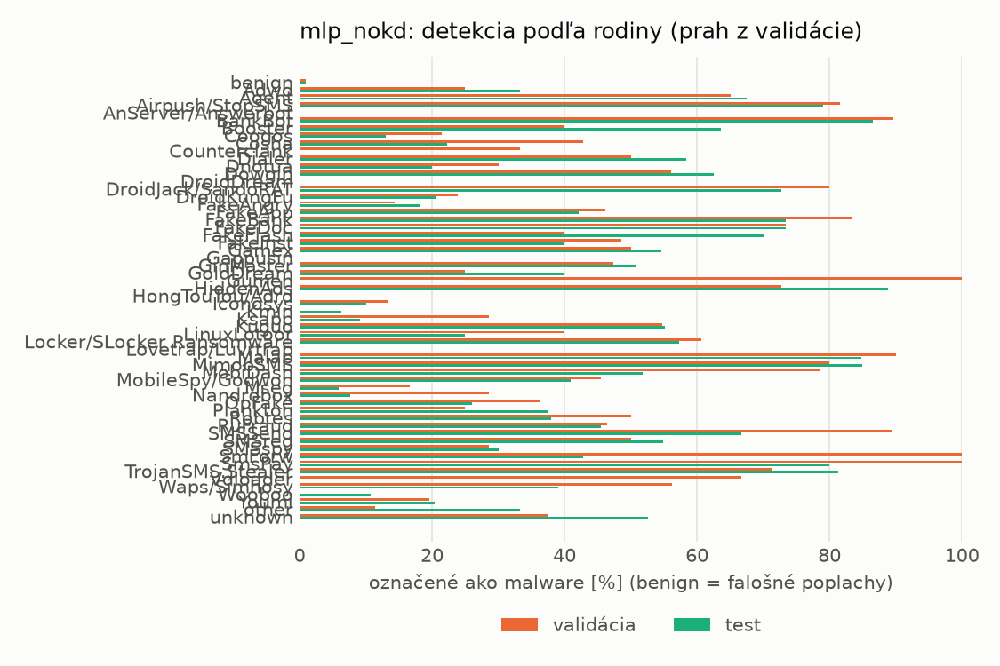
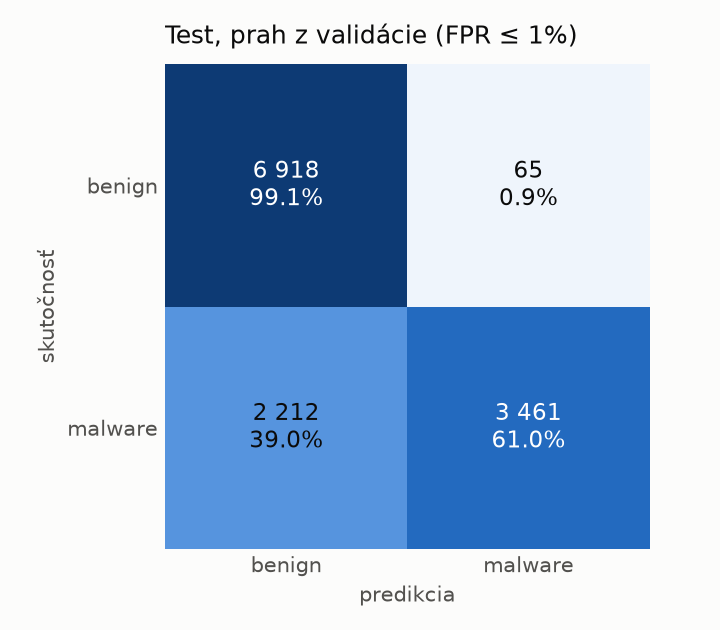
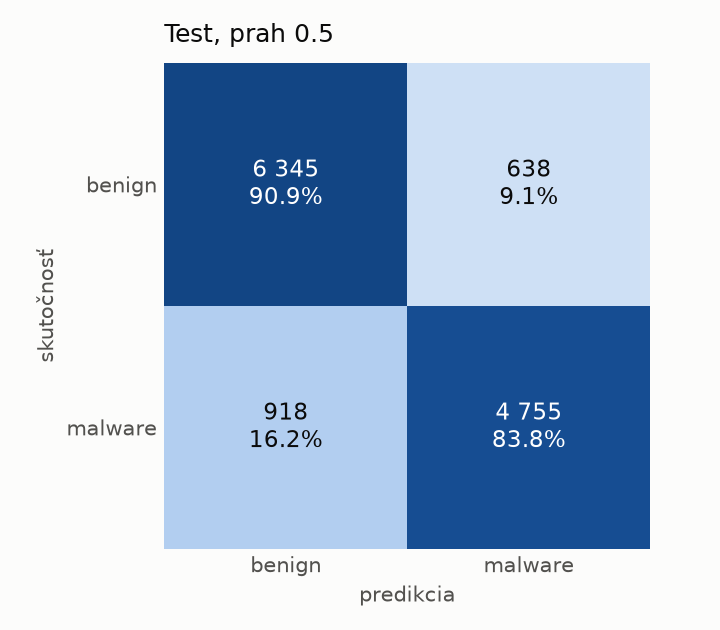
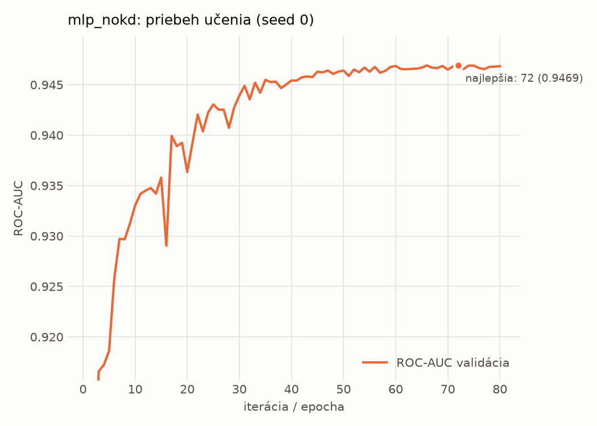

# dynamic/mlp_nokd – beh `20261123-214146`

> Automaticky generované (`src/training/run_tabular.py`). Konfigurácia: `config.yaml`, protokol: `protocol.yaml`.

- **Model:** `mlp` – kontrola – rovnaké malé MLP bez destilácie (iba skutočné označenia)
- **Ladenie:** bez ladenia – hyperparametre prevzaté z `runs_v4/emu_p/full/students_dynamic/mlp_nokd/20261123-205230`
- **Finálne modely:** seedy [0, 1, 2]; hodnoty sú priemer ± smerodajná odchýlka cez seedy
- **Najlepšie hyperparametre:** `{"hidden_layers": 1, "max_epochs": 100, "patience": 8, "hidden_width": 64, "dropout": 0.039782849658421375, "lr": 0.0018574312606020214, "weight_decay": 6.674701047165933e-06, "batch_size": 256}`

## Detekčná kvalita (bez prahu)
| metrika | train (podvzorka) | validácia | test |
|---|---|---|---|
| ROC-AUC | 0.9570 ± 0.0029 | 0.9464 ± 0.0005 | 0.9420 ± 0.0023 |
| PR-AUC | 0.9523 ± 0.0035 | 0.9391 ± 0.0014 | 0.9403 ± 0.0028 |
| TPR pri FPR 1 % | 0.7067 ± 0.0219 | 0.6209 ± 0.0174 | 0.6070 ± 0.0071 |
| TPR pri FPR 0,1 % | 0.4248 ± 0.0385 | 0.1751 ± 0.0198 | 0.2471 ± 0.0443 |
| log loss | 0.2520 ± 0.0092 | 0.2886 ± 0.0022 | 0.2997 ± 0.0061 |
| Brier skóre | 0.0743 ± 0.0027 | 0.0835 ± 0.0007 | 0.0905 ± 0.0020 |

Rozdiel ROC-AUC train − validácia: **0.0106** (veľký rozdiel = preučenie).

## Pri prahu z validácie (FPR ≤ 1% na validácii)
| metrika | train (podvzorka) | validácia | test |
|---|---|---|---|
| accuracy | 0.8475 ± 0.0057 | 0.8367 ± 0.0072 | 0.8157 ± 0.0049 |
| balanced accuracy | 0.8138 ± 0.0069 | 0.8056 ± 0.0087 | 0.7954 ± 0.0055 |
| precision | 0.9883 ± 0.0020 | 0.9784 ± 0.0006 | 0.9816 ± 0.0009 |
| recall (TPR) | 0.6327 ± 0.0131 | 0.6209 ± 0.0174 | 0.6000 ± 0.0115 |
| FPR | 0.0051 ± 0.0008 | 0.0097 ± 0.0000 | 0.0091 ± 0.0006 |
| F1 | 0.7714 ± 0.0103 | 0.7596 ± 0.0133 | 0.7447 ± 0.0087 |
| MCC | 0.7024 ± 0.0111 | 0.6835 ± 0.0135 | 0.6589 ± 0.0082 |

## Pri pevnom prahu 0.5
| metrika | train (podvzorka) | validácia | test |
|---|---|---|---|
| accuracy | 0.9028 ± 0.0040 | 0.8927 ± 0.0025 | 0.8763 ± 0.0034 |
| balanced accuracy | 0.8957 ± 0.0052 | 0.8883 ± 0.0020 | 0.8717 ± 0.0041 |
| precision | 0.8991 ± 0.0043 | 0.8779 ± 0.0117 | 0.8895 ± 0.0067 |
| recall (TPR) | 0.8573 ± 0.0124 | 0.8619 ± 0.0106 | 0.8268 ± 0.0130 |
| FPR | 0.0660 ± 0.0037 | 0.0854 ± 0.0102 | 0.0835 ± 0.0068 |
| F1 | 0.8777 ± 0.0059 | 0.8698 ± 0.0024 | 0.8569 ± 0.0051 |
| MCC | 0.7978 ± 0.0083 | 0.7788 ± 0.0049 | 0.7499 ± 0.0067 |

## Výpočtové nároky (seed 0, testovacia množina)
| meranie | hodnota |
|---|---|
| tréning finálneho modelu | 13.3 s (priemer cez seedy) |
| ladenie spolu | 0 s |
| počet parametrov / uzlov | 8 129 |
| veľkosť modelu na disku | 0.04 MB |
| transformácia vstupu – latencia (1 vlákno) | 0.015 ms |
| transformácia vstupu – priepustnosť | 769 254 vzoriek/s |
| CPU latencia modelu (batch 1, 1 vlákno) | 0.155 ms (p95 0.167) |
| CPU priepustnosť (24 vlákien) | 5 812 170 vzoriek/s |
| GPU latencia (batch 1) | 0.466 ms (p95 0.515) |
| GPU priepustnosť | 2 996 283 vzoriek/s |
| GPU špičková pamäť | 76 MB |

## Grafy
| | |
|---|---|
|  |  |
|  |  |
|  |  |
|  |  |

## Súbory
`metrics.json` (všetky metriky po seedoch vrátane rodín), `timing.json`, `hpo_trials.csv`,
`predictions/<časť>_seed<N>.parquet` (sha256, family, label, score), `model/seed_<N>/`, `log.txt`.
