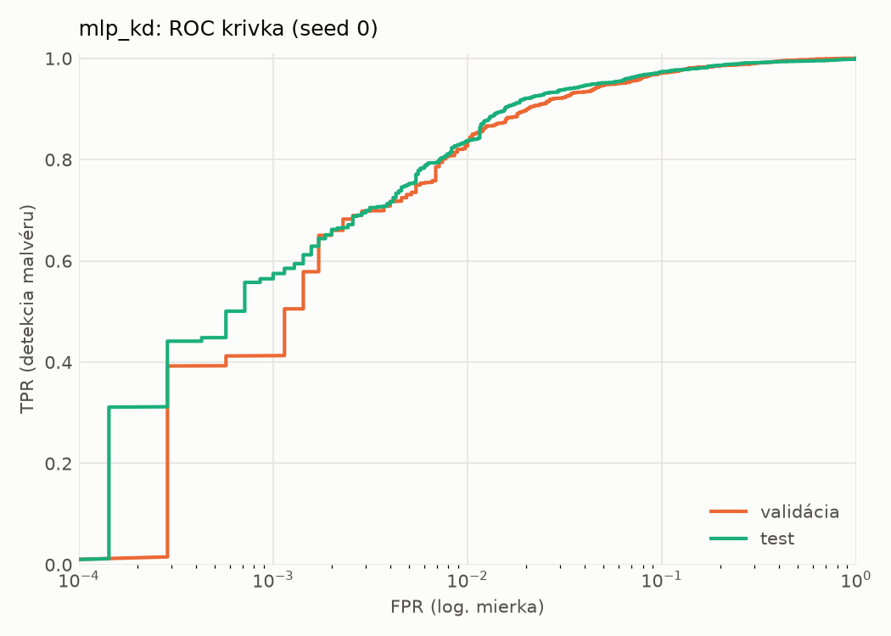
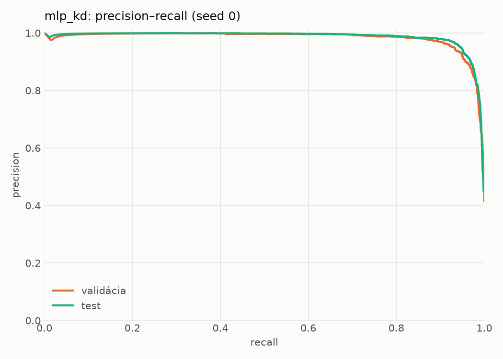
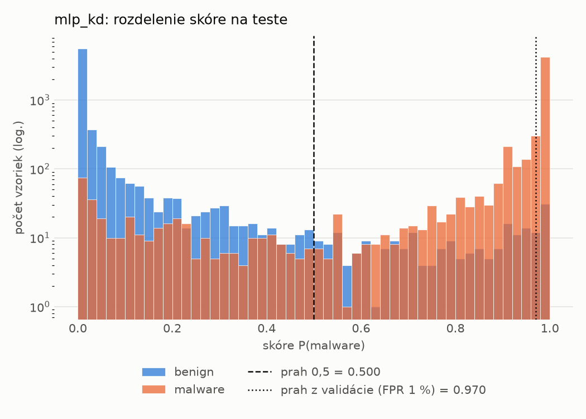
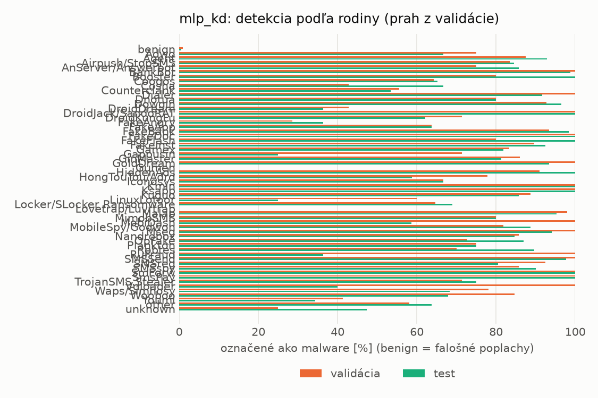
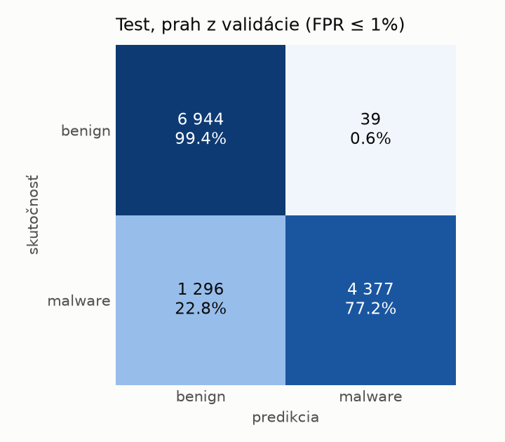
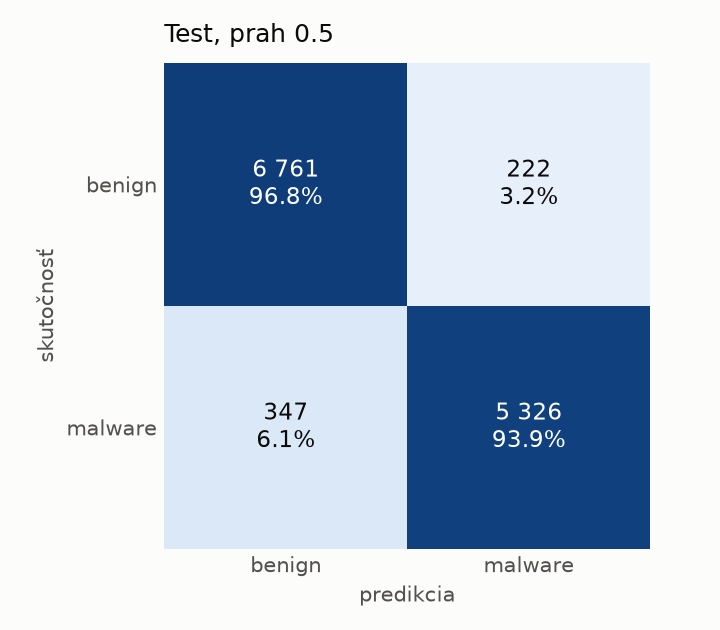
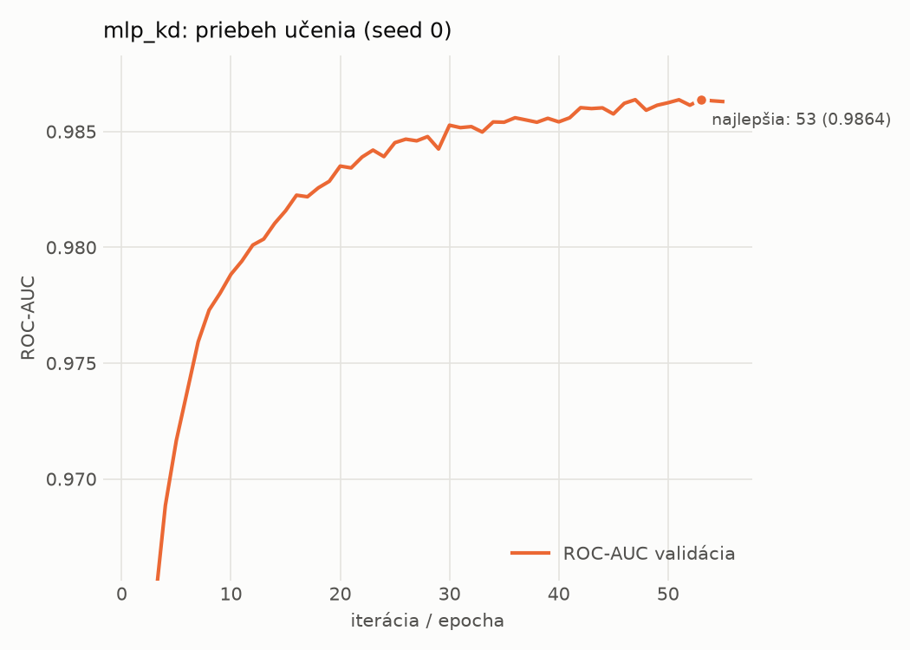

# static/mlp_kd – beh `20261123-214009`

> Automaticky generované (`src/training/run_tabular.py`). Konfigurácia: `config.yaml`, protokol: `protocol.yaml`.

- **Model:** `mlp` – študent – malé MLP učené destiláciou z hybridného učiteľa
- **Ladenie:** bez ladenia – hyperparametre prevzaté z `runs_v4/emu_p/full/students_static/mlp_kd/20261123-203204`
- **Finálne modely:** seedy [0, 1, 2]; hodnoty sú priemer ± smerodajná odchýlka cez seedy
- **Najlepšie hyperparametre:** `{"hidden_layers": 1, "max_epochs": 100, "patience": 8, "hidden_width": 64, "dropout": 0.0038513032258879476, "lr": 0.0011339137585789736, "weight_decay": 0.00026533084929296607, "batch_size": 1024, "kd_alpha": 0.3835611341536954, "kd_temperature": 1.7047486853284286}`

## Detekčná kvalita (bez prahu)
| metrika | train (podvzorka) | validácia | test |
|---|---|---|---|
| ROC-AUC | 0.9912 ± 0.0003 | 0.9862 ± 0.0002 | 0.9871 ± 0.0008 |
| PR-AUC | 0.9900 ± 0.0002 | 0.9819 ± 0.0003 | 0.9865 ± 0.0008 |
| TPR pri FPR 1 % | 0.9066 ± 0.0051 | 0.8382 ± 0.0102 | 0.8505 ± 0.0245 |
| TPR pri FPR 0,1 % | 0.7194 ± 0.0065 | 0.4686 ± 0.0499 | 0.5524 ± 0.0356 |
| log loss | 0.1102 ± 0.0024 | 0.1576 ± 0.0025 | 0.1446 ± 0.0058 |
| Brier skóre | 0.0292 ± 0.0005 | 0.0399 ± 0.0006 | 0.0359 ± 0.0003 |

Rozdiel ROC-AUC train − validácia: **0.0051** (veľký rozdiel = preučenie).

## Pri prahu z validácie (FPR ≤ 1% na validácii)
| metrika | train (podvzorka) | validácia | test |
|---|---|---|---|
| accuracy | 0.9388 ± 0.0019 | 0.9270 ± 0.0043 | 0.9032 ± 0.0144 |
| balanced accuracy | 0.9256 ± 0.0025 | 0.9142 ± 0.0051 | 0.8927 ± 0.0161 |
| precision | 0.9933 ± 0.0011 | 0.9839 ± 0.0002 | 0.9905 ± 0.0007 |
| recall (TPR) | 0.8552 ± 0.0056 | 0.8382 ± 0.0102 | 0.7916 ± 0.0324 |
| FPR | 0.0039 ± 0.0007 | 0.0097 ± 0.0000 | 0.0062 ± 0.0005 |
| F1 | 0.9191 ± 0.0028 | 0.9052 ± 0.0061 | 0.8797 ± 0.0198 |
| MCC | 0.8766 ± 0.0036 | 0.8537 ± 0.0082 | 0.8148 ± 0.0261 |

## Pri pevnom prahu 0.5
| metrika | train (podvzorka) | validácia | test |
|---|---|---|---|
| accuracy | 0.9616 ± 0.0004 | 0.9491 ± 0.0007 | 0.9555 ± 0.0004 |
| balanced accuracy | 0.9584 ± 0.0003 | 0.9469 ± 0.0007 | 0.9541 ± 0.0005 |
| precision | 0.9631 ± 0.0012 | 0.9429 ± 0.0012 | 0.9600 ± 0.0011 |
| recall (TPR) | 0.9416 ± 0.0008 | 0.9341 ± 0.0010 | 0.9399 ± 0.0013 |
| FPR | 0.0247 ± 0.0008 | 0.0402 ± 0.0009 | 0.0318 ± 0.0009 |
| F1 | 0.9522 ± 0.0004 | 0.9385 ± 0.0008 | 0.9499 ± 0.0005 |
| MCC | 0.9203 ± 0.0007 | 0.8951 ± 0.0014 | 0.9101 ± 0.0009 |

## Výpočtové nároky (seed 0, testovacia množina)
| meranie | hodnota |
|---|---|
| tréning finálneho modelu | 4.4 s (priemer cez seedy) |
| ladenie spolu | 0 s |
| počet parametrov / uzlov | 10 689 |
| veľkosť modelu na disku | 0.05 MB |
| transformácia vstupu – latencia (1 vlákno) | 0.007 ms |
| transformácia vstupu – priepustnosť | 977 607 vzoriek/s |
| CPU latencia modelu (batch 1, 1 vlákno) | 0.055 ms (p95 0.063) |
| CPU priepustnosť (24 vlákien) | 4 024 165 vzoriek/s |
| GPU latencia (batch 1) | 0.264 ms (p95 0.281) |
| GPU priepustnosť | 1 923 141 vzoriek/s |
| GPU špičková pamäť | 61 MB |

## Grafy
| | |
|---|---|
|  |  |
|  |  |
|  |  |
|  |  |

## Súbory
`metrics.json` (všetky metriky po seedoch vrátane rodín), `timing.json`, `hpo_trials.csv`,
`predictions/<časť>_seed<N>.parquet` (sha256, family, label, score), `model/seed_<N>/`, `log.txt`.
