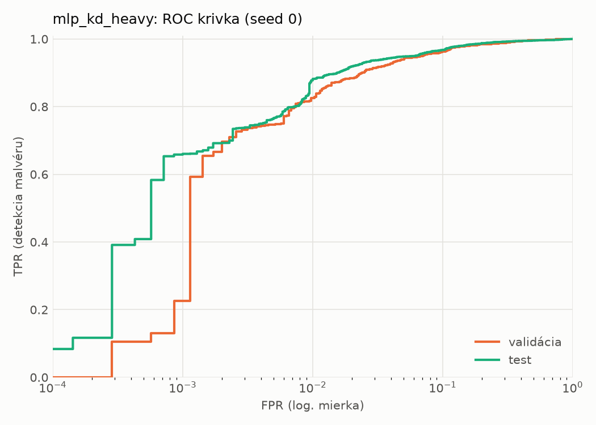
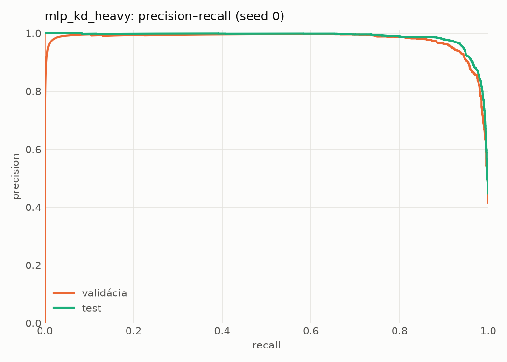
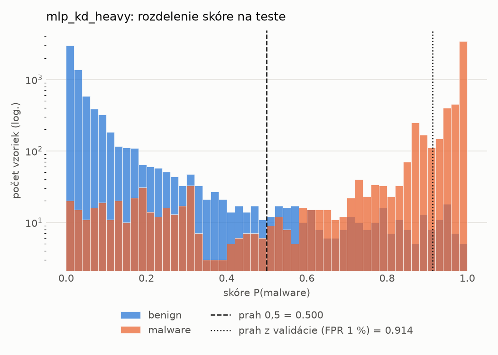
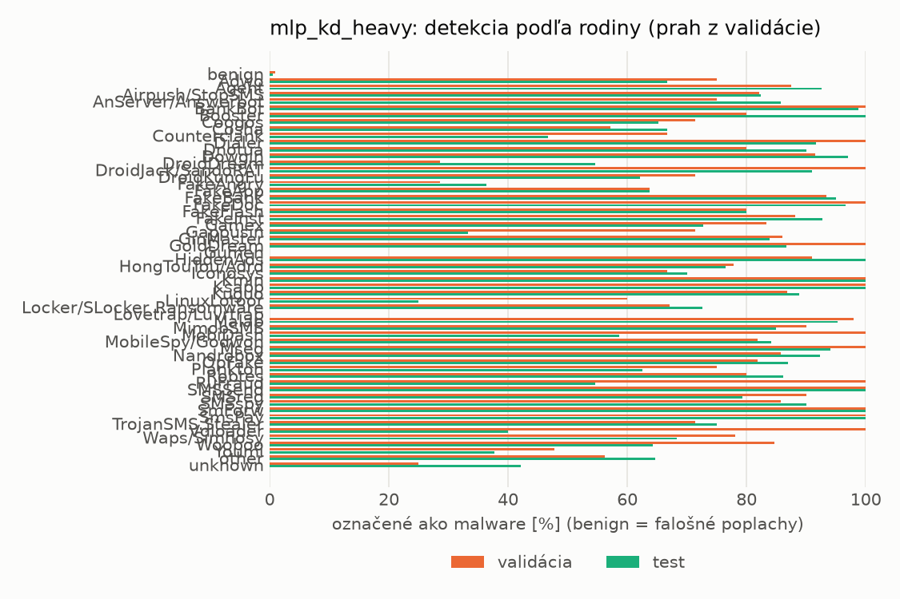
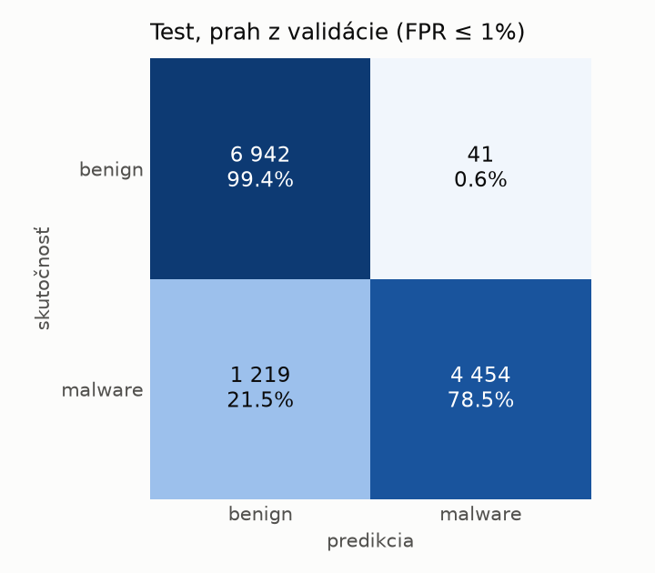
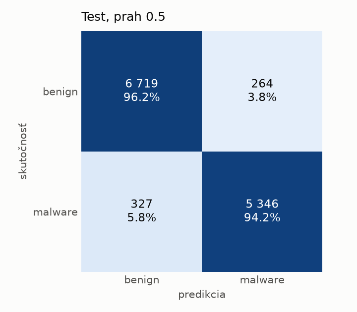
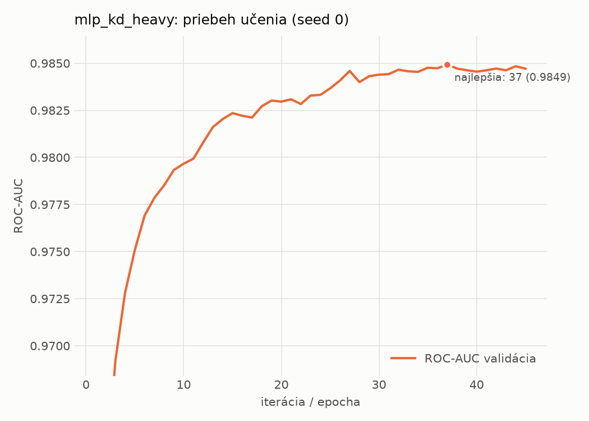

# static/mlp_kd_heavy – beh `20261123-214110`

> Automaticky generované (`src/training/run_tabular.py`). Konfigurácia: `config.yaml`, protokol: `protocol.yaml`.

- **Model:** `mlp` – študent – malé MLP učené destiláciou z mlp_large hybridu (V4)
- **Ladenie:** bez ladenia – hyperparametre prevzaté z `runs_v4/emu_p/full/students_static/mlp_kd_heavy/20261123-204329`
- **Finálne modely:** seedy [0, 1, 2]; hodnoty sú priemer ± smerodajná odchýlka cez seedy
- **Najlepšie hyperparametre:** `{"hidden_layers": 1, "max_epochs": 100, "patience": 8, "hidden_width": 64, "dropout": 0.1254973730751401, "lr": 0.0014439667191275393, "weight_decay": 1.2808340108243318e-06, "batch_size": 1024, "kd_alpha": 0.5142654341824873, "kd_temperature": 1.3883261824077338}`

## Detekčná kvalita (bez prahu)
| metrika | train (podvzorka) | validácia | test |
|---|---|---|---|
| ROC-AUC | 0.9903 ± 0.0002 | 0.9846 ± 0.0003 | 0.9871 ± 0.0004 |
| PR-AUC | 0.9888 ± 0.0002 | 0.9792 ± 0.0002 | 0.9867 ± 0.0004 |
| TPR pri FPR 1 % | 0.8952 ± 0.0017 | 0.8294 ± 0.0068 | 0.8788 ± 0.0009 |
| TPR pri FPR 0,1 % | 0.7203 ± 0.0061 | 0.3789 ± 0.1409 | 0.6171 ± 0.0359 |
| log loss | 0.1171 ± 0.0013 | 0.1501 ± 0.0012 | 0.1353 ± 0.0017 |
| Brier skóre | 0.0314 ± 0.0003 | 0.0412 ± 0.0002 | 0.0364 ± 0.0007 |

Rozdiel ROC-AUC train − validácia: **0.0056** (veľký rozdiel = preučenie).

## Pri prahu z validácie (FPR ≤ 1% na validácii)
| metrika | train (podvzorka) | validácia | test |
|---|---|---|---|
| accuracy | 0.9342 ± 0.0018 | 0.9235 ± 0.0028 | 0.9137 ± 0.0123 |
| balanced accuracy | 0.9203 ± 0.0022 | 0.9099 ± 0.0033 | 0.9045 ± 0.0138 |
| precision | 0.9915 ± 0.0004 | 0.9839 ± 0.0002 | 0.9906 ± 0.0004 |
| recall (TPR) | 0.8455 ± 0.0045 | 0.8294 ± 0.0068 | 0.8153 ± 0.0278 |
| FPR | 0.0049 ± 0.0003 | 0.0096 ± 0.0002 | 0.0063 ± 0.0004 |
| F1 | 0.9127 ± 0.0026 | 0.9001 ± 0.0040 | 0.8943 ± 0.0168 |
| MCC | 0.8675 ± 0.0036 | 0.8468 ± 0.0053 | 0.8339 ± 0.0224 |

## Pri pevnom prahu 0.5
| metrika | train (podvzorka) | validácia | test |
|---|---|---|---|
| accuracy | 0.9607 ± 0.0003 | 0.9481 ± 0.0010 | 0.9534 ± 0.0021 |
| balanced accuracy | 0.9583 ± 0.0003 | 0.9466 ± 0.0010 | 0.9524 ± 0.0022 |
| precision | 0.9570 ± 0.0000 | 0.9380 ± 0.0016 | 0.9530 ± 0.0014 |
| recall (TPR) | 0.9458 ± 0.0006 | 0.9371 ± 0.0011 | 0.9426 ± 0.0034 |
| FPR | 0.0292 ± 0.0000 | 0.0440 ± 0.0012 | 0.0378 ± 0.0011 |
| F1 | 0.9514 ± 0.0003 | 0.9376 ± 0.0012 | 0.9478 ± 0.0024 |
| MCC | 0.9184 ± 0.0005 | 0.8932 ± 0.0021 | 0.9058 ± 0.0042 |

## Výpočtové nároky (seed 0, testovacia množina)
| meranie | hodnota |
|---|---|
| tréning finálneho modelu | 3.5 s (priemer cez seedy) |
| ladenie spolu | 0 s |
| počet parametrov / uzlov | 10 689 |
| veľkosť modelu na disku | 0.05 MB |
| transformácia vstupu – latencia (1 vlákno) | 0.015 ms |
| transformácia vstupu – priepustnosť | 740 537 vzoriek/s |
| CPU latencia modelu (batch 1, 1 vlákno) | 0.152 ms (p95 0.162) |
| CPU priepustnosť (24 vlákien) | 5 379 580 vzoriek/s |
| GPU latencia (batch 1) | 0.477 ms (p95 0.500) |
| GPU priepustnosť | 3 450 570 vzoriek/s |
| GPU špičková pamäť | 92 MB |

## Grafy
| | |
|---|---|
|  |  |
|  |  |
|  |  |
|  |  |

## Súbory
`metrics.json` (všetky metriky po seedoch vrátane rodín), `timing.json`, `hpo_trials.csv`,
`predictions/<časť>_seed<N>.parquet` (sha256, family, label, score), `model/seed_<N>/`, `log.txt`.
