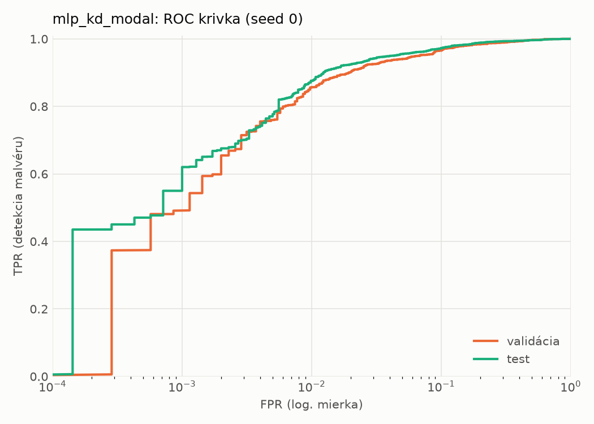
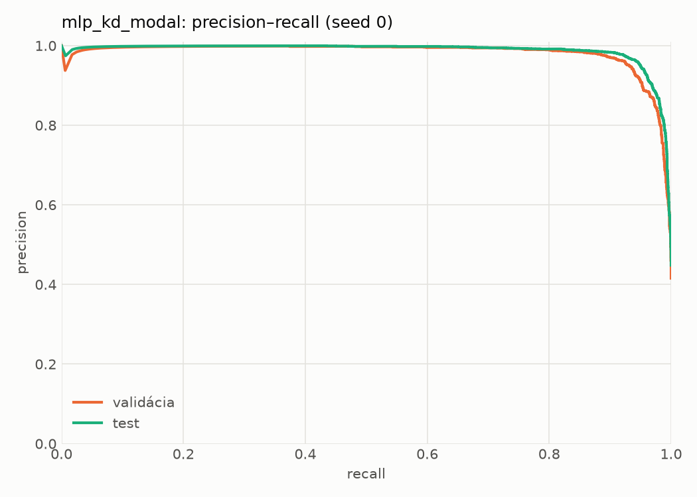
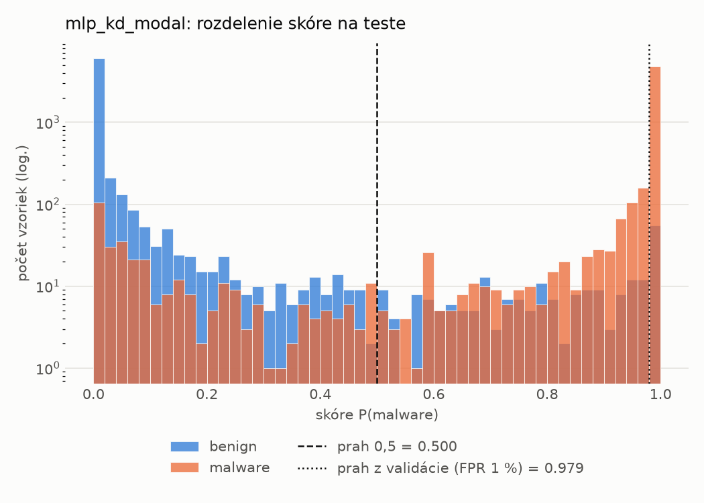
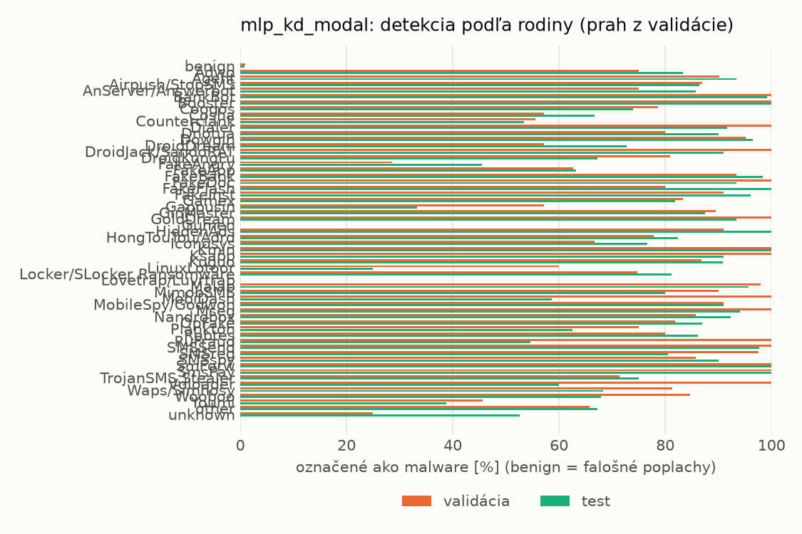
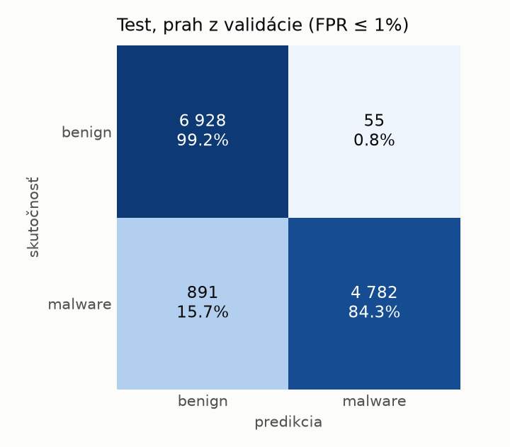
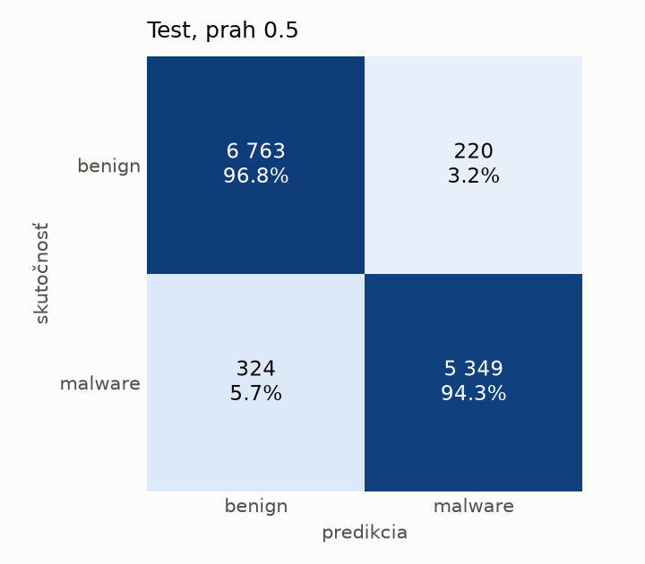
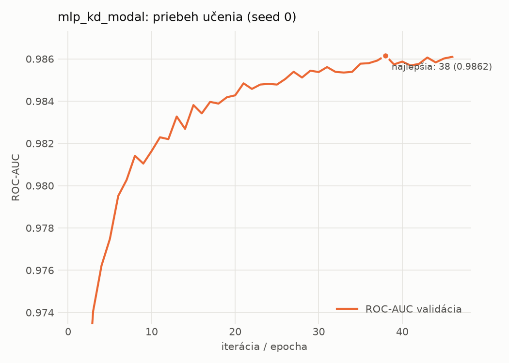

# static/mlp_kd_modal – beh `20261123-214047`

> Automaticky generované (`src/training/run_tabular.py`). Konfigurácia: `config.yaml`, protokol: `protocol.yaml`.

- **Model:** `mlp` – študent – malé MLP učené destiláciou z učiteľa rovnakej modality (variant A)
- **Ladenie:** bez ladenia – hyperparametre prevzaté z `runs_v4/emu_p/full/students_static/mlp_kd_modal/20261123-203932`
- **Finálne modely:** seedy [0, 1, 2]; hodnoty sú priemer ± smerodajná odchýlka cez seedy
- **Najlepšie hyperparametre:** `{"hidden_layers": 1, "max_epochs": 100, "patience": 8, "hidden_width": 64, "dropout": 0.037581027791643296, "lr": 0.0019348891318937097, "weight_decay": 9.225533739654786e-05, "batch_size": 512, "kd_alpha": 0.37781550385889523, "kd_temperature": 3.209412682485264}`

## Detekčná kvalita (bez prahu)
| metrika | train (podvzorka) | validácia | test |
|---|---|---|---|
| ROC-AUC | 0.9910 ± 0.0004 | 0.9864 ± 0.0005 | 0.9880 ± 0.0009 |
| PR-AUC | 0.9894 ± 0.0004 | 0.9824 ± 0.0005 | 0.9877 ± 0.0005 |
| TPR pri FPR 1 % | 0.8986 ± 0.0083 | 0.8546 ± 0.0025 | 0.8807 ± 0.0040 |
| TPR pri FPR 0,1 % | 0.7142 ± 0.0068 | 0.5364 ± 0.0649 | 0.5804 ± 0.0279 |
| log loss | 0.1290 ± 0.0034 | 0.1776 ± 0.0028 | 0.1535 ± 0.0061 |
| Brier skóre | 0.0317 ± 0.0006 | 0.0412 ± 0.0005 | 0.0358 ± 0.0001 |

Rozdiel ROC-AUC train − validácia: **0.0046** (veľký rozdiel = preučenie).

## Pri prahu z validácie (FPR ≤ 1% na validácii)
| metrika | train (podvzorka) | validácia | test |
|---|---|---|---|
| accuracy | 0.9403 ± 0.0014 | 0.9339 ± 0.0011 | 0.9276 ± 0.0022 |
| balanced accuracy | 0.9279 ± 0.0017 | 0.9225 ± 0.0013 | 0.9202 ± 0.0024 |
| precision | 0.9907 ± 0.0008 | 0.9844 ± 0.0003 | 0.9894 ± 0.0007 |
| recall (TPR) | 0.8614 ± 0.0037 | 0.8546 ± 0.0025 | 0.8477 ± 0.0045 |
| FPR | 0.0056 ± 0.0005 | 0.0096 ± 0.0002 | 0.0074 ± 0.0004 |
| F1 | 0.9215 ± 0.0019 | 0.9149 ± 0.0015 | 0.9131 ± 0.0028 |
| MCC | 0.8793 ± 0.0026 | 0.8671 ± 0.0021 | 0.8592 ± 0.0042 |

## Pri pevnom prahu 0.5
| metrika | train (podvzorka) | validácia | test |
|---|---|---|---|
| accuracy | 0.9613 ± 0.0007 | 0.9504 ± 0.0003 | 0.9570 ± 0.0003 |
| balanced accuracy | 0.9581 ± 0.0008 | 0.9479 ± 0.0002 | 0.9556 ± 0.0004 |
| precision | 0.9633 ± 0.0005 | 0.9465 ± 0.0007 | 0.9611 ± 0.0008 |
| recall (TPR) | 0.9408 ± 0.0014 | 0.9334 ± 0.0005 | 0.9421 ± 0.0015 |
| FPR | 0.0246 ± 0.0003 | 0.0375 ± 0.0005 | 0.0310 ± 0.0007 |
| F1 | 0.9519 ± 0.0009 | 0.9399 ± 0.0003 | 0.9515 ± 0.0004 |
| MCC | 0.9197 ± 0.0015 | 0.8977 ± 0.0005 | 0.9130 ± 0.0006 |

## Výpočtové nároky (seed 0, testovacia množina)
| meranie | hodnota |
|---|---|
| tréning finálneho modelu | 7.1 s (priemer cez seedy) |
| ladenie spolu | 0 s |
| počet parametrov / uzlov | 10 689 |
| veľkosť modelu na disku | 0.05 MB |
| transformácia vstupu – latencia (1 vlákno) | 0.015 ms |
| transformácia vstupu – priepustnosť | 748 916 vzoriek/s |
| CPU latencia modelu (batch 1, 1 vlákno) | 0.152 ms (p95 0.162) |
| CPU priepustnosť (24 vlákien) | 3 967 522 vzoriek/s |
| GPU latencia (batch 1) | 0.442 ms (p95 0.474) |
| GPU priepustnosť | 2 010 101 vzoriek/s |
| GPU špičková pamäť | 61 MB |

## Grafy
| | |
|---|---|
|  |  |
|  |  |
|  |  |
|  |  |

## Súbory
`metrics.json` (všetky metriky po seedoch vrátane rodín), `timing.json`, `hpo_trials.csv`,
`predictions/<časť>_seed<N>.parquet` (sha256, family, label, score), `model/seed_<N>/`, `log.txt`.
