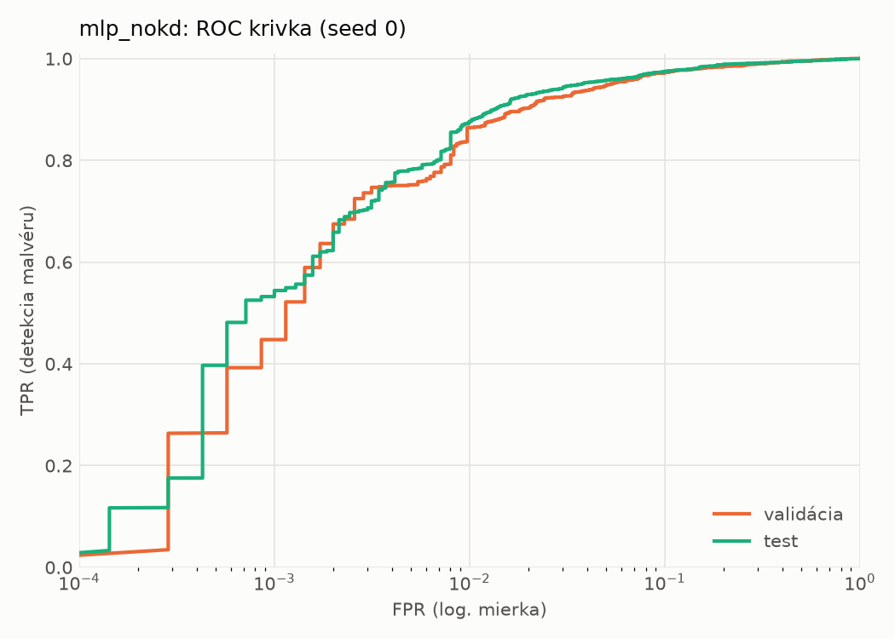
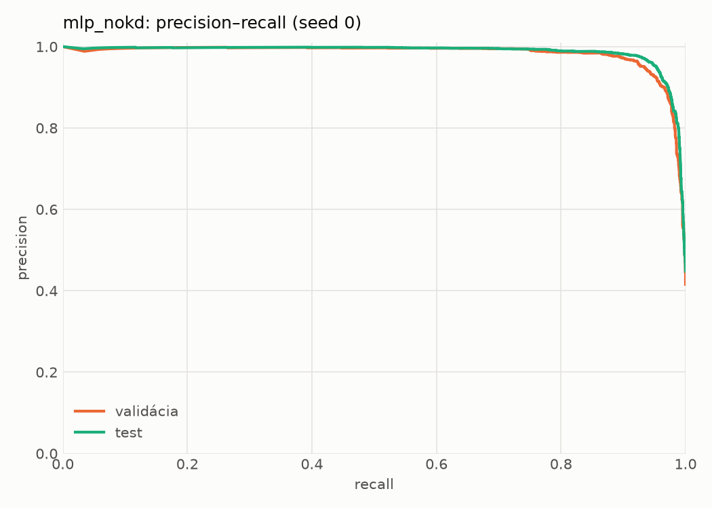
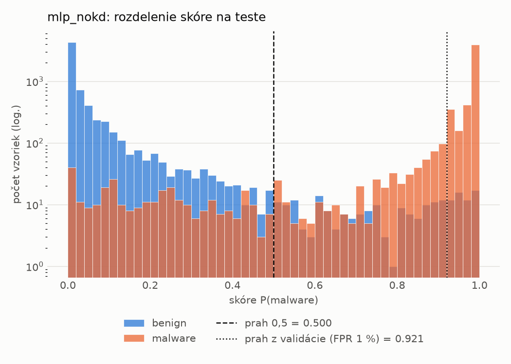
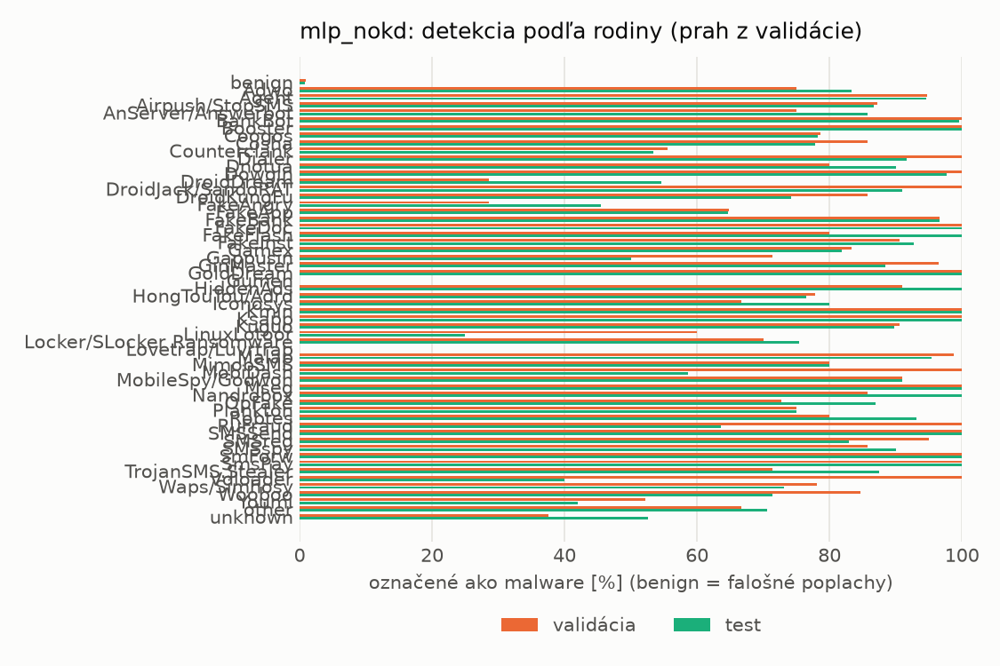
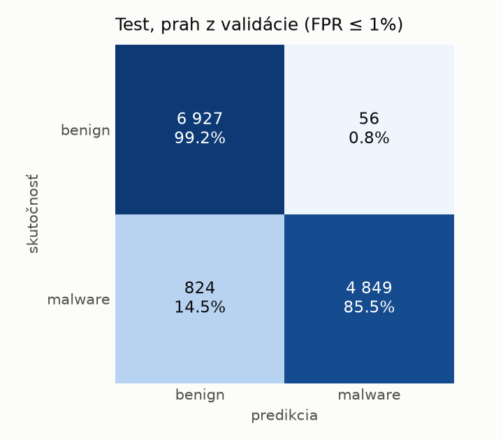
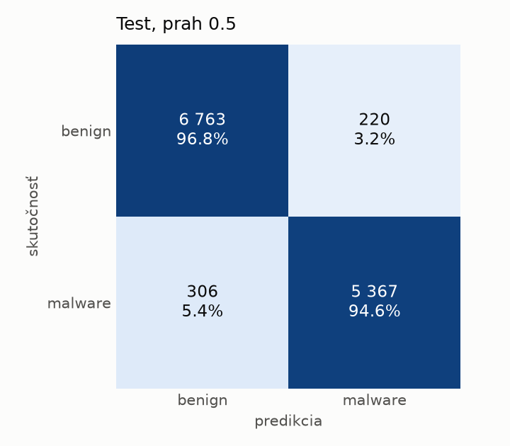
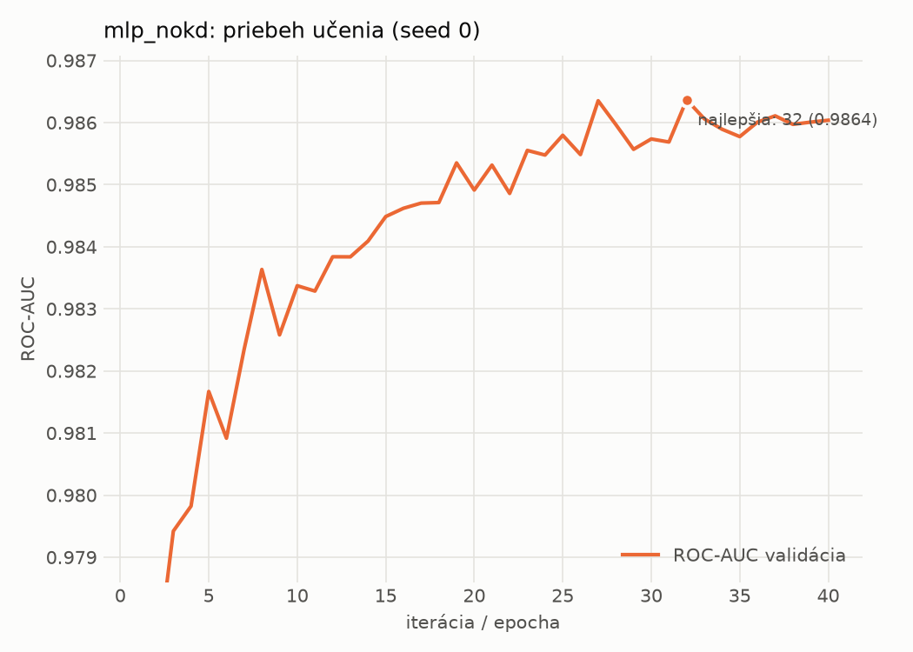

# static/mlp_nokd – beh `20261123-214024`

> Automaticky generované (`src/training/run_tabular.py`). Konfigurácia: `config.yaml`, protokol: `protocol.yaml`.

- **Model:** `mlp` – kontrola – rovnaké malé MLP bez destilácie (iba skutočné označenia)
- **Ladenie:** bez ladenia – hyperparametre prevzaté z `runs_v4/emu_p/full/students_static/mlp_nokd/20261123-203547`
- **Finálne modely:** seedy [0, 1, 2]; hodnoty sú priemer ± smerodajná odchýlka cez seedy
- **Najlepšie hyperparametre:** `{"hidden_layers": 1, "max_epochs": 100, "patience": 8, "hidden_width": 64, "dropout": 0.15022694447625398, "lr": 0.0027248227778296176, "weight_decay": 1.7062100113192703e-06, "batch_size": 256}`

## Detekčná kvalita (bez prahu)
| metrika | train (podvzorka) | validácia | test |
|---|---|---|---|
| ROC-AUC | 0.9932 ± 0.0006 | 0.9860 ± 0.0004 | 0.9871 ± 0.0007 |
| PR-AUC | 0.9917 ± 0.0011 | 0.9825 ± 0.0004 | 0.9867 ± 0.0001 |
| TPR pri FPR 1 % | 0.9208 ± 0.0043 | 0.8503 ± 0.0121 | 0.8732 ± 0.0168 |
| TPR pri FPR 0,1 % | 0.7471 ± 0.0277 | 0.4738 ± 0.0890 | 0.5110 ± 0.0240 |
| log loss | 0.0965 ± 0.0043 | 0.1435 ± 0.0021 | 0.1351 ± 0.0051 |
| Brier skóre | 0.0260 ± 0.0010 | 0.0383 ± 0.0003 | 0.0341 ± 0.0009 |

Rozdiel ROC-AUC train − validácia: **0.0072** (veľký rozdiel = preučenie).

## Pri prahu z validácie (FPR ≤ 1% na validácii)
| metrika | train (podvzorka) | validácia | test |
|---|---|---|---|
| accuracy | 0.9439 ± 0.0033 | 0.9321 ± 0.0050 | 0.9196 ± 0.0103 |
| balanced accuracy | 0.9320 ± 0.0040 | 0.9203 ± 0.0060 | 0.9112 ± 0.0116 |
| precision | 0.9934 ± 0.0010 | 0.9841 ± 0.0002 | 0.9890 ± 0.0004 |
| recall (TPR) | 0.8679 ± 0.0078 | 0.8503 ± 0.0121 | 0.8299 ± 0.0236 |
| FPR | 0.0039 ± 0.0006 | 0.0097 ± 0.0000 | 0.0075 ± 0.0005 |
| F1 | 0.9264 ± 0.0047 | 0.9123 ± 0.0070 | 0.9024 ± 0.0138 |
| MCC | 0.8867 ± 0.0066 | 0.8635 ± 0.0098 | 0.8444 ± 0.0189 |

## Pri pevnom prahu 0.5
| metrika | train (podvzorka) | validácia | test |
|---|---|---|---|
| accuracy | 0.9669 ± 0.0013 | 0.9500 ± 0.0009 | 0.9572 ± 0.0022 |
| balanced accuracy | 0.9647 ± 0.0014 | 0.9483 ± 0.0011 | 0.9560 ± 0.0022 |
| precision | 0.9655 ± 0.0014 | 0.9409 ± 0.0012 | 0.9594 ± 0.0023 |
| recall (TPR) | 0.9528 ± 0.0019 | 0.9386 ± 0.0023 | 0.9446 ± 0.0025 |
| FPR | 0.0234 ± 0.0010 | 0.0419 ± 0.0009 | 0.0325 ± 0.0019 |
| F1 | 0.9591 ± 0.0016 | 0.9398 ± 0.0012 | 0.9519 ± 0.0024 |
| MCC | 0.9314 ± 0.0026 | 0.8970 ± 0.0019 | 0.9135 ± 0.0044 |

## Výpočtové nároky (seed 0, testovacia množina)
| meranie | hodnota |
|---|---|
| tréning finálneho modelu | 7.1 s (priemer cez seedy) |
| ladenie spolu | 0 s |
| počet parametrov / uzlov | 10 689 |
| veľkosť modelu na disku | 0.05 MB |
| transformácia vstupu – latencia (1 vlákno) | 0.014 ms |
| transformácia vstupu – priepustnosť | 741 965 vzoriek/s |
| CPU latencia modelu (batch 1, 1 vlákno) | 0.152 ms (p95 0.161) |
| CPU priepustnosť (24 vlákien) | 6 890 244 vzoriek/s |
| GPU latencia (batch 1) | 0.275 ms (p95 0.295) |
| GPU priepustnosť | 2 494 924 vzoriek/s |
| GPU špičková pamäť | 92 MB |

## Grafy
| | |
|---|---|
|  |  |
|  |  |
|  |  |
|  |  |

## Súbory
`metrics.json` (všetky metriky po seedoch vrátane rodín), `timing.json`, `hpo_trials.csv`,
`predictions/<časť>_seed<N>.parquet` (sha256, family, label, score), `model/seed_<N>/`, `log.txt`.
