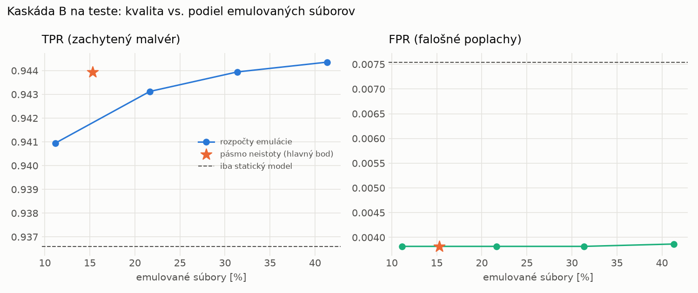

# Kaskáda B `b_baselines` – beh `20261123-215936`

> Generované `src/cascade/evaluate_b.py` (2026-11-23T21:59:36+01:00). Seedy: [0, 1, 2]; hodnoty = priemer ± sm. odchýlka.
> Všetky prahy a pásmo neistoty sú z validácie; test sa na nič nenastavuje. Postup: `docs/09_plan_v2.md`.

| rola | beh |
|---|---|
| static | `runs_v4/emu_p/lofo/FakeInst/static/lightgbm/20261123-184203` |
| dynamic | `runs_v4/emu_p/lofo/FakeInst/dynamic/lightgbm/20261123-214549` |
| hybrid | `runs_v4/emu_p/lofo/FakeInst/hybrid/lightgbm/20261123-214927` |

Druhý stupeň: **dynamic**. Pásmo neistoty statického modelu: FPR ≤ 0.1% nad `hi`,
najviac 1% malvéru validácie pod `lo` (seed 0: lo = 0.0102, hi = 0.9941, seed 1: lo = 0.0038, hi = 0.9990, seed 2: lo = 0.0038, hi = 0.9992).

## Test
| prístup | accuracy | balanced_accuracy | precision | recall_tpr | fpr | f1 | mcc |
|---|---|---|---|---|---|---|---|
| kaskáda B | 0.9728 ± 0.0006 | 0.9701 ± 0.0007 | 0.9950 ± 0.0004 | 0.9439 ± 0.0015 | 0.0038 ± 0.0003 | 0.9688 ± 0.0007 | 0.9457 ± 0.0011 |
| statický | 0.9674 ± 0.0009 | 0.9645 ± 0.0011 | 0.9902 ± 0.0018 | 0.9366 ± 0.0033 | 0.0075 ± 0.0014 | 0.9626 ± 0.0011 | 0.9349 ± 0.0017 |
| dynamický | 0.9067 ± 0.0006 | 0.8970 ± 0.0007 | 0.9867 ± 0.0008 | 0.8027 ± 0.0017 | 0.0088 ± 0.0005 | 0.8853 ± 0.0008 | 0.8203 ± 0.0010 |
| hybrid (každá vzorka) | 0.9768 ± 0.0005 | 0.9750 ± 0.0005 | 0.9912 ± 0.0005 | 0.9568 ± 0.0006 | 0.0069 ± 0.0004 | 0.9737 ± 0.0005 | 0.9535 ± 0.0010 |

- **emulované súbory: 15.28%** (ostatné rozhodne iba statický model); na hybrid ide 3.36% súborov
- chyby pri istom rozhodnutí statického modelu (seed 0): 47
- validácia: emulované 14.17%, na hybrid 3.22%

## Validácia
| prístup | accuracy | balanced_accuracy | precision | recall_tpr | fpr | f1 | mcc |
|---|---|---|---|---|---|---|---|
| kaskáda B | 0.9774 ± 0.0006 | 0.9748 ± 0.0006 | 0.9905 ± 0.0004 | 0.9565 ± 0.0010 | 0.0069 ± 0.0003 | 0.9732 ± 0.0007 | 0.9542 ± 0.0011 |
| statický | 0.9720 ± 0.0011 | 0.9689 ± 0.0013 | 0.9865 ± 0.0000 | 0.9476 ± 0.0026 | 0.0097 ± 0.0000 | 0.9667 ± 0.0014 | 0.9431 ± 0.0022 |
| dynamický | 0.9292 ± 0.0009 | 0.9191 ± 0.0010 | 0.9851 ± 0.0003 | 0.8479 ± 0.0019 | 0.0096 ± 0.0002 | 0.9114 ± 0.0012 | 0.8596 ± 0.0018 |
| hybrid (každá vzorka) | 0.9772 ± 0.0004 | 0.9750 ± 0.0004 | 0.9867 ± 0.0000 | 0.9598 ± 0.0009 | 0.0097 ± 0.0000 | 0.9731 ± 0.0005 | 0.9536 ± 0.0008 |

## Januárové vzorky vynechanej rodiny (iba malvér → TPR)
| prístup | TPR |
|---|---|
| kaskáda B | 0.8098 ± 0.0096 |
| statický | 0.8246 ± 0.0157 |
| dynamický | 0.3532 ± 0.0080 |
| hybrid (každá vzorka) | 0.8899 ± 0.0042 |

Podiel emulovaných: 31.76%

## Krivka rozpočtu emulácie (test, priemer cez seedy)
| budget_val | emulation_rate | hybrid_rate | recall_tpr | fpr | f1 |
|---|---|---|---|---|---|
| 0.1000 | 0.1117 | 0.0342 | 0.9409 | 0.0038 | 0.9672 |
| 0.2000 | 0.2164 | 0.0555 | 0.9431 | 0.0038 | 0.9684 |
| 0.3000 | 0.3137 | 0.0631 | 0.9439 | 0.0038 | 0.9688 |
| 0.4000 | 0.4133 | 0.0701 | 0.9444 | 0.0039 | 0.9690 |

## Výpočtové nároky
Čas dynamickej analýzy (beh v emulátore alebo na zariadení) dataset neuvádza, preto sa neodhaduje. Úspora kaskády B = podiel súborov s dynamickou analýzou: **15.28%** (ostatné prístupy 100 %).

_Chýba benchmark niektorého komponentu (v zero-day behoch sa nemeria)._

