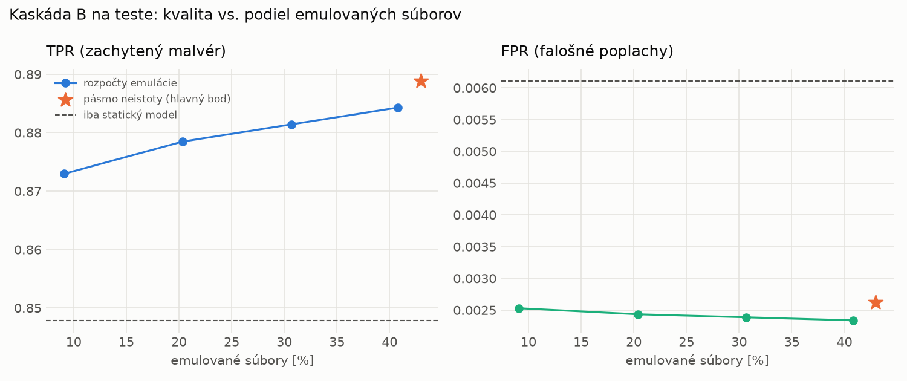

# Kaskáda B `b_heavyteacher` – beh `20261123-215939`

> Generované `src/cascade/evaluate_b.py` (2026-11-23T21:59:40+01:00). Seedy: [0, 1, 2]; hodnoty = priemer ± sm. odchýlka.
> Všetky prahy a pásmo neistoty sú z validácie; test sa na nič nenastavuje. Postup: `docs/09_plan_v2.md`.

| rola | beh |
|---|---|
| static | `runs_v4/emu_p/lofo/FakeInst/students_static/mlp_kd_heavy/20261123-215712` |
| dynamic | `runs_v4/emu_p/lofo/FakeInst/students_dynamic/mlp_kd_heavy/20261123-215855` |
| hybrid | `runs_v4/emu_p/lofo/FakeInst/hybrid/lightgbm/20261123-214927` |

Druhý stupeň: **dynamic**. Pásmo neistoty statického modelu: FPR ≤ 0.1% nad `hi`,
najviac 1% malvéru validácie pod `lo` (seed 0: lo = 0.0413, hi = 0.9974, seed 1: lo = 0.0430, hi = 0.9926, seed 2: lo = 0.0481, hi = 0.9941).

## Test
| prístup | accuracy | balanced_accuracy | precision | recall_tpr | fpr | f1 | mcc |
|---|---|---|---|---|---|---|---|
| kaskáda B | 0.9487 ± 0.0026 | 0.9431 ± 0.0030 | 0.9964 ± 0.0006 | 0.8889 ± 0.0063 | 0.0026 ± 0.0005 | 0.9396 ± 0.0033 | 0.8997 ± 0.0049 |
| statický | 0.9284 ± 0.0046 | 0.9209 ± 0.0051 | 0.9912 ± 0.0002 | 0.8479 ± 0.0102 | 0.0061 ± 0.0001 | 0.9139 ± 0.0060 | 0.8610 ± 0.0086 |
| dynamický | 0.8101 ± 0.0051 | 0.7892 ± 0.0057 | 0.9826 ± 0.0005 | 0.5868 ± 0.0114 | 0.0084 ± 0.0001 | 0.7347 ± 0.0091 | 0.6496 ± 0.0089 |
| hybrid (každá vzorka) | 0.9768 ± 0.0005 | 0.9750 ± 0.0005 | 0.9912 ± 0.0005 | 0.9568 ± 0.0006 | 0.0069 ± 0.0004 | 0.9737 ± 0.0005 | 0.9535 ± 0.0010 |

- **emulované súbory: 42.95%** (ostatné rozhodne iba statický model); na hybrid ide 10.46% súborov
- chyby pri istom rozhodnutí statického modelu (seed 0): 50
- validácia: emulované 42.17%, na hybrid 9.89%

## Validácia
| prístup | accuracy | balanced_accuracy | precision | recall_tpr | fpr | f1 | mcc |
|---|---|---|---|---|---|---|---|
| kaskáda B | 0.9526 ± 0.0021 | 0.9456 ± 0.0025 | 0.9931 ± 0.0009 | 0.8958 ± 0.0052 | 0.0047 ± 0.0006 | 0.9419 ± 0.0028 | 0.9055 ± 0.0041 |
| statický | 0.9303 ± 0.0027 | 0.9204 ± 0.0031 | 0.9850 ± 0.0001 | 0.8506 ± 0.0062 | 0.0097 ± 0.0000 | 0.9128 ± 0.0036 | 0.8617 ± 0.0051 |
| dynamický | 0.8327 ± 0.0071 | 0.8067 ± 0.0082 | 0.9796 ± 0.0005 | 0.6231 ± 0.0165 | 0.0097 ± 0.0000 | 0.7616 ± 0.0125 | 0.6815 ± 0.0128 |
| hybrid (každá vzorka) | 0.9772 ± 0.0004 | 0.9750 ± 0.0004 | 0.9867 ± 0.0000 | 0.9598 ± 0.0009 | 0.0097 ± 0.0000 | 0.9731 ± 0.0005 | 0.9536 ± 0.0008 |

## Januárové vzorky vynechanej rodiny (iba malvér → TPR)
| prístup | TPR |
|---|---|
| kaskáda B | 0.7674 ± 0.0109 |
| statický | 0.7845 ± 0.0140 |
| dynamický | 0.1538 ± 0.0046 |
| hybrid (každá vzorka) | 0.8899 ± 0.0042 |

Podiel emulovaných: 57.94%

## Krivka rozpočtu emulácie (test, priemer cez seedy)
| budget_val | emulation_rate | hybrid_rate | recall_tpr | fpr | f1 |
|---|---|---|---|---|---|
| 0.1000 | 0.0908 | 0.0422 | 0.8730 | 0.0025 | 0.9306 |
| 0.2000 | 0.2037 | 0.0808 | 0.8785 | 0.0024 | 0.9338 |
| 0.3000 | 0.3067 | 0.1035 | 0.8814 | 0.0024 | 0.9355 |
| 0.4000 | 0.4081 | 0.1325 | 0.8843 | 0.0023 | 0.9372 |

## Výpočtové nároky
Čas dynamickej analýzy (beh v emulátore alebo na zariadení) dataset neuvádza, preto sa neodhaduje. Úspora kaskády B = podiel súborov s dynamickou analýzou: **42.95%** (ostatné prístupy 100 %).

_Chýba benchmark niektorého komponentu (v zero-day behoch sa nemeria)._

