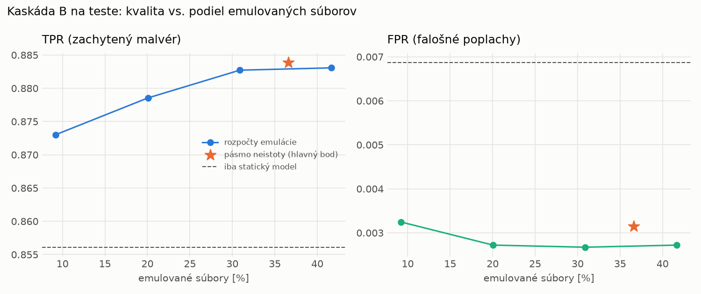

# Kaskáda B `b_main` – beh `20261123-215930`

> Generované `src/cascade/evaluate_b.py` (2026-11-23T21:59:30+01:00). Seedy: [0, 1, 2]; hodnoty = priemer ± sm. odchýlka.
> Všetky prahy a pásmo neistoty sú z validácie; test sa na nič nenastavuje. Postup: `docs/09_plan_v2.md`.

| rola | beh |
|---|---|
| static | `runs_v4/emu_p/lofo/FakeInst/students_static/mlp_kd/20261123-215606` |
| dynamic | `runs_v4/emu_p/lofo/FakeInst/students_dynamic/mlp_kd/20261123-215727` |
| hybrid | `runs_v4/emu_p/lofo/FakeInst/hybrid/lightgbm/20261123-214927` |

Druhý stupeň: **dynamic**. Pásmo neistoty statického modelu: FPR ≤ 0.1% nad `hi`,
najviac 1% malvéru validácie pod `lo` (seed 0: lo = 0.0091, hi = 0.9992, seed 1: lo = 0.0073, hi = 0.9999, seed 2: lo = 0.0073, hi = 0.9981).

## Test
| prístup | accuracy | balanced_accuracy | precision | recall_tpr | fpr | f1 | mcc |
|---|---|---|---|---|---|---|---|
| kaskáda B | 0.9462 ± 0.0016 | 0.9404 ± 0.0018 | 0.9956 ± 0.0002 | 0.8839 ± 0.0034 | 0.0032 ± 0.0001 | 0.9364 ± 0.0020 | 0.8949 ± 0.0030 |
| statický | 0.9317 ± 0.0021 | 0.9246 ± 0.0024 | 0.9902 ± 0.0014 | 0.8561 ± 0.0058 | 0.0069 ± 0.0010 | 0.9183 ± 0.0028 | 0.8669 ± 0.0036 |
| dynamický | 0.8075 ± 0.0046 | 0.7862 ± 0.0052 | 0.9841 ± 0.0013 | 0.5799 ± 0.0110 | 0.0076 ± 0.0007 | 0.7297 ± 0.0085 | 0.6456 ± 0.0076 |
| hybrid (každá vzorka) | 0.9768 ± 0.0005 | 0.9750 ± 0.0005 | 0.9912 ± 0.0005 | 0.9568 ± 0.0006 | 0.0069 ± 0.0004 | 0.9737 ± 0.0005 | 0.9535 ± 0.0010 |

- **emulované súbory: 36.59%** (ostatné rozhodne iba statický model); na hybrid ide 8.67% súborov
- chyby pri istom rozhodnutí statického modelu (seed 0): 60
- validácia: emulované 36.44%, na hybrid 8.63%

## Validácia
| prístup | accuracy | balanced_accuracy | precision | recall_tpr | fpr | f1 | mcc |
|---|---|---|---|---|---|---|---|
| kaskáda B | 0.9524 ± 0.0017 | 0.9454 ± 0.0019 | 0.9924 ± 0.0011 | 0.8960 ± 0.0032 | 0.0052 ± 0.0008 | 0.9418 ± 0.0022 | 0.9051 ± 0.0035 |
| statický | 0.9353 ± 0.0027 | 0.9262 ± 0.0031 | 0.9852 ± 0.0001 | 0.8621 ± 0.0063 | 0.0097 ± 0.0000 | 0.9195 ± 0.0036 | 0.8712 ± 0.0052 |
| dynamický | 0.8325 ± 0.0071 | 0.8065 ± 0.0083 | 0.9796 ± 0.0005 | 0.6227 ± 0.0166 | 0.0097 ± 0.0000 | 0.7613 ± 0.0126 | 0.6812 ± 0.0129 |
| hybrid (každá vzorka) | 0.9772 ± 0.0004 | 0.9750 ± 0.0004 | 0.9867 ± 0.0000 | 0.9598 ± 0.0009 | 0.0097 ± 0.0000 | 0.9731 ± 0.0005 | 0.9536 ± 0.0008 |

## Januárové vzorky vynechanej rodiny (iba malvér → TPR)
| prístup | TPR |
|---|---|
| kaskáda B | 0.7676 ± 0.0054 |
| statický | 0.7866 ± 0.0109 |
| dynamický | 0.1471 ± 0.0047 |
| hybrid (každá vzorka) | 0.8899 ± 0.0042 |

Podiel emulovaných: 53.12%

## Krivka rozpočtu emulácie (test, priemer cez seedy)
| budget_val | emulation_rate | hybrid_rate | recall_tpr | fpr | f1 |
|---|---|---|---|---|---|
| 0.1000 | 0.0921 | 0.0410 | 0.8730 | 0.0032 | 0.9302 |
| 0.2000 | 0.2006 | 0.0755 | 0.8785 | 0.0027 | 0.9337 |
| 0.3000 | 0.3087 | 0.1119 | 0.8827 | 0.0027 | 0.9361 |
| 0.4000 | 0.4166 | 0.1316 | 0.8831 | 0.0027 | 0.9362 |

## Výpočtové nároky
Čas dynamickej analýzy (beh v emulátore alebo na zariadení) dataset neuvádza, preto sa neodhaduje. Úspora kaskády B = podiel súborov s dynamickou analýzou: **36.59%** (ostatné prístupy 100 %).

_Chýba benchmark niektorého komponentu (v zero-day behoch sa nemeria)._

