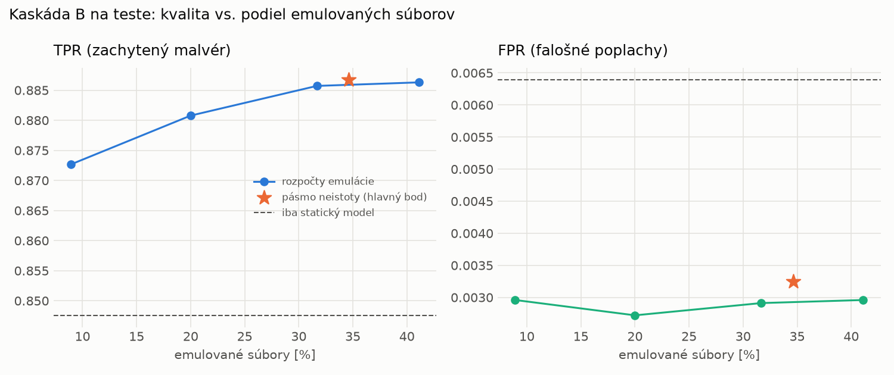

# Kaskáda B `b_nokd` – beh `20261123-215937`

> Generované `src/cascade/evaluate_b.py` (2026-11-23T21:59:38+01:00). Seedy: [0, 1, 2]; hodnoty = priemer ± sm. odchýlka.
> Všetky prahy a pásmo neistoty sú z validácie; test sa na nič nenastavuje. Postup: `docs/09_plan_v2.md`.

| rola | beh |
|---|---|
| static | `runs_v4/emu_p/lofo/FakeInst/students_static/mlp_nokd/20261123-215622` |
| dynamic | `runs_v4/emu_p/lofo/FakeInst/students_dynamic/mlp_nokd/20261123-215750` |
| hybrid | `runs_v4/emu_p/lofo/FakeInst/hybrid/lightgbm/20261123-214927` |

Druhý stupeň: **dynamic**. Pásmo neistoty statického modelu: FPR ≤ 0.1% nad `hi`,
najviac 1% malvéru validácie pod `lo` (seed 0: lo = 0.0297, hi = 0.9991, seed 1: lo = 0.0369, hi = 0.9990, seed 2: lo = 0.0338, hi = 0.9982).

## Test
| prístup | accuracy | balanced_accuracy | precision | recall_tpr | fpr | f1 | mcc |
|---|---|---|---|---|---|---|---|
| kaskáda B | 0.9475 ± 0.0032 | 0.9418 ± 0.0036 | 0.9955 ± 0.0005 | 0.8868 ± 0.0069 | 0.0032 ± 0.0004 | 0.9380 ± 0.0040 | 0.8972 ± 0.0061 |
| statický | 0.9282 ± 0.0029 | 0.9206 ± 0.0034 | 0.9908 ± 0.0015 | 0.8476 ± 0.0076 | 0.0064 ± 0.0011 | 0.9136 ± 0.0039 | 0.8604 ± 0.0052 |
| dynamický | 0.8102 ± 0.0068 | 0.7892 ± 0.0077 | 0.9842 ± 0.0019 | 0.5860 ± 0.0165 | 0.0076 ± 0.0011 | 0.7345 ± 0.0124 | 0.6503 ± 0.0110 |
| hybrid (každá vzorka) | 0.9768 ± 0.0005 | 0.9750 ± 0.0005 | 0.9912 ± 0.0005 | 0.9568 ± 0.0006 | 0.0069 ± 0.0004 | 0.9737 ± 0.0005 | 0.9535 ± 0.0010 |

- **emulované súbory: 34.61%** (ostatné rozhodne iba statický model); na hybrid ide 7.73% súborov
- chyby pri istom rozhodnutí statického modelu (seed 0): 58
- validácia: emulované 34.48%, na hybrid 7.96%

## Validácia
| prístup | accuracy | balanced_accuracy | precision | recall_tpr | fpr | f1 | mcc |
|---|---|---|---|---|---|---|---|
| kaskáda B | 0.9536 ± 0.0012 | 0.9467 ± 0.0014 | 0.9931 ± 0.0005 | 0.8981 ± 0.0031 | 0.0047 ± 0.0003 | 0.9432 ± 0.0015 | 0.9074 ± 0.0022 |
| statický | 0.9299 ± 0.0004 | 0.9199 ± 0.0005 | 0.9851 ± 0.0002 | 0.8494 ± 0.0010 | 0.0096 ± 0.0002 | 0.9122 ± 0.0005 | 0.8609 ± 0.0007 |
| dynamický | 0.8339 ± 0.0074 | 0.8081 ± 0.0086 | 0.9797 ± 0.0005 | 0.6260 ± 0.0172 | 0.0097 ± 0.0000 | 0.7638 ± 0.0129 | 0.6837 ± 0.0134 |
| hybrid (každá vzorka) | 0.9772 ± 0.0004 | 0.9750 ± 0.0004 | 0.9867 ± 0.0000 | 0.9598 ± 0.0009 | 0.0097 ± 0.0000 | 0.9731 ± 0.0005 | 0.9536 ± 0.0008 |

## Januárové vzorky vynechanej rodiny (iba malvér → TPR)
| prístup | TPR |
|---|---|
| kaskáda B | 0.7766 ± 0.0124 |
| statický | 0.7921 ± 0.0106 |
| dynamický | 0.1471 ± 0.0130 |
| hybrid (každá vzorka) | 0.8899 ± 0.0042 |

Podiel emulovaných: 38.43%

## Krivka rozpočtu emulácie (test, priemer cez seedy)
| budget_val | emulation_rate | hybrid_rate | recall_tpr | fpr | f1 |
|---|---|---|---|---|---|
| 0.1000 | 0.0893 | 0.0384 | 0.8727 | 0.0030 | 0.9302 |
| 0.2000 | 0.2000 | 0.0713 | 0.8808 | 0.0027 | 0.9349 |
| 0.3000 | 0.3167 | 0.0941 | 0.8857 | 0.0029 | 0.9376 |
| 0.4000 | 0.4111 | 0.1083 | 0.8863 | 0.0030 | 0.9379 |

## Výpočtové nároky
Čas dynamickej analýzy (beh v emulátore alebo na zariadení) dataset neuvádza, preto sa neodhaduje. Úspora kaskády B = podiel súborov s dynamickou analýzou: **34.61%** (ostatné prístupy 100 %).

_Chýba benchmark niektorého komponentu (v zero-day behoch sa nemeria)._

