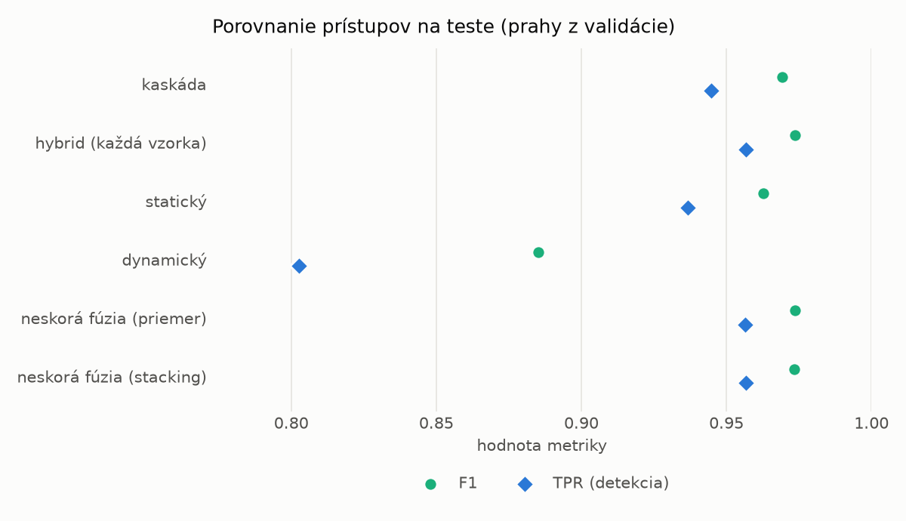
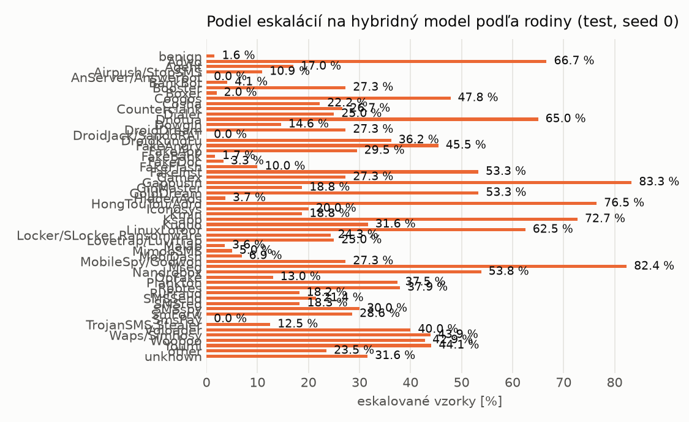

# Kaskáda `baselines` – beh `20261123-215926`

> Generované `src/cascade/evaluate.py` (2026-11-23T21:59:26+01:00). Seedy: [0, 1, 2]; hodnoty = priemer ± sm. odchýlka.
> Všetky prahy sú určené na validácii (FPR ≤ 1 %); test sa na nič nenastavuje.

| rola | beh |
|---|---|
| static | `runs_v4/emu_p/lofo/FakeInst/static/lightgbm/20261123-184203` |
| dynamic | `runs_v4/emu_p/lofo/FakeInst/dynamic/lightgbm/20261123-214549` |
| hybrid | `runs_v4/emu_p/lofo/FakeInst/hybrid/lightgbm/20261123-214927` |

## Test
| prístup | accuracy | balanced_accuracy | precision | recall_tpr | fpr | f1 | mcc |
|---|---|---|---|---|---|---|---|
| kaskáda | 0.9731 ± 0.0006 | 0.9705 ± 0.0007 | 0.9949 ± 0.0005 | 0.9449 ± 0.0017 | 0.0039 ± 0.0004 | 0.9693 ± 0.0007 | 0.9464 ± 0.0012 |
| hybrid (každá vzorka) | 0.9768 ± 0.0005 | 0.9750 ± 0.0005 | 0.9912 ± 0.0005 | 0.9568 ± 0.0006 | 0.0069 ± 0.0004 | 0.9737 ± 0.0005 | 0.9535 ± 0.0010 |
| statický | 0.9674 ± 0.0009 | 0.9645 ± 0.0011 | 0.9902 ± 0.0018 | 0.9366 ± 0.0033 | 0.0075 ± 0.0014 | 0.9626 ± 0.0011 | 0.9349 ± 0.0017 |
| dynamický | 0.9067 ± 0.0006 | 0.8970 ± 0.0007 | 0.9867 ± 0.0008 | 0.8027 ± 0.0017 | 0.0088 ± 0.0005 | 0.8853 ± 0.0008 | 0.8203 ± 0.0010 |
| neskorá fúzia (priemer) | 0.9767 ± 0.0004 | 0.9748 ± 0.0005 | 0.9912 ± 0.0004 | 0.9565 ± 0.0008 | 0.0069 ± 0.0003 | 0.9735 ± 0.0005 | 0.9532 ± 0.0009 |
| neskorá fúzia (stacking) | 0.9765 ± 0.0001 | 0.9747 ± 0.0002 | 0.9906 ± 0.0008 | 0.9567 ± 0.0010 | 0.0074 ± 0.0007 | 0.9734 ± 0.0002 | 0.9529 ± 0.0003 |

## Validácia
| prístup | accuracy | balanced_accuracy | precision | recall_tpr | fpr | f1 | mcc |
|---|---|---|---|---|---|---|---|
| kaskáda | 0.9776 ± 0.0005 | 0.9750 ± 0.0006 | 0.9909 ± 0.0004 | 0.9567 ± 0.0009 | 0.0066 ± 0.0003 | 0.9735 ± 0.0006 | 0.9546 ± 0.0011 |
| hybrid (každá vzorka) | 0.9772 ± 0.0004 | 0.9750 ± 0.0004 | 0.9867 ± 0.0000 | 0.9598 ± 0.0009 | 0.0097 ± 0.0000 | 0.9731 ± 0.0005 | 0.9536 ± 0.0008 |
| statický | 0.9720 ± 0.0011 | 0.9689 ± 0.0013 | 0.9865 ± 0.0000 | 0.9476 ± 0.0026 | 0.0097 ± 0.0000 | 0.9667 ± 0.0014 | 0.9431 ± 0.0022 |
| dynamický | 0.9292 ± 0.0009 | 0.9191 ± 0.0010 | 0.9851 ± 0.0003 | 0.8479 ± 0.0019 | 0.0096 ± 0.0002 | 0.9114 ± 0.0012 | 0.8596 ± 0.0018 |
| neskorá fúzia (priemer) | 0.9819 ± 0.0002 | 0.9805 ± 0.0003 | 0.9871 ± 0.0004 | 0.9706 ± 0.0004 | 0.0096 ± 0.0003 | 0.9788 ± 0.0003 | 0.9632 ± 0.0005 |
| neskorá fúzia (stacking) | 0.9817 ± 0.0001 | 0.9803 ± 0.0001 | 0.9871 ± 0.0004 | 0.9701 ± 0.0002 | 0.0096 ± 0.0003 | 0.9785 ± 0.0001 | 0.9627 ± 0.0002 |

## Správanie kaskády (test, seed 0)
- podiel eskalácií na hybrid: **9.06%** (1147 vzoriek)
- chyby pri zhode študentov (kaskáda ich nemôže opraviť): **229**
  (1.990% zo zhôd; FP 5, FN 224)
- úspešnosť na eskalovaných vzorkách: hybrid 0.9058413251961639, statický 0.8343504795117699,
  dynamický 0.16564952048823017  → prínos hybridu pri nezhode

## Výpočtové nároky (odhad z benchmarkov komponentov)
_Chýba benchmark niektorého komponentu (`python -m src.evaluation.benchmark`)._

