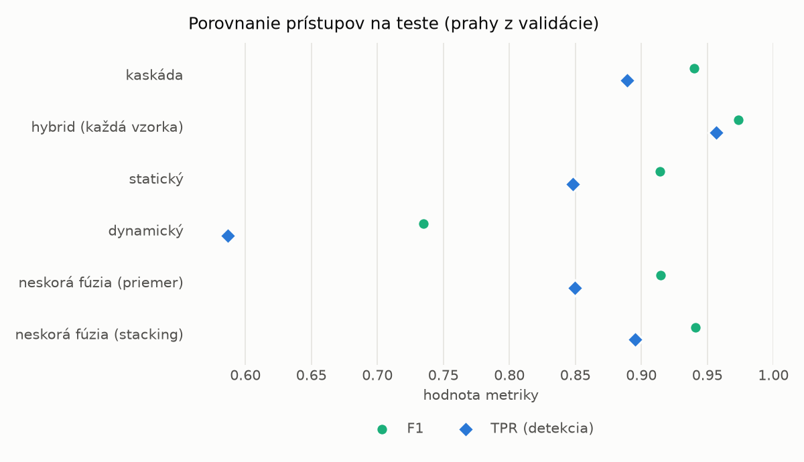
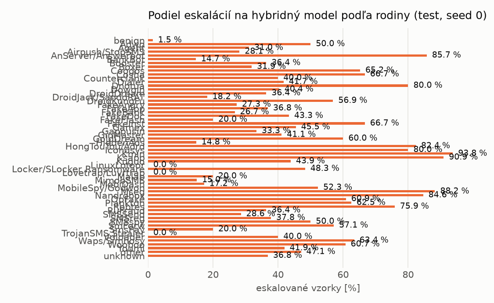

# Kaskáda `heavyteacher` – beh `20261123-215928`

> Generované `src/cascade/evaluate.py` (2026-11-23T21:59:28+01:00). Seedy: [0, 1, 2]; hodnoty = priemer ± sm. odchýlka.
> Všetky prahy sú určené na validácii (FPR ≤ 1 %); test sa na nič nenastavuje.

| rola | beh |
|---|---|
| static | `runs_v4/emu_p/lofo/FakeInst/students_static/mlp_kd_heavy/20261123-215712` |
| dynamic | `runs_v4/emu_p/lofo/FakeInst/students_dynamic/mlp_kd_heavy/20261123-215855` |
| hybrid | `runs_v4/emu_p/lofo/FakeInst/hybrid/lightgbm/20261123-214927` |

## Test
| prístup | accuracy | balanced_accuracy | precision | recall_tpr | fpr | f1 | mcc |
|---|---|---|---|---|---|---|---|
| kaskáda | 0.9490 ± 0.0026 | 0.9434 ± 0.0029 | 0.9966 ± 0.0005 | 0.8894 ± 0.0062 | 0.0025 ± 0.0004 | 0.9399 ± 0.0033 | 0.9003 ± 0.0049 |
| hybrid (každá vzorka) | 0.9768 ± 0.0005 | 0.9750 ± 0.0005 | 0.9912 ± 0.0005 | 0.9568 ± 0.0006 | 0.0069 ± 0.0004 | 0.9737 ± 0.0005 | 0.9535 ± 0.0010 |
| statický | 0.9284 ± 0.0046 | 0.9209 ± 0.0051 | 0.9912 ± 0.0002 | 0.8479 ± 0.0102 | 0.0061 ± 0.0001 | 0.9139 ± 0.0060 | 0.8610 ± 0.0086 |
| dynamický | 0.8101 ± 0.0051 | 0.7892 ± 0.0057 | 0.9826 ± 0.0005 | 0.5868 ± 0.0114 | 0.0084 ± 0.0001 | 0.7347 ± 0.0091 | 0.6496 ± 0.0089 |
| neskorá fúzia (priemer) | 0.9289 ± 0.0026 | 0.9214 ± 0.0030 | 0.9904 ± 0.0013 | 0.8496 ± 0.0062 | 0.0067 ± 0.0009 | 0.9146 ± 0.0035 | 0.8617 ± 0.0049 |
| neskorá fúzia (stacking) | 0.9495 ± 0.0019 | 0.9444 ± 0.0022 | 0.9910 ± 0.0008 | 0.8954 ± 0.0049 | 0.0066 ± 0.0006 | 0.9408 ± 0.0024 | 0.9005 ± 0.0035 |

## Validácia
| prístup | accuracy | balanced_accuracy | precision | recall_tpr | fpr | f1 | mcc |
|---|---|---|---|---|---|---|---|
| kaskáda | 0.9529 ± 0.0019 | 0.9458 ± 0.0022 | 0.9937 ± 0.0008 | 0.8959 ± 0.0048 | 0.0043 ± 0.0006 | 0.9423 ± 0.0025 | 0.9061 ± 0.0036 |
| hybrid (každá vzorka) | 0.9772 ± 0.0004 | 0.9750 ± 0.0004 | 0.9867 ± 0.0000 | 0.9598 ± 0.0009 | 0.0097 ± 0.0000 | 0.9731 ± 0.0005 | 0.9536 ± 0.0008 |
| statický | 0.9303 ± 0.0027 | 0.9204 ± 0.0031 | 0.9850 ± 0.0001 | 0.8506 ± 0.0062 | 0.0097 ± 0.0000 | 0.9128 ± 0.0036 | 0.8617 ± 0.0051 |
| dynamický | 0.8327 ± 0.0071 | 0.8067 ± 0.0082 | 0.9796 ± 0.0005 | 0.6231 ± 0.0165 | 0.0097 ± 0.0000 | 0.7616 ± 0.0125 | 0.6815 ± 0.0128 |
| neskorá fúzia (priemer) | 0.9419 ± 0.0024 | 0.9339 ± 0.0027 | 0.9854 ± 0.0001 | 0.8776 ± 0.0055 | 0.0097 ± 0.0000 | 0.9284 ± 0.0031 | 0.8840 ± 0.0046 |
| neskorá fúzia (stacking) | 0.9536 ± 0.0007 | 0.9475 ± 0.0009 | 0.9859 ± 0.0000 | 0.9048 ± 0.0017 | 0.0097 ± 0.0000 | 0.9436 ± 0.0009 | 0.9067 ± 0.0014 |

## Správanie kaskády (test, seed 0)
- podiel eskalácií na hybrid: **17.26%** (2184 vzoriek)
- chyby pri zhode študentov (kaskáda ich nemôže opraviť): **624**
  (5.959% zo zhôd; FP 0, FN 624)
- úspešnosť na eskalovaných vzorkách: hybrid 0.9771062271062271, statický 0.847985347985348,
  dynamický 0.152014652014652  → prínos hybridu pri nezhode

## Výpočtové nároky (odhad z benchmarkov komponentov)
_Chýba benchmark niektorého komponentu (`python -m src.evaluation.benchmark`)._

