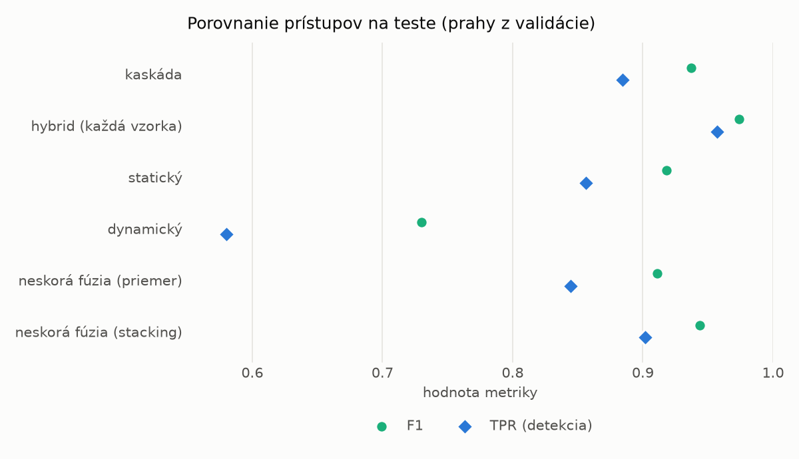
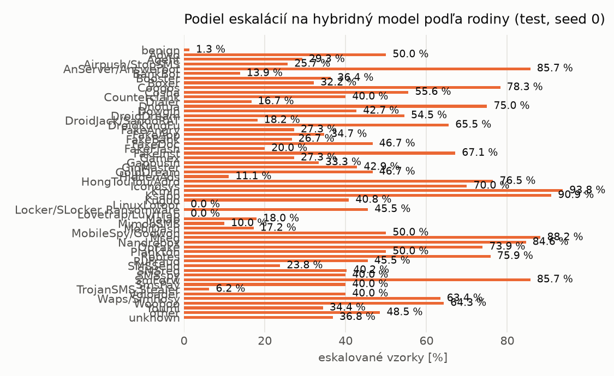

# Kaskáda `main` – beh `20261123-215917`

> Generované `src/cascade/evaluate.py` (2026-11-23T21:59:17+01:00). Seedy: [0, 1, 2]; hodnoty = priemer ± sm. odchýlka.
> Všetky prahy sú určené na validácii (FPR ≤ 1 %); test sa na nič nenastavuje.

| rola | beh |
|---|---|
| static | `runs_v4/emu_p/lofo/FakeInst/students_static/mlp_kd/20261123-215606` |
| dynamic | `runs_v4/emu_p/lofo/FakeInst/students_dynamic/mlp_kd/20261123-215727` |
| hybrid | `runs_v4/emu_p/lofo/FakeInst/hybrid/lightgbm/20261123-214927` |

## Test
| prístup | accuracy | balanced_accuracy | precision | recall_tpr | fpr | f1 | mcc |
|---|---|---|---|---|---|---|---|
| kaskáda | 0.9467 ± 0.0017 | 0.9409 ± 0.0018 | 0.9962 ± 0.0007 | 0.8844 ± 0.0032 | 0.0027 ± 0.0005 | 0.9370 ± 0.0021 | 0.8958 ± 0.0033 |
| hybrid (každá vzorka) | 0.9768 ± 0.0005 | 0.9750 ± 0.0005 | 0.9912 ± 0.0005 | 0.9568 ± 0.0006 | 0.0069 ± 0.0004 | 0.9737 ± 0.0005 | 0.9535 ± 0.0010 |
| statický | 0.9317 ± 0.0021 | 0.9246 ± 0.0024 | 0.9902 ± 0.0014 | 0.8561 ± 0.0058 | 0.0069 ± 0.0010 | 0.9183 ± 0.0028 | 0.8669 ± 0.0036 |
| dynamický | 0.8075 ± 0.0046 | 0.7862 ± 0.0052 | 0.9841 ± 0.0013 | 0.5799 ± 0.0110 | 0.0076 ± 0.0007 | 0.7297 ± 0.0085 | 0.6456 ± 0.0076 |
| neskorá fúzia (priemer) | 0.9260 ± 0.0067 | 0.9184 ± 0.0076 | 0.9888 ± 0.0025 | 0.8446 ± 0.0172 | 0.0078 ± 0.0019 | 0.9109 ± 0.0090 | 0.8561 ± 0.0119 |
| neskorá fúzia (stacking) | 0.9518 ± 0.0032 | 0.9471 ± 0.0037 | 0.9898 ± 0.0027 | 0.9018 ± 0.0095 | 0.0075 ± 0.0021 | 0.9437 ± 0.0040 | 0.9048 ± 0.0057 |

## Validácia
| prístup | accuracy | balanced_accuracy | precision | recall_tpr | fpr | f1 | mcc |
|---|---|---|---|---|---|---|---|
| kaskáda | 0.9530 ± 0.0015 | 0.9460 ± 0.0017 | 0.9934 ± 0.0007 | 0.8964 ± 0.0031 | 0.0045 ± 0.0004 | 0.9424 ± 0.0019 | 0.9063 ± 0.0030 |
| hybrid (každá vzorka) | 0.9772 ± 0.0004 | 0.9750 ± 0.0004 | 0.9867 ± 0.0000 | 0.9598 ± 0.0009 | 0.0097 ± 0.0000 | 0.9731 ± 0.0005 | 0.9536 ± 0.0008 |
| statický | 0.9353 ± 0.0027 | 0.9262 ± 0.0031 | 0.9852 ± 0.0001 | 0.8621 ± 0.0063 | 0.0097 ± 0.0000 | 0.9195 ± 0.0036 | 0.8712 ± 0.0052 |
| dynamický | 0.8325 ± 0.0071 | 0.8065 ± 0.0083 | 0.9796 ± 0.0005 | 0.6227 ± 0.0166 | 0.0097 ± 0.0000 | 0.7613 ± 0.0126 | 0.6812 ± 0.0129 |
| neskorá fúzia (priemer) | 0.9429 ± 0.0046 | 0.9351 ± 0.0053 | 0.9855 ± 0.0002 | 0.8799 ± 0.0107 | 0.0097 ± 0.0000 | 0.9297 ± 0.0060 | 0.8859 ± 0.0089 |
| neskorá fúzia (stacking) | 0.9564 ± 0.0044 | 0.9508 ± 0.0052 | 0.9860 ± 0.0002 | 0.9114 ± 0.0103 | 0.0097 ± 0.0000 | 0.9472 ± 0.0057 | 0.9123 ± 0.0087 |

## Správanie kaskády (test, seed 0)
- podiel eskalácií na hybrid: **16.72%** (2116 vzoriek)
- chyby pri zhode študentov (kaskáda ich nemôže opraviť): **624**
  (5.920% zo zhôd; FP 1, FN 623)
- úspešnosť na eskalovaných vzorkách: hybrid 0.974952741020794, statický 0.8879962192816635,
  dynamický 0.11200378071833648  → prínos hybridu pri nezhode

## Výpočtové nároky (odhad z benchmarkov komponentov)
_Chýba benchmark niektorého komponentu (`python -m src.evaluation.benchmark`)._

