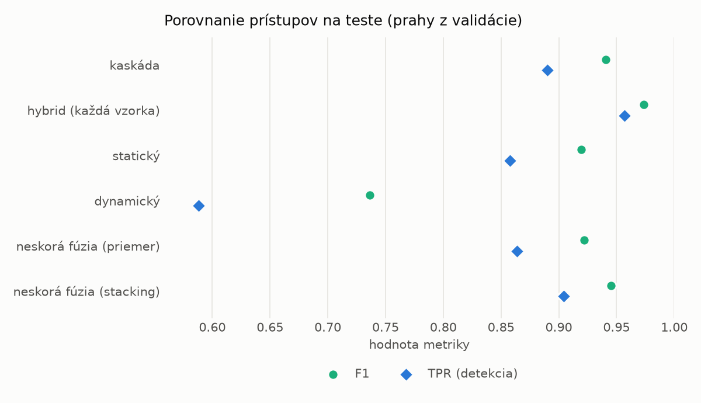
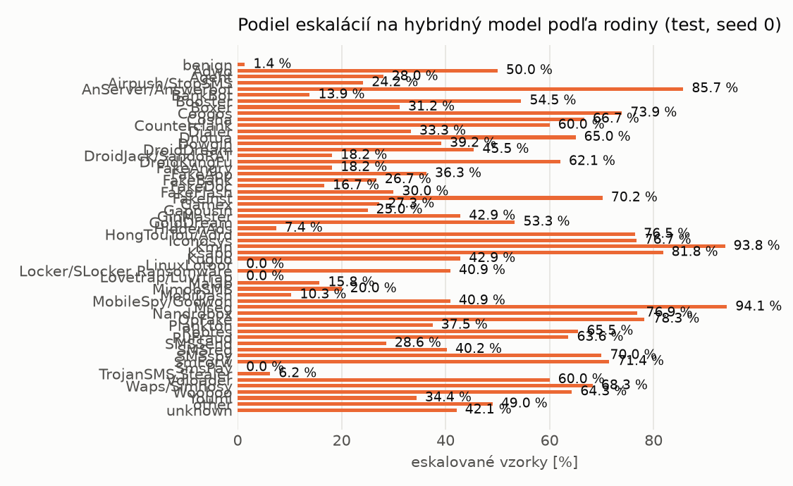

# Kaskáda `modal` – beh `20261123-215921`

> Generované `src/cascade/evaluate.py` (2026-11-23T21:59:22+01:00). Seedy: [0, 1, 2]; hodnoty = priemer ± sm. odchýlka.
> Všetky prahy sú určené na validácii (FPR ≤ 1 %); test sa na nič nenastavuje.

| rola | beh |
|---|---|
| static | `runs_v4/emu_p/lofo/FakeInst/students_static/mlp_kd_modal/20261123-215647` |
| dynamic | `runs_v4/emu_p/lofo/FakeInst/students_dynamic/mlp_kd_modal/20261123-215834` |
| hybrid | `runs_v4/emu_p/lofo/FakeInst/hybrid/lightgbm/20261123-214927` |

## Test
| prístup | accuracy | balanced_accuracy | precision | recall_tpr | fpr | f1 | mcc |
|---|---|---|---|---|---|---|---|
| kaskáda | 0.9496 ± 0.0016 | 0.9440 ± 0.0017 | 0.9968 ± 0.0003 | 0.8904 ± 0.0034 | 0.0023 ± 0.0002 | 0.9406 ± 0.0019 | 0.9014 ± 0.0030 |
| hybrid (každá vzorka) | 0.9768 ± 0.0005 | 0.9750 ± 0.0005 | 0.9912 ± 0.0005 | 0.9568 ± 0.0006 | 0.0069 ± 0.0004 | 0.9737 ± 0.0005 | 0.9535 ± 0.0010 |
| statický | 0.9325 ± 0.0029 | 0.9255 ± 0.0032 | 0.9904 ± 0.0005 | 0.8577 ± 0.0061 | 0.0067 ± 0.0003 | 0.9193 ± 0.0037 | 0.8684 ± 0.0054 |
| dynamický | 0.8114 ± 0.0020 | 0.7904 ± 0.0023 | 0.9847 ± 0.0001 | 0.5883 ± 0.0046 | 0.0074 ± 0.0000 | 0.7366 ± 0.0036 | 0.6524 ± 0.0036 |
| neskorá fúzia (priemer) | 0.9343 ± 0.0026 | 0.9277 ± 0.0030 | 0.9882 ± 0.0012 | 0.8637 ± 0.0068 | 0.0084 ± 0.0009 | 0.9218 ± 0.0034 | 0.8714 ± 0.0046 |
| neskorá fúzia (stacking) | 0.9530 ± 0.0010 | 0.9484 ± 0.0012 | 0.9901 ± 0.0006 | 0.9042 ± 0.0025 | 0.0074 ± 0.0005 | 0.9452 ± 0.0013 | 0.9070 ± 0.0020 |

## Validácia
| prístup | accuracy | balanced_accuracy | precision | recall_tpr | fpr | f1 | mcc |
|---|---|---|---|---|---|---|---|
| kaskáda | 0.9551 ± 0.0011 | 0.9484 ± 0.0013 | 0.9938 ± 0.0003 | 0.9010 ± 0.0025 | 0.0042 ± 0.0002 | 0.9451 ± 0.0015 | 0.9104 ± 0.0023 |
| hybrid (každá vzorka) | 0.9772 ± 0.0004 | 0.9750 ± 0.0004 | 0.9867 ± 0.0000 | 0.9598 ± 0.0009 | 0.0097 ± 0.0000 | 0.9731 ± 0.0005 | 0.9536 ± 0.0008 |
| statický | 0.9358 ± 0.0046 | 0.9268 ± 0.0053 | 0.9853 ± 0.0004 | 0.8633 ± 0.0105 | 0.0096 ± 0.0002 | 0.9203 ± 0.0061 | 0.8723 ± 0.0088 |
| dynamický | 0.8356 ± 0.0028 | 0.8101 ± 0.0033 | 0.9798 ± 0.0002 | 0.6299 ± 0.0065 | 0.0097 ± 0.0000 | 0.7668 ± 0.0049 | 0.6868 ± 0.0051 |
| neskorá fúzia (priemer) | 0.9453 ± 0.0022 | 0.9379 ± 0.0026 | 0.9856 ± 0.0001 | 0.8855 ± 0.0052 | 0.0097 ± 0.0000 | 0.9329 ± 0.0029 | 0.8906 ± 0.0043 |
| neskorá fúzia (stacking) | 0.9565 ± 0.0011 | 0.9510 ± 0.0013 | 0.9860 ± 0.0000 | 0.9117 ± 0.0025 | 0.0097 ± 0.0000 | 0.9474 ± 0.0014 | 0.9125 ± 0.0021 |

## Správanie kaskády (test, seed 0)
- podiel eskalácií na hybrid: **16.35%** (2069 vzoriek)
- chyby pri zhode študentov (kaskáda ich nemôže opraviť): **560**
  (5.290% zo zhôd; FP 0, FN 560)
- úspešnosť na eskalovaných vzorkách: hybrid 0.972933784436926, statický 0.8777187046882552,
  dynamický 0.12228129531174481  → prínos hybridu pri nezhode

## Výpočtové nároky (odhad z benchmarkov komponentov)
_Chýba benchmark niektorého komponentu (`python -m src.evaluation.benchmark`)._

