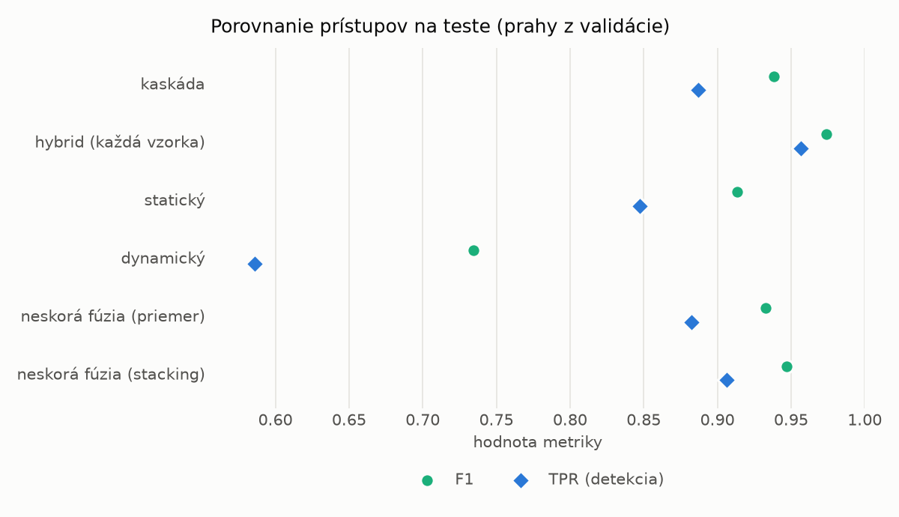
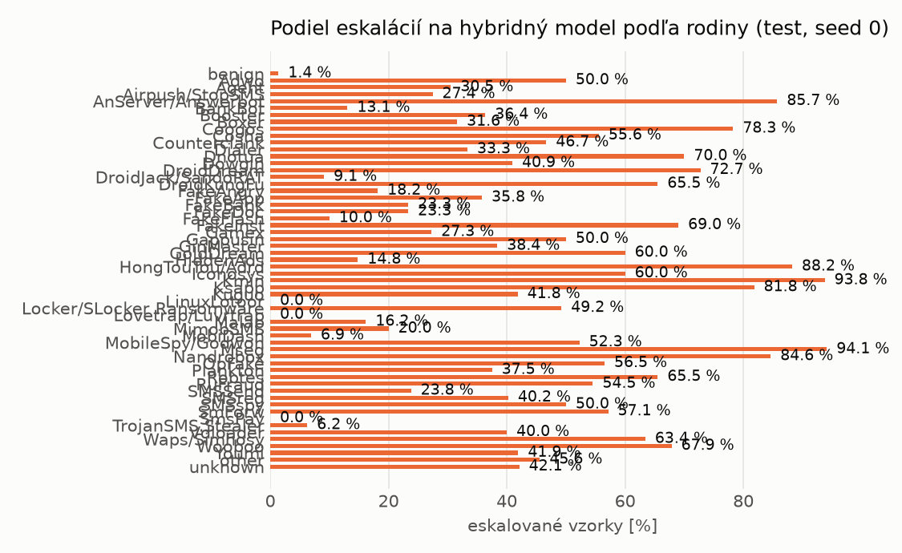

# Kaskáda `nokd` – beh `20261123-215919`

> Generované `src/cascade/evaluate.py` (2026-11-23T21:59:20+01:00). Seedy: [0, 1, 2]; hodnoty = priemer ± sm. odchýlka.
> Všetky prahy sú určené na validácii (FPR ≤ 1 %); test sa na nič nenastavuje.

| rola | beh |
|---|---|
| static | `runs_v4/emu_p/lofo/FakeInst/students_static/mlp_nokd/20261123-215622` |
| dynamic | `runs_v4/emu_p/lofo/FakeInst/students_dynamic/mlp_nokd/20261123-215750` |
| hybrid | `runs_v4/emu_p/lofo/FakeInst/hybrid/lightgbm/20261123-214927` |

## Test
| prístup | accuracy | balanced_accuracy | precision | recall_tpr | fpr | f1 | mcc |
|---|---|---|---|---|---|---|---|
| kaskáda | 0.9478 ± 0.0029 | 0.9421 ± 0.0033 | 0.9963 ± 0.0001 | 0.8868 ± 0.0065 | 0.0027 ± 0.0001 | 0.9383 ± 0.0037 | 0.8979 ± 0.0056 |
| hybrid (každá vzorka) | 0.9768 ± 0.0005 | 0.9750 ± 0.0005 | 0.9912 ± 0.0005 | 0.9568 ± 0.0006 | 0.0069 ± 0.0004 | 0.9737 ± 0.0005 | 0.9535 ± 0.0010 |
| statický | 0.9282 ± 0.0029 | 0.9206 ± 0.0034 | 0.9908 ± 0.0015 | 0.8476 ± 0.0076 | 0.0064 ± 0.0011 | 0.9136 ± 0.0039 | 0.8604 ± 0.0052 |
| dynamický | 0.8102 ± 0.0068 | 0.7892 ± 0.0077 | 0.9842 ± 0.0019 | 0.5860 ± 0.0165 | 0.0076 ± 0.0011 | 0.7345 ± 0.0124 | 0.6503 ± 0.0110 |
| neskorá fúzia (priemer) | 0.9428 ± 0.0026 | 0.9372 ± 0.0030 | 0.9890 ± 0.0011 | 0.8823 ± 0.0069 | 0.0080 ± 0.0009 | 0.9326 ± 0.0034 | 0.8876 ± 0.0048 |
| neskorá fúzia (stacking) | 0.9544 ± 0.0010 | 0.9499 ± 0.0011 | 0.9911 ± 0.0002 | 0.9064 ± 0.0023 | 0.0066 ± 0.0002 | 0.9468 ± 0.0012 | 0.9098 ± 0.0019 |

## Validácia
| prístup | accuracy | balanced_accuracy | precision | recall_tpr | fpr | f1 | mcc |
|---|---|---|---|---|---|---|---|
| kaskáda | 0.9537 ± 0.0012 | 0.9468 ± 0.0014 | 0.9935 ± 0.0005 | 0.8980 ± 0.0031 | 0.0044 ± 0.0003 | 0.9433 ± 0.0015 | 0.9077 ± 0.0023 |
| hybrid (každá vzorka) | 0.9772 ± 0.0004 | 0.9750 ± 0.0004 | 0.9867 ± 0.0000 | 0.9598 ± 0.0009 | 0.0097 ± 0.0000 | 0.9731 ± 0.0005 | 0.9536 ± 0.0008 |
| statický | 0.9299 ± 0.0004 | 0.9199 ± 0.0005 | 0.9851 ± 0.0002 | 0.8494 ± 0.0010 | 0.0096 ± 0.0002 | 0.9122 ± 0.0005 | 0.8609 ± 0.0007 |
| dynamický | 0.8339 ± 0.0074 | 0.8081 ± 0.0086 | 0.9797 ± 0.0005 | 0.6260 ± 0.0172 | 0.0097 ± 0.0000 | 0.7638 ± 0.0129 | 0.6837 ± 0.0134 |
| neskorá fúzia (priemer) | 0.9538 ± 0.0020 | 0.9478 ± 0.0024 | 0.9859 ± 0.0001 | 0.9053 ± 0.0048 | 0.0097 ± 0.0000 | 0.9439 ± 0.0026 | 0.9071 ± 0.0040 |
| neskorá fúzia (stacking) | 0.9592 ± 0.0008 | 0.9541 ± 0.0009 | 0.9861 ± 0.0000 | 0.9179 ± 0.0018 | 0.0097 ± 0.0000 | 0.9508 ± 0.0010 | 0.9177 ± 0.0015 |

## Správanie kaskády (test, seed 0)
- podiel eskalácií na hybrid: **16.89%** (2137 vzoriek)
- chyby pri zhode študentov (kaskáda ich nemôže opraviť): **575**
  (5.466% zo zhôd; FP 1, FN 574)
- úspešnosť na eskalovaných vzorkách: hybrid 0.9658399625643426, statický 0.8572765559195134,
  dynamický 0.14272344408048665  → prínos hybridu pri nezhode

## Výpočtové nároky (odhad z benchmarkov komponentov)
_Chýba benchmark niektorého komponentu (`python -m src.evaluation.benchmark`)._

