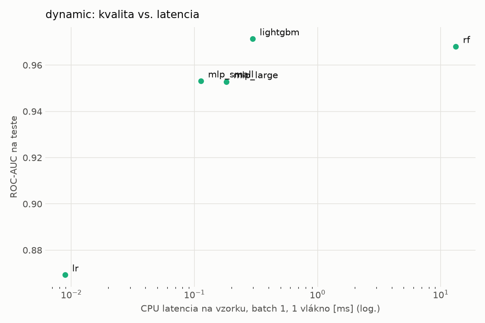
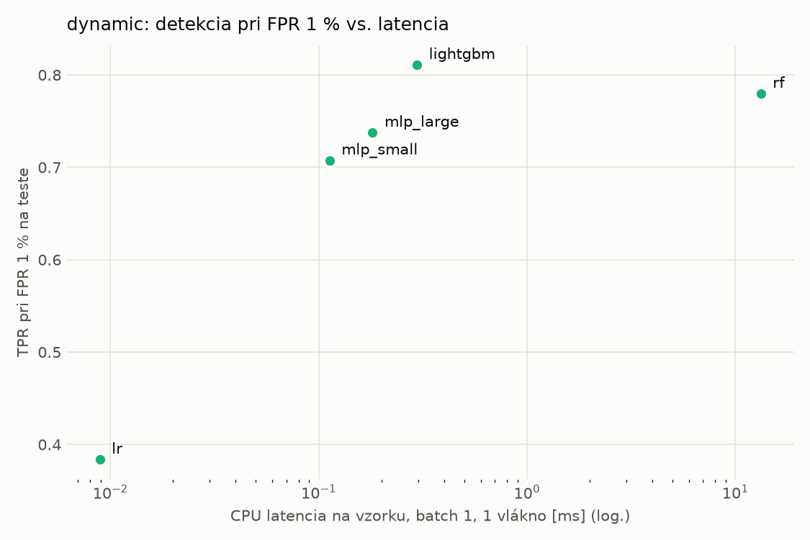
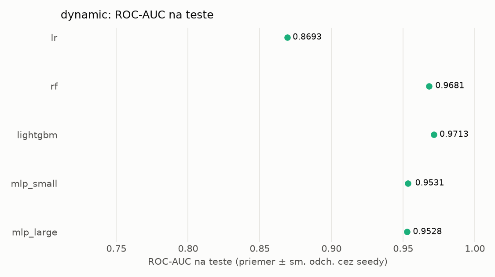
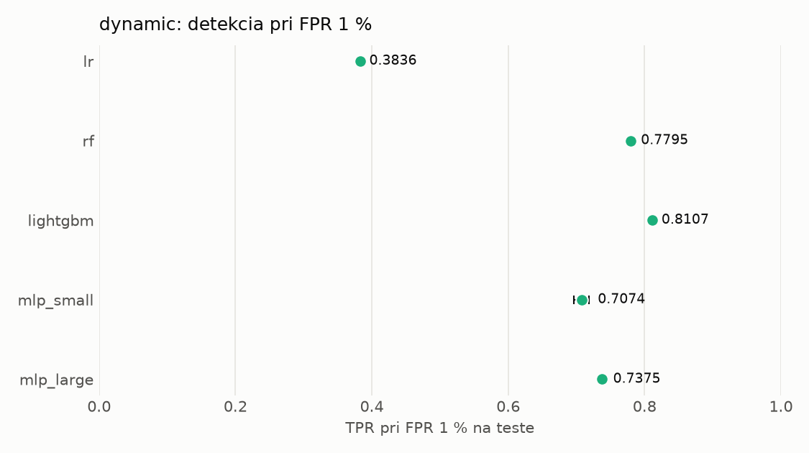

# Porovnanie modelov – dynamic

> Generované `src/evaluation/compare.py` (2026-11-23T21:49:12+01:00); použitý je posledný beh každého modelu.
> Metriky sú priemer cez seedy. \* = pri prahu určenom na validácii (FPR ≤ 1 %).
> CPU ms/vz. = medián latencie jednej vzorky na 1 vlákne vrátane transformácie vstupu (meranie hneď po tréningu,
> orientačné). Oficiálne merania spotreby sú v časti „Spotreba zdrojov pri inferencii“.

## Detekčná kvalita a orientačné časy
| model | ROC-AUC val | ROC-AUC test | TPR@FPR 1 % test | TPR@FPR 0,1 % test | F1 test* | FPR test* | gap train−val | CPU ms/vz. | CPU vz./s | GPU ms/vz. | parametre | MB | tréning s | ladenie min |
|---|---|---|---|---|---|---|---|---|---|---|---|---|---|---|
| [lr](../../dynamic/lr/20261123-214528/README.md) | 0.8834 | 0.8693 ± 0.0000 | 0.3836 | 0.1220 | 0.5528 | 0.0105 | -0.0035 | 0.009 | 4 618 135 | – | 124 | 0.01 | 0.4 | 0.0 |
| [rf](../../dynamic/rf/20261123-214531/README.md) | 0.9761 | 0.9681 ± 0.0007 | 0.7795 | 0.6422 | 0.8487 | 0.0065 | 0.0236 | 13.243 | 101 123 | – | 3 959 902 | 317.15 | 2.6 | 0.0 |
| [lightgbm](../../dynamic/lightgbm/20261123-214549/README.md) | 0.9810 | 0.9713 ± 0.0003 | 0.8107 | 0.7014 | 0.8853 | 0.0088 | 0.0190 | 0.296 | 38 301 | – | 817 770 | 45.41 | 26.7 | 0.0 |
| [mlp_small](../../dynamic/mlp_small/20261123-214737/README.md) | 0.9676 | 0.9531 ± 0.0016 | 0.7074 | 0.3741 | 0.8143 | 0.0090 | 0.0220 | 0.113 | 2 253 561 | 0.670 | 65 537 | 0.27 | 20.4 | 0.0 |
| [mlp_large](../../dynamic/mlp_large/20261123-214840/README.md) | 0.9696 | 0.9528 ± 0.0003 | 0.7375 | 0.4224 | 0.8400 | 0.0093 | 0.0255 | 0.181 | 435 275 | 0.422 | 786 945 | 3.17 | 9.9 | 0.0 |

## Nízka prevalencia malvéru (test, prah z validácie)
| model | TPR | FPR | precision @ 1 % | falošné na 1 skutočný poplach @ 1 % | precision @ 0.1 % | falošné na 1 skutočný poplach @ 0.1 % |
|---|---|---|---|---|---|---|
| lr | 0.3869 | 0.0105 | 0.272 | 2.67 | 0.036 | 26.99 |
| rf | 0.7431 | 0.0065 | 0.536 | 0.86 | 0.103 | 8.73 |
| lightgbm | 0.8027 | 0.0088 | 0.480 | 1.08 | 0.084 | 10.93 |
| mlp_small | 0.6944 | 0.0090 | 0.437 | 1.29 | 0.072 | 12.98 |
| mlp_large | 0.7324 | 0.0093 | 0.444 | 1.25 | 0.073 | 12.63 |

Prepočet: TPR a FPR nezávisia od podielu malvéru, preto sa dajú preniesť na nízku prevalenciu (v reálnej prevádzke je malvéru ~1 % alebo menej; v teste 54 %). „Falošné na 1 skutočný poplach“ = koľko neškodných súborov je označených na každý zachytený malvér.

## Spotreba zdrojov pri inferencii (benchmark, testovacia množina)
_Benchmark zatiaľ nebol spustený (`python -m src.evaluation.benchmark --approach dynamic`)._

## Grafy

