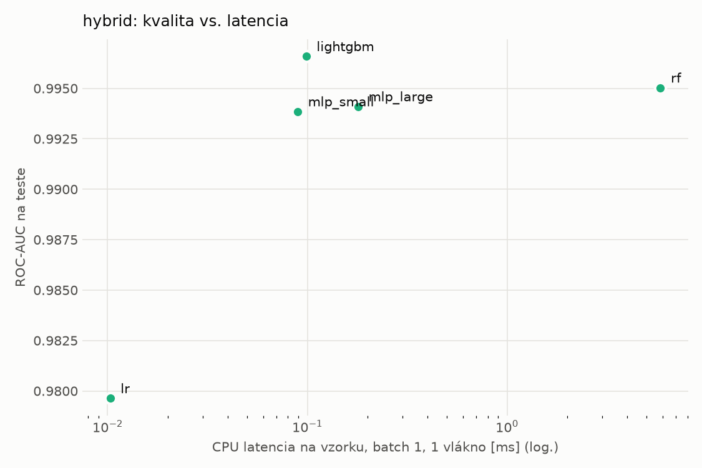
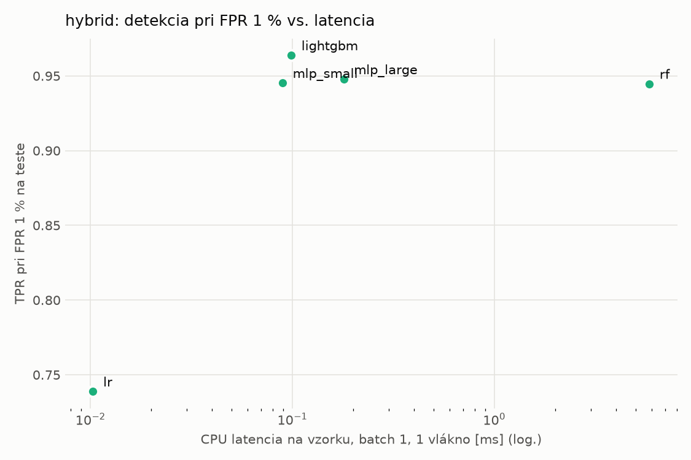
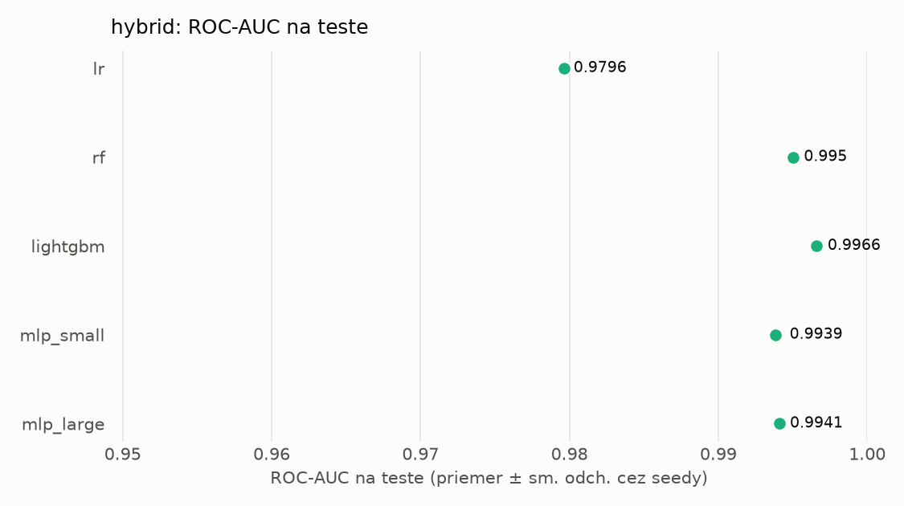
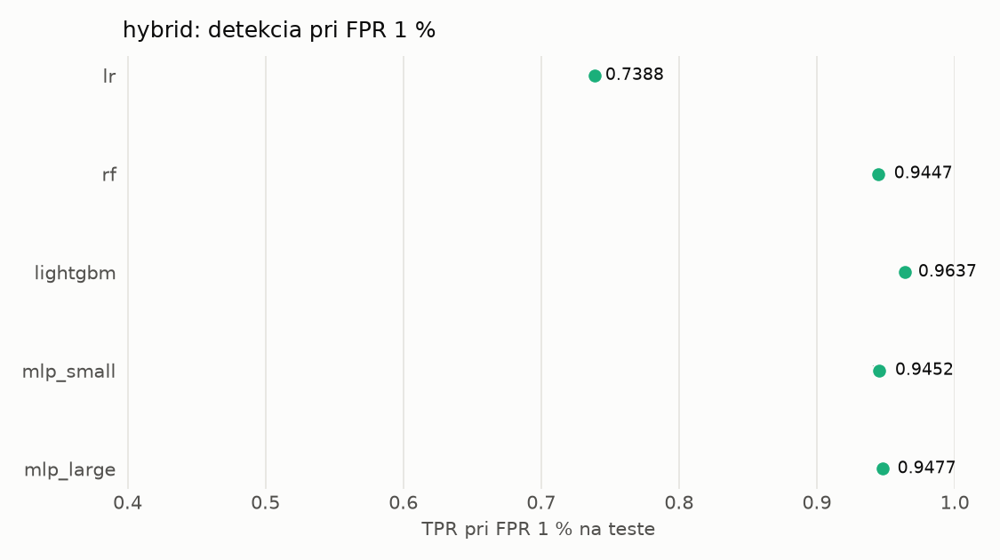

# Porovnanie modelov – hybrid

> Generované `src/evaluation/compare.py` (2026-11-23T21:51:09+01:00); použitý je posledný beh každého modelu.
> Metriky sú priemer cez seedy. \* = pri prahu určenom na validácii (FPR ≤ 1 %).
> CPU ms/vz. = medián latencie jednej vzorky na 1 vlákne vrátane transformácie vstupu (meranie hneď po tréningu,
> orientačné). Oficiálne merania spotreby sú v časti „Spotreba zdrojov pri inferencii“.

## Detekčná kvalita a orientačné časy
| model | ROC-AUC val | ROC-AUC test | TPR@FPR 1 % test | TPR@FPR 0,1 % test | F1 test* | FPR test* | gap train−val | CPU ms/vz. | CPU vz./s | GPU ms/vz. | parametre | MB | tréning s | ladenie min |
|---|---|---|---|---|---|---|---|---|---|---|---|---|---|---|
| [lr](../../hybrid/lr/20261123-214915/README.md) | 0.9776 | 0.9796 ± 0.0000 | 0.7388 | 0.3993 | 0.8347 | 0.0090 | 0.0026 | 0.010 | 2 212 239 | – | 287 | 0.01 | 0.5 | 0.0 |
| [rf](../../hybrid/rf/20261123-214918/README.md) | 0.9944 | 0.9950 ± 0.0001 | 0.9447 | 0.8583 | 0.9603 | 0.0072 | 0.0056 | 5.862 | 170 057 | – | 983 180 | 78.91 | 1.4 | 0.0 |
| [lightgbm](../../hybrid/lightgbm/20261123-214927/README.md) | 0.9957 | 0.9966 ± 0.0001 | 0.9637 | 0.8915 | 0.9737 | 0.0069 | 0.0043 | 0.099 | 139 956 | – | 241 255 | 13.39 | 13.8 | 0.0 |
| [mlp_small](../../hybrid/mlp_small/20261123-215017/README.md) | 0.9925 | 0.9939 ± 0.0003 | 0.9452 | 0.7210 | 0.9564 | 0.0066 | 0.0059 | 0.089 | 1 339 458 | 0.658 | 107 265 | 0.45 | 3.9 | 0.0 |
| [mlp_large](../../hybrid/mlp_large/20261123-215031/README.md) | 0.9930 | 0.9941 ± 0.0001 | 0.9477 | 0.8112 | 0.9636 | 0.0072 | 0.0052 | 0.180 | 747 138 | 0.593 | 323 521 | 1.32 | 11.8 | 0.0 |

## Nízka prevalencia malvéru (test, prah z validácie)
| model | TPR | FPR | precision @ 1 % | falošné na 1 skutočný poplach @ 1 % | precision @ 0.1 % | falošné na 1 skutočný poplach @ 0.1 % |
|---|---|---|---|---|---|---|
| lr | 0.7243 | 0.0090 | 0.448 | 1.23 | 0.074 | 12.44 |
| rf | 0.9318 | 0.0072 | 0.568 | 0.76 | 0.115 | 7.68 |
| lightgbm | 0.9568 | 0.0069 | 0.584 | 0.71 | 0.122 | 7.18 |
| mlp_small | 0.9239 | 0.0066 | 0.586 | 0.71 | 0.123 | 7.12 |
| mlp_large | 0.9379 | 0.0072 | 0.570 | 0.76 | 0.116 | 7.63 |

Prepočet: TPR a FPR nezávisia od podielu malvéru, preto sa dajú preniesť na nízku prevalenciu (v reálnej prevádzke je malvéru ~1 % alebo menej; v teste 54 %). „Falošné na 1 skutočný poplach“ = koľko neškodných súborov je označených na každý zachytený malvér.

## Spotreba zdrojov pri inferencii (benchmark, testovacia množina)
_Benchmark zatiaľ nebol spustený (`python -m src.evaluation.benchmark --approach hybrid`)._

## Grafy

