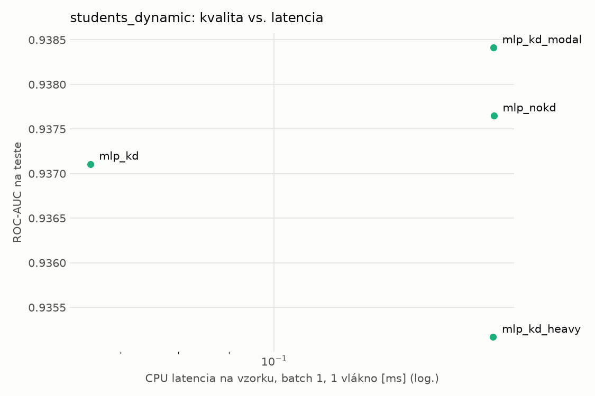
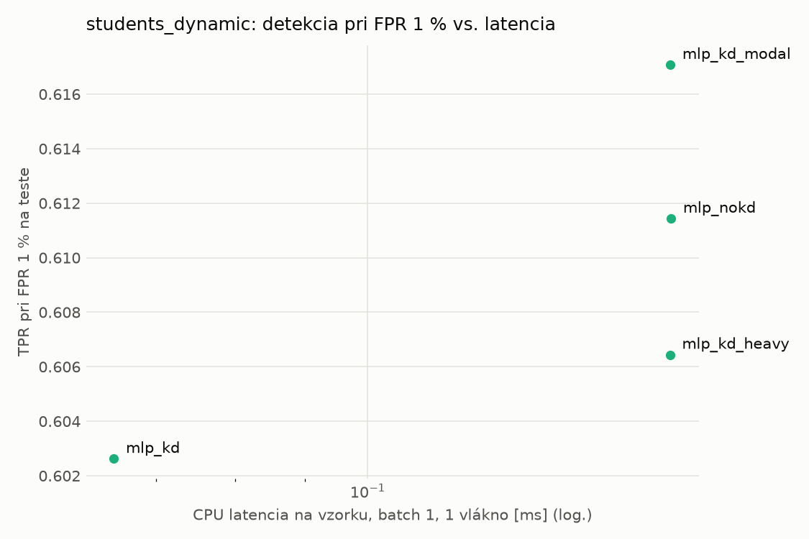
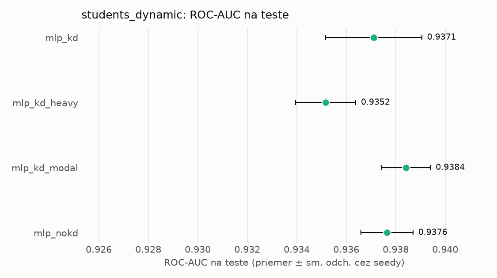
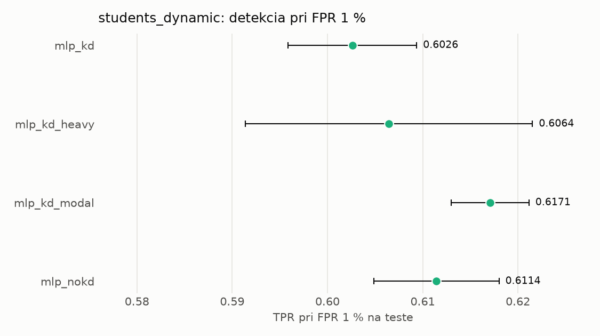

# Porovnanie modelov – students_dynamic

> Generované `src/evaluation/compare.py` (2026-11-23T21:59:15+01:00); použitý je posledný beh každého modelu.
> Metriky sú priemer cez seedy. \* = pri prahu určenom na validácii (FPR ≤ 1 %).
> CPU ms/vz. = medián latencie jednej vzorky na 1 vlákne vrátane transformácie vstupu (meranie hneď po tréningu,
> orientačné). Oficiálne merania spotreby sú v časti „Spotreba zdrojov pri inferencii“.

## Detekčná kvalita a orientačné časy
| model | ROC-AUC val | ROC-AUC test | TPR@FPR 1 % test | TPR@FPR 0,1 % test | F1 test* | FPR test* | gap train−val | CPU ms/vz. | CPU vz./s | GPU ms/vz. | parametre | MB | tréning s | ladenie min |
|---|---|---|---|---|---|---|---|---|---|---|---|---|---|---|
| [mlp_kd](../../students_dynamic/mlp_kd/20261123-215727/README.md) | 0.9510 | 0.9371 ± 0.0019 | 0.6026 | 0.3704 | 0.7297 | 0.0076 | 0.0062 | 0.065 | 6 991 106 | 0.270 | 8 129 | 0.04 | 6.9 | 0.0 |
| [mlp_kd_heavy](../../students_dynamic/mlp_kd_heavy/20261123-215855/README.md) | 0.9498 | 0.9352 ± 0.0012 | 0.6064 | 0.2850 | 0.7347 | 0.0084 | 0.0075 | 0.166 | 9 086 732 | 0.271 | 8 129 | 0.04 | 6.0 | 0.0 |
| [mlp_kd_modal](../../students_dynamic/mlp_kd_modal/20261123-215834/README.md) | 0.9518 | 0.9384 ± 0.0010 | 0.6171 | 0.3474 | 0.7366 | 0.0074 | 0.0060 | 0.167 | 4 948 583 | 0.442 | 8 129 | 0.04 | 6.4 | 0.0 |
| [mlp_nokd](../../students_dynamic/mlp_nokd/20261123-215750/README.md) | 0.9528 | 0.9376 ± 0.0010 | 0.6114 | 0.3035 | 0.7345 | 0.0076 | 0.0101 | 0.167 | 7 994 441 | 0.288 | 8 129 | 0.04 | 14.0 | 0.0 |

## Nízka prevalencia malvéru (test, prah z validácie)
| model | TPR | FPR | precision @ 1 % | falošné na 1 skutočný poplach @ 1 % | precision @ 0.1 % | falošné na 1 skutočný poplach @ 0.1 % |
|---|---|---|---|---|---|---|
| mlp_kd | 0.5799 | 0.0076 | 0.434 | 1.30 | 0.071 | 13.16 |
| mlp_kd_heavy | 0.5868 | 0.0084 | 0.412 | 1.43 | 0.065 | 14.39 |
| mlp_kd_modal | 0.5883 | 0.0074 | 0.444 | 1.25 | 0.073 | 12.64 |
| mlp_nokd | 0.5860 | 0.0076 | 0.437 | 1.29 | 0.071 | 13.02 |

Prepočet: TPR a FPR nezávisia od podielu malvéru, preto sa dajú preniesť na nízku prevalenciu (v reálnej prevádzke je malvéru ~1 % alebo menej; v teste 54 %). „Falošné na 1 skutočný poplach“ = koľko neškodných súborov je označených na každý zachytený malvér.

## Spotreba zdrojov pri inferencii (benchmark, testovacia množina)
_Benchmark zatiaľ nebol spustený (`python -m src.evaluation.benchmark --approach students_dynamic`)._

## Grafy

