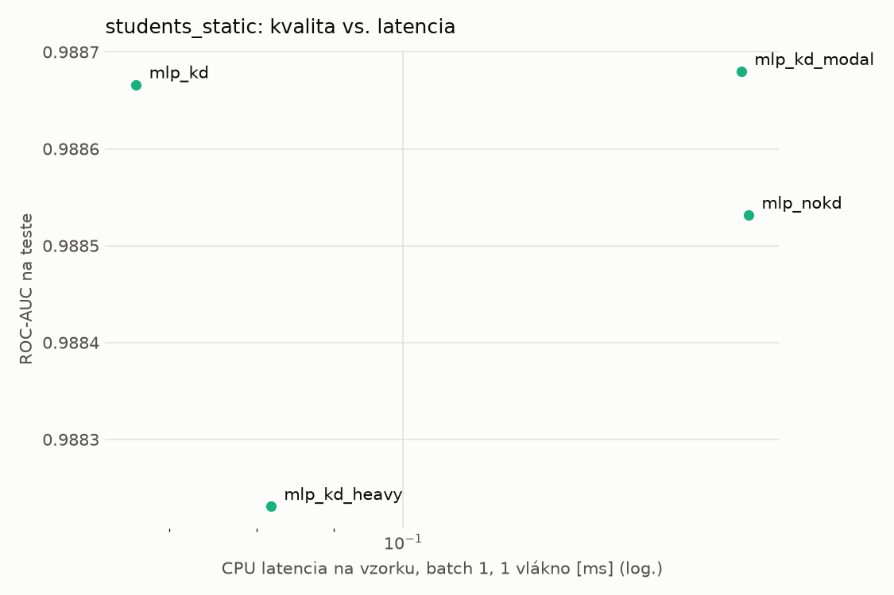
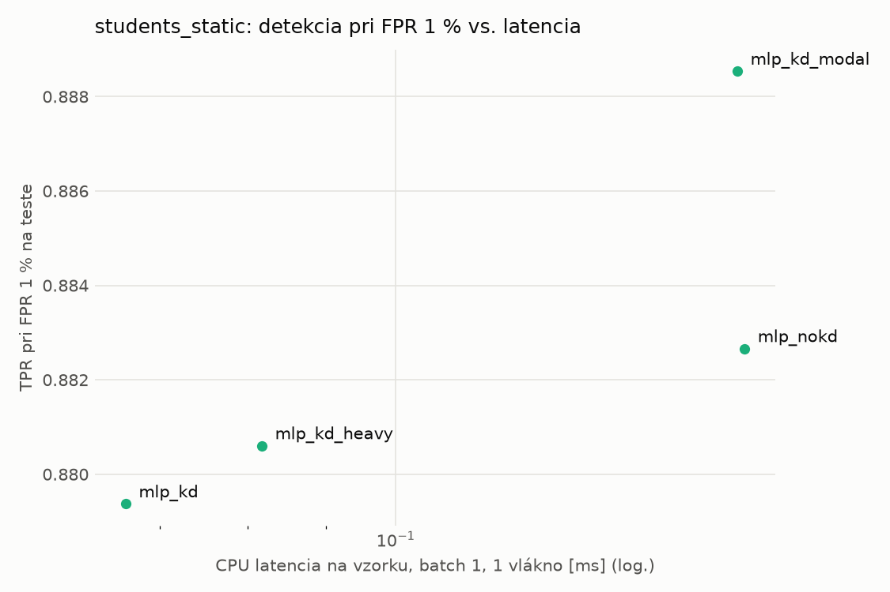
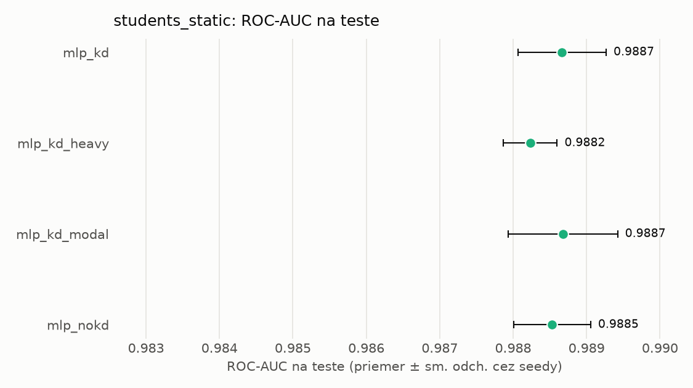
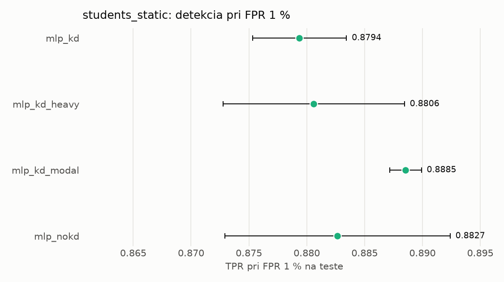

# Porovnanie modelov – students_static

> Generované `src/evaluation/compare.py` (2026-11-23T21:57:24+01:00); použitý je posledný beh každého modelu.
> Metriky sú priemer cez seedy. \* = pri prahu určenom na validácii (FPR ≤ 1 %).
> CPU ms/vz. = medián latencie jednej vzorky na 1 vlákne vrátane transformácie vstupu (meranie hneď po tréningu,
> orientačné). Oficiálne merania spotreby sú v časti „Spotreba zdrojov pri inferencii“.

## Detekčná kvalita a orientačné časy
| model | ROC-AUC val | ROC-AUC test | TPR@FPR 1 % test | TPR@FPR 0,1 % test | F1 test* | FPR test* | gap train−val | CPU ms/vz. | CPU vz./s | GPU ms/vz. | parametre | MB | tréning s | ladenie min |
|---|---|---|---|---|---|---|---|---|---|---|---|---|---|---|
| [mlp_kd](../../students_static/mlp_kd/20261123-215606/README.md) | 0.9875 | 0.9887 ± 0.0006 | 0.8794 | 0.6662 | 0.9183 | 0.0069 | 0.0042 | 0.066 | 3 688 505 | 0.442 | 10 689 | 0.05 | 4.8 | 0.0 |
| [mlp_kd_heavy](../../students_static/mlp_kd_heavy/20261123-215712/README.md) | 0.9859 | 0.9882 ± 0.0004 | 0.8806 | 0.7000 | 0.9139 | 0.0061 | 0.0052 | 0.082 | 6 312 534 | 0.451 | 10 689 | 0.05 | 3.5 | 0.0 |
| [mlp_kd_modal](../../students_static/mlp_kd_modal/20261123-215647/README.md) | 0.9870 | 0.9887 ± 0.0007 | 0.8885 | 0.6875 | 0.9193 | 0.0067 | 0.0043 | 0.168 | 3 912 573 | 0.441 | 10 689 | 0.05 | 7.9 | 0.0 |
| [mlp_nokd](../../students_static/mlp_nokd/20261123-215622/README.md) | 0.9870 | 0.9885 ± 0.0005 | 0.8827 | 0.5650 | 0.9136 | 0.0064 | 0.0064 | 0.169 | 4 867 318 | 0.442 | 10 689 | 0.05 | 7.5 | 0.0 |

## Nízka prevalencia malvéru (test, prah z validácie)
| model | TPR | FPR | precision @ 1 % | falošné na 1 skutočný poplach @ 1 % | precision @ 0.1 % | falošné na 1 skutočný poplach @ 0.1 % |
|---|---|---|---|---|---|---|
| mlp_kd | 0.8561 | 0.0069 | 0.557 | 0.79 | 0.111 | 8.02 |
| mlp_kd_heavy | 0.8479 | 0.0061 | 0.584 | 0.71 | 0.122 | 7.20 |
| mlp_kd_modal | 0.8577 | 0.0067 | 0.563 | 0.78 | 0.113 | 7.84 |
| mlp_nokd | 0.8476 | 0.0064 | 0.572 | 0.75 | 0.117 | 7.54 |

Prepočet: TPR a FPR nezávisia od podielu malvéru, preto sa dajú preniesť na nízku prevalenciu (v reálnej prevádzke je malvéru ~1 % alebo menej; v teste 54 %). „Falošné na 1 skutočný poplach“ = koľko neškodných súborov je označených na každý zachytený malvér.

## Spotreba zdrojov pri inferencii (benchmark, testovacia množina)
_Benchmark zatiaľ nebol spustený (`python -m src.evaluation.benchmark --approach students_static`)._

## Grafy

