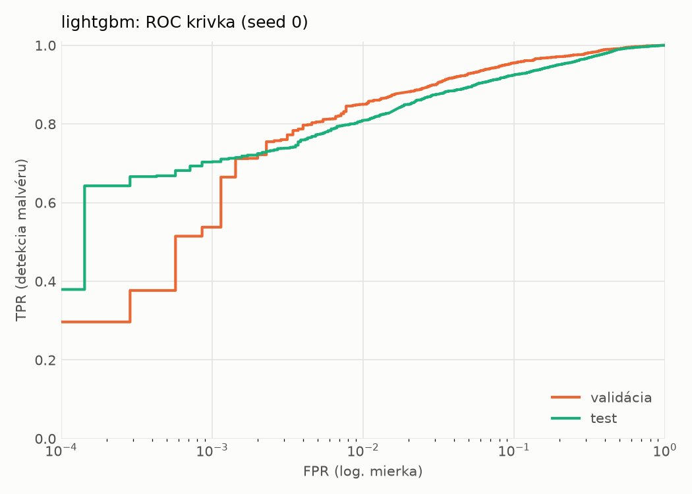
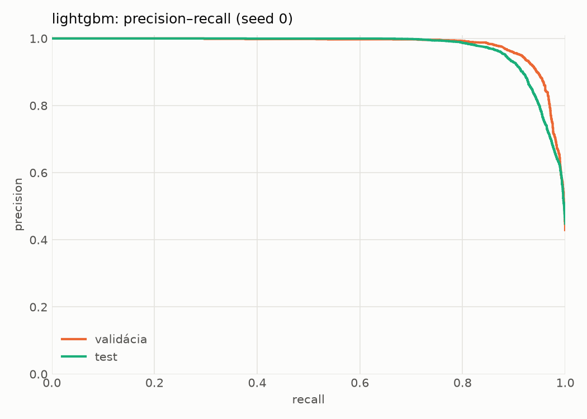
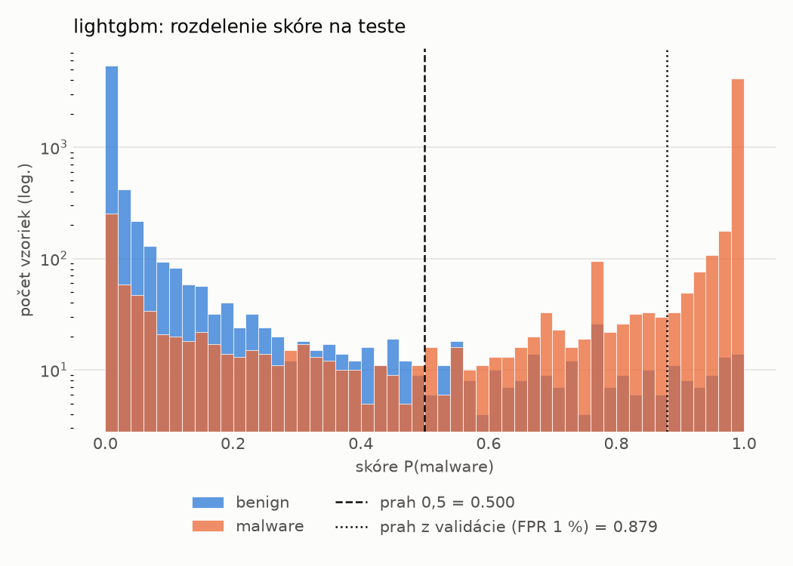
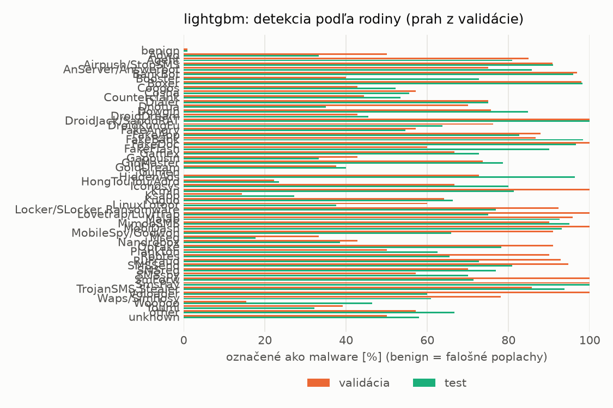
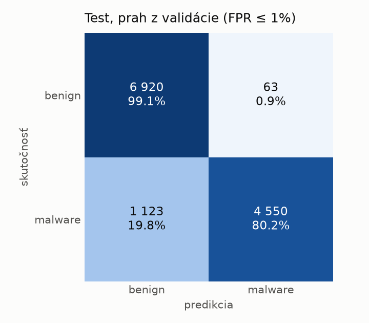
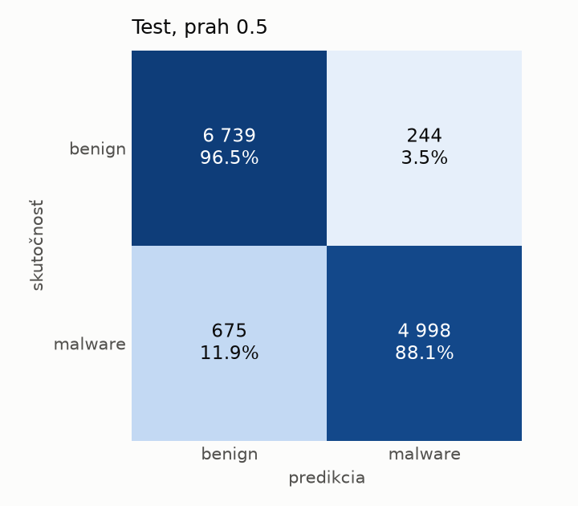
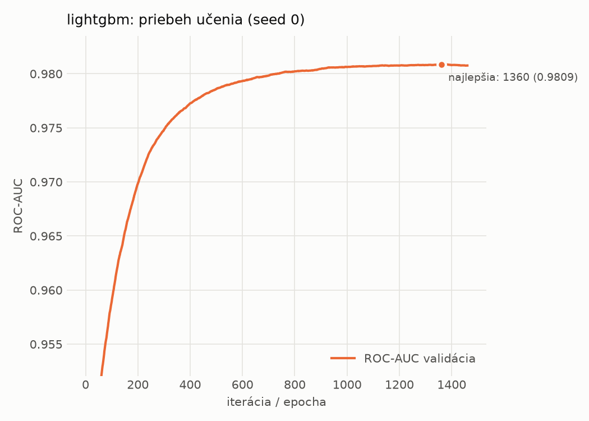

# dynamic/lightgbm – beh `20261123-214549`

> Automaticky generované (`src/training/run_tabular.py`). Konfigurácia: `config.yaml`, protokol: `protocol.yaml`.

- **Model:** `lightgbm` – LightGBM, gradient boosting stromov s early stopping na validácii (pôvodné hodnoty príznakov)
- **Ladenie:** bez ladenia – hyperparametre prevzaté z `runs_v4/emu_p/full/dynamic/lightgbm/20261123-191933`
- **Finálne modely:** seedy [0, 1, 2]; hodnoty sú priemer ± smerodajná odchýlka cez seedy
- **Najlepšie hyperparametre:** `{"num_boost_round": 5000, "early_stopping_rounds": 100, "learning_rate": 0.020757076290036595, "num_leaves": 469, "min_child_samples": 116, "feature_fraction": 0.9578728497385997, "bagging_fraction": 0.9870779948179744, "lambda_l1": 0.002495609179699052, "lambda_l2": 0.0024900497451761272}`

## Detekčná kvalita (bez prahu)
| metrika | train (podvzorka) | validácia | test |
|---|---|---|---|
| ROC-AUC | 0.9999 ± 0.0000 | 0.9810 ± 0.0001 | 0.9713 ± 0.0003 |
| PR-AUC | 0.9999 ± 0.0000 | 0.9803 ± 0.0000 | 0.9734 ± 0.0003 |
| TPR pri FPR 1 % | 1.0000 ± 0.0000 | 0.8479 ± 0.0019 | 0.8107 ± 0.0014 |
| TPR pri FPR 0,1 % | 0.9827 ± 0.0005 | 0.5342 ± 0.0136 | 0.7014 ± 0.0020 |
| log loss | 0.0133 ± 0.0005 | 0.1801 ± 0.0015 | 0.2425 ± 0.0006 |
| Brier skóre | 0.0027 ± 0.0001 | 0.0459 ± 0.0002 | 0.0596 ± 0.0002 |

Rozdiel ROC-AUC train − validácia: **0.0190** (veľký rozdiel = preučenie).

## Pri prahu z validácie (FPR ≤ 1% na validácii)
| metrika | train (podvzorka) | validácia | test |
|---|---|---|---|
| accuracy | 0.9895 ± 0.0002 | 0.9292 ± 0.0009 | 0.9067 ± 0.0006 |
| balanced accuracy | 0.9876 ± 0.0002 | 0.9191 ± 0.0010 | 0.8970 ± 0.0007 |
| precision | 0.9995 ± 0.0000 | 0.9851 ± 0.0003 | 0.9867 ± 0.0008 |
| recall (TPR) | 0.9755 ± 0.0005 | 0.8479 ± 0.0019 | 0.8027 ± 0.0017 |
| FPR | 0.0003 ± 0.0000 | 0.0096 ± 0.0002 | 0.0088 ± 0.0005 |
| F1 | 0.9874 ± 0.0002 | 0.9114 ± 0.0012 | 0.8853 ± 0.0008 |
| MCC | 0.9786 ± 0.0004 | 0.8596 ± 0.0018 | 0.8203 ± 0.0010 |

## Pri pevnom prahu 0.5
| metrika | train (podvzorka) | validácia | test |
|---|---|---|---|
| accuracy | 0.9969 ± 0.0002 | 0.9418 ± 0.0010 | 0.9280 ± 0.0005 |
| balanced accuracy | 0.9973 ± 0.0002 | 0.9384 ± 0.0010 | 0.9236 ± 0.0005 |
| precision | 0.9935 ± 0.0001 | 0.9477 ± 0.0015 | 0.9545 ± 0.0009 |
| recall (TPR) | 0.9993 ± 0.0002 | 0.9147 ± 0.0016 | 0.8814 ± 0.0003 |
| FPR | 0.0048 ± 0.0001 | 0.0379 ± 0.0012 | 0.0341 ± 0.0007 |
| F1 | 0.9964 ± 0.0002 | 0.9309 ± 0.0012 | 0.9165 ± 0.0006 |
| MCC | 0.9937 ± 0.0003 | 0.8810 ± 0.0020 | 0.8555 ± 0.0011 |

## Výpočtové nároky (seed 0, testovacia množina)
| meranie | hodnota |
|---|---|
| tréning finálneho modelu | 26.7 s (priemer cez seedy) |
| ladenie spolu | 0 s |
| počet parametrov / uzlov | 817 770 |
| veľkosť modelu na disku | 45.41 MB |
| CPU latencia modelu (batch 1, 1 vlákno) | 0.296 ms (p95 0.359) |
| CPU priepustnosť (24 vlákien) | 38 301 vzoriek/s |

## Grafy
| | |
|---|---|
|  |  |
|  |  |
|  |  |
|  |  |

## Súbory
`metrics.json` (všetky metriky po seedoch vrátane rodín), `timing.json`, `hpo_trials.csv`,
`predictions/<časť>_seed<N>.parquet` (sha256, family, label, score), `model/seed_<N>/`, `log.txt`.
