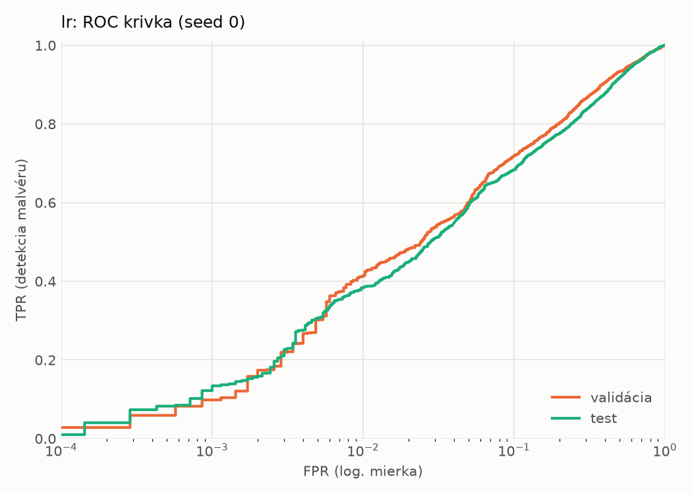
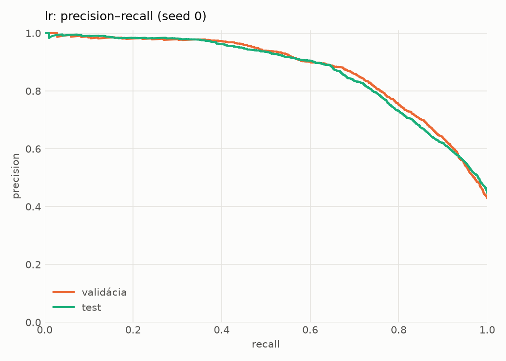
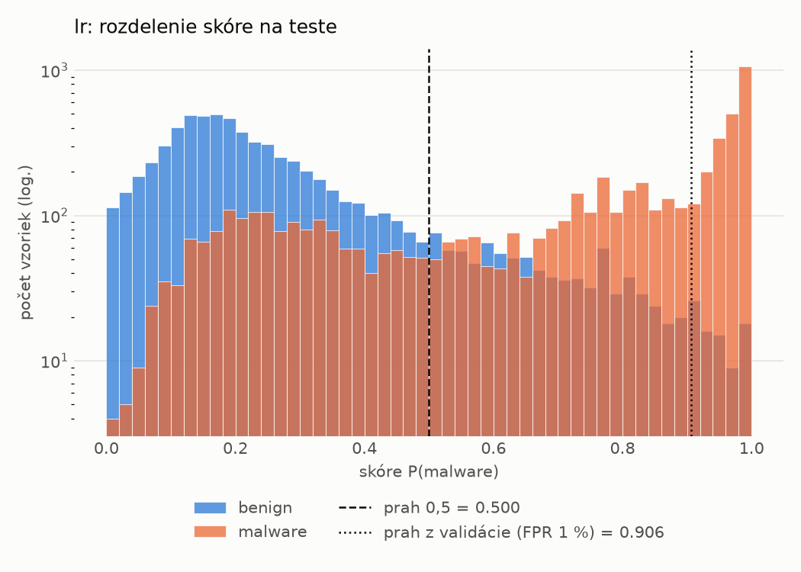
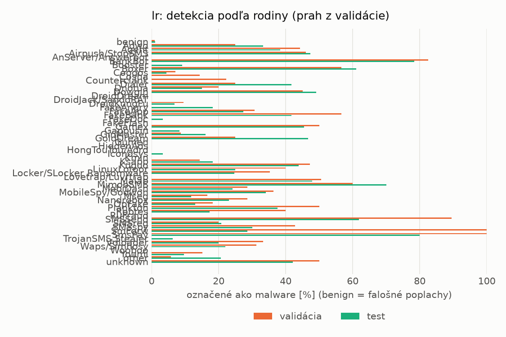
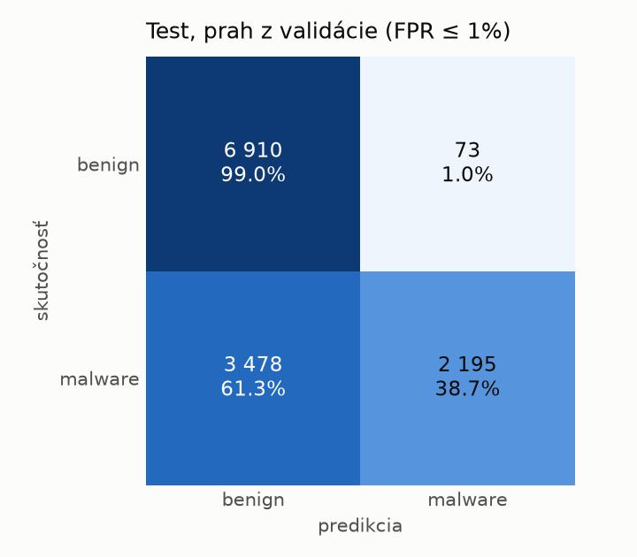
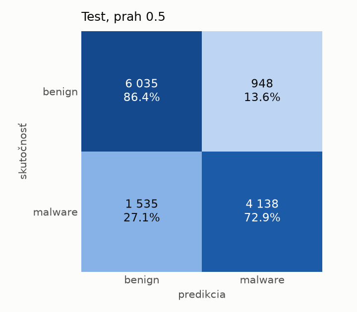

# dynamic/lr – beh `20261123-214528`

> Automaticky generované (`src/training/run_tabular.py`). Konfigurácia: `config.yaml`, protokol: `protocol.yaml`.

- **Model:** `logreg` – logistická regresia s L2 regularizáciou (vstup signed log1p + štandardizácia)
- **Ladenie:** bez ladenia – hyperparametre prevzaté z `runs_v4/emu_p/full/dynamic/lr/20261123-191800`
- **Finálne modely:** seedy [0, 1, 2]; hodnoty sú priemer ± smerodajná odchýlka cez seedy
- **Najlepšie hyperparametre:** `{"max_iter": 2000, "C": 7.504621081078761}`

## Detekčná kvalita (bez prahu)
| metrika | train (podvzorka) | validácia | test |
|---|---|---|---|
| ROC-AUC | 0.8799 ± 0.0000 | 0.8834 ± 0.0000 | 0.8693 ± 0.0000 |
| PR-AUC | 0.8713 ± 0.0000 | 0.8747 ± 0.0000 | 0.8689 ± 0.0000 |
| TPR pri FPR 1 % | 0.4255 ± 0.0000 | 0.4121 ± 0.0000 | 0.3836 ± 0.0000 |
| TPR pri FPR 0,1 % | 0.0843 ± 0.0000 | 0.0984 ± 0.0000 | 0.1220 ± 0.0000 |
| log loss | 0.4200 ± 0.0000 | 0.4191 ± 0.0000 | 0.4376 ± 0.0000 |
| Brier skóre | 0.1326 ± 0.0000 | 0.1322 ± 0.0000 | 0.1406 ± 0.0000 |

Rozdiel ROC-AUC train − validácia: **-0.0035** (veľký rozdiel = preučenie).

## Pri prahu z validácie (FPR ≤ 1% na validácii)
| metrika | train (podvzorka) | validácia | test |
|---|---|---|---|
| accuracy | 0.7524 ± 0.0000 | 0.7421 ± 0.0000 | 0.7194 ± 0.0000 |
| balanced accuracy | 0.7077 ± 0.0000 | 0.7012 ± 0.0000 | 0.6882 ± 0.0000 |
| precision | 0.9691 ± 0.0000 | 0.9695 ± 0.0000 | 0.9678 ± 0.0000 |
| recall (TPR) | 0.4253 ± 0.0000 | 0.4121 ± 0.0000 | 0.3869 ± 0.0000 |
| FPR | 0.0098 ± 0.0000 | 0.0097 ± 0.0000 | 0.0105 ± 0.0000 |
| F1 | 0.5911 ± 0.0000 | 0.5784 ± 0.0000 | 0.5528 ± 0.0000 |
| MCC | 0.5285 ± 0.0000 | 0.5157 ± 0.0000 | 0.4882 ± 0.0000 |

## Pri pevnom prahu 0.5
| metrika | train (podvzorka) | validácia | test |
|---|---|---|---|
| accuracy | 0.8152 ± 0.0000 | 0.8164 ± 0.0000 | 0.8038 ± 0.0000 |
| balanced accuracy | 0.8071 ± 0.0000 | 0.8087 ± 0.0000 | 0.7968 ± 0.0000 |
| precision | 0.7949 ± 0.0000 | 0.8057 ± 0.0000 | 0.8136 ± 0.0000 |
| recall (TPR) | 0.7560 ± 0.0000 | 0.7541 ± 0.0000 | 0.7294 ± 0.0000 |
| FPR | 0.1418 ± 0.0000 | 0.1367 ± 0.0000 | 0.1358 ± 0.0000 |
| F1 | 0.7750 ± 0.0000 | 0.7790 ± 0.0000 | 0.7692 ± 0.0000 |
| MCC | 0.6189 ± 0.0000 | 0.6233 ± 0.0000 | 0.6022 ± 0.0000 |

## Výpočtové nároky (seed 0, testovacia množina)
| meranie | hodnota |
|---|---|
| tréning finálneho modelu | 0.4 s (priemer cez seedy) |
| ladenie spolu | 0 s |
| počet parametrov / uzlov | 124 |
| veľkosť modelu na disku | 0.01 MB |
| transformácia vstupu – latencia (1 vlákno) | 0.005 ms |
| transformácia vstupu – priepustnosť | 1 239 023 vzoriek/s |
| CPU latencia modelu (batch 1, 1 vlákno) | 0.004 ms (p95 0.004) |
| CPU priepustnosť (24 vlákien) | 4 618 135 vzoriek/s |

## Grafy
| | |
|---|---|
|  |  |
|  |  |
|  |  |
|  |  |

## Súbory
`metrics.json` (všetky metriky po seedoch vrátane rodín), `timing.json`, `hpo_trials.csv`,
`predictions/<časť>_seed<N>.parquet` (sha256, family, label, score), `model/seed_<N>/`, `log.txt`.
