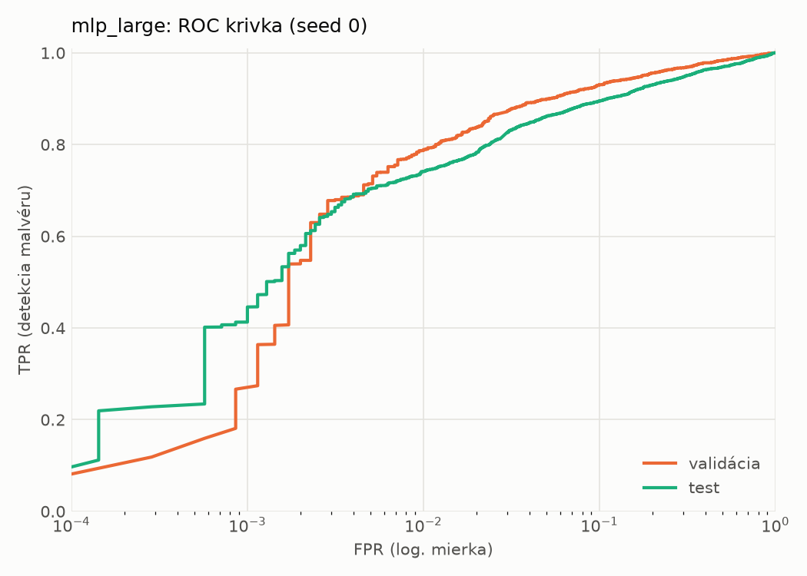
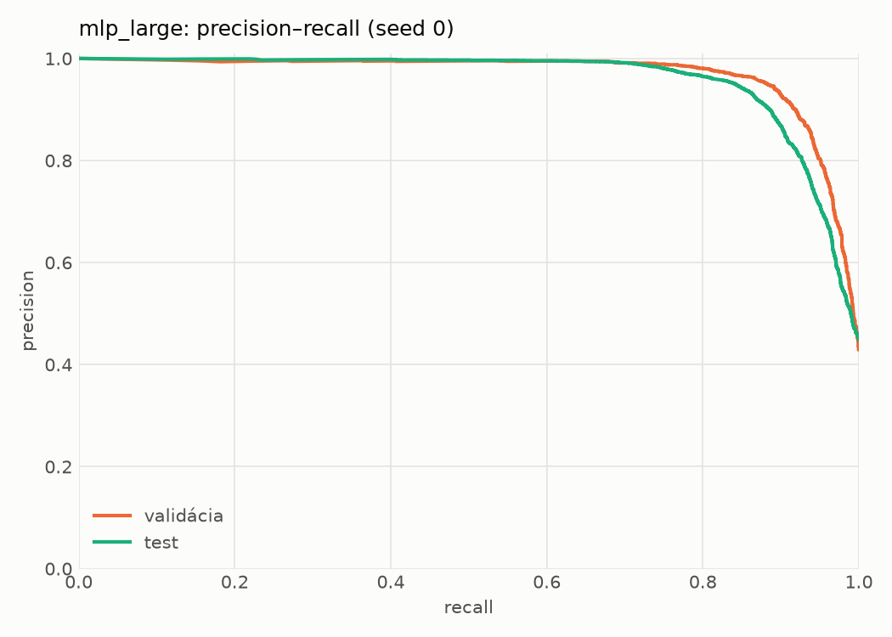
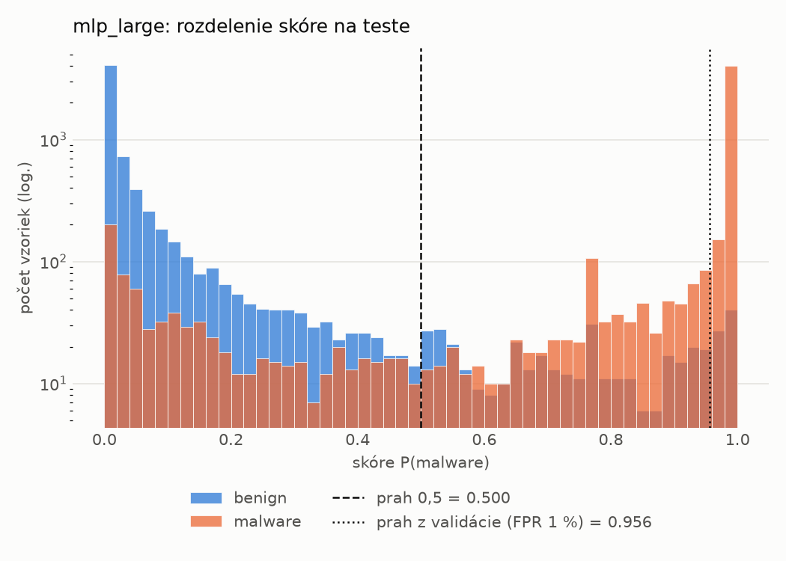
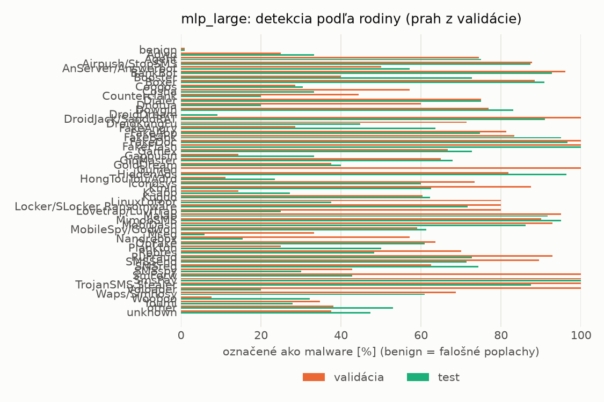
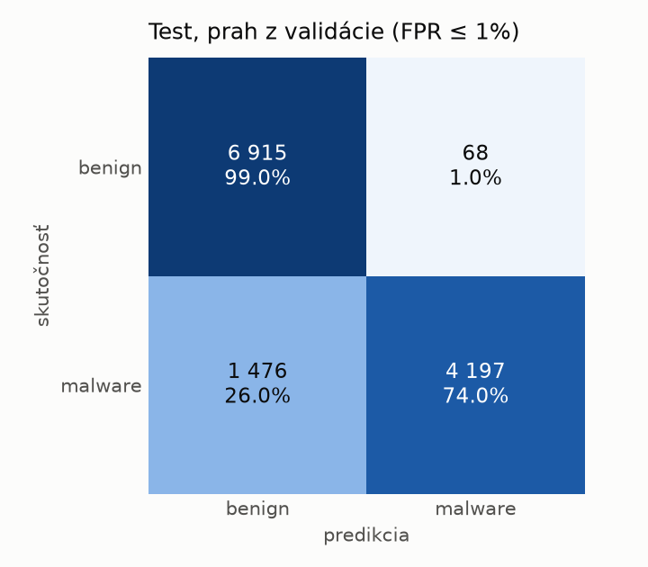
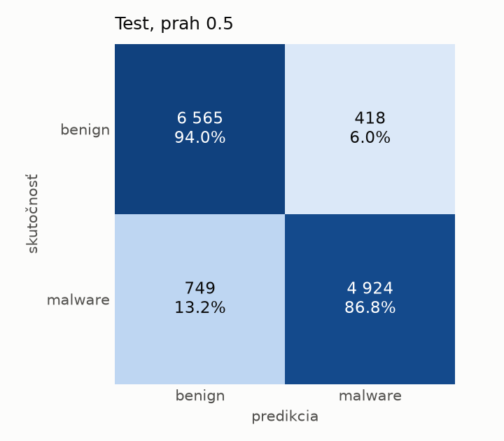
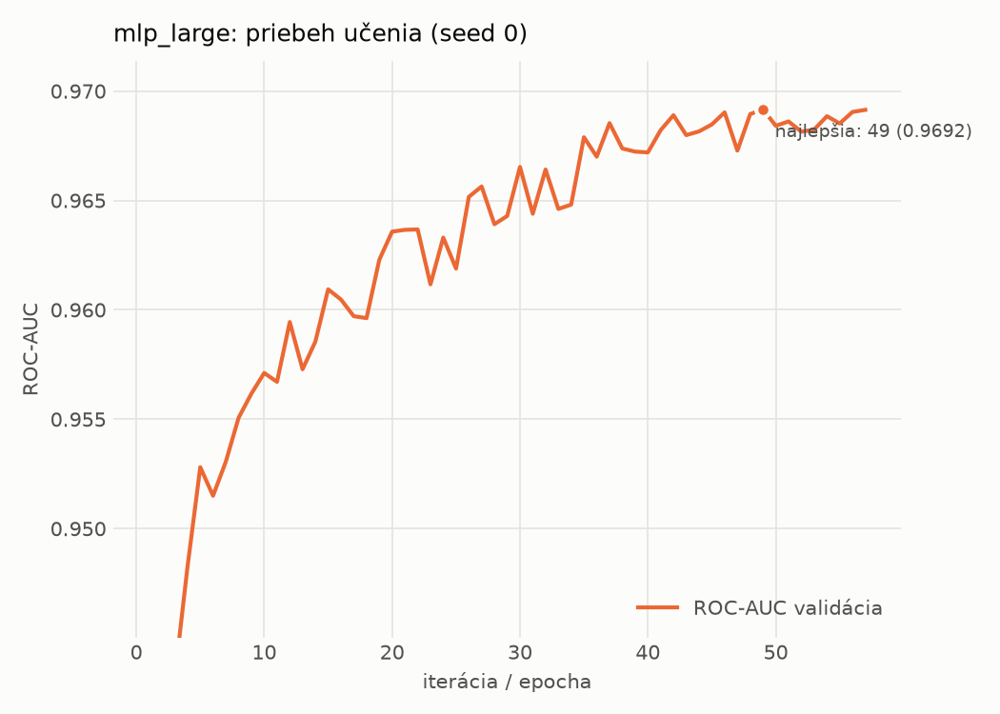

# dynamic/mlp_large – beh `20261123-214840`

> Automaticky generované (`src/training/run_tabular.py`). Konfigurácia: `config.yaml`, protokol: `protocol.yaml`.

- **Model:** `mlp` – veľká neurónová sieť (3–5 skrytých vrstiev, 512–2048 neurónov), kandidát na učiteľa
- **Ladenie:** bez ladenia – hyperparametre prevzaté z `runs_v4/emu_p/full/dynamic/mlp_large/20261123-194626`
- **Finálne modely:** seedy [0, 1, 2]; hodnoty sú priemer ± smerodajná odchýlka cez seedy
- **Najlepšie hyperparametre:** `{"max_epochs": 100, "patience": 8, "hidden_layers": 3, "hidden_width": 1024, "width_decay": 0.5, "dropout": 0.11628417924821868, "lr": 0.0004582958225587737, "weight_decay": 0.0007705605519981878, "batch_size": 512}`

## Detekčná kvalita (bez prahu)
| metrika | train (podvzorka) | validácia | test |
|---|---|---|---|
| ROC-AUC | 0.9950 ± 0.0011 | 0.9696 ± 0.0007 | 0.9528 ± 0.0003 |
| PR-AUC | 0.9942 ± 0.0013 | 0.9682 ± 0.0012 | 0.9580 ± 0.0004 |
| TPR pri FPR 1 % | 0.9355 ± 0.0117 | 0.7869 ± 0.0027 | 0.7375 ± 0.0037 |
| TPR pri FPR 0,1 % | 0.8841 ± 0.0108 | 0.2972 ± 0.1122 | 0.4224 ± 0.0094 |
| log loss | 0.0868 ± 0.0098 | 0.2309 ± 0.0050 | 0.2992 ± 0.0124 |
| Brier skóre | 0.0242 ± 0.0029 | 0.0586 ± 0.0006 | 0.0732 ± 0.0002 |

Rozdiel ROC-AUC train − validácia: **0.0255** (veľký rozdiel = preučenie).

## Pri prahu z validácie (FPR ≤ 1% na validácii)
| metrika | train (podvzorka) | validácia | test |
|---|---|---|---|
| accuracy | 0.9249 ± 0.0030 | 0.9030 ± 0.0011 | 0.8749 ± 0.0027 |
| balanced accuracy | 0.9108 ± 0.0036 | 0.8886 ± 0.0013 | 0.8615 ± 0.0031 |
| precision | 1.0000 ± 0.0000 | 0.9838 ± 0.0001 | 0.9847 ± 0.0006 |
| recall (TPR) | 0.8216 ± 0.0071 | 0.7869 ± 0.0027 | 0.7324 ± 0.0066 |
| FPR | 0.0000 ± 0.0000 | 0.0097 ± 0.0000 | 0.0093 ± 0.0004 |
| F1 | 0.9020 ± 0.0043 | 0.8744 ± 0.0017 | 0.8400 ± 0.0041 |
| MCC | 0.8528 ± 0.0057 | 0.8101 ± 0.0021 | 0.7628 ± 0.0047 |

## Pri pevnom prahu 0.5
| metrika | train (podvzorka) | validácia | test |
|---|---|---|---|
| accuracy | 0.9689 ± 0.0042 | 0.9245 ± 0.0024 | 0.9074 ± 0.0010 |
| balanced accuracy | 0.9673 ± 0.0044 | 0.9224 ± 0.0025 | 0.9038 ± 0.0012 |
| precision | 0.9683 ± 0.0045 | 0.9152 ± 0.0024 | 0.9206 ± 0.0010 |
| recall (TPR) | 0.9574 ± 0.0058 | 0.9081 ± 0.0040 | 0.8684 ± 0.0027 |
| FPR | 0.0228 ± 0.0032 | 0.0632 ± 0.0019 | 0.0609 ± 0.0009 |
| F1 | 0.9628 ± 0.0051 | 0.9117 ± 0.0028 | 0.8938 ± 0.0013 |
| MCC | 0.9361 ± 0.0087 | 0.8457 ± 0.0048 | 0.8130 ± 0.0020 |

## Výpočtové nároky (seed 0, testovacia množina)
| meranie | hodnota |
|---|---|
| tréning finálneho modelu | 9.9 s (priemer cez seedy) |
| ladenie spolu | 0 s |
| počet parametrov / uzlov | 786 945 |
| veľkosť modelu na disku | 3.17 MB |
| transformácia vstupu – latencia (1 vlákno) | 0.015 ms |
| transformácia vstupu – priepustnosť | 762 694 vzoriek/s |
| CPU latencia modelu (batch 1, 1 vlákno) | 0.167 ms (p95 0.378) |
| CPU priepustnosť (24 vlákien) | 435 275 vzoriek/s |
| GPU latencia (batch 1) | 0.422 ms (p95 0.950) |
| GPU priepustnosť | 1 404 334 vzoriek/s |
| GPU špičková pamäť | 146 MB |

## Grafy
| | |
|---|---|
|  |  |
|  |  |
|  |  |
|  |  |

## Súbory
`metrics.json` (všetky metriky po seedoch vrátane rodín), `timing.json`, `hpo_trials.csv`,
`predictions/<časť>_seed<N>.parquet` (sha256, family, label, score), `model/seed_<N>/`, `log.txt`.
