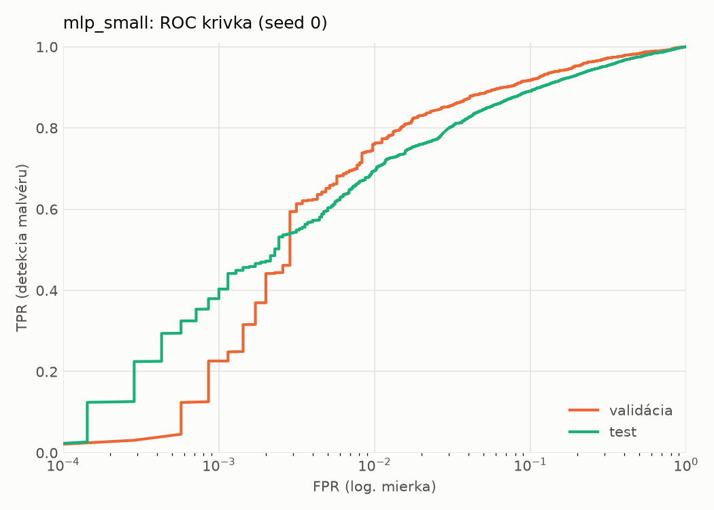
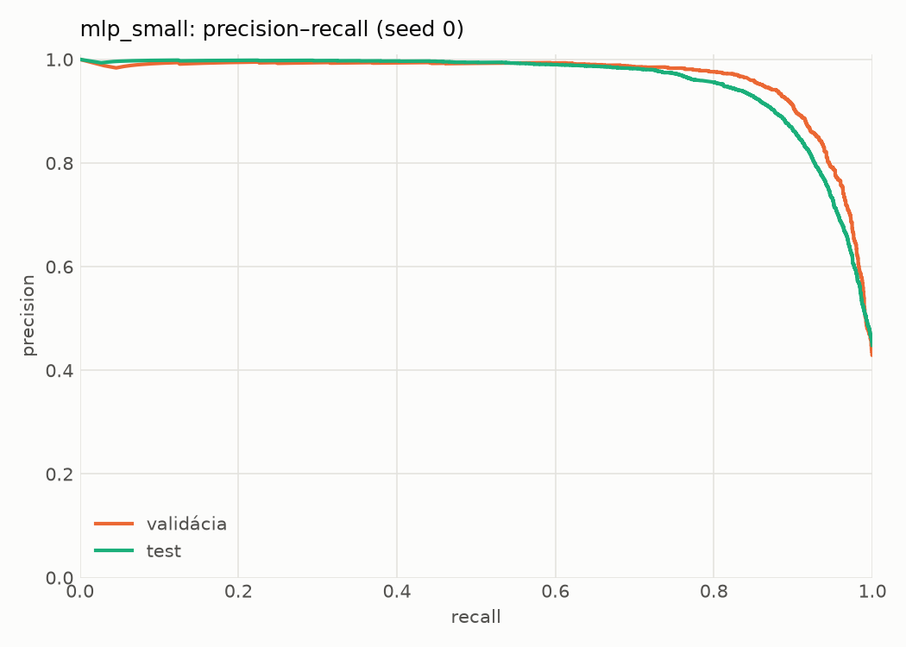
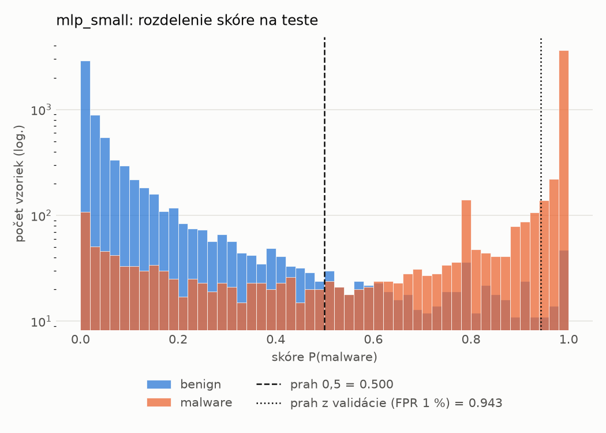
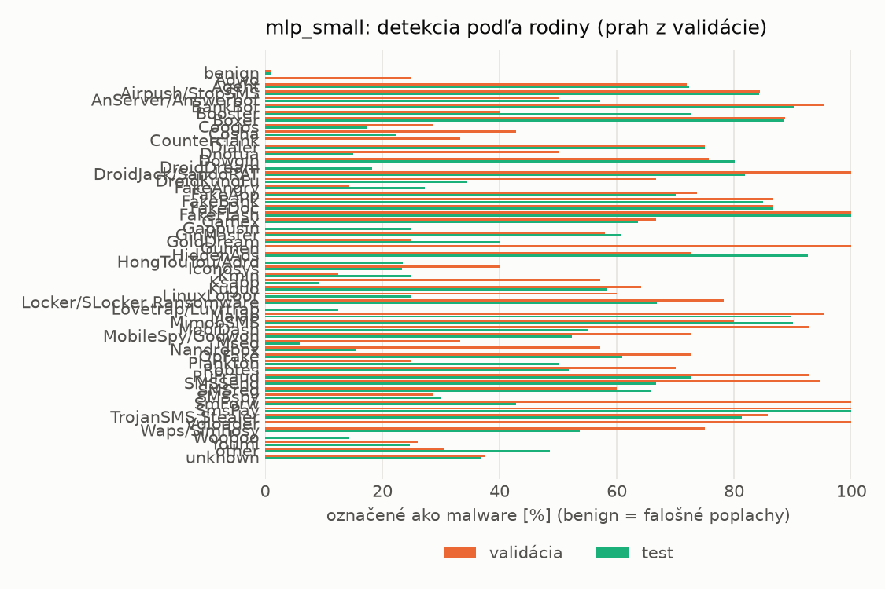
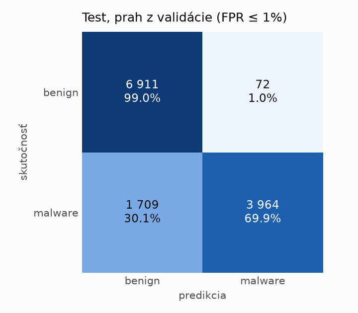
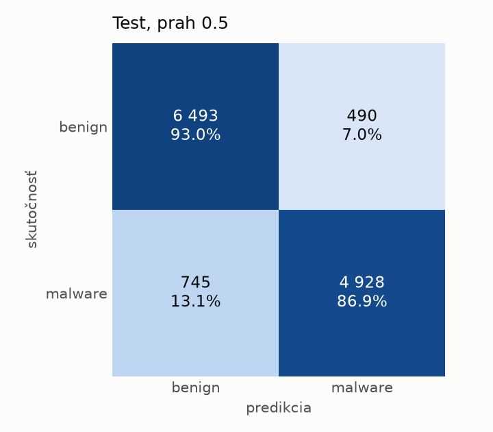
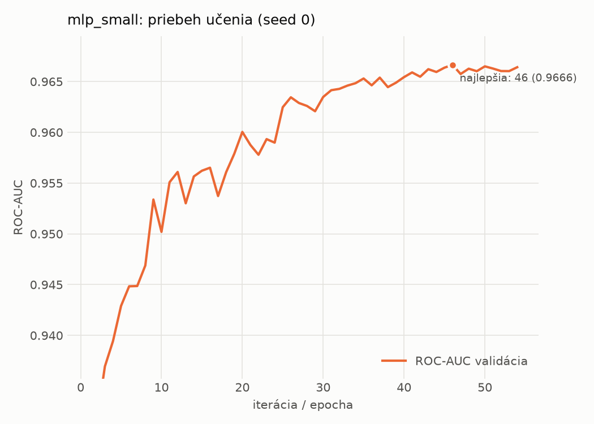

# dynamic/mlp_small – beh `20261123-214737`

> Automaticky generované (`src/training/run_tabular.py`). Konfigurácia: `config.yaml`, protokol: `protocol.yaml`.

- **Model:** `mlp` – malá neurónová sieť (1–2 skryté vrstvy), kandidát na ľahkého študenta
- **Ladenie:** bez ladenia – hyperparametre prevzaté z `runs_v4/emu_p/full/dynamic/mlp_small/20261123-193925`
- **Finálne modely:** seedy [0, 1, 2]; hodnoty sú priemer ± smerodajná odchýlka cez seedy
- **Najlepšie hyperparametre:** `{"width_decay": 0.5, "max_epochs": 100, "patience": 8, "hidden_layers": 2, "hidden_width": 256, "dropout": 0.06125761383416514, "lr": 0.0018225597913134257, "weight_decay": 9.759441755448828e-06, "batch_size": 256}`

## Detekčná kvalita (bez prahu)
| metrika | train (podvzorka) | validácia | test |
|---|---|---|---|
| ROC-AUC | 0.9896 ± 0.0025 | 0.9676 ± 0.0008 | 0.9531 ± 0.0016 |
| PR-AUC | 0.9884 ± 0.0026 | 0.9654 ± 0.0020 | 0.9560 ± 0.0011 |
| TPR pri FPR 1 % | 0.8860 ± 0.0178 | 0.7550 ± 0.0062 | 0.7074 ± 0.0113 |
| TPR pri FPR 0,1 % | 0.8182 ± 0.0278 | 0.3072 ± 0.0710 | 0.3741 ± 0.0292 |
| log loss | 0.1241 ± 0.0156 | 0.2308 ± 0.0060 | 0.2835 ± 0.0078 |
| Brier skóre | 0.0353 ± 0.0048 | 0.0618 ± 0.0008 | 0.0756 ± 0.0012 |

Rozdiel ROC-AUC train − validácia: **0.0220** (veľký rozdiel = preučenie).

## Pri prahu z validácie (FPR ≤ 1% na validácii)
| metrika | train (podvzorka) | validácia | test |
|---|---|---|---|
| accuracy | 0.9030 ± 0.0039 | 0.8893 ± 0.0026 | 0.8580 ± 0.0019 |
| balanced accuracy | 0.8849 ± 0.0045 | 0.8727 ± 0.0030 | 0.8427 ± 0.0023 |
| precision | 0.9993 ± 0.0005 | 0.9833 ± 0.0002 | 0.9843 ± 0.0022 |
| recall (TPR) | 0.7702 ± 0.0088 | 0.7550 ± 0.0062 | 0.6944 ± 0.0059 |
| FPR | 0.0004 ± 0.0003 | 0.0096 ± 0.0002 | 0.0090 ± 0.0014 |
| F1 | 0.8699 ± 0.0058 | 0.8541 ± 0.0039 | 0.8143 ± 0.0034 |
| MCC | 0.8118 ± 0.0073 | 0.7849 ± 0.0047 | 0.7330 ± 0.0029 |

## Pri pevnom prahu 0.5
| metrika | train (podvzorka) | validácia | test |
|---|---|---|---|
| accuracy | 0.9541 ± 0.0057 | 0.9178 ± 0.0030 | 0.9013 ± 0.0022 |
| balanced accuracy | 0.9522 ± 0.0056 | 0.9160 ± 0.0028 | 0.8977 ± 0.0024 |
| precision | 0.9497 ± 0.0087 | 0.9046 ± 0.0055 | 0.9114 ± 0.0027 |
| recall (TPR) | 0.9408 ± 0.0061 | 0.9037 ± 0.0013 | 0.8637 ± 0.0048 |
| FPR | 0.0363 ± 0.0065 | 0.0717 ± 0.0045 | 0.0683 ± 0.0024 |
| F1 | 0.9452 ± 0.0067 | 0.9041 ± 0.0033 | 0.8869 ± 0.0027 |
| MCC | 0.9057 ± 0.0116 | 0.8321 ± 0.0060 | 0.8003 ± 0.0045 |

## Výpočtové nároky (seed 0, testovacia množina)
| meranie | hodnota |
|---|---|
| tréning finálneho modelu | 20.4 s (priemer cez seedy) |
| ladenie spolu | 0 s |
| počet parametrov / uzlov | 65 537 |
| veľkosť modelu na disku | 0.27 MB |
| transformácia vstupu – latencia (1 vlákno) | 0.006 ms |
| transformácia vstupu – priepustnosť | 1 049 333 vzoriek/s |
| CPU latencia modelu (batch 1, 1 vlákno) | 0.107 ms (p95 0.125) |
| CPU priepustnosť (24 vlákien) | 2 253 561 vzoriek/s |
| GPU latencia (batch 1) | 0.670 ms (p95 0.733) |
| GPU priepustnosť | 1 989 906 vzoriek/s |
| GPU špičková pamäť | 66 MB |

## Grafy
| | |
|---|---|
|  |  |
|  |  |
|  |  |
|  |  |

## Súbory
`metrics.json` (všetky metriky po seedoch vrátane rodín), `timing.json`, `hpo_trials.csv`,
`predictions/<časť>_seed<N>.parquet` (sha256, family, label, score), `model/seed_<N>/`, `log.txt`.
