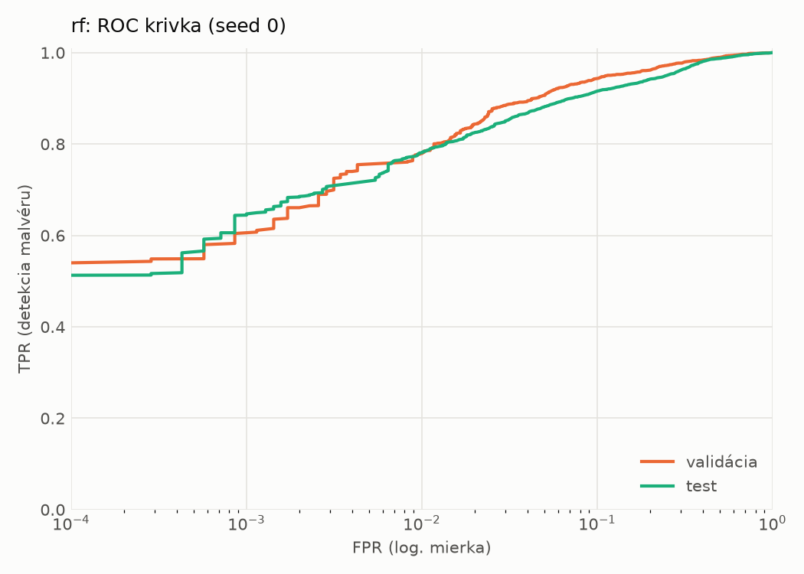
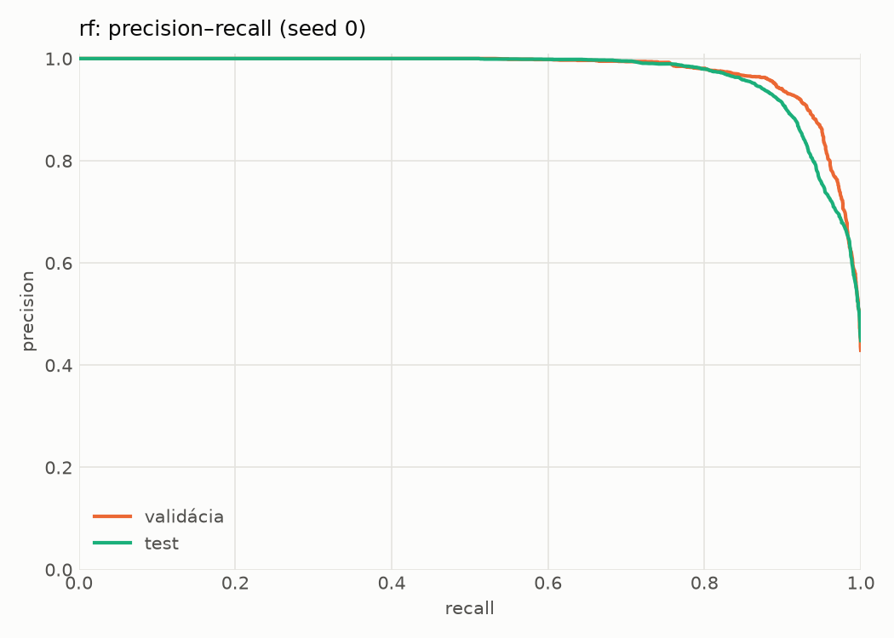
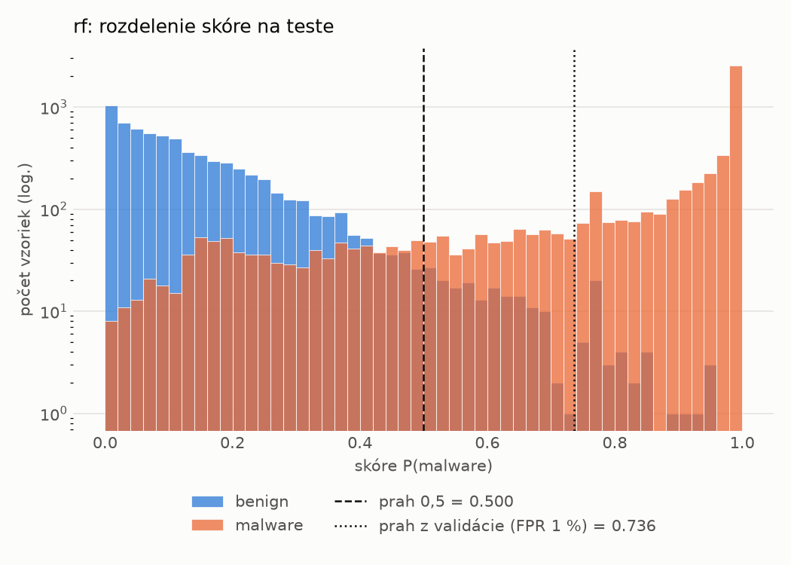
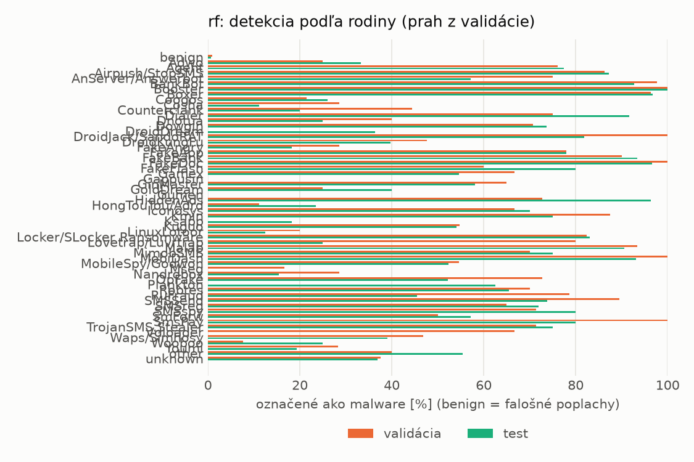
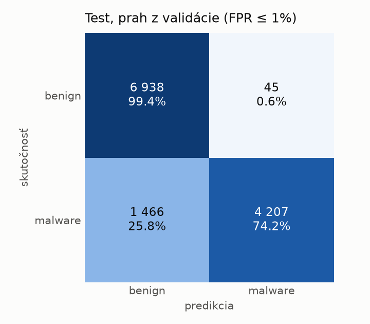
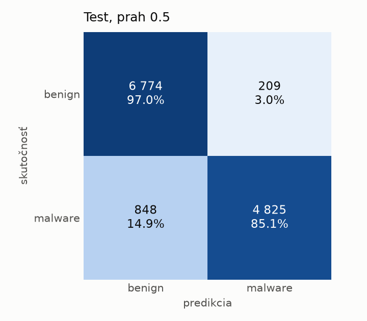

# dynamic/rf – beh `20261123-214531`

> Automaticky generované (`src/training/run_tabular.py`). Konfigurácia: `config.yaml`, protokol: `protocol.yaml`.

- **Model:** `random_forest` – Random Forest (pôvodné hodnoty príznakov)
- **Ladenie:** bez ladenia – hyperparametre prevzaté z `runs_v4/emu_p/full/dynamic/rf/20261123-191811`
- **Finálne modely:** seedy [0, 1, 2]; hodnoty sú priemer ± smerodajná odchýlka cez seedy
- **Najlepšie hyperparametre:** `{"n_estimators": 450, "max_depth": null, "min_samples_leaf": 1, "max_features": "sqrt"}`

## Detekčná kvalita (bez prahu)
| metrika | train (podvzorka) | validácia | test |
|---|---|---|---|
| ROC-AUC | 0.9997 ± 0.0000 | 0.9761 ± 0.0002 | 0.9681 ± 0.0007 |
| PR-AUC | 0.9996 ± 0.0000 | 0.9754 ± 0.0001 | 0.9697 ± 0.0006 |
| TPR pri FPR 1 % | 0.9998 ± 0.0000 | 0.7813 ± 0.0019 | 0.7795 ± 0.0024 |
| TPR pri FPR 0,1 % | 0.9403 ± 0.0017 | 0.6048 ± 0.0061 | 0.6422 ± 0.0031 |
| log loss | 0.0636 ± 0.0002 | 0.2057 ± 0.0006 | 0.2328 ± 0.0003 |
| Brier skóre | 0.0092 ± 0.0000 | 0.0572 ± 0.0001 | 0.0667 ± 0.0003 |

Rozdiel ROC-AUC train − validácia: **0.0236** (veľký rozdiel = preučenie).

## Pri prahu z validácie (FPR ≤ 1% na validácii)
| metrika | train (podvzorka) | validácia | test |
|---|---|---|---|
| accuracy | 0.9888 ± 0.0009 | 0.9006 ± 0.0008 | 0.8812 ± 0.0006 |
| balanced accuracy | 0.9873 ± 0.0011 | 0.8858 ± 0.0010 | 0.8683 ± 0.0007 |
| precision | 0.9952 ± 0.0000 | 0.9837 ± 0.0000 | 0.9894 ± 0.0004 |
| recall (TPR) | 0.9781 ± 0.0021 | 0.7813 ± 0.0019 | 0.7431 ± 0.0013 |
| FPR | 0.0035 ± 0.0000 | 0.0097 ± 0.0000 | 0.0065 ± 0.0002 |
| F1 | 0.9866 ± 0.0011 | 0.8709 ± 0.0012 | 0.8487 ± 0.0009 |
| MCC | 0.9771 ± 0.0018 | 0.8057 ± 0.0015 | 0.7751 ± 0.0011 |

## Pri pevnom prahu 0.5
| metrika | train (podvzorka) | validácia | test |
|---|---|---|---|
| accuracy | 0.9975 ± 0.0000 | 0.9338 ± 0.0005 | 0.9161 ± 0.0004 |
| balanced accuracy | 0.9978 ± 0.0000 | 0.9281 ± 0.0007 | 0.9098 ± 0.0005 |
| precision | 0.9943 ± 0.0000 | 0.9554 ± 0.0007 | 0.9591 ± 0.0006 |
| recall (TPR) | 0.9998 ± 0.0000 | 0.8873 ± 0.0019 | 0.8489 ± 0.0014 |
| FPR | 0.0041 ± 0.0000 | 0.0311 ± 0.0006 | 0.0294 ± 0.0005 |
| F1 | 0.9970 ± 0.0000 | 0.9201 ± 0.0007 | 0.9007 ± 0.0006 |
| MCC | 0.9949 ± 0.0000 | 0.8655 ± 0.0010 | 0.8331 ± 0.0007 |

## Výpočtové nároky (seed 0, testovacia množina)
| meranie | hodnota |
|---|---|
| tréning finálneho modelu | 2.6 s (priemer cez seedy) |
| ladenie spolu | 0 s |
| počet parametrov / uzlov | 3 959 902 |
| veľkosť modelu na disku | 317.15 MB |
| CPU latencia modelu (batch 1, 1 vlákno) | 13.243 ms (p95 13.663) |
| CPU priepustnosť (24 vlákien) | 101 123 vzoriek/s |

## Grafy
| | |
|---|---|
|  |  |
|  |  |
|  |  |
|  |  |

## Súbory
`metrics.json` (všetky metriky po seedoch vrátane rodín), `timing.json`, `hpo_trials.csv`,
`predictions/<časť>_seed<N>.parquet` (sha256, family, label, score), `model/seed_<N>/`, `log.txt`.
