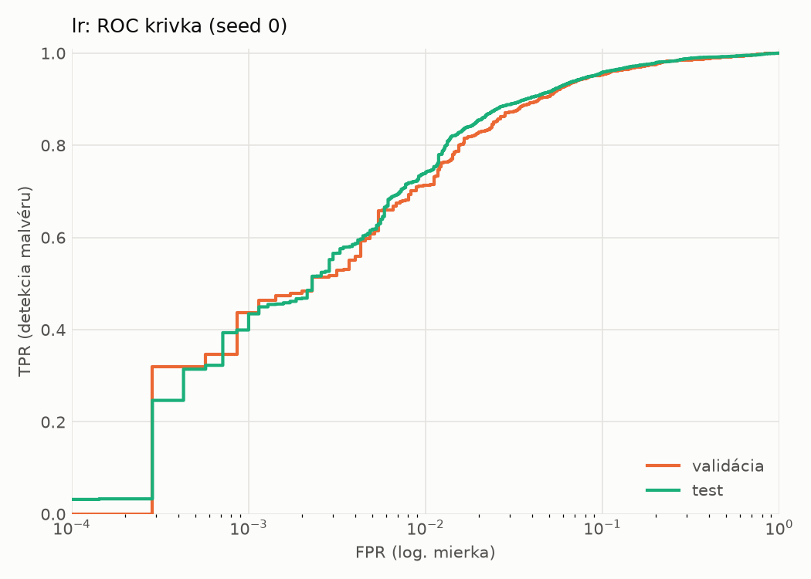
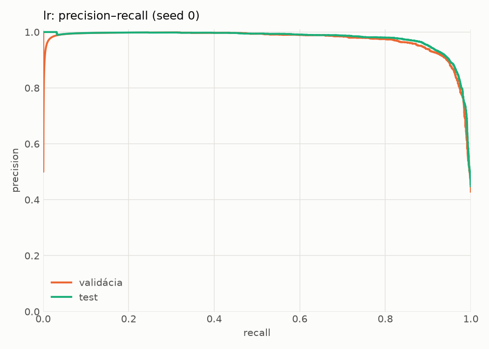
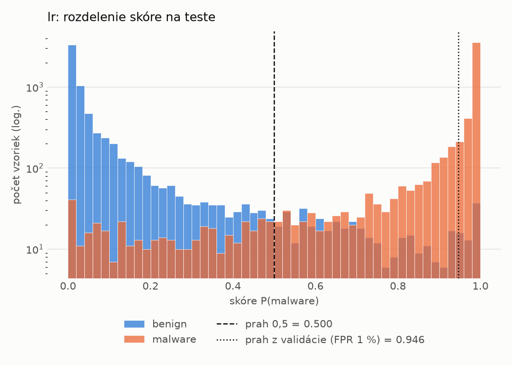
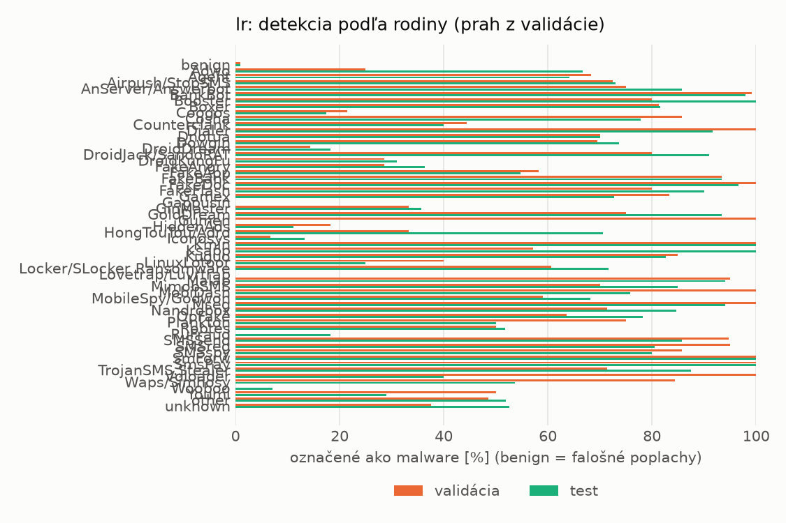
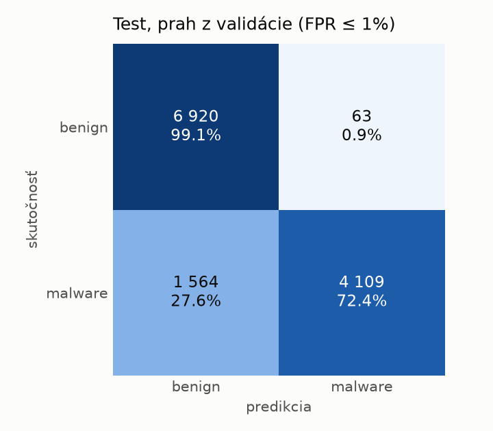
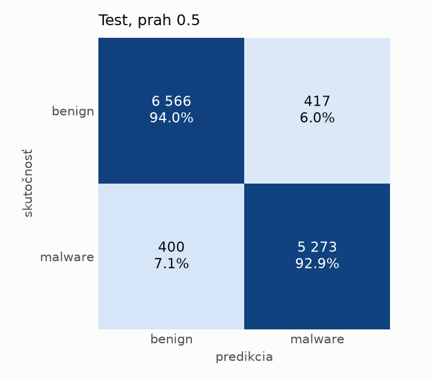

# hybrid/lr – beh `20261123-214915`

> Automaticky generované (`src/training/run_tabular.py`). Konfigurácia: `config.yaml`, protokol: `protocol.yaml`.

- **Model:** `logreg` – logistická regresia s L2 regularizáciou (vstup signed log1p + štandardizácia)
- **Ladenie:** bez ladenia – hyperparametre prevzaté z `runs_v4/emu_p/full/hybrid/lr/20261123-195300`
- **Finálne modely:** seedy [0, 1, 2]; hodnoty sú priemer ± smerodajná odchýlka cez seedy
- **Najlepšie hyperparametre:** `{"max_iter": 2000, "C": 7.106361724509844}`

## Detekčná kvalita (bez prahu)
| metrika | train (podvzorka) | validácia | test |
|---|---|---|---|
| ROC-AUC | 0.9802 ± 0.0000 | 0.9776 ± 0.0000 | 0.9796 ± 0.0000 |
| PR-AUC | 0.9768 ± 0.0000 | 0.9732 ± 0.0000 | 0.9775 ± 0.0000 |
| TPR pri FPR 1 % | 0.7627 ± 0.0000 | 0.7125 ± 0.0000 | 0.7388 ± 0.0000 |
| TPR pri FPR 0,1 % | 0.3222 ± 0.0000 | 0.4365 ± 0.0000 | 0.3993 ± 0.0000 |
| log loss | 0.1720 ± 0.0000 | 0.1857 ± 0.0000 | 0.1774 ± 0.0000 |
| Brier skóre | 0.0473 ± 0.0000 | 0.0509 ± 0.0000 | 0.0485 ± 0.0000 |

Rozdiel ROC-AUC train − validácia: **0.0026** (veľký rozdiel = preučenie).

## Pri prahu z validácie (FPR ≤ 1% na validácii)
| metrika | train (podvzorka) | validácia | test |
|---|---|---|---|
| accuracy | 0.8786 ± 0.0000 | 0.8711 ± 0.0000 | 0.8714 ± 0.0000 |
| balanced accuracy | 0.8571 ± 0.0000 | 0.8514 ± 0.0000 | 0.8576 ± 0.0000 |
| precision | 0.9864 ± 0.0000 | 0.9821 ± 0.0000 | 0.9849 ± 0.0000 |
| recall (TPR) | 0.7215 ± 0.0000 | 0.7125 ± 0.0000 | 0.7243 ± 0.0000 |
| FPR | 0.0073 ± 0.0000 | 0.0097 ± 0.0000 | 0.0090 ± 0.0000 |
| F1 | 0.8334 ± 0.0000 | 0.8259 ± 0.0000 | 0.8347 ± 0.0000 |
| MCC | 0.7639 ± 0.0000 | 0.7512 ± 0.0000 | 0.7567 ± 0.0000 |

## Pri pevnom prahu 0.5
| metrika | train (podvzorka) | validácia | test |
|---|---|---|---|
| accuracy | 0.9371 ± 0.0000 | 0.9342 ± 0.0000 | 0.9354 ± 0.0000 |
| balanced accuracy | 0.9365 ± 0.0000 | 0.9331 ± 0.0000 | 0.9349 ± 0.0000 |
| precision | 0.9190 ± 0.0000 | 0.9221 ± 0.0000 | 0.9267 ± 0.0000 |
| recall (TPR) | 0.9328 ± 0.0000 | 0.9249 ± 0.0000 | 0.9295 ± 0.0000 |
| FPR | 0.0597 ± 0.0000 | 0.0588 ± 0.0000 | 0.0597 ± 0.0000 |
| F1 | 0.9258 ± 0.0000 | 0.9235 ± 0.0000 | 0.9281 ± 0.0000 |
| MCC | 0.8713 ± 0.0000 | 0.8658 ± 0.0000 | 0.8695 ± 0.0000 |

## Výpočtové nároky (seed 0, testovacia množina)
| meranie | hodnota |
|---|---|
| tréning finálneho modelu | 0.5 s (priemer cez seedy) |
| ladenie spolu | 0 s |
| počet parametrov / uzlov | 287 |
| veľkosť modelu na disku | 0.01 MB |
| transformácia vstupu – latencia (1 vlákno) | 0.006 ms |
| transformácia vstupu – priepustnosť | 512 389 vzoriek/s |
| CPU latencia modelu (batch 1, 1 vlákno) | 0.004 ms (p95 0.004) |
| CPU priepustnosť (24 vlákien) | 2 212 239 vzoriek/s |

## Grafy
| | |
|---|---|
|  |  |
|  |  |
|  |  |
|  |  |

## Súbory
`metrics.json` (všetky metriky po seedoch vrátane rodín), `timing.json`, `hpo_trials.csv`,
`predictions/<časť>_seed<N>.parquet` (sha256, family, label, score), `model/seed_<N>/`, `log.txt`.
