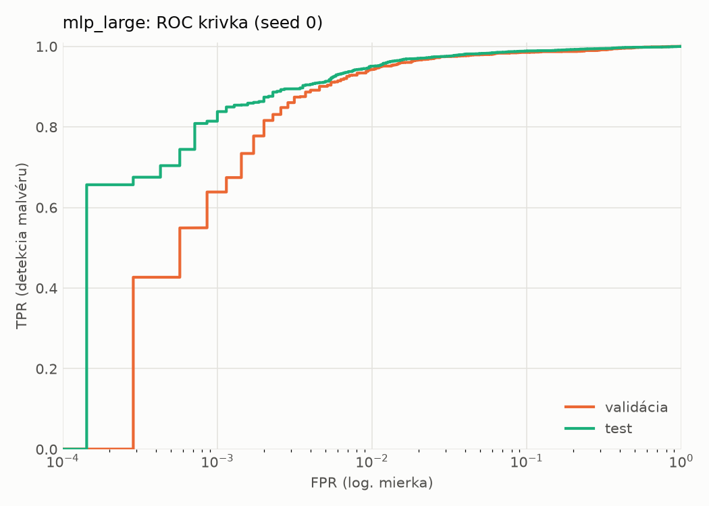
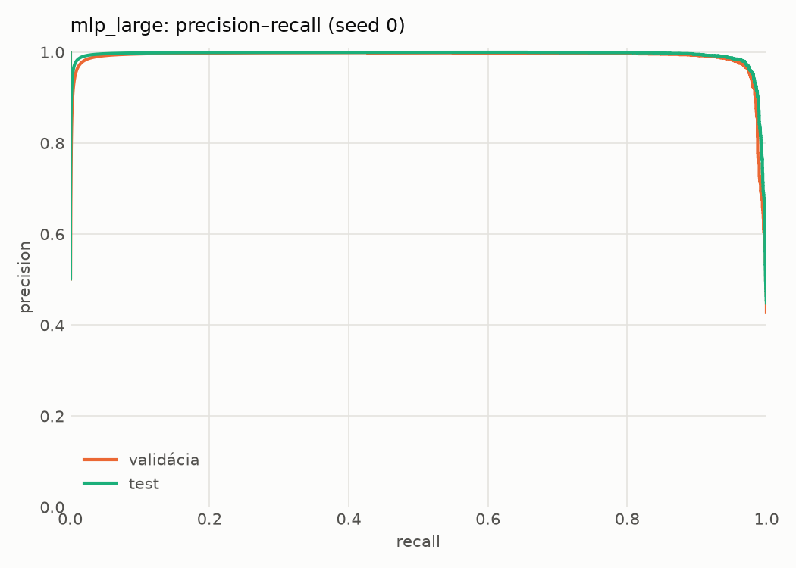
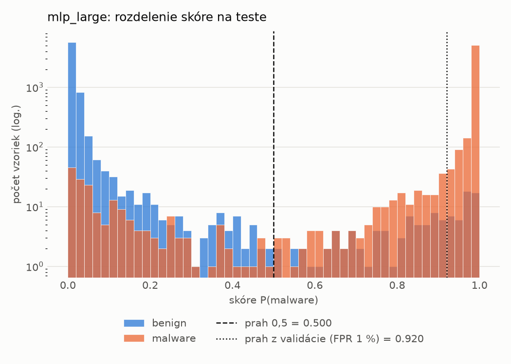
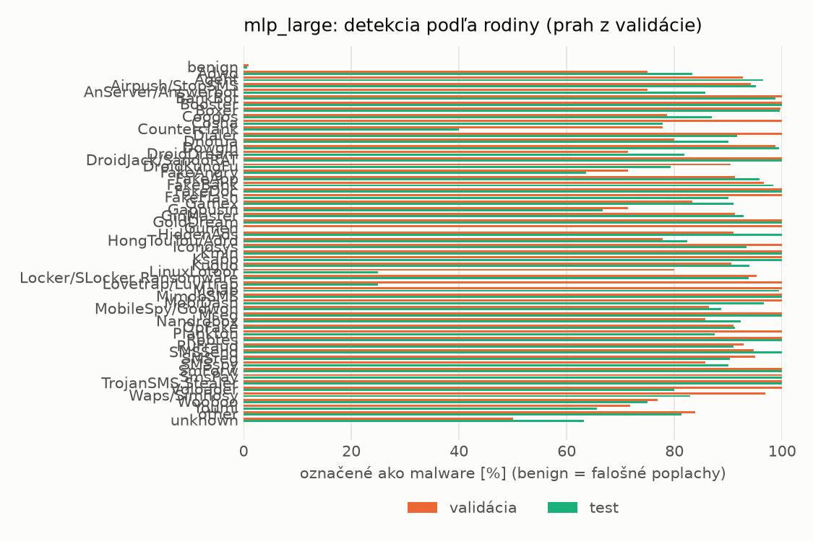
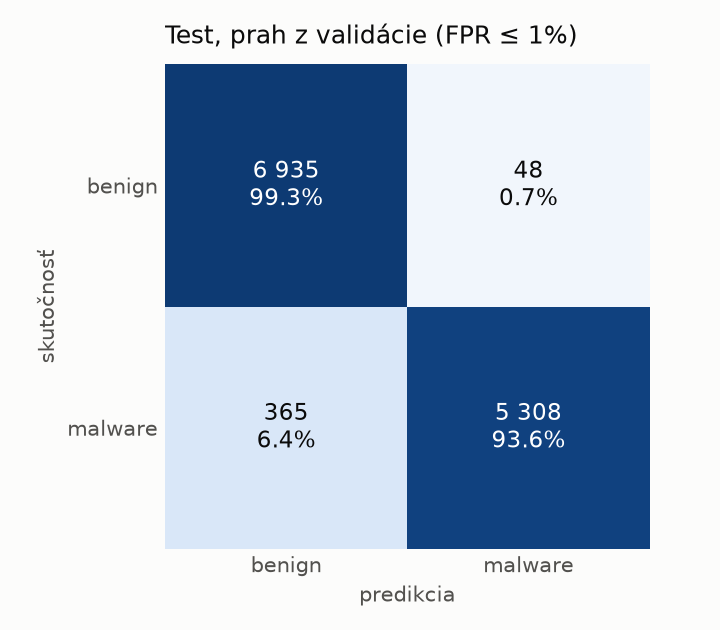
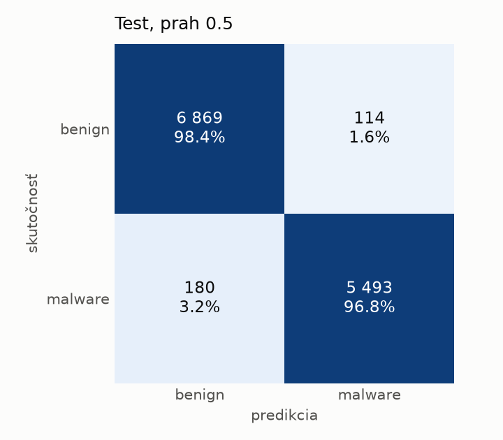
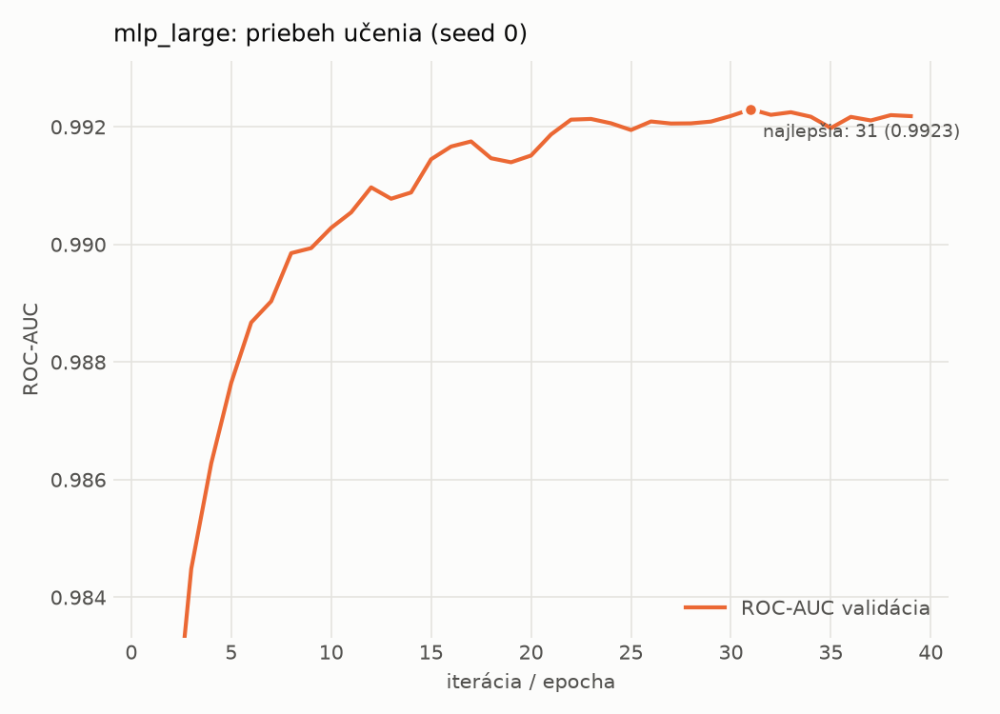

# hybrid/mlp_large – beh `20261123-215031`

> Automaticky generované (`src/training/run_tabular.py`). Konfigurácia: `config.yaml`, protokol: `protocol.yaml`.

- **Model:** `mlp` – veľká neurónová sieť (3–5 skrytých vrstiev, 512–2048 neurónov), kandidát na učiteľa
- **Ladenie:** bez ladenia – hyperparametre prevzaté z `runs_v4/emu_p/full/hybrid/mlp_large/20261123-200933`
- **Finálne modely:** seedy [0, 1, 2]; hodnoty sú priemer ± smerodajná odchýlka cez seedy
- **Najlepšie hyperparametre:** `{"max_epochs": 100, "patience": 8, "hidden_layers": 5, "hidden_width": 512, "width_decay": 0.5, "dropout": 0.18561035972653261, "lr": 0.00013117672209273214, "weight_decay": 3.948210593203141e-06, "batch_size": 512}`

## Detekčná kvalita (bez prahu)
| metrika | train (podvzorka) | validácia | test |
|---|---|---|---|
| ROC-AUC | 0.9982 ± 0.0003 | 0.9930 ± 0.0007 | 0.9941 ± 0.0001 |
| PR-AUC | 0.9983 ± 0.0003 | 0.9922 ± 0.0020 | 0.9939 ± 0.0006 |
| TPR pri FPR 1 % | 0.9896 ± 0.0014 | 0.9454 ± 0.0027 | 0.9477 ± 0.0030 |
| TPR pri FPR 0,1 % | 0.9675 ± 0.0055 | 0.7391 ± 0.0876 | 0.8112 ± 0.0194 |
| log loss | 0.0342 ± 0.0036 | 0.0903 ± 0.0017 | 0.0829 ± 0.0015 |
| Brier skóre | 0.0070 ± 0.0006 | 0.0220 ± 0.0006 | 0.0206 ± 0.0005 |

Rozdiel ROC-AUC train − validácia: **0.0052** (veľký rozdiel = preučenie).

## Pri prahu z validácie (FPR ≤ 1% na validácii)
| metrika | train (podvzorka) | validácia | test |
|---|---|---|---|
| accuracy | 0.9858 ± 0.0022 | 0.9710 ± 0.0012 | 0.9682 ± 0.0007 |
| balanced accuracy | 0.9834 ± 0.0026 | 0.9678 ± 0.0014 | 0.9654 ± 0.0008 |
| precision | 0.9986 ± 0.0001 | 0.9865 ± 0.0000 | 0.9907 ± 0.0005 |
| recall (TPR) | 0.9677 ± 0.0051 | 0.9454 ± 0.0027 | 0.9379 ± 0.0019 |
| FPR | 0.0010 ± 0.0001 | 0.0097 ± 0.0000 | 0.0072 ± 0.0004 |
| F1 | 0.9829 ± 0.0027 | 0.9655 ± 0.0014 | 0.9636 ± 0.0009 |
| MCC | 0.9712 ± 0.0045 | 0.9411 ± 0.0023 | 0.9365 ± 0.0014 |

## Pri pevnom prahu 0.5
| metrika | train (podvzorka) | validácia | test |
|---|---|---|---|
| accuracy | 0.9921 ± 0.0006 | 0.9739 ± 0.0012 | 0.9756 ± 0.0010 |
| balanced accuracy | 0.9912 ± 0.0007 | 0.9735 ± 0.0012 | 0.9748 ± 0.0011 |
| precision | 0.9955 ± 0.0004 | 0.9689 ± 0.0021 | 0.9788 ± 0.0014 |
| recall (TPR) | 0.9857 ± 0.0011 | 0.9704 ± 0.0009 | 0.9666 ± 0.0020 |
| FPR | 0.0032 ± 0.0003 | 0.0234 ± 0.0016 | 0.0170 ± 0.0011 |
| F1 | 0.9906 ± 0.0007 | 0.9697 ± 0.0014 | 0.9726 ± 0.0011 |
| MCC | 0.9838 ± 0.0012 | 0.9468 ± 0.0025 | 0.9507 ± 0.0020 |

## Výpočtové nároky (seed 0, testovacia množina)
| meranie | hodnota |
|---|---|
| tréning finálneho modelu | 11.8 s (priemer cez seedy) |
| ladenie spolu | 0 s |
| počet parametrov / uzlov | 323 521 |
| veľkosť modelu na disku | 1.32 MB |
| transformácia vstupu – latencia (1 vlákno) | 0.017 ms |
| transformácia vstupu – priepustnosť | 288 244 vzoriek/s |
| CPU latencia modelu (batch 1, 1 vlákno) | 0.163 ms (p95 0.211) |
| CPU priepustnosť (24 vlákien) | 747 138 vzoriek/s |
| GPU latencia (batch 1) | 0.593 ms (p95 1.360) |
| GPU priepustnosť | 1 138 457 vzoriek/s |
| GPU špičková pamäť | 180 MB |

## Grafy
| | |
|---|---|
|  |  |
|  |  |
|  |  |
|  |  |

## Súbory
`metrics.json` (všetky metriky po seedoch vrátane rodín), `timing.json`, `hpo_trials.csv`,
`predictions/<časť>_seed<N>.parquet` (sha256, family, label, score), `model/seed_<N>/`, `log.txt`.
