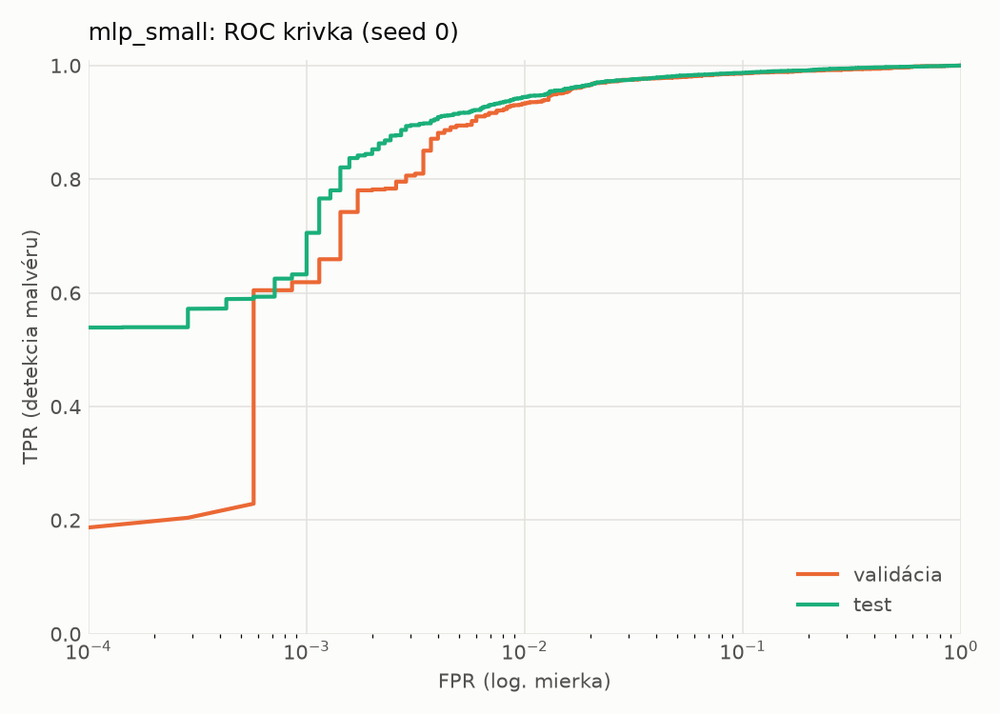
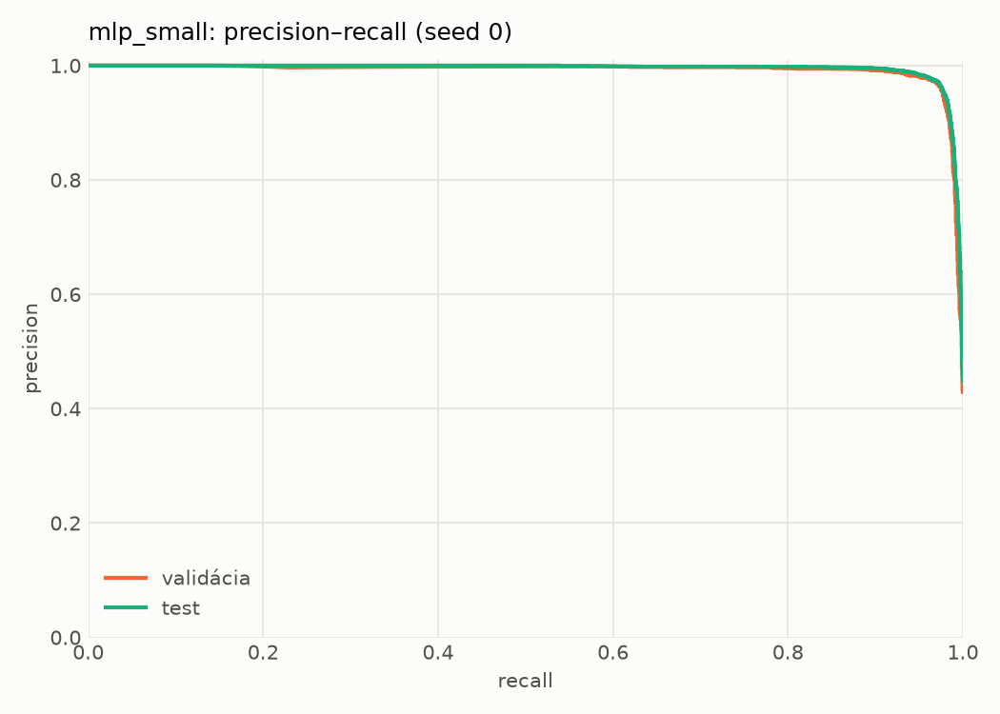
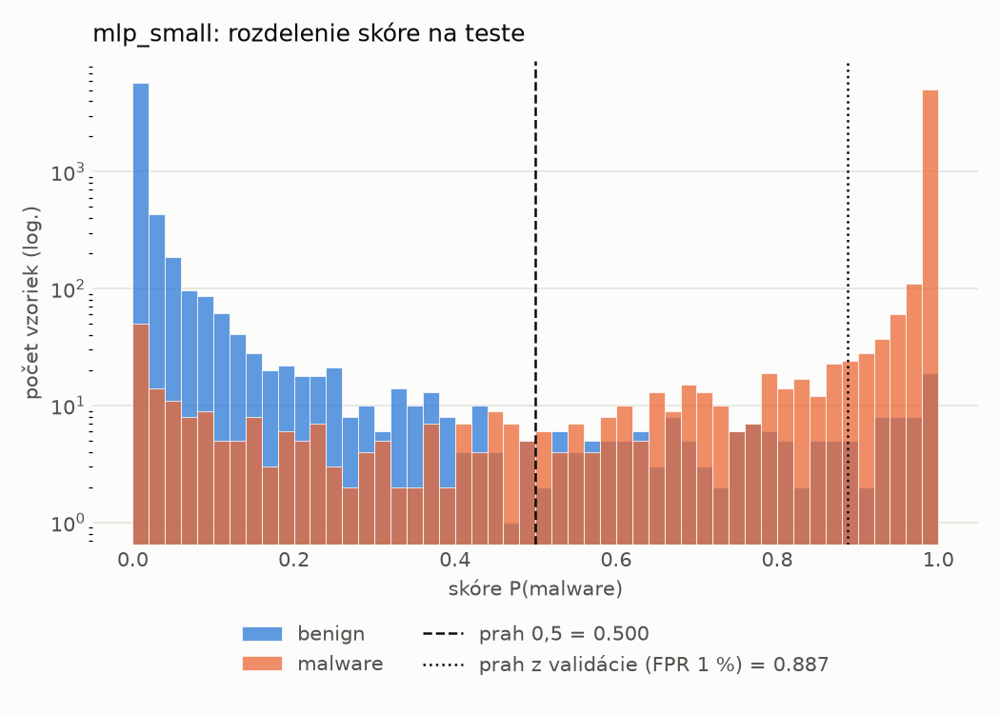
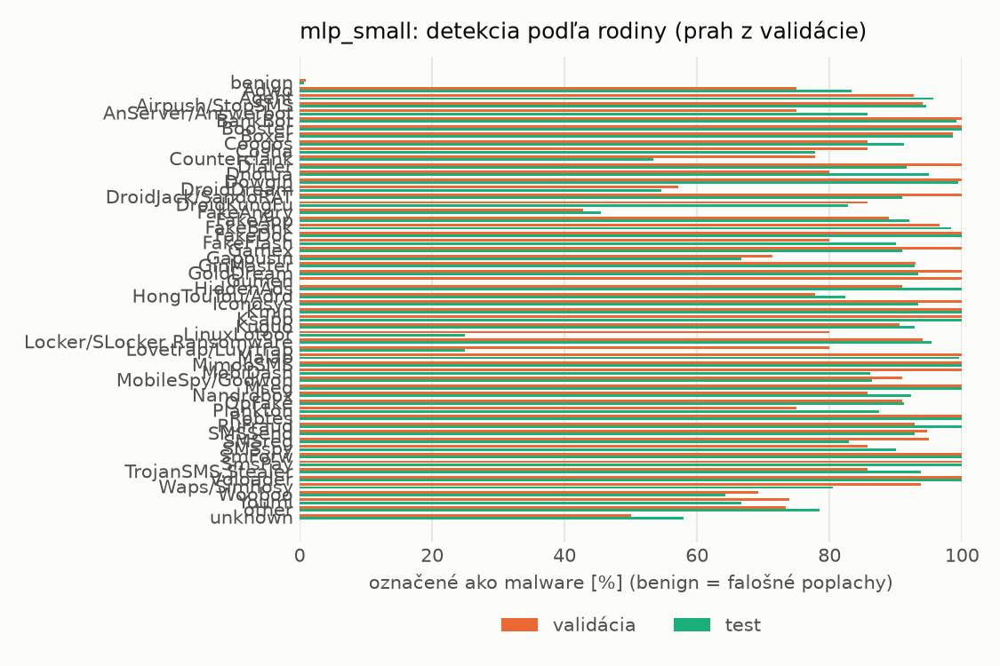
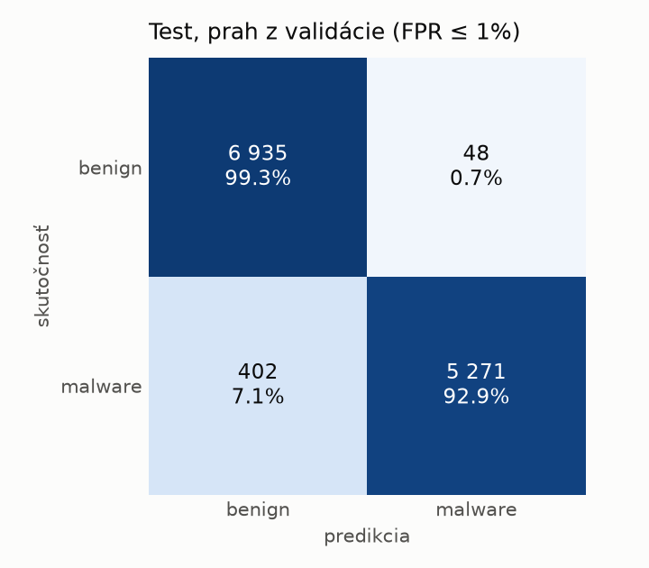
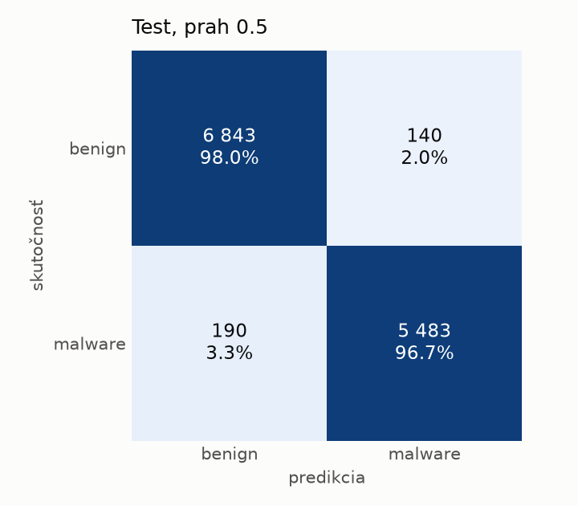
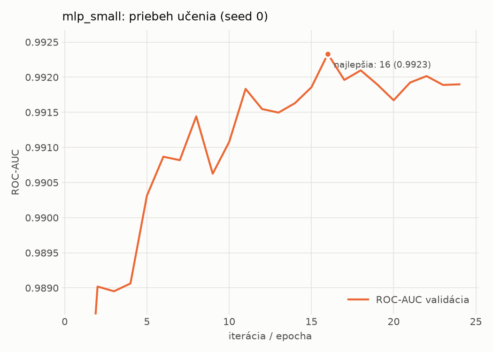

# hybrid/mlp_small – beh `20261123-215017`

> Automaticky generované (`src/training/run_tabular.py`). Konfigurácia: `config.yaml`, protokol: `protocol.yaml`.

- **Model:** `mlp` – malá neurónová sieť (1–2 skryté vrstvy), kandidát na ľahkého študenta
- **Ladenie:** bez ladenia – hyperparametre prevzaté z `runs_v4/emu_p/full/hybrid/mlp_small/20261123-200627`
- **Finálne modely:** seedy [0, 1, 2]; hodnoty sú priemer ± smerodajná odchýlka cez seedy
- **Najlepšie hyperparametre:** `{"width_decay": 0.5, "max_epochs": 100, "patience": 8, "hidden_layers": 2, "hidden_width": 256, "dropout": 0.2736594475747717, "lr": 0.0019631646658614973, "weight_decay": 0.0007425190310675283, "batch_size": 512}`

## Detekčná kvalita (bez prahu)
| metrika | train (podvzorka) | validácia | test |
|---|---|---|---|
| ROC-AUC | 0.9984 ± 0.0002 | 0.9925 ± 0.0003 | 0.9939 ± 0.0003 |
| PR-AUC | 0.9983 ± 0.0002 | 0.9918 ± 0.0004 | 0.9939 ± 0.0004 |
| TPR pri FPR 1 % | 0.9846 ± 0.0013 | 0.9288 ± 0.0036 | 0.9452 ± 0.0037 |
| TPR pri FPR 0,1 % | 0.9575 ± 0.0054 | 0.6157 ± 0.0550 | 0.7210 ± 0.0819 |
| log loss | 0.0376 ± 0.0024 | 0.1032 ± 0.0039 | 0.0885 ± 0.0038 |
| Brier skóre | 0.0094 ± 0.0006 | 0.0226 ± 0.0006 | 0.0207 ± 0.0003 |

Rozdiel ROC-AUC train − validácia: **0.0059** (veľký rozdiel = preučenie).

## Pri prahu z validácie (FPR ≤ 1% na validácii)
| metrika | train (podvzorka) | validácia | test |
|---|---|---|---|
| accuracy | 0.9774 ± 0.0018 | 0.9639 ± 0.0015 | 0.9623 ± 0.0023 |
| balanced accuracy | 0.9733 ± 0.0022 | 0.9595 ± 0.0018 | 0.9587 ± 0.0026 |
| precision | 0.9992 ± 0.0006 | 0.9862 ± 0.0001 | 0.9913 ± 0.0006 |
| recall (TPR) | 0.9472 ± 0.0048 | 0.9288 ± 0.0036 | 0.9239 ± 0.0051 |
| FPR | 0.0006 ± 0.0004 | 0.0097 ± 0.0000 | 0.0066 ± 0.0005 |
| F1 | 0.9725 ± 0.0023 | 0.9567 ± 0.0019 | 0.9564 ± 0.0028 |
| MCC | 0.9544 ± 0.0036 | 0.9270 ± 0.0031 | 0.9250 ± 0.0045 |

## Pri pevnom prahu 0.5
| metrika | train (podvzorka) | validácia | test |
|---|---|---|---|
| accuracy | 0.9887 ± 0.0010 | 0.9727 ± 0.0012 | 0.9747 ± 0.0007 |
| balanced accuracy | 0.9877 ± 0.0009 | 0.9722 ± 0.0012 | 0.9740 ± 0.0007 |
| precision | 0.9919 ± 0.0017 | 0.9682 ± 0.0018 | 0.9762 ± 0.0012 |
| recall (TPR) | 0.9812 ± 0.0007 | 0.9682 ± 0.0014 | 0.9672 ± 0.0013 |
| FPR | 0.0058 ± 0.0012 | 0.0239 ± 0.0014 | 0.0191 ± 0.0010 |
| F1 | 0.9865 ± 0.0011 | 0.9682 ± 0.0014 | 0.9717 ± 0.0008 |
| MCC | 0.9768 ± 0.0020 | 0.9443 ± 0.0025 | 0.9489 ± 0.0014 |

## Výpočtové nároky (seed 0, testovacia množina)
| meranie | hodnota |
|---|---|
| tréning finálneho modelu | 3.9 s (priemer cez seedy) |
| ladenie spolu | 0 s |
| počet parametrov / uzlov | 107 265 |
| veľkosť modelu na disku | 0.45 MB |
| transformácia vstupu – latencia (1 vlákno) | 0.007 ms |
| transformácia vstupu – priepustnosť | 468 682 vzoriek/s |
| CPU latencia modelu (batch 1, 1 vlákno) | 0.082 ms (p95 0.233) |
| CPU priepustnosť (24 vlákien) | 1 339 458 vzoriek/s |
| GPU latencia (batch 1) | 0.658 ms (p95 0.731) |
| GPU priepustnosť | 819 403 vzoriek/s |
| GPU špičková pamäť | 105 MB |

## Grafy
| | |
|---|---|
|  |  |
|  |  |
|  |  |
|  |  |

## Súbory
`metrics.json` (všetky metriky po seedoch vrátane rodín), `timing.json`, `hpo_trials.csv`,
`predictions/<časť>_seed<N>.parquet` (sha256, family, label, score), `model/seed_<N>/`, `log.txt`.
