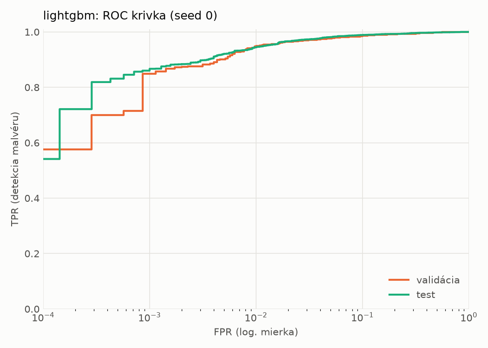
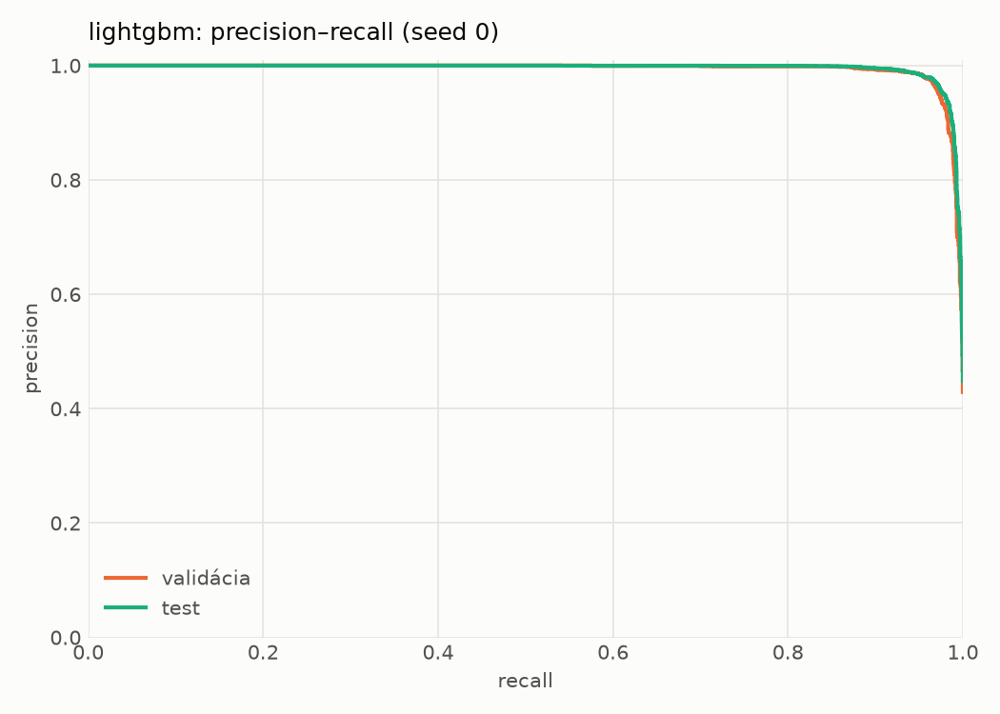
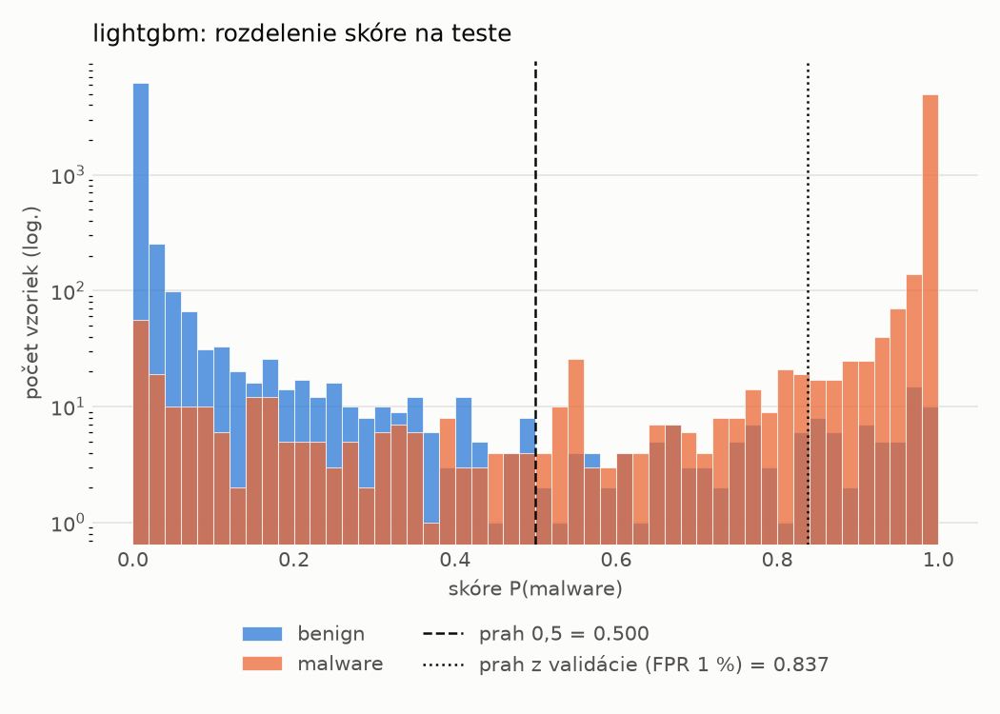
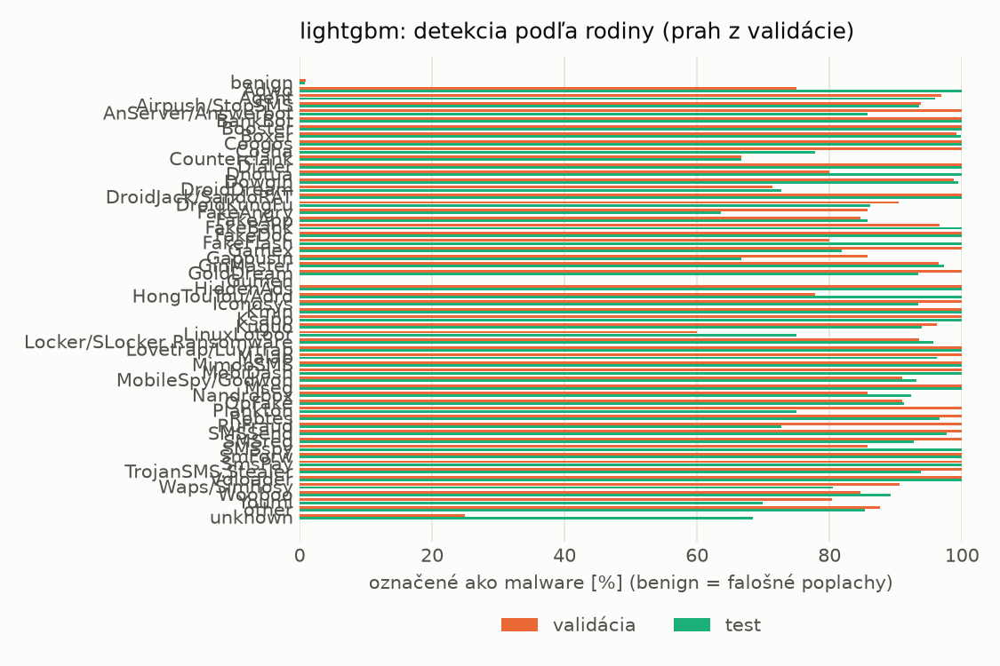
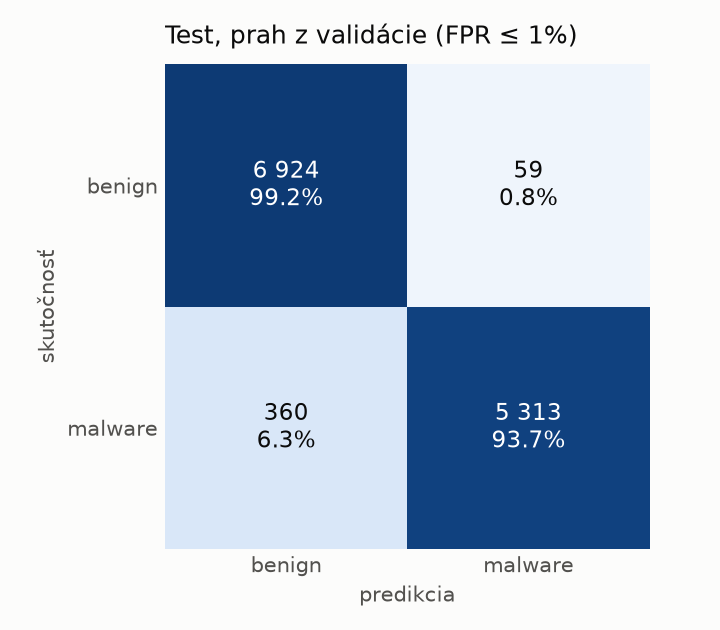
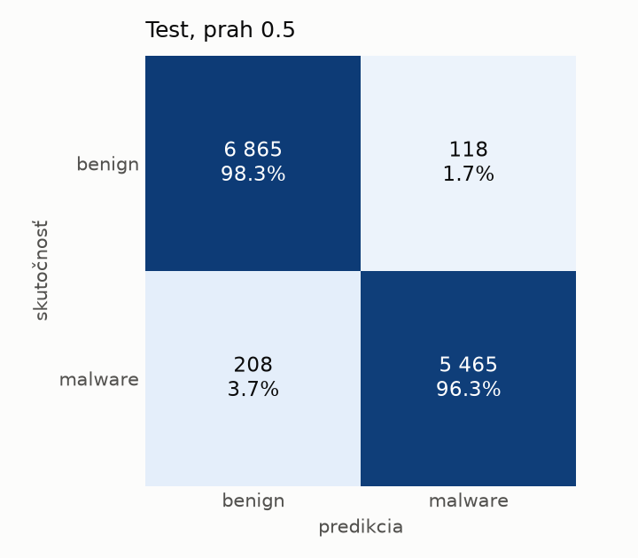
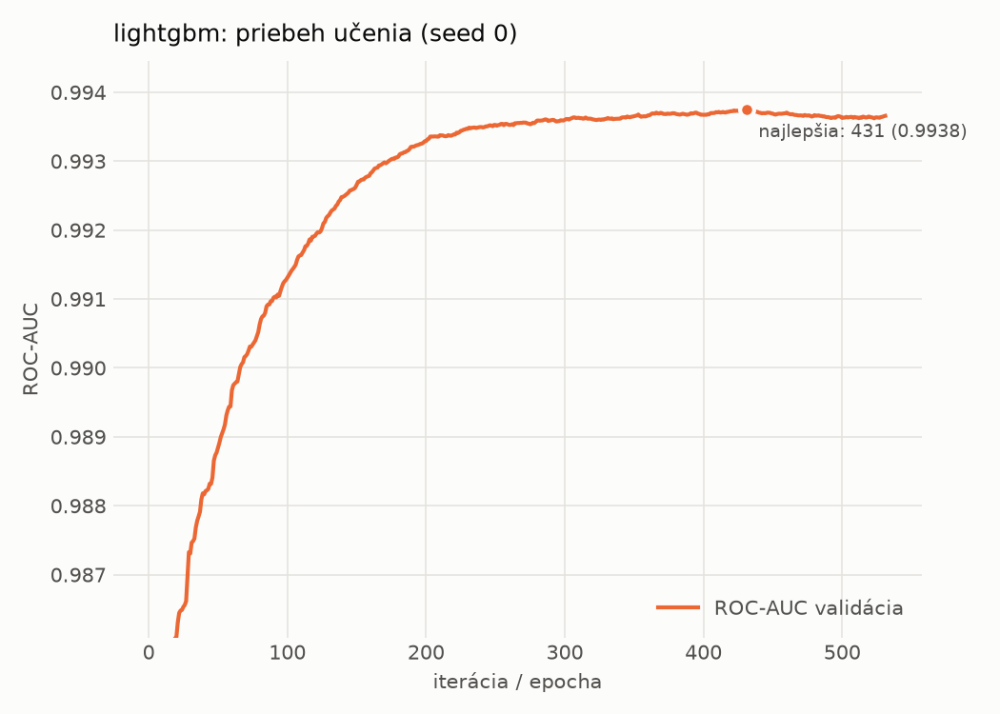

# static/lightgbm – beh `20261123-184203`

> Automaticky generované (`src/training/run_tabular.py`). Konfigurácia: `config.yaml`, protokol: `protocol.yaml`.

- **Model:** `lightgbm` – LightGBM, gradient boosting stromov s early stopping na validácii (pôvodné hodnoty príznakov)
- **Ladenie:** bez ladenia – hyperparametre prevzaté z `runs_v4/real_p/full/static/lightgbm/20261122-231010`
- **Finálne modely:** seedy [0, 1, 2]; hodnoty sú priemer ± smerodajná odchýlka cez seedy
- **Najlepšie hyperparametre:** `{"num_boost_round": 5000, "early_stopping_rounds": 100, "learning_rate": 0.03701536655085927, "num_leaves": 240, "min_child_samples": 18, "feature_fraction": 0.860319963795015, "bagging_fraction": 0.9949001098214416, "lambda_l1": 1.0205843882460235e-07, "lambda_l2": 0.00015478320101473535}`

## Detekčná kvalita (bez prahu)
| metrika | train (podvzorka) | validácia | test |
|---|---|---|---|
| ROC-AUC | 1.0000 ± 0.0000 | 0.9940 ± 0.0002 | 0.9949 ± 0.0001 |
| PR-AUC | 1.0000 ± 0.0000 | 0.9937 ± 0.0002 | 0.9950 ± 0.0001 |
| TPR pri FPR 1 % | 1.0000 ± 0.0000 | 0.9476 ± 0.0026 | 0.9451 ± 0.0010 |
| TPR pri FPR 0,1 % | 0.9999 ± 0.0001 | 0.8392 ± 0.0094 | 0.8626 ± 0.0021 |
| log loss | 0.0032 ± 0.0027 | 0.1052 ± 0.0098 | 0.0941 ± 0.0089 |
| Brier skóre | 0.0004 ± 0.0002 | 0.0228 ± 0.0002 | 0.0218 ± 0.0005 |

Rozdiel ROC-AUC train − validácia: **0.0060** (veľký rozdiel = preučenie).

## Pri prahu z validácie (FPR ≤ 1% na validácii)
| metrika | train (podvzorka) | validácia | test |
|---|---|---|---|
| accuracy | 0.9986 ± 0.0013 | 0.9720 ± 0.0011 | 0.9674 ± 0.0009 |
| balanced accuracy | 0.9983 ± 0.0015 | 0.9689 ± 0.0013 | 0.9645 ± 0.0011 |
| precision | 1.0000 ± 0.0000 | 0.9865 ± 0.0000 | 0.9902 ± 0.0018 |
| recall (TPR) | 0.9967 ± 0.0031 | 0.9476 ± 0.0026 | 0.9366 ± 0.0033 |
| FPR | 0.0000 ± 0.0000 | 0.0097 ± 0.0000 | 0.0075 ± 0.0014 |
| F1 | 0.9983 ± 0.0016 | 0.9667 ± 0.0014 | 0.9626 ± 0.0011 |
| MCC | 0.9971 ± 0.0027 | 0.9431 ± 0.0022 | 0.9349 ± 0.0017 |

## Pri pevnom prahu 0.5
| metrika | train (podvzorka) | validácia | test |
|---|---|---|---|
| accuracy | 0.9995 ± 0.0001 | 0.9727 ± 0.0006 | 0.9741 ± 0.0002 |
| balanced accuracy | 0.9995 ± 0.0001 | 0.9716 ± 0.0005 | 0.9730 ± 0.0003 |
| precision | 0.9991 ± 0.0000 | 0.9722 ± 0.0018 | 0.9795 ± 0.0007 |
| recall (TPR) | 0.9998 ± 0.0002 | 0.9639 ± 0.0010 | 0.9623 ± 0.0009 |
| FPR | 0.0007 ± 0.0000 | 0.0207 ± 0.0014 | 0.0163 ± 0.0006 |
| F1 | 0.9994 ± 0.0001 | 0.9680 ± 0.0007 | 0.9709 ± 0.0003 |
| MCC | 0.9990 ± 0.0002 | 0.9442 ± 0.0012 | 0.9477 ± 0.0005 |

## Výpočtové nároky (seed 0, testovacia množina)
| meranie | hodnota |
|---|---|
| tréning finálneho modelu | 7.6 s (priemer cez seedy) |
| ladenie spolu | 0 s |
| počet parametrov / uzlov | 206 449 |
| veľkosť modelu na disku | 11.47 MB |
| CPU latencia modelu (batch 1, 1 vlákno) | 0.081 ms (p95 0.098) |
| CPU priepustnosť (24 vlákien) | 159 528 vzoriek/s |

## Grafy
| | |
|---|---|
|  |  |
|  |  |
|  |  |
|  |  |

## Súbory
`metrics.json` (všetky metriky po seedoch vrátane rodín), `timing.json`, `hpo_trials.csv`,
`predictions/<časť>_seed<N>.parquet` (sha256, family, label, score), `model/seed_<N>/`, `log.txt`.
