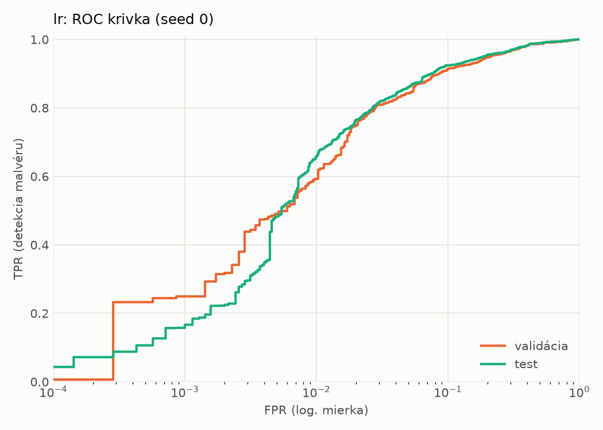
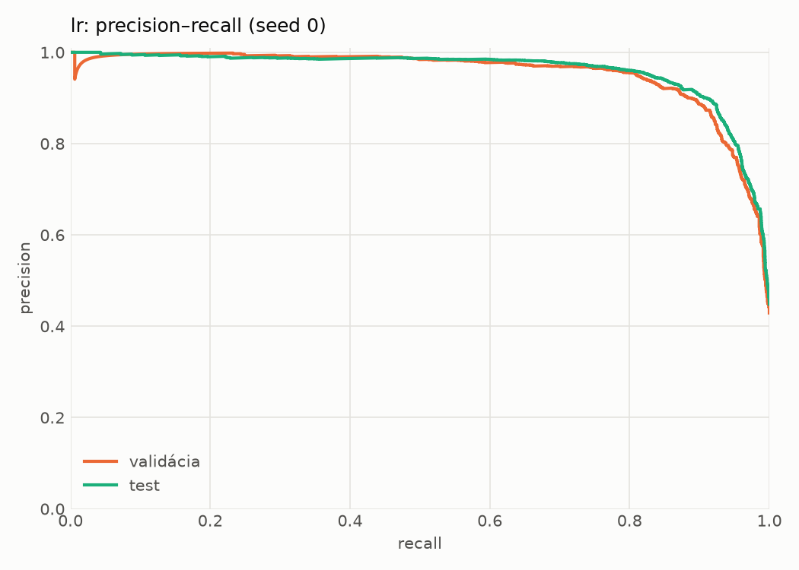
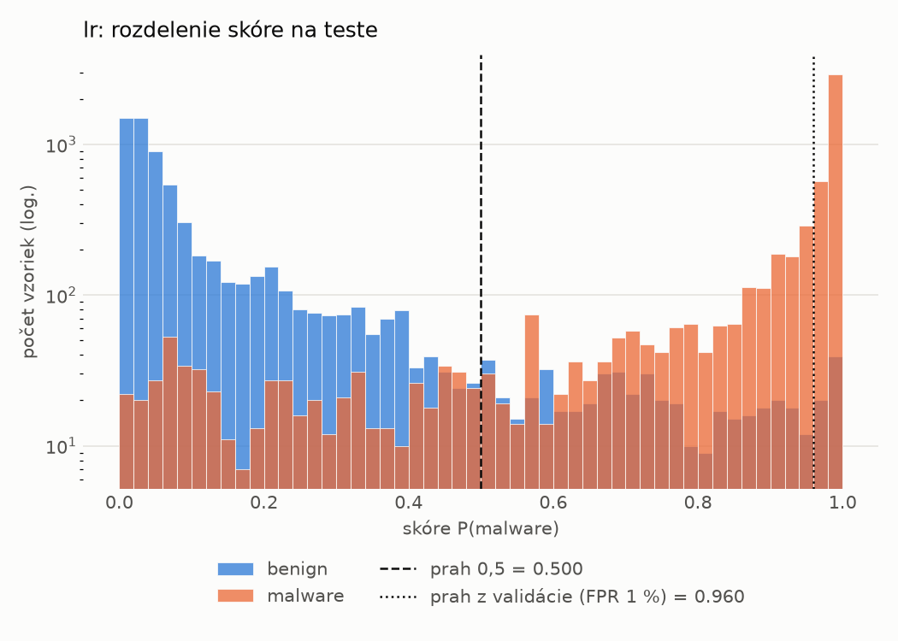
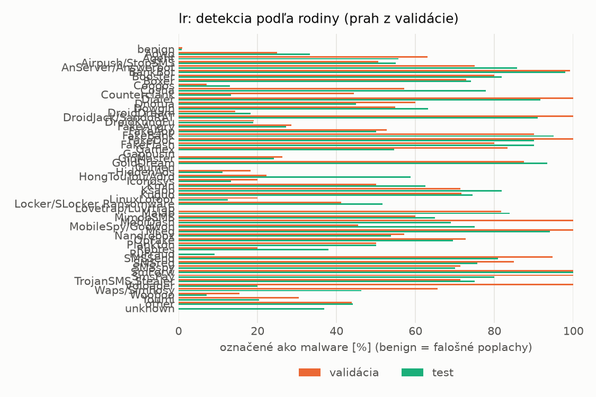
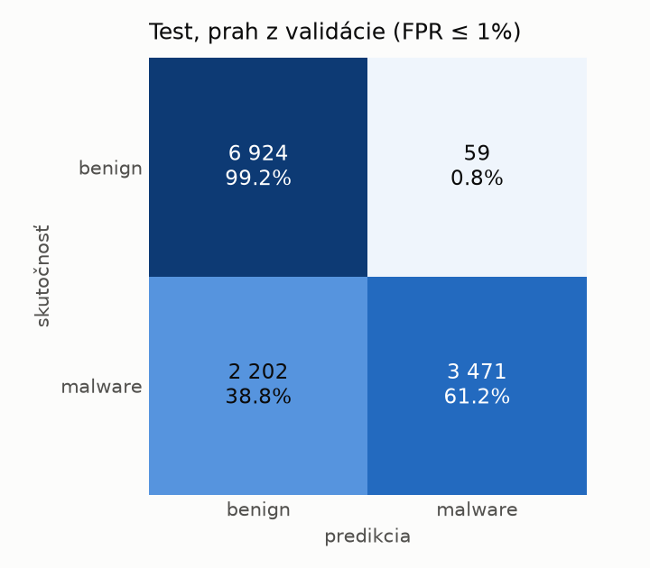
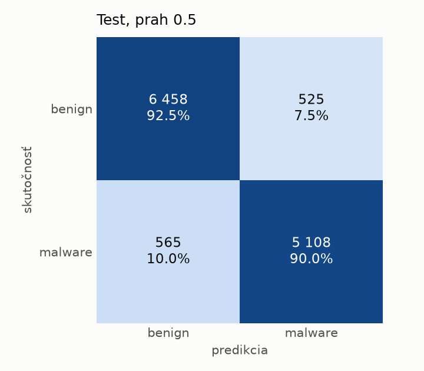

# static/lr – beh `20261123-184147`

> Automaticky generované (`src/training/run_tabular.py`). Konfigurácia: `config.yaml`, protokol: `protocol.yaml`.

- **Model:** `logreg` – logistická regresia s L2 regularizáciou (vstup signed log1p + štandardizácia)
- **Ladenie:** bez ladenia – hyperparametre prevzaté z `runs_v4/real_p/full/static/lr/20261122-230905`
- **Finálne modely:** seedy [0, 1, 2]; hodnoty sú priemer ± smerodajná odchýlka cez seedy
- **Najlepšie hyperparametre:** `{"max_iter": 2000, "C": 5.669849511478847}`

## Detekčná kvalita (bez prahu)
| metrika | train (podvzorka) | validácia | test |
|---|---|---|---|
| ROC-AUC | 0.9656 ± 0.0000 | 0.9617 ± 0.0000 | 0.9649 ± 0.0000 |
| PR-AUC | 0.9590 ± 0.0000 | 0.9547 ± 0.0000 | 0.9602 ± 0.0000 |
| TPR pri FPR 1 % | 0.6505 ± 0.0000 | 0.5925 ± 0.0000 | 0.6557 ± 0.0000 |
| TPR pri FPR 0,1 % | 0.2492 ± 0.0000 | 0.2490 ± 0.0000 | 0.1576 ± 0.0000 |
| log loss | 0.2310 ± 0.0000 | 0.2459 ± 0.0000 | 0.2358 ± 0.0000 |
| Brier skóre | 0.0660 ± 0.0000 | 0.0702 ± 0.0000 | 0.0669 ± 0.0000 |

Rozdiel ROC-AUC train − validácia: **0.0039** (veľký rozdiel = preučenie).

## Pri prahu z validácie (FPR ≤ 1% na validácii)
| metrika | train (podvzorka) | validácia | test |
|---|---|---|---|
| accuracy | 0.8273 ± 0.0000 | 0.8195 ± 0.0000 | 0.8213 ± 0.0000 |
| balanced accuracy | 0.7962 ± 0.0000 | 0.7914 ± 0.0000 | 0.8017 ± 0.0000 |
| precision | 0.9840 ± 0.0000 | 0.9786 ± 0.0000 | 0.9833 ± 0.0000 |
| recall (TPR) | 0.5994 ± 0.0000 | 0.5925 ± 0.0000 | 0.6118 ± 0.0000 |
| FPR | 0.0071 ± 0.0000 | 0.0097 ± 0.0000 | 0.0084 ± 0.0000 |
| F1 | 0.7450 ± 0.0000 | 0.7381 ± 0.0000 | 0.7543 ± 0.0000 |
| MCC | 0.6698 ± 0.0000 | 0.6577 ± 0.0000 | 0.6691 ± 0.0000 |

## Pri pevnom prahu 0.5
| metrika | train (podvzorka) | validácia | test |
|---|---|---|---|
| accuracy | 0.9148 ± 0.0000 | 0.9098 ± 0.0000 | 0.9139 ± 0.0000 |
| balanced accuracy | 0.9128 ± 0.0000 | 0.9075 ± 0.0000 | 0.9126 ± 0.0000 |
| precision | 0.8977 ± 0.0000 | 0.8982 ± 0.0000 | 0.9068 ± 0.0000 |
| recall (TPR) | 0.9002 ± 0.0000 | 0.8910 ± 0.0000 | 0.9004 ± 0.0000 |
| FPR | 0.0746 ± 0.0000 | 0.0760 ± 0.0000 | 0.0752 ± 0.0000 |
| F1 | 0.8989 ± 0.0000 | 0.8945 ± 0.0000 | 0.9036 ± 0.0000 |
| MCC | 0.8253 ± 0.0000 | 0.8158 ± 0.0000 | 0.8258 ± 0.0000 |

## Výpočtové nároky (seed 0, testovacia množina)
| meranie | hodnota |
|---|---|
| tréning finálneho modelu | 0.1 s (priemer cez seedy) |
| ladenie spolu | 0 s |
| počet parametrov / uzlov | 164 |
| veľkosť modelu na disku | 0.01 MB |
| transformácia vstupu – latencia (1 vlákno) | 0.005 ms |
| transformácia vstupu – priepustnosť | 1 096 527 vzoriek/s |
| CPU latencia modelu (batch 1, 1 vlákno) | 0.004 ms (p95 0.004) |
| CPU priepustnosť (24 vlákien) | 3 389 939 vzoriek/s |

## Grafy
| | |
|---|---|
|  |  |
|  |  |
|  |  |
|  |  |

## Súbory
`metrics.json` (všetky metriky po seedoch vrátane rodín), `timing.json`, `hpo_trials.csv`,
`predictions/<časť>_seed<N>.parquet` (sha256, family, label, score), `model/seed_<N>/`, `log.txt`.
