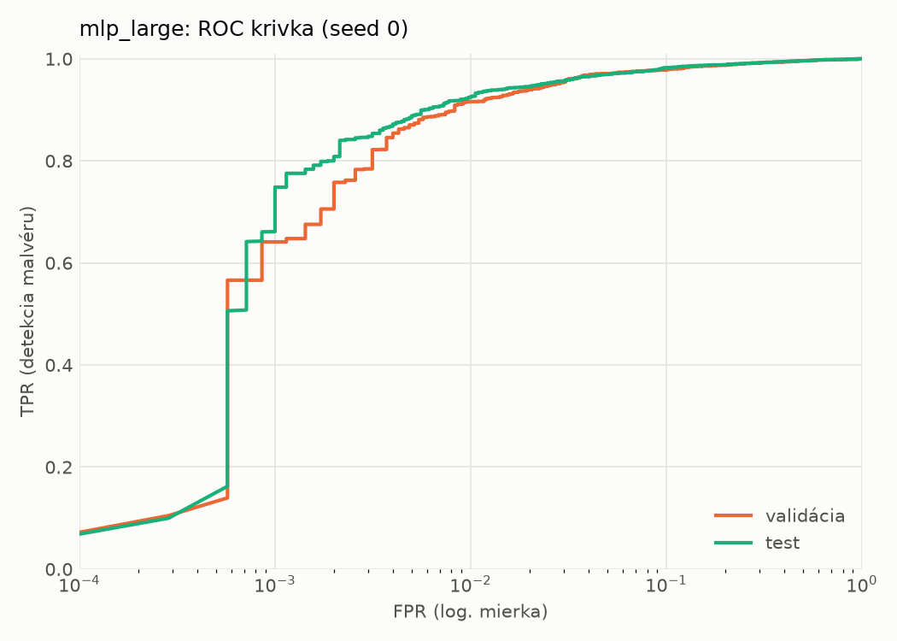
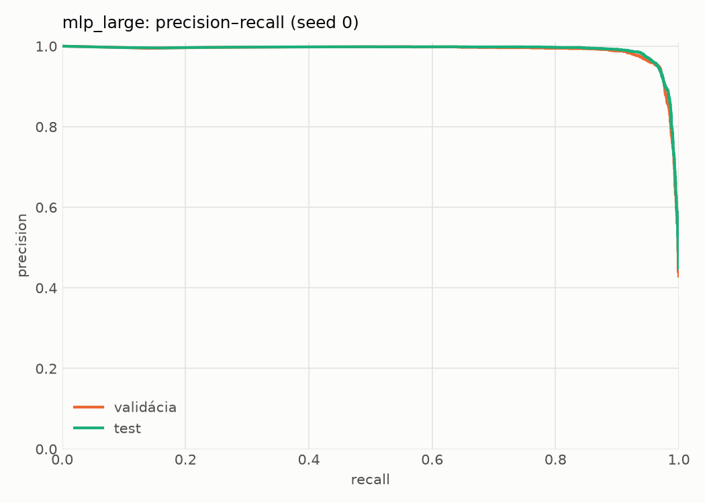
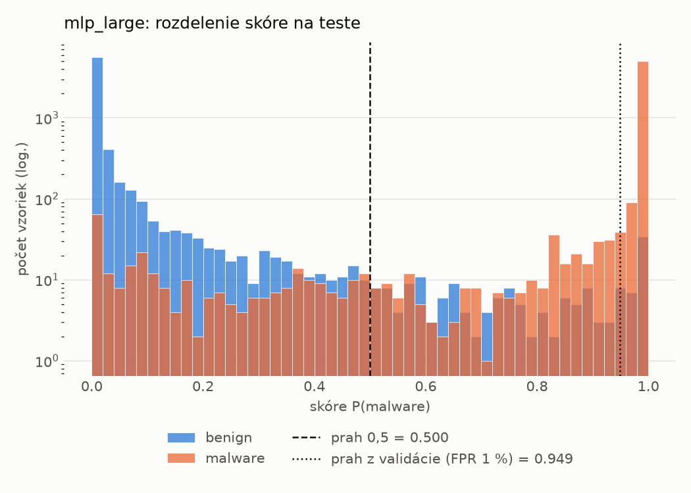
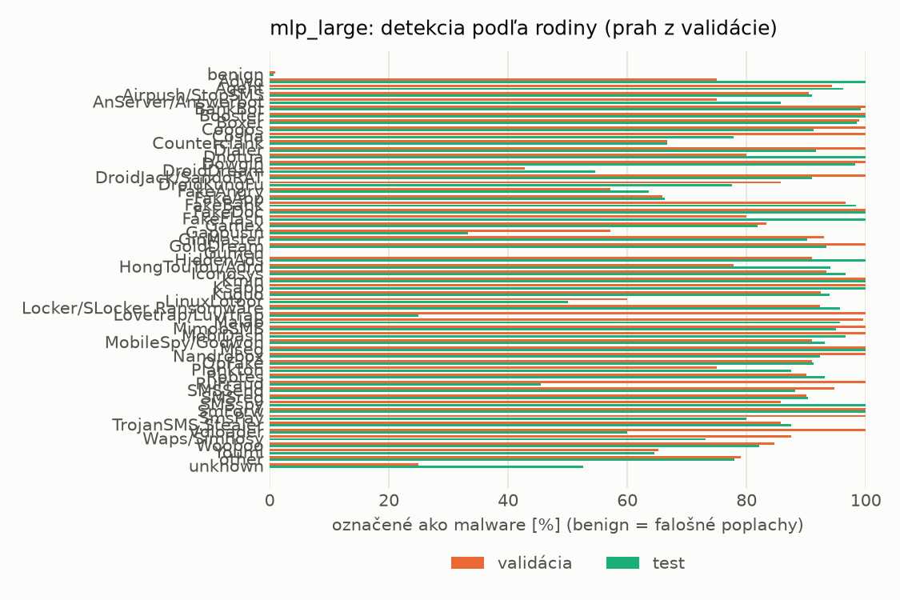
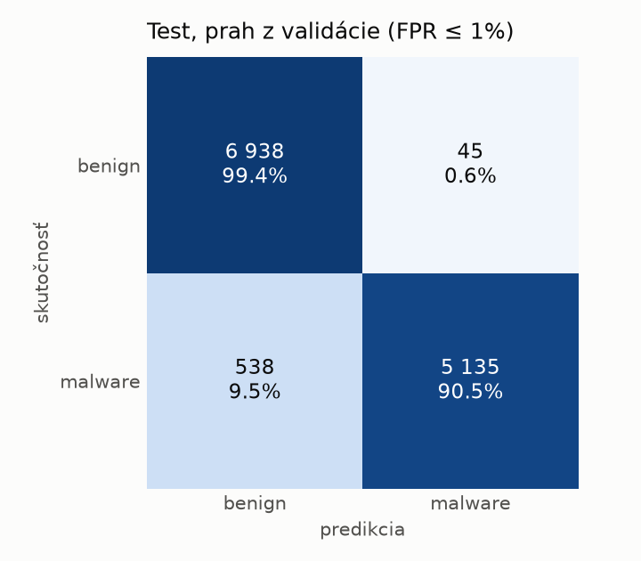
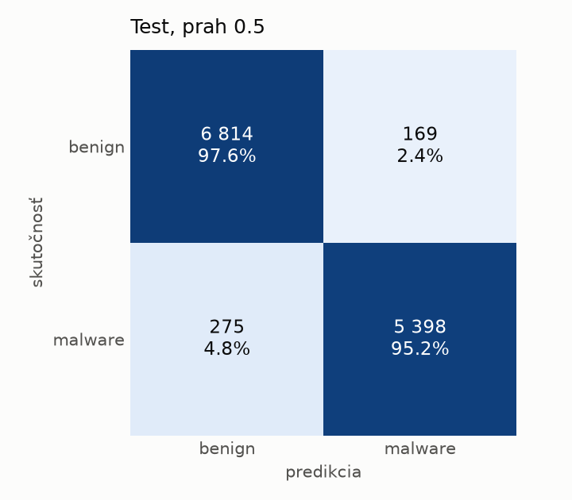
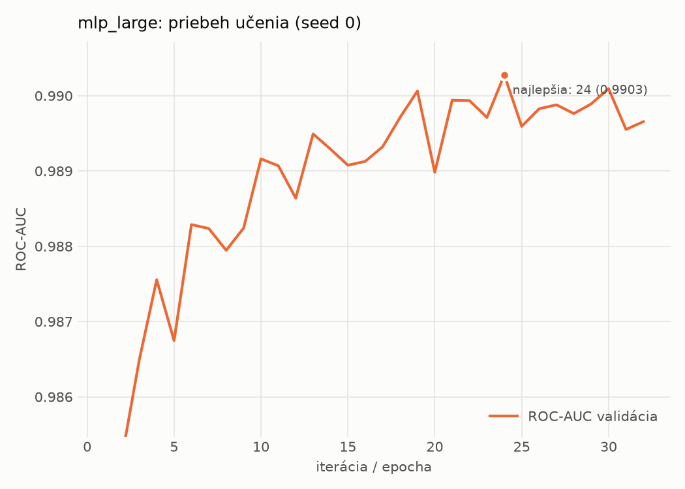

# static/mlp_large – beh `20261123-184304`

> Automaticky generované (`src/training/run_tabular.py`). Konfigurácia: `config.yaml`, protokol: `protocol.yaml`.

- **Model:** `mlp` – veľká neurónová sieť (3–5 skrytých vrstiev, 512–2048 neurónov), kandidát na učiteľa
- **Ladenie:** bez ladenia – hyperparametre prevzaté z `runs_v4/real_p/full/static/mlp_large/20261122-232356`
- **Finálne modely:** seedy [0, 1, 2]; hodnoty sú priemer ± smerodajná odchýlka cez seedy
- **Najlepšie hyperparametre:** `{"max_epochs": 100, "patience": 8, "hidden_layers": 3, "hidden_width": 2048, "width_decay": 0.5, "dropout": 0.24592095800405475, "lr": 0.0002046278772560144, "weight_decay": 0.007038560648637635, "batch_size": 256}`

## Detekčná kvalita (bez prahu)
| metrika | train (podvzorka) | validácia | test |
|---|---|---|---|
| ROC-AUC | 0.9976 ± 0.0006 | 0.9902 ± 0.0002 | 0.9904 ± 0.0007 |
| PR-AUC | 0.9973 ± 0.0007 | 0.9889 ± 0.0004 | 0.9898 ± 0.0004 |
| TPR pri FPR 1 % | 0.9698 ± 0.0053 | 0.9023 ± 0.0133 | 0.9166 ± 0.0098 |
| TPR pri FPR 0,1 % | 0.9154 ± 0.0137 | 0.5921 ± 0.0570 | 0.6622 ± 0.0315 |
| log loss | 0.0535 ± 0.0069 | 0.1238 ± 0.0031 | 0.1173 ± 0.0017 |
| Brier skóre | 0.0142 ± 0.0019 | 0.0295 ± 0.0009 | 0.0283 ± 0.0011 |

Rozdiel ROC-AUC train − validácia: **0.0073** (veľký rozdiel = preučenie).

## Pri prahu z validácie (FPR ≤ 1% na validácii)
| metrika | train (podvzorka) | validácia | test |
|---|---|---|---|
| accuracy | 0.9645 ± 0.0061 | 0.9526 ± 0.0058 | 0.9486 ± 0.0057 |
| balanced accuracy | 0.9580 ± 0.0072 | 0.9464 ± 0.0067 | 0.9433 ± 0.0064 |
| precision | 0.9981 ± 0.0006 | 0.9861 ± 0.0004 | 0.9921 ± 0.0008 |
| recall (TPR) | 0.9173 ± 0.0147 | 0.9023 ± 0.0133 | 0.8925 ± 0.0135 |
| FPR | 0.0013 ± 0.0004 | 0.0096 ± 0.0002 | 0.0058 ± 0.0006 |
| F1 | 0.9560 ± 0.0079 | 0.9423 ± 0.0075 | 0.9396 ± 0.0071 |
| MCC | 0.9286 ± 0.0119 | 0.9048 ± 0.0114 | 0.8990 ± 0.0107 |

## Pri pevnom prahu 0.5
| metrika | train (podvzorka) | validácia | test |
|---|---|---|---|
| accuracy | 0.9816 ± 0.0022 | 0.9628 ± 0.0015 | 0.9640 ± 0.0009 |
| balanced accuracy | 0.9800 ± 0.0027 | 0.9617 ± 0.0019 | 0.9626 ± 0.0011 |
| precision | 0.9861 ± 0.0013 | 0.9591 ± 0.0022 | 0.9697 ± 0.0022 |
| recall (TPR) | 0.9699 ± 0.0058 | 0.9540 ± 0.0051 | 0.9493 ± 0.0036 |
| FPR | 0.0100 ± 0.0010 | 0.0306 ± 0.0019 | 0.0241 ± 0.0019 |
| F1 | 0.9779 ± 0.0027 | 0.9565 ± 0.0019 | 0.9594 ± 0.0011 |
| MCC | 0.9622 ± 0.0045 | 0.9241 ± 0.0030 | 0.9272 ± 0.0017 |

## Výpočtové nároky (seed 0, testovacia množina)
| meranie | hodnota |
|---|---|
| tréning finálneho modelu | 10.5 s (priemer cez seedy) |
| ladenie spolu | 0 s |
| počet parametrov / uzlov | 2 966 529 |
| veľkosť modelu na disku | 11.91 MB |
| transformácia vstupu – latencia (1 vlákno) | 0.015 ms |
| transformácia vstupu – priepustnosť | 746 103 vzoriek/s |
| CPU latencia modelu (batch 1, 1 vlákno) | 0.317 ms (p95 0.670) |
| CPU priepustnosť (24 vlákien) | 101 865 vzoriek/s |
| GPU latencia (batch 1) | 0.523 ms (p95 0.551) |
| GPU priepustnosť | 788 060 vzoriek/s |
| GPU špičková pamäť | 247 MB |

## Grafy
| | |
|---|---|
|  |  |
|  |  |
|  |  |
|  |  |

## Súbory
`metrics.json` (všetky metriky po seedoch vrátane rodín), `timing.json`, `hpo_trials.csv`,
`predictions/<časť>_seed<N>.parquet` (sha256, family, label, score), `model/seed_<N>/`, `log.txt`.
