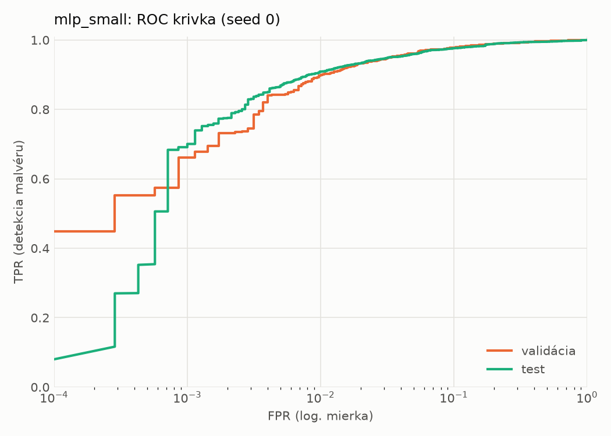
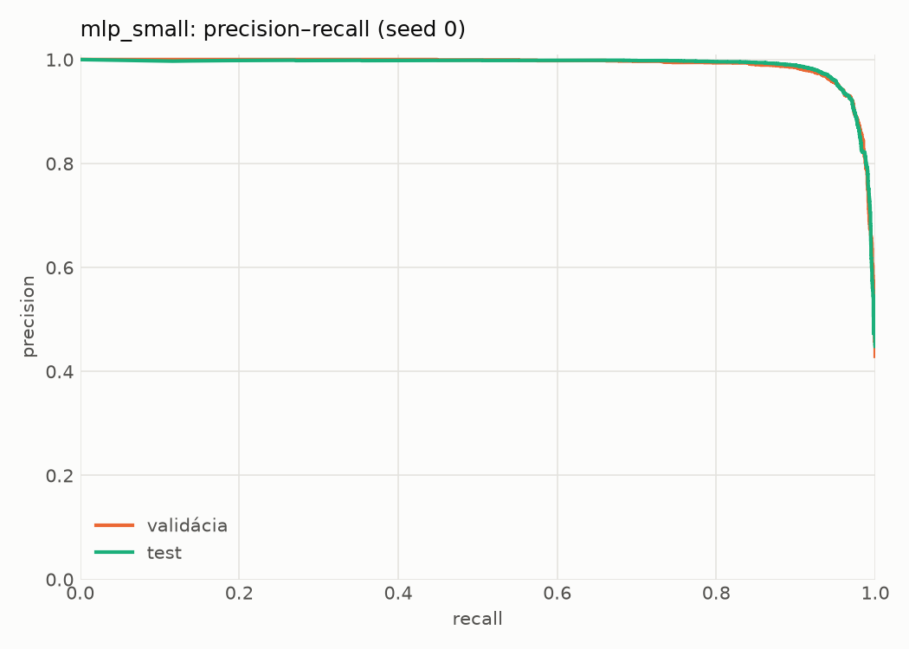
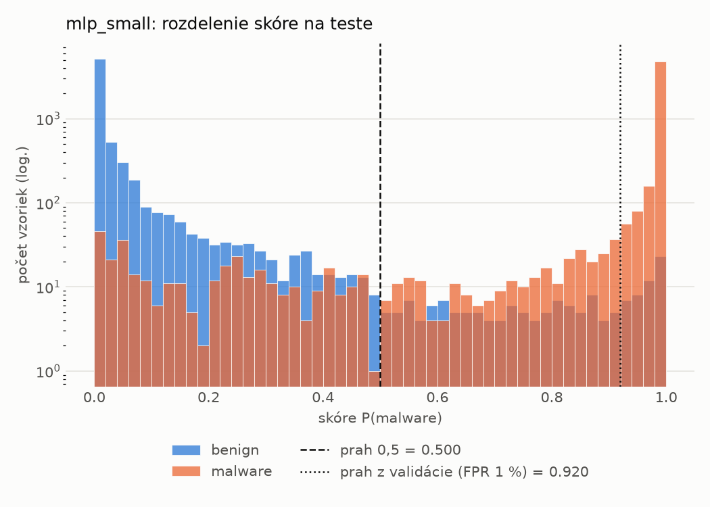
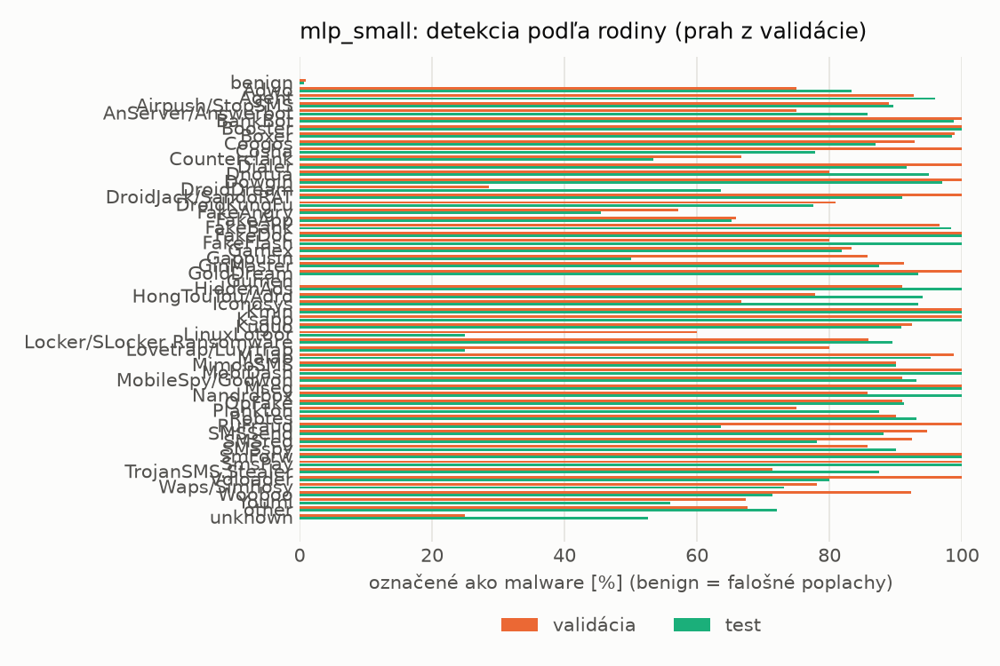
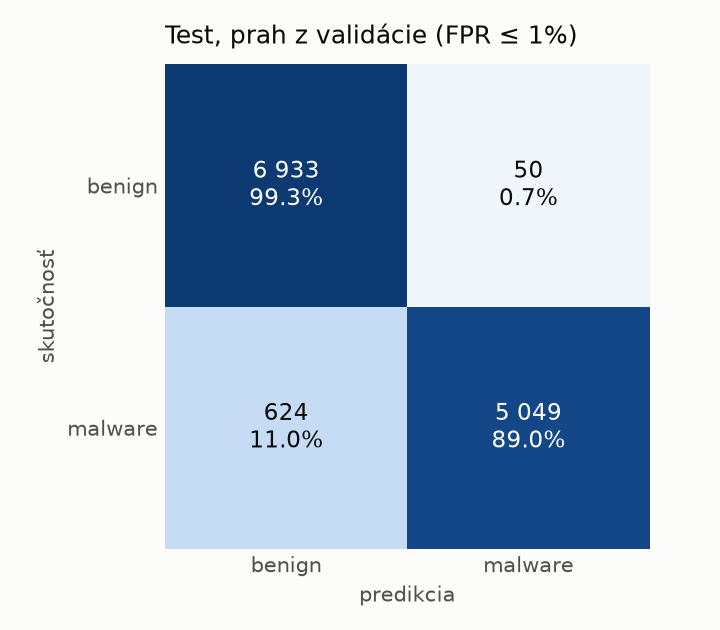
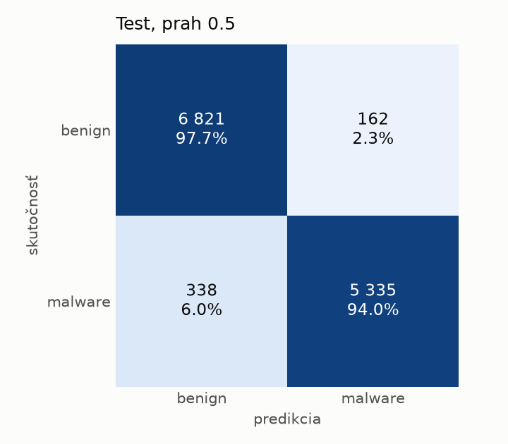
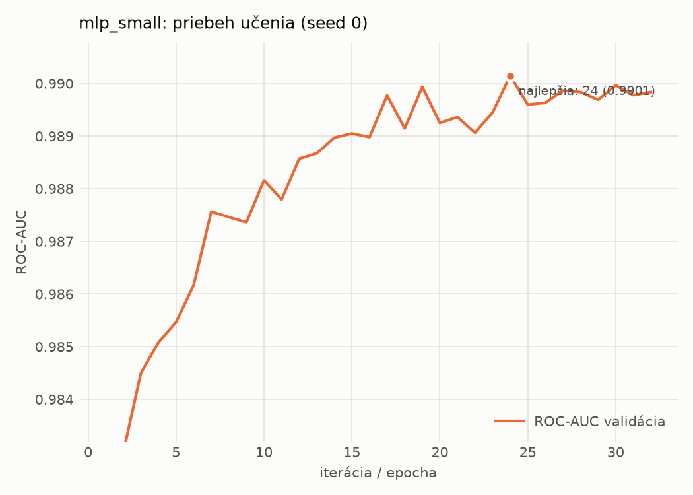

# static/mlp_small – beh `20261123-184236`

> Automaticky generované (`src/training/run_tabular.py`). Konfigurácia: `config.yaml`, protokol: `protocol.yaml`.

- **Model:** `mlp` – malá neurónová sieť (1–2 skryté vrstvy), kandidát na ľahkého študenta
- **Ladenie:** bez ladenia – hyperparametre prevzaté z `runs_v4/real_p/full/static/mlp_small/20261122-231849`
- **Finálne modely:** seedy [0, 1, 2]; hodnoty sú priemer ± smerodajná odchýlka cez seedy
- **Najlepšie hyperparametre:** `{"width_decay": 0.5, "max_epochs": 100, "patience": 8, "hidden_layers": 2, "hidden_width": 256, "dropout": 0.2770731649287669, "lr": 0.0010447758392925718, "weight_decay": 0.0006745378680415608, "batch_size": 256}`

## Detekčná kvalita (bez prahu)
| metrika | train (podvzorka) | validácia | test |
|---|---|---|---|
| ROC-AUC | 0.9965 ± 0.0005 | 0.9903 ± 0.0003 | 0.9904 ± 0.0010 |
| PR-AUC | 0.9962 ± 0.0005 | 0.9891 ± 0.0006 | 0.9901 ± 0.0010 |
| TPR pri FPR 1 % | 0.9625 ± 0.0054 | 0.9055 ± 0.0074 | 0.9143 ± 0.0050 |
| TPR pri FPR 0,1 % | 0.8949 ± 0.0077 | 0.6546 ± 0.0122 | 0.6851 ± 0.0316 |
| log loss | 0.0640 ± 0.0036 | 0.1214 ± 0.0008 | 0.1173 ± 0.0059 |
| Brier skóre | 0.0169 ± 0.0011 | 0.0307 ± 0.0006 | 0.0298 ± 0.0015 |

Rozdiel ROC-AUC train − validácia: **0.0062** (veľký rozdiel = preučenie).

## Pri prahu z validácie (FPR ≤ 1% na validácii)
| metrika | train (podvzorka) | validácia | test |
|---|---|---|---|
| accuracy | 0.9645 ± 0.0024 | 0.9539 ± 0.0032 | 0.9505 ± 0.0033 |
| balanced accuracy | 0.9583 ± 0.0028 | 0.9479 ± 0.0037 | 0.9457 ± 0.0037 |
| precision | 0.9963 ± 0.0005 | 0.9859 ± 0.0001 | 0.9896 ± 0.0015 |
| recall (TPR) | 0.9191 ± 0.0057 | 0.9055 ± 0.0074 | 0.8991 ± 0.0080 |
| FPR | 0.0025 ± 0.0004 | 0.0097 ± 0.0000 | 0.0077 ± 0.0012 |
| F1 | 0.9562 ± 0.0031 | 0.9439 ± 0.0041 | 0.9422 ± 0.0041 |
| MCC | 0.9286 ± 0.0047 | 0.9072 ± 0.0063 | 0.9023 ± 0.0062 |

## Pri pevnom prahu 0.5
| metrika | train (podvzorka) | validácia | test |
|---|---|---|---|
| accuracy | 0.9791 ± 0.0021 | 0.9598 ± 0.0008 | 0.9620 ± 0.0015 |
| balanced accuracy | 0.9773 ± 0.0026 | 0.9586 ± 0.0012 | 0.9606 ± 0.0018 |
| precision | 0.9840 ± 0.0012 | 0.9561 ± 0.0021 | 0.9673 ± 0.0030 |
| recall (TPR) | 0.9661 ± 0.0061 | 0.9499 ± 0.0039 | 0.9472 ± 0.0059 |
| FPR | 0.0115 ± 0.0010 | 0.0328 ± 0.0017 | 0.0261 ± 0.0026 |
| F1 | 0.9749 ± 0.0026 | 0.9530 ± 0.0011 | 0.9571 ± 0.0018 |
| MCC | 0.9571 ± 0.0042 | 0.9179 ± 0.0017 | 0.9231 ± 0.0029 |

## Výpočtové nároky (seed 0, testovacia množina)
| meranie | hodnota |
|---|---|
| tréning finálneho modelu | 8.8 s (priemer cez seedy) |
| ladenie spolu | 0 s |
| počet parametrov / uzlov | 75 777 |
| veľkosť modelu na disku | 0.32 MB |
| transformácia vstupu – latencia (1 vlákno) | 0.015 ms |
| transformácia vstupu – priepustnosť | 863 319 vzoriek/s |
| CPU latencia modelu (batch 1, 1 vlákno) | 0.100 ms (p95 0.238) |
| CPU priepustnosť (24 vlákien) | 2 138 344 vzoriek/s |
| GPU latencia (batch 1) | 0.646 ms (p95 0.735) |
| GPU priepustnosť | 1 561 370 vzoriek/s |
| GPU špičková pamäť | 75 MB |

## Grafy
| | |
|---|---|
|  |  |
|  |  |
|  |  |
|  |  |

## Súbory
`metrics.json` (všetky metriky po seedoch vrátane rodín), `timing.json`, `hpo_trials.csv`,
`predictions/<časť>_seed<N>.parquet` (sha256, family, label, score), `model/seed_<N>/`, `log.txt`.
