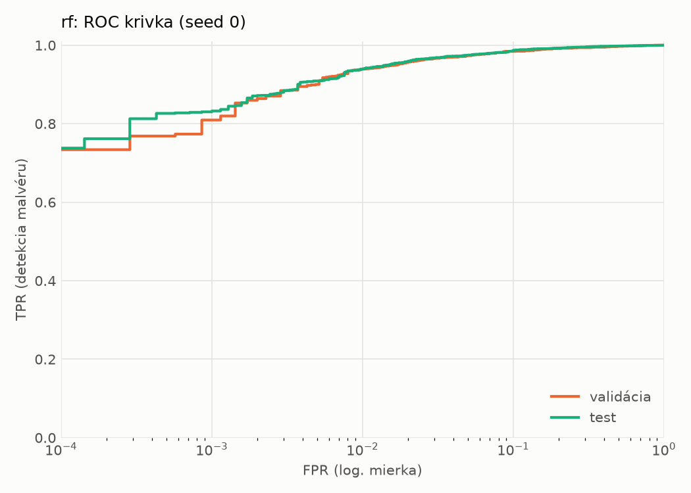
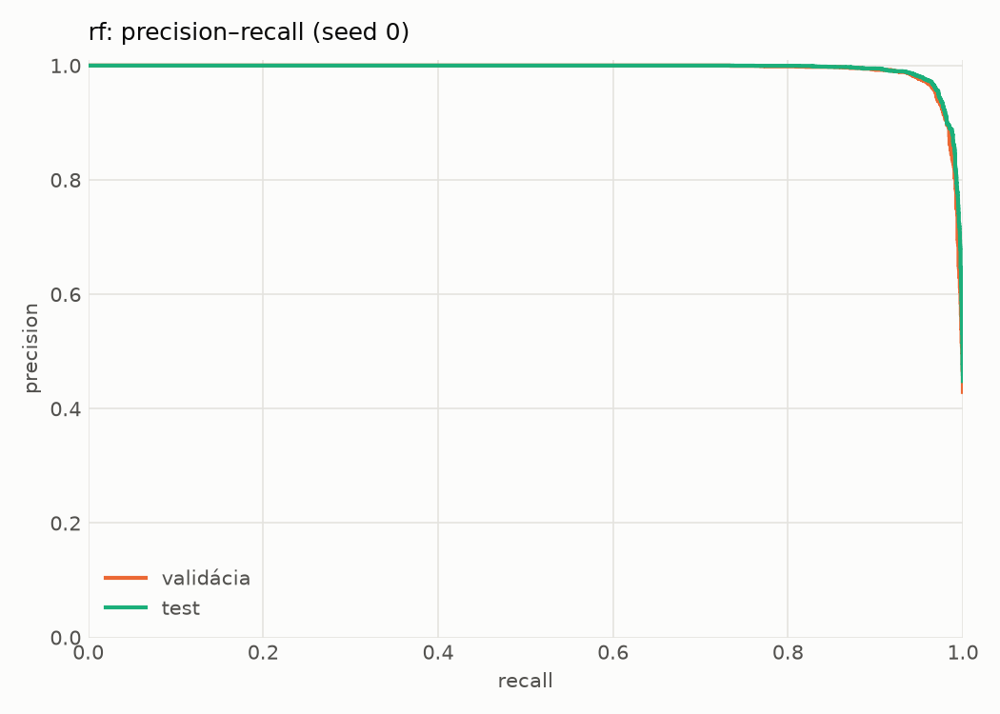
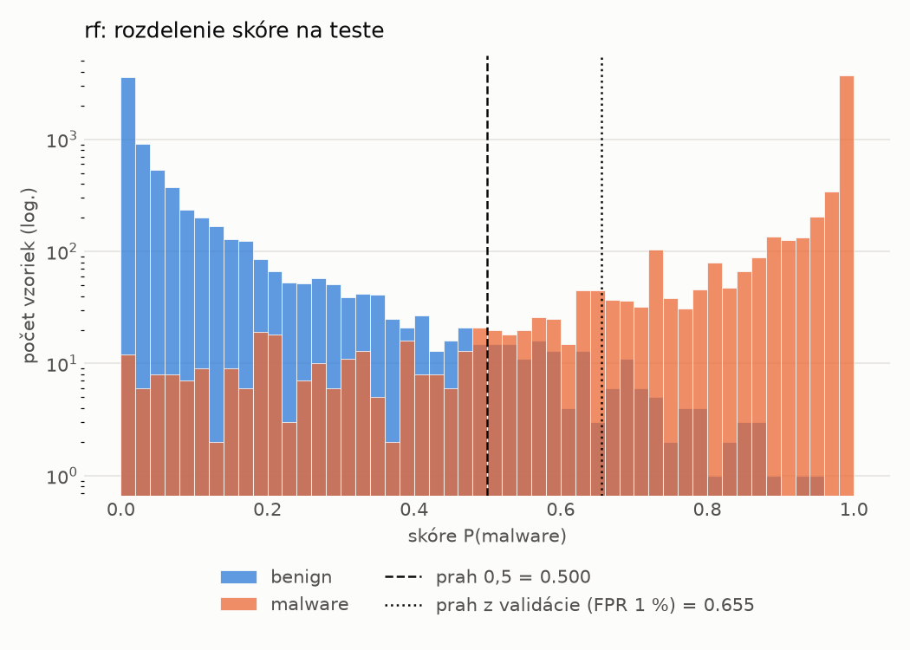
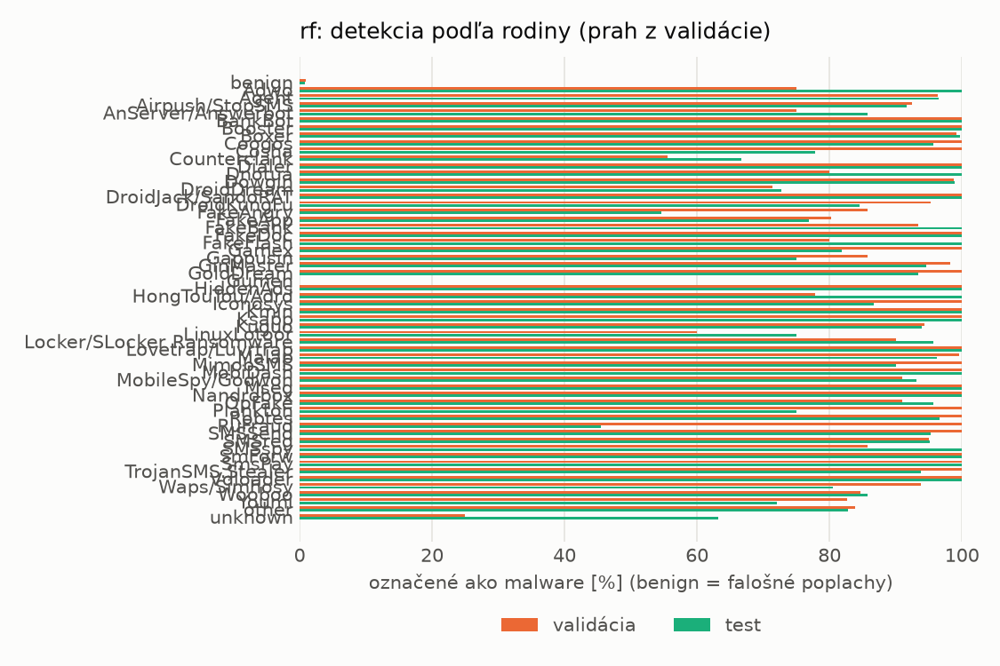
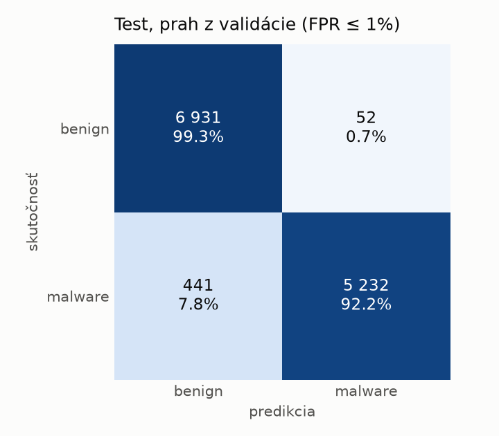
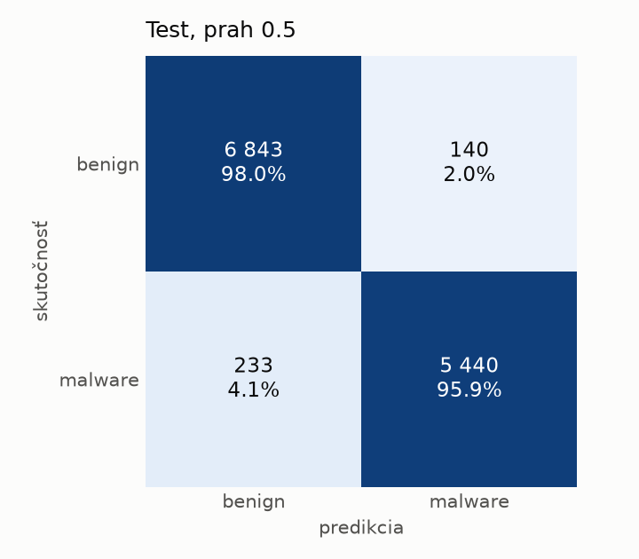

# static/rf – beh `20261123-184149`

> Automaticky generované (`src/training/run_tabular.py`). Konfigurácia: `config.yaml`, protokol: `protocol.yaml`.

- **Model:** `random_forest` – Random Forest (pôvodné hodnoty príznakov)
- **Ladenie:** bez ladenia – hyperparametre prevzaté z `runs_v4/real_p/full/static/rf/20261122-230914`
- **Finálne modely:** seedy [0, 1, 2]; hodnoty sú priemer ± smerodajná odchýlka cez seedy
- **Najlepšie hyperparametre:** `{"n_estimators": 500, "max_depth": 32, "min_samples_leaf": 1, "max_features": "log2"}`

## Detekčná kvalita (bez prahu)
| metrika | train (podvzorka) | validácia | test |
|---|---|---|---|
| ROC-AUC | 1.0000 ± 0.0000 | 0.9931 ± 0.0000 | 0.9940 ± 0.0001 |
| PR-AUC | 1.0000 ± 0.0000 | 0.9930 ± 0.0000 | 0.9941 ± 0.0001 |
| TPR pri FPR 1 % | 1.0000 ± 0.0000 | 0.9377 ± 0.0010 | 0.9378 ± 0.0017 |
| TPR pri FPR 0,1 % | 0.9979 ± 0.0004 | 0.8155 ± 0.0053 | 0.8326 ± 0.0029 |
| log loss | 0.0369 ± 0.0002 | 0.1007 ± 0.0001 | 0.1032 ± 0.0004 |
| Brier skóre | 0.0057 ± 0.0001 | 0.0260 ± 0.0000 | 0.0267 ± 0.0001 |

Rozdiel ROC-AUC train − validácia: **0.0069** (veľký rozdiel = preučenie).

## Pri prahu z validácie (FPR ≤ 1% na validácii)
| metrika | train (podvzorka) | validácia | test |
|---|---|---|---|
| accuracy | 0.9922 ± 0.0002 | 0.9678 ± 0.0004 | 0.9602 ± 0.0008 |
| balanced accuracy | 0.9907 ± 0.0002 | 0.9640 ± 0.0005 | 0.9564 ± 0.0009 |
| precision | 1.0000 ± 0.0000 | 0.9865 ± 0.0002 | 0.9905 ± 0.0004 |
| recall (TPR) | 0.9814 ± 0.0004 | 0.9377 ± 0.0010 | 0.9200 ± 0.0021 |
| FPR | 0.0000 ± 0.0000 | 0.0096 ± 0.0002 | 0.0072 ± 0.0003 |
| F1 | 0.9906 ± 0.0002 | 0.9615 ± 0.0005 | 0.9540 ± 0.0010 |
| MCC | 0.9840 ± 0.0003 | 0.9347 ± 0.0009 | 0.9209 ± 0.0015 |

## Pri pevnom prahu 0.5
| metrika | train (podvzorka) | validácia | test |
|---|---|---|---|
| accuracy | 0.9976 ± 0.0003 | 0.9693 ± 0.0007 | 0.9702 ± 0.0004 |
| balanced accuracy | 0.9973 ± 0.0004 | 0.9685 ± 0.0007 | 0.9691 ± 0.0004 |
| precision | 0.9995 ± 0.0000 | 0.9662 ± 0.0010 | 0.9751 ± 0.0005 |
| recall (TPR) | 0.9949 ± 0.0008 | 0.9623 ± 0.0007 | 0.9580 ± 0.0008 |
| FPR | 0.0003 ± 0.0000 | 0.0253 ± 0.0007 | 0.0199 ± 0.0004 |
| F1 | 0.9972 ± 0.0004 | 0.9642 ± 0.0008 | 0.9665 ± 0.0004 |
| MCC | 0.9952 ± 0.0007 | 0.9374 ± 0.0014 | 0.9398 ± 0.0007 |

## Výpočtové nároky (seed 0, testovacia množina)
| meranie | hodnota |
|---|---|
| tréning finálneho modelu | 1.5 s (priemer cez seedy) |
| ladenie spolu | 0 s |
| počet parametrov / uzlov | 2 992 084 |
| veľkosť modelu na disku | 239.74 MB |
| CPU latencia modelu (batch 1, 1 vlákno) | 14.338 ms (p95 14.851) |
| CPU priepustnosť (24 vlákien) | 113 048 vzoriek/s |

## Grafy
| | |
|---|---|
|  |  |
|  |  |
|  |  |
|  |  |

## Súbory
`metrics.json` (všetky metriky po seedoch vrátane rodín), `timing.json`, `hpo_trials.csv`,
`predictions/<časť>_seed<N>.parquet` (sha256, family, label, score), `model/seed_<N>/`, `log.txt`.
