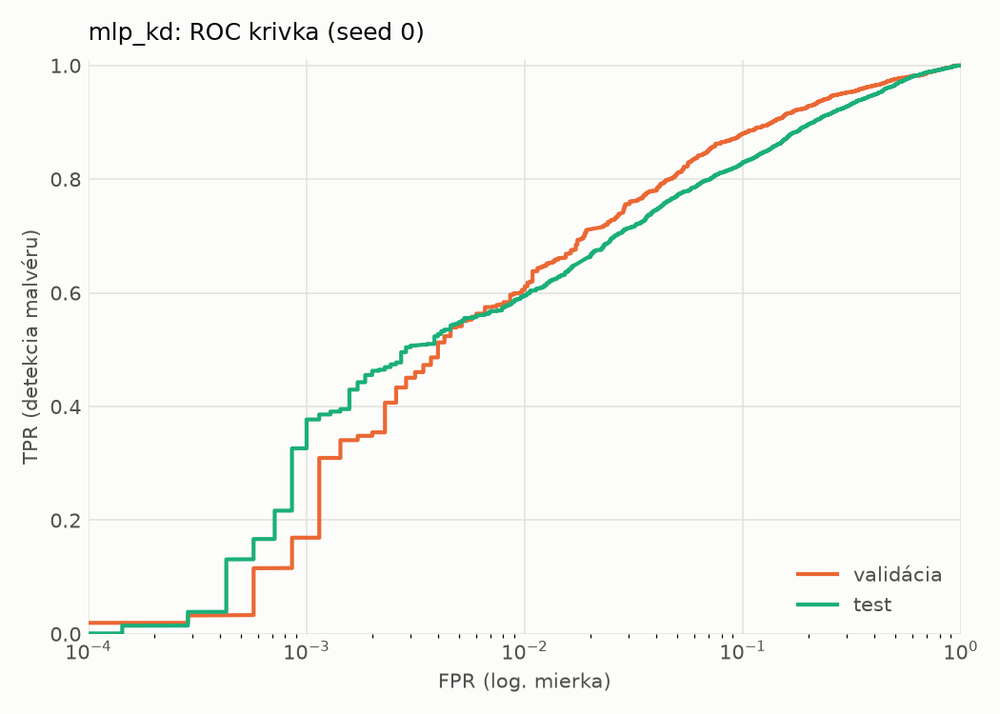
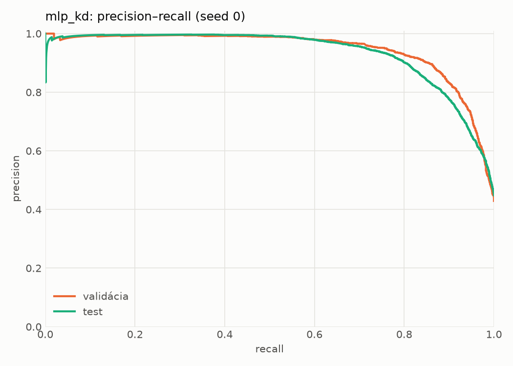
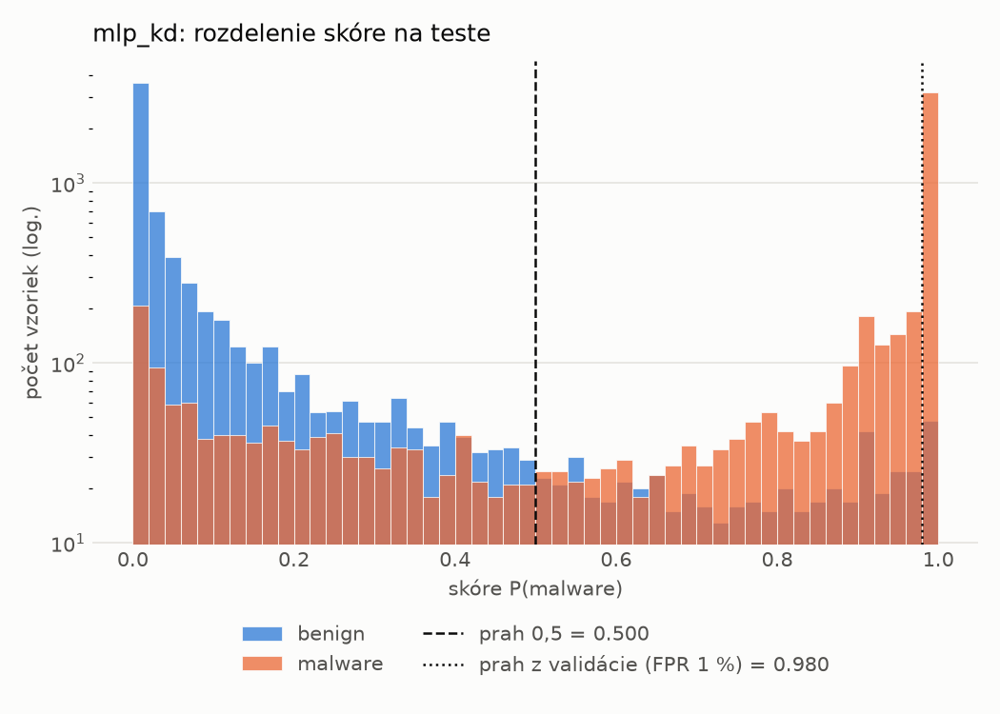
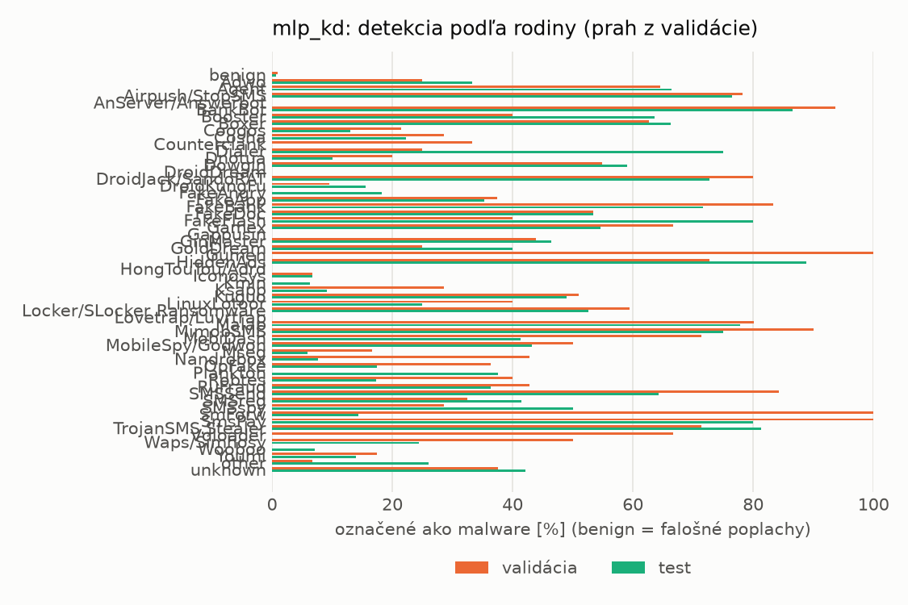
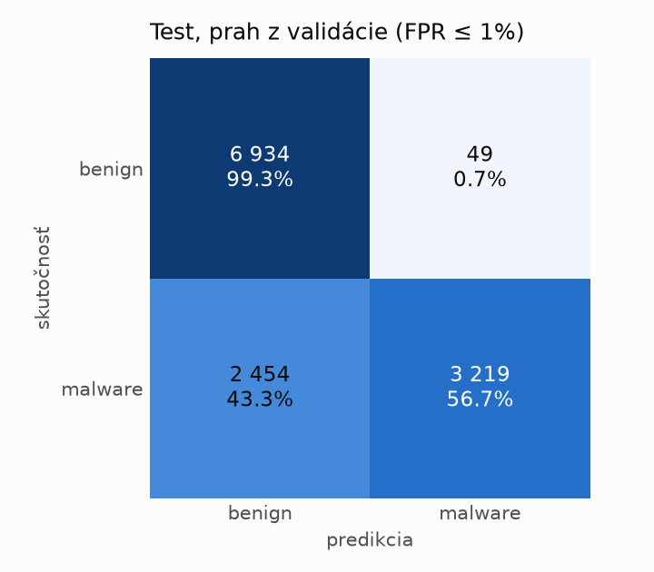
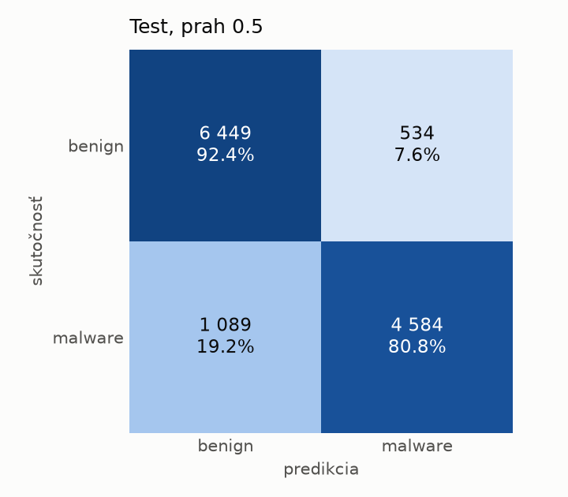
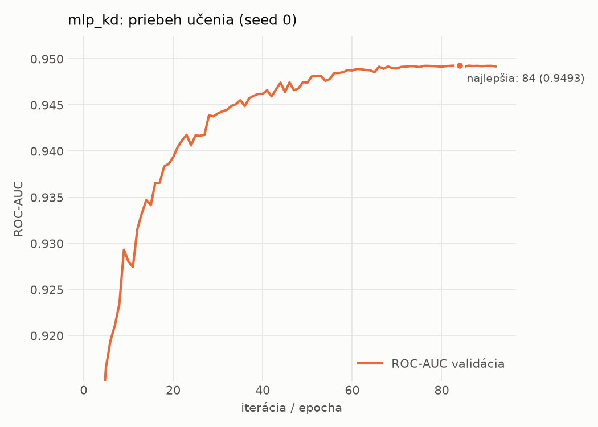

# dynamic/mlp_kd – beh `20261123-215727`

> Automaticky generované (`src/training/run_tabular.py`). Konfigurácia: `config.yaml`, protokol: `protocol.yaml`.

- **Model:** `mlp` – študent – malé MLP učené destiláciou z hybridného učiteľa
- **Ladenie:** bez ladenia – hyperparametre prevzaté z `runs_v4/emu_p/full/students_dynamic/mlp_kd/20261123-204643`
- **Finálne modely:** seedy [0, 1, 2]; hodnoty sú priemer ± smerodajná odchýlka cez seedy
- **Najlepšie hyperparametre:** `{"hidden_layers": 1, "max_epochs": 100, "patience": 8, "hidden_width": 64, "dropout": 0.18336599346560475, "lr": 0.002029071520651615, "weight_decay": 5.085344324013556e-05, "batch_size": 1024, "kd_alpha": 0.6628106947860043, "kd_temperature": 3.3639590927520047}`

## Detekčná kvalita (bez prahu)
| metrika | train (podvzorka) | validácia | test |
|---|---|---|---|
| ROC-AUC | 0.9572 ± 0.0022 | 0.9510 ± 0.0015 | 0.9371 ± 0.0019 |
| PR-AUC | 0.9542 ± 0.0023 | 0.9465 ± 0.0021 | 0.9376 ± 0.0024 |
| TPR pri FPR 1 % | 0.6795 ± 0.0126 | 0.6227 ± 0.0166 | 0.6026 ± 0.0067 |
| TPR pri FPR 0,1 % | 0.5164 ± 0.0158 | 0.2002 ± 0.0371 | 0.3704 ± 0.0386 |
| log loss | 0.2676 ± 0.0082 | 0.2991 ± 0.0052 | 0.3519 ± 0.0056 |
| Brier skóre | 0.0764 ± 0.0025 | 0.0797 ± 0.0018 | 0.0971 ± 0.0020 |

Rozdiel ROC-AUC train − validácia: **0.0062** (veľký rozdiel = preučenie).

## Pri prahu z validácie (FPR ≤ 1% na validácii)
| metrika | train (podvzorka) | validácia | test |
|---|---|---|---|
| accuracy | 0.8410 ± 0.0065 | 0.8325 ± 0.0071 | 0.8075 ± 0.0046 |
| balanced accuracy | 0.8123 ± 0.0077 | 0.8065 ± 0.0083 | 0.7862 ± 0.0052 |
| precision | 0.9872 ± 0.0009 | 0.9796 ± 0.0005 | 0.9841 ± 0.0013 |
| recall (TPR) | 0.6305 ± 0.0159 | 0.6227 ± 0.0166 | 0.5799 ± 0.0110 |
| FPR | 0.0059 ± 0.0006 | 0.0097 ± 0.0000 | 0.0076 ± 0.0007 |
| F1 | 0.7694 ± 0.0117 | 0.7613 ± 0.0126 | 0.7297 ± 0.0085 |
| MCC | 0.6955 ± 0.0116 | 0.6812 ± 0.0129 | 0.6456 ± 0.0076 |

## Pri pevnom prahu 0.5
| metrika | train (podvzorka) | validácia | test |
|---|---|---|---|
| accuracy | 0.9007 ± 0.0036 | 0.8985 ± 0.0010 | 0.8742 ± 0.0033 |
| balanced accuracy | 0.8950 ± 0.0038 | 0.8942 ± 0.0011 | 0.8683 ± 0.0034 |
| precision | 0.9005 ± 0.0040 | 0.8957 ± 0.0014 | 0.8983 ± 0.0030 |
| recall (TPR) | 0.8590 ± 0.0051 | 0.8642 ± 0.0025 | 0.8112 ± 0.0049 |
| FPR | 0.0690 ± 0.0027 | 0.0757 ± 0.0012 | 0.0746 ± 0.0020 |
| F1 | 0.8792 ± 0.0045 | 0.8796 ± 0.0012 | 0.8525 ± 0.0040 |
| MCC | 0.7956 ± 0.0075 | 0.7923 ± 0.0020 | 0.7463 ± 0.0066 |

## Výpočtové nároky (seed 0, testovacia množina)
| meranie | hodnota |
|---|---|
| tréning finálneho modelu | 6.9 s (priemer cez seedy) |
| ladenie spolu | 0 s |
| počet parametrov / uzlov | 8 129 |
| veľkosť modelu na disku | 0.04 MB |
| transformácia vstupu – latencia (1 vlákno) | 0.014 ms |
| transformácia vstupu – priepustnosť | 1 250 679 vzoriek/s |
| CPU latencia modelu (batch 1, 1 vlákno) | 0.051 ms (p95 0.059) |
| CPU priepustnosť (24 vlákien) | 6 991 106 vzoriek/s |
| GPU latencia (batch 1) | 0.270 ms (p95 0.292) |
| GPU priepustnosť | 2 256 454 vzoriek/s |
| GPU špičková pamäť | 53 MB |

## Grafy
| | |
|---|---|
|  |  |
|  |  |
|  |  |
|  |  |

## Súbory
`metrics.json` (všetky metriky po seedoch vrátane rodín), `timing.json`, `hpo_trials.csv`,
`predictions/<časť>_seed<N>.parquet` (sha256, family, label, score), `model/seed_<N>/`, `log.txt`.
