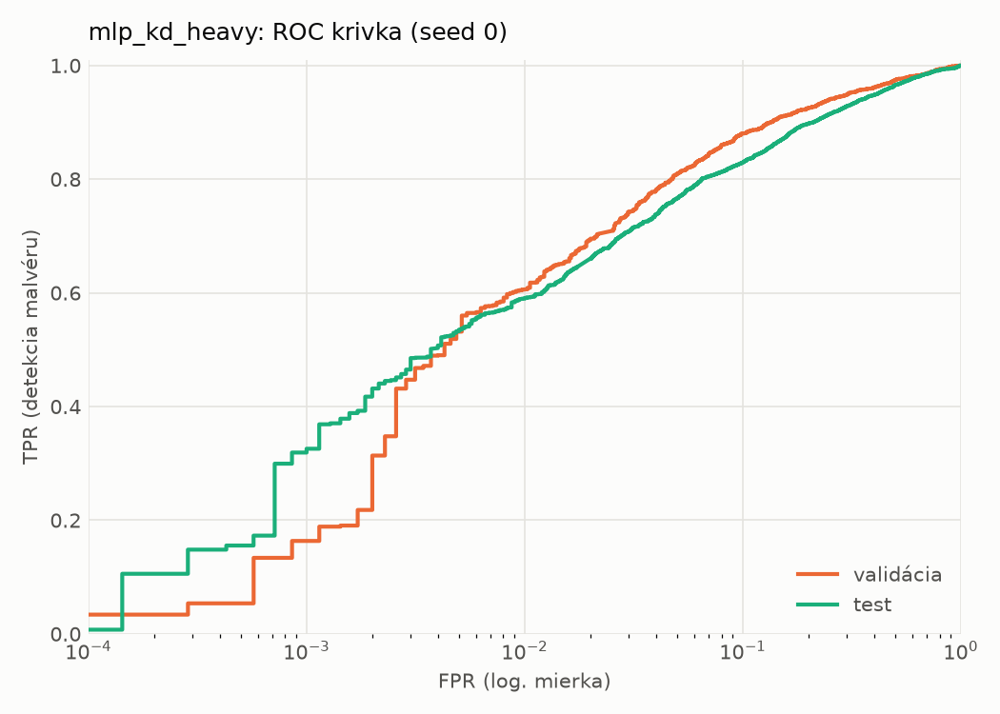
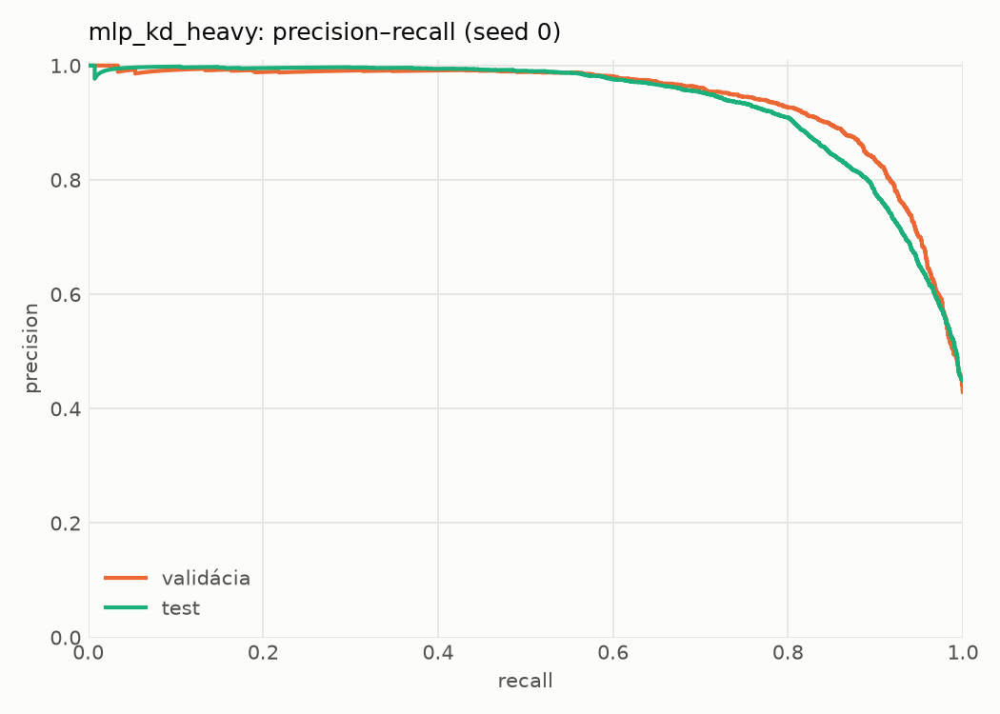
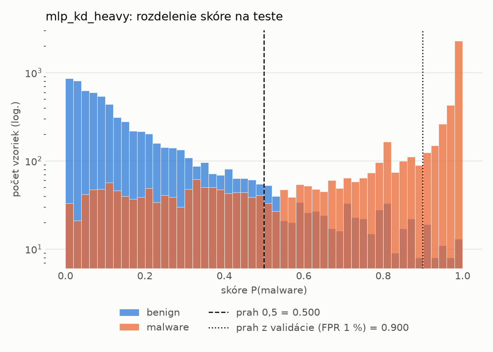
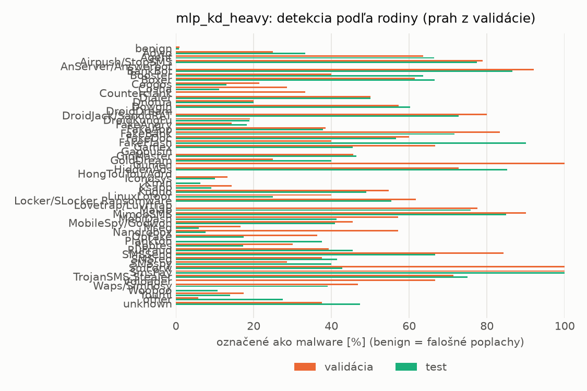
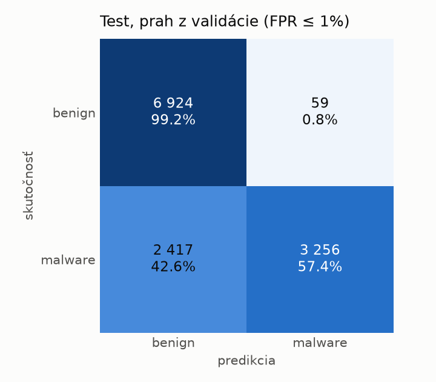
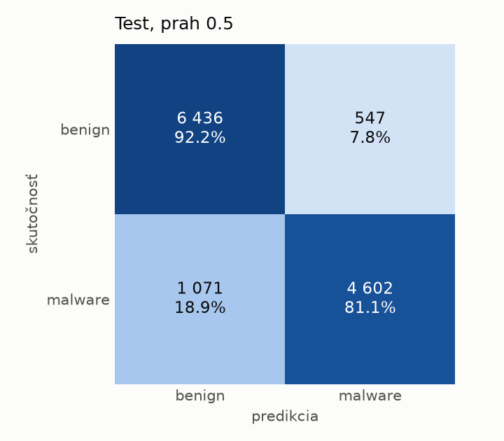
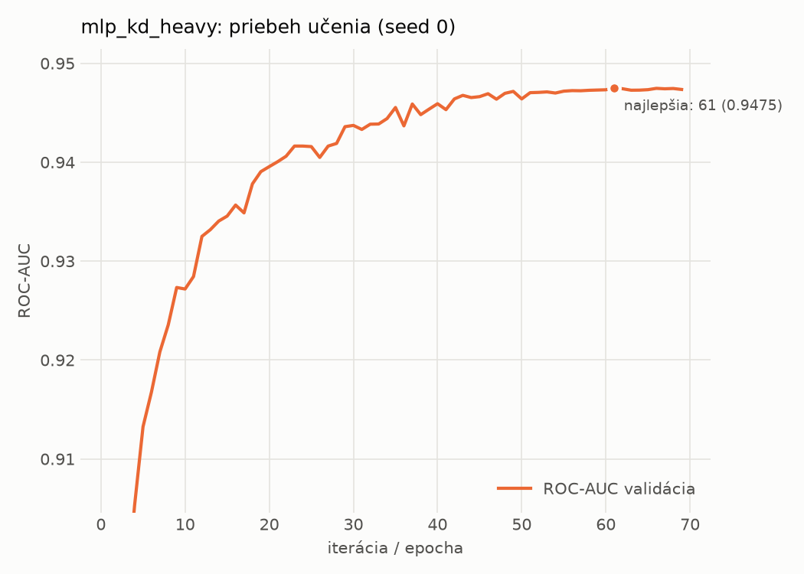

# dynamic/mlp_kd_heavy – beh `20261123-215855`

> Automaticky generované (`src/training/run_tabular.py`). Konfigurácia: `config.yaml`, protokol: `protocol.yaml`.

- **Model:** `mlp` – študent – malé MLP učené destiláciou z mlp_large hybridu (V4)
- **Ladenie:** bez ladenia – hyperparametre prevzaté z `runs_v4/emu_p/full/students_dynamic/mlp_kd_heavy/20261123-210504`
- **Finálne modely:** seedy [0, 1, 2]; hodnoty sú priemer ± smerodajná odchýlka cez seedy
- **Najlepšie hyperparametre:** `{"hidden_layers": 1, "max_epochs": 100, "patience": 8, "hidden_width": 64, "dropout": 0.11940169496551375, "lr": 0.0010131280233016235, "weight_decay": 6.964554367863767e-06, "batch_size": 1024, "kd_alpha": 0.5527208987397508, "kd_temperature": 1.1661827551200896}`

## Detekčná kvalita (bez prahu)
| metrika | train (podvzorka) | validácia | test |
|---|---|---|---|
| ROC-AUC | 0.9573 ± 0.0029 | 0.9498 ± 0.0020 | 0.9352 ± 0.0012 |
| PR-AUC | 0.9540 ± 0.0030 | 0.9449 ± 0.0019 | 0.9362 ± 0.0009 |
| TPR pri FPR 1 % | 0.6738 ± 0.0177 | 0.6231 ± 0.0165 | 0.6064 ± 0.0151 |
| TPR pri FPR 0,1 % | 0.5171 ± 0.0165 | 0.1290 ± 0.0304 | 0.2850 ± 0.0845 |
| log loss | 0.2535 ± 0.0088 | 0.2764 ± 0.0058 | 0.3117 ± 0.0031 |
| Brier skóre | 0.0759 ± 0.0029 | 0.0804 ± 0.0024 | 0.0938 ± 0.0013 |

Rozdiel ROC-AUC train − validácia: **0.0075** (veľký rozdiel = preučenie).

## Pri prahu z validácie (FPR ≤ 1% na validácii)
| metrika | train (podvzorka) | validácia | test |
|---|---|---|---|
| accuracy | 0.8440 ± 0.0063 | 0.8327 ± 0.0071 | 0.8101 ± 0.0051 |
| balanced accuracy | 0.8159 ± 0.0075 | 0.8067 ± 0.0082 | 0.7892 ± 0.0057 |
| precision | 0.9864 ± 0.0004 | 0.9796 ± 0.0005 | 0.9826 ± 0.0005 |
| recall (TPR) | 0.6382 ± 0.0153 | 0.6231 ± 0.0165 | 0.5868 ± 0.0114 |
| FPR | 0.0064 ± 0.0003 | 0.0097 ± 0.0000 | 0.0084 ± 0.0001 |
| F1 | 0.7749 ± 0.0112 | 0.7616 ± 0.0125 | 0.7347 ± 0.0091 |
| MCC | 0.7008 ± 0.0113 | 0.6815 ± 0.0128 | 0.6496 ± 0.0089 |

## Pri pevnom prahu 0.5
| metrika | train (podvzorka) | validácia | test |
|---|---|---|---|
| accuracy | 0.9003 ± 0.0033 | 0.8976 ± 0.0035 | 0.8743 ± 0.0019 |
| balanced accuracy | 0.8945 ± 0.0028 | 0.8935 ± 0.0036 | 0.8684 ± 0.0017 |
| precision | 0.9004 ± 0.0082 | 0.8936 ± 0.0040 | 0.8978 ± 0.0046 |
| recall (TPR) | 0.8580 ± 0.0027 | 0.8644 ± 0.0053 | 0.8120 ± 0.0025 |
| FPR | 0.0690 ± 0.0064 | 0.0774 ± 0.0030 | 0.0751 ± 0.0038 |
| F1 | 0.8787 ± 0.0034 | 0.8788 ± 0.0042 | 0.8527 ± 0.0019 |
| MCC | 0.7948 ± 0.0068 | 0.7906 ± 0.0071 | 0.7464 ± 0.0040 |

## Výpočtové nároky (seed 0, testovacia množina)
| meranie | hodnota |
|---|---|
| tréning finálneho modelu | 6.0 s (priemer cez seedy) |
| ladenie spolu | 0 s |
| počet parametrov / uzlov | 8 129 |
| veľkosť modelu na disku | 0.04 MB |
| transformácia vstupu – latencia (1 vlákno) | 0.015 ms |
| transformácia vstupu – priepustnosť | 766 417 vzoriek/s |
| CPU latencia modelu (batch 1, 1 vlákno) | 0.152 ms (p95 0.161) |
| CPU priepustnosť (24 vlákien) | 9 086 732 vzoriek/s |
| GPU latencia (batch 1) | 0.271 ms (p95 0.312) |
| GPU priepustnosť | 3 114 250 vzoriek/s |
| GPU špičková pamäť | 77 MB |

## Grafy
| | |
|---|---|
|  |  |
|  |  |
|  |  |
|  |  |

## Súbory
`metrics.json` (všetky metriky po seedoch vrátane rodín), `timing.json`, `hpo_trials.csv`,
`predictions/<časť>_seed<N>.parquet` (sha256, family, label, score), `model/seed_<N>/`, `log.txt`.
