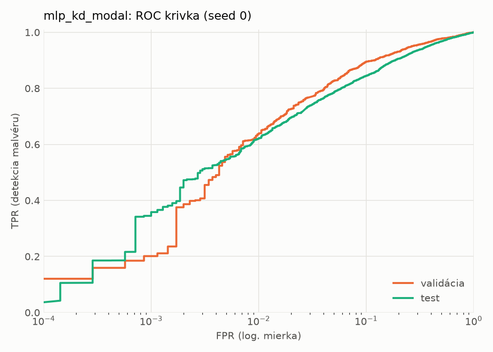
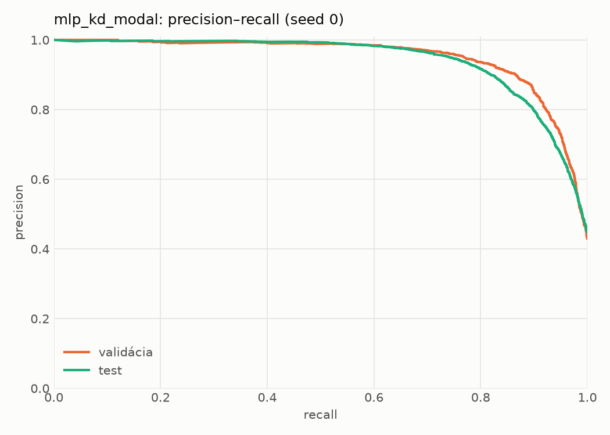
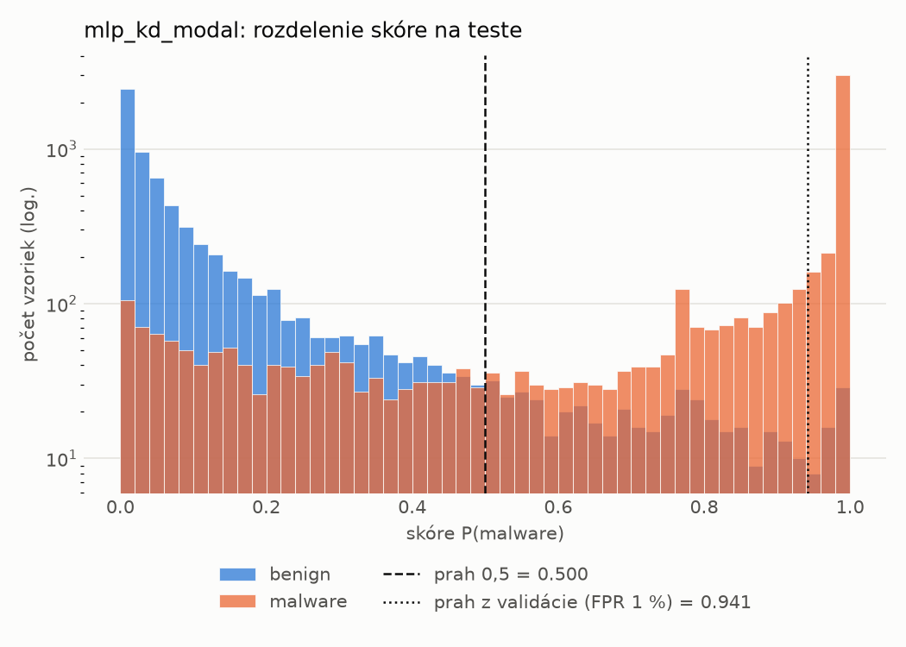
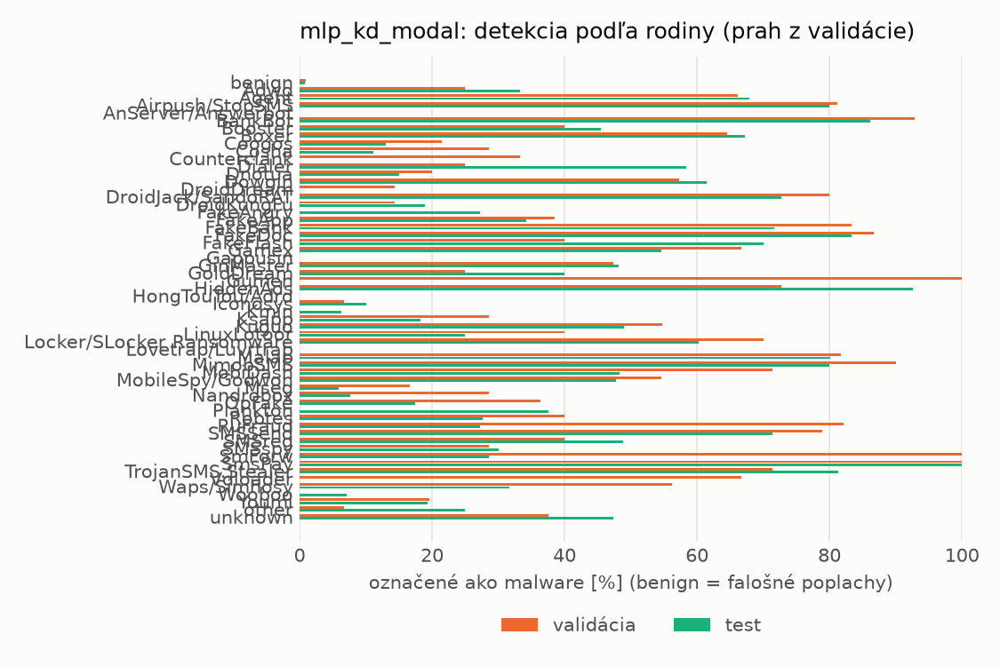
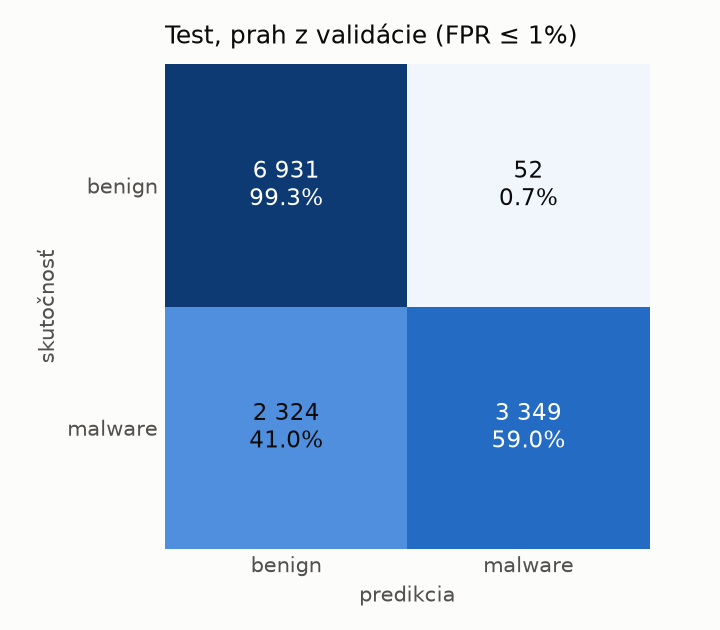
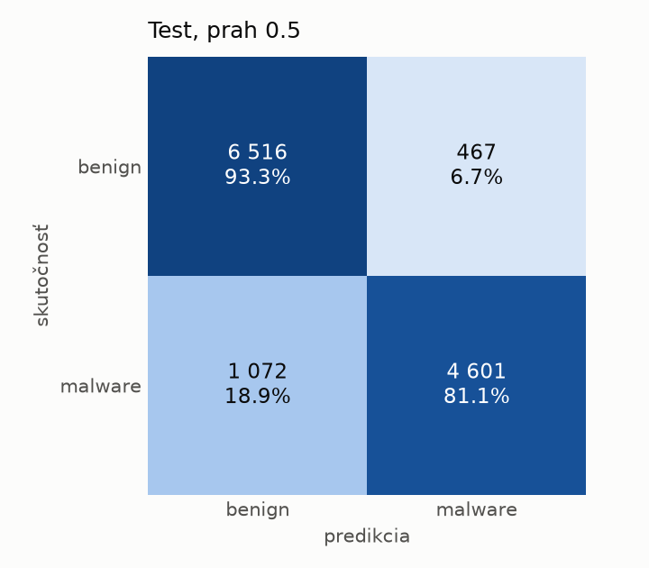
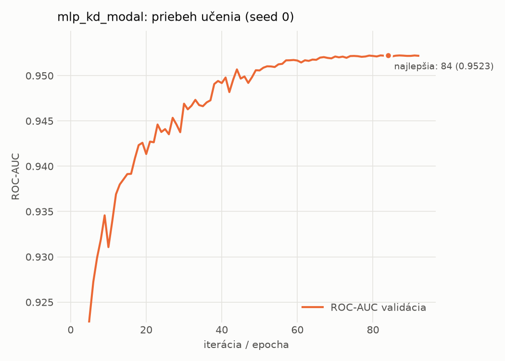

# dynamic/mlp_kd_modal – beh `20261123-215834`

> Automaticky generované (`src/training/run_tabular.py`). Konfigurácia: `config.yaml`, protokol: `protocol.yaml`.

- **Model:** `mlp` – študent – malé MLP učené destiláciou z učiteľa rovnakej modality (variant A)
- **Ladenie:** bez ladenia – hyperparametre prevzaté z `runs_v4/emu_p/full/students_dynamic/mlp_kd_modal/20261123-210004`
- **Finálne modely:** seedy [0, 1, 2]; hodnoty sú priemer ± smerodajná odchýlka cez seedy
- **Najlepšie hyperparametre:** `{"hidden_layers": 1, "max_epochs": 100, "patience": 8, "hidden_width": 64, "dropout": 0.17256398759806554, "lr": 0.00273877224500614, "weight_decay": 0.00015336049950880602, "batch_size": 1024, "kd_alpha": 0.5720540077101433, "kd_temperature": 1.5970216771892711}`

## Detekčná kvalita (bez prahu)
| metrika | train (podvzorka) | validácia | test |
|---|---|---|---|
| ROC-AUC | 0.9578 ± 0.0008 | 0.9518 ± 0.0004 | 0.9384 ± 0.0010 |
| PR-AUC | 0.9552 ± 0.0009 | 0.9485 ± 0.0007 | 0.9404 ± 0.0009 |
| TPR pri FPR 1 % | 0.6826 ± 0.0080 | 0.6299 ± 0.0065 | 0.6171 ± 0.0041 |
| TPR pri FPR 0,1 % | 0.5285 ± 0.0126 | 0.2240 ± 0.0298 | 0.3474 ± 0.0025 |
| log loss | 0.2488 ± 0.0032 | 0.2777 ± 0.0017 | 0.3187 ± 0.0027 |
| Brier skóre | 0.0734 ± 0.0007 | 0.0774 ± 0.0004 | 0.0922 ± 0.0011 |

Rozdiel ROC-AUC train − validácia: **0.0060** (veľký rozdiel = preučenie).

## Pri prahu z validácie (FPR ≤ 1% na validácii)
| metrika | train (podvzorka) | validácia | test |
|---|---|---|---|
| accuracy | 0.8453 ± 0.0016 | 0.8356 ± 0.0028 | 0.8114 ± 0.0020 |
| balanced accuracy | 0.8175 ± 0.0019 | 0.8101 ± 0.0033 | 0.7904 ± 0.0023 |
| precision | 0.9862 ± 0.0009 | 0.9798 ± 0.0002 | 0.9847 ± 0.0001 |
| recall (TPR) | 0.6415 ± 0.0037 | 0.6299 ± 0.0065 | 0.5883 ± 0.0046 |
| FPR | 0.0065 ± 0.0004 | 0.0097 ± 0.0000 | 0.0074 ± 0.0000 |
| F1 | 0.7773 ± 0.0028 | 0.7668 ± 0.0049 | 0.7366 ± 0.0036 |
| MCC | 0.7031 ± 0.0030 | 0.6868 ± 0.0051 | 0.6524 ± 0.0036 |

## Pri pevnom prahu 0.5
| metrika | train (podvzorka) | validácia | test |
|---|---|---|---|
| accuracy | 0.9033 ± 0.0014 | 0.8999 ± 0.0012 | 0.8767 ± 0.0021 |
| balanced accuracy | 0.8967 ± 0.0012 | 0.8952 ± 0.0014 | 0.8702 ± 0.0022 |
| precision | 0.9096 ± 0.0037 | 0.9007 ± 0.0024 | 0.9075 ± 0.0026 |
| recall (TPR) | 0.8553 ± 0.0017 | 0.8619 ± 0.0037 | 0.8073 ± 0.0034 |
| FPR | 0.0618 ± 0.0029 | 0.0715 ± 0.0021 | 0.0668 ± 0.0019 |
| F1 | 0.8816 ± 0.0015 | 0.8808 ± 0.0016 | 0.8545 ± 0.0026 |
| MCC | 0.8011 ± 0.0030 | 0.7952 ± 0.0025 | 0.7521 ± 0.0043 |

## Výpočtové nároky (seed 0, testovacia množina)
| meranie | hodnota |
|---|---|
| tréning finálneho modelu | 6.4 s (priemer cez seedy) |
| ladenie spolu | 0 s |
| počet parametrov / uzlov | 8 129 |
| veľkosť modelu na disku | 0.04 MB |
| transformácia vstupu – latencia (1 vlákno) | 0.014 ms |
| transformácia vstupu – priepustnosť | 776 985 vzoriek/s |
| CPU latencia modelu (batch 1, 1 vlákno) | 0.152 ms (p95 0.162) |
| CPU priepustnosť (24 vlákien) | 4 948 583 vzoriek/s |
| GPU latencia (batch 1) | 0.442 ms (p95 0.480) |
| GPU priepustnosť | 2 526 097 vzoriek/s |
| GPU špičková pamäť | 53 MB |

## Grafy
| | |
|---|---|
|  |  |
|  |  |
|  |  |
|  |  |

## Súbory
`metrics.json` (všetky metriky po seedoch vrátane rodín), `timing.json`, `hpo_trials.csv`,
`predictions/<časť>_seed<N>.parquet` (sha256, family, label, score), `model/seed_<N>/`, `log.txt`.
