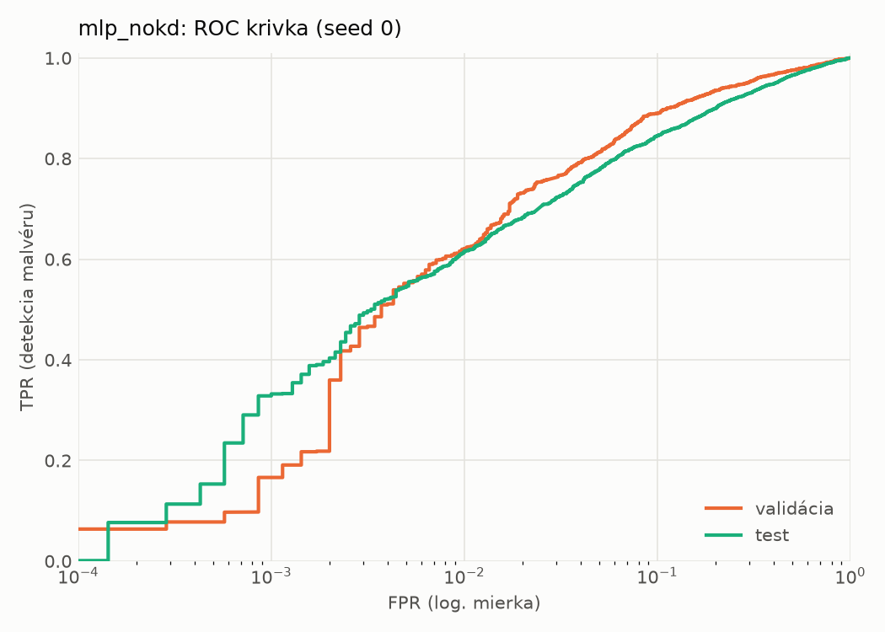
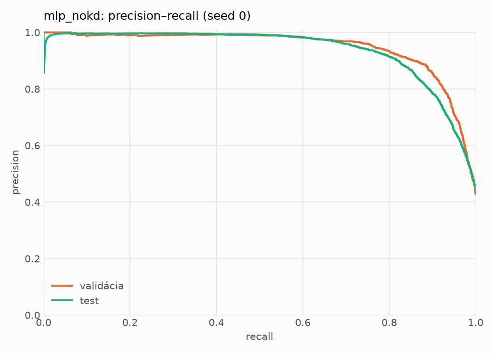
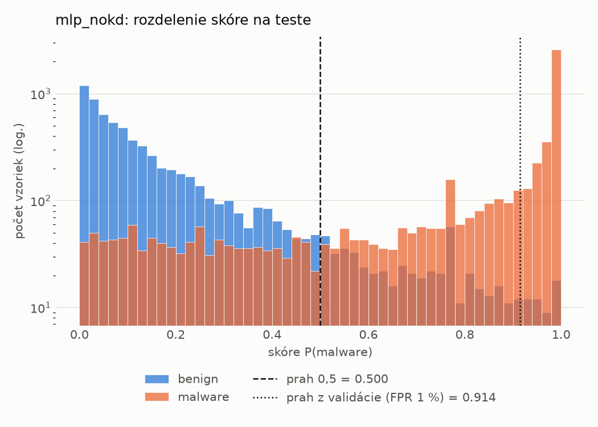
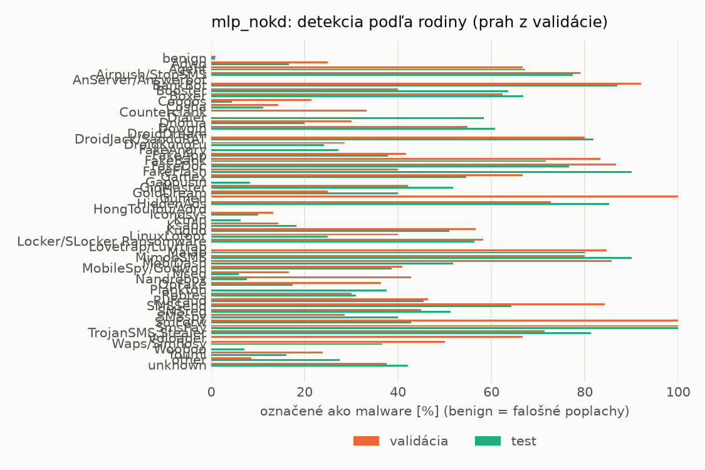
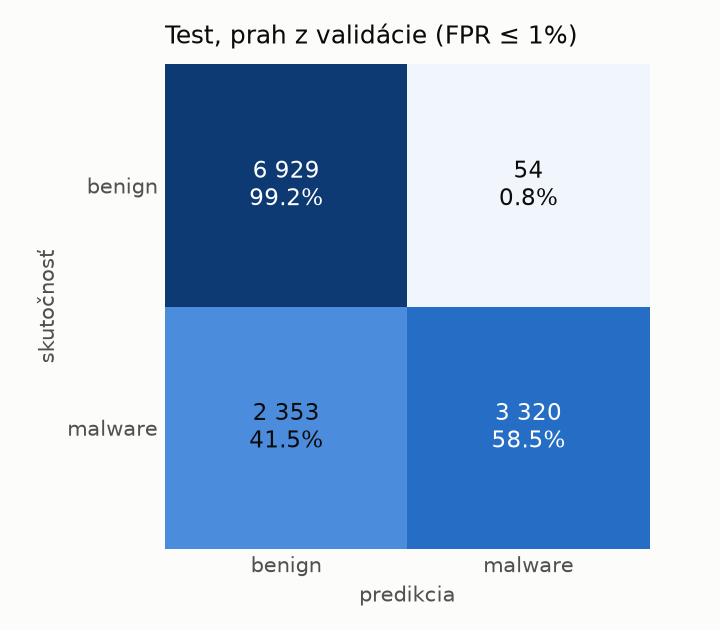
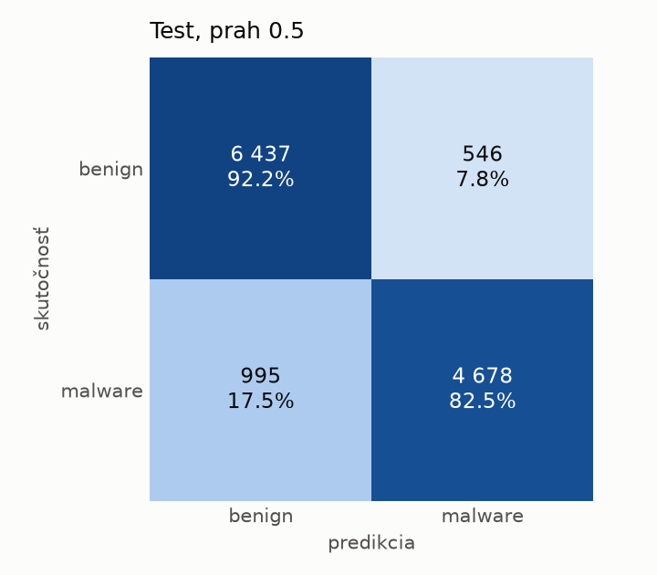
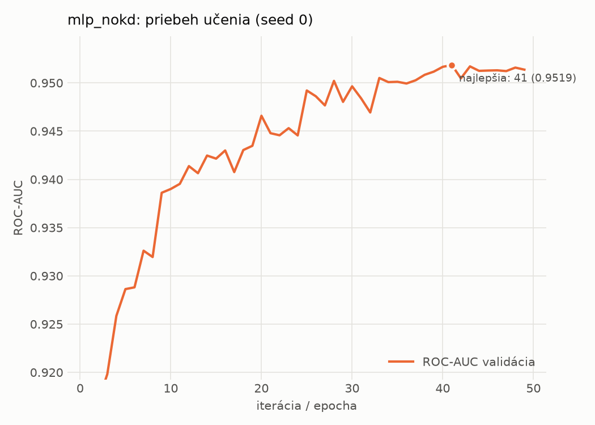

# dynamic/mlp_nokd – beh `20261123-215750`

> Automaticky generované (`src/training/run_tabular.py`). Konfigurácia: `config.yaml`, protokol: `protocol.yaml`.

- **Model:** `mlp` – kontrola – rovnaké malé MLP bez destilácie (iba skutočné označenia)
- **Ladenie:** bez ladenia – hyperparametre prevzaté z `runs_v4/emu_p/full/students_dynamic/mlp_nokd/20261123-205230`
- **Finálne modely:** seedy [0, 1, 2]; hodnoty sú priemer ± smerodajná odchýlka cez seedy
- **Najlepšie hyperparametre:** `{"hidden_layers": 1, "max_epochs": 100, "patience": 8, "hidden_width": 64, "dropout": 0.039782849658421375, "lr": 0.0018574312606020214, "weight_decay": 6.674701047165933e-06, "batch_size": 256}`

## Detekčná kvalita (bez prahu)
| metrika | train (podvzorka) | validácia | test |
|---|---|---|---|
| ROC-AUC | 0.9630 ± 0.0018 | 0.9528 ± 0.0011 | 0.9376 ± 0.0010 |
| PR-AUC | 0.9598 ± 0.0020 | 0.9481 ± 0.0013 | 0.9392 ± 0.0013 |
| TPR pri FPR 1 % | 0.7019 ± 0.0078 | 0.6260 ± 0.0172 | 0.6114 ± 0.0066 |
| TPR pri FPR 0,1 % | 0.5464 ± 0.0114 | 0.1552 ± 0.0264 | 0.3035 ± 0.0865 |
| log loss | 0.2369 ± 0.0070 | 0.2706 ± 0.0026 | 0.3072 ± 0.0013 |
| Brier skóre | 0.0705 ± 0.0021 | 0.0780 ± 0.0015 | 0.0912 ± 0.0010 |

Rozdiel ROC-AUC train − validácia: **0.0101** (veľký rozdiel = preučenie).

## Pri prahu z validácie (FPR ≤ 1% na validácii)
| metrika | train (podvzorka) | validácia | test |
|---|---|---|---|
| accuracy | 0.8445 ± 0.0057 | 0.8339 ± 0.0074 | 0.8102 ± 0.0068 |
| balanced accuracy | 0.8162 ± 0.0069 | 0.8081 ± 0.0086 | 0.7892 ± 0.0077 |
| precision | 0.9896 ± 0.0009 | 0.9797 ± 0.0005 | 0.9842 ± 0.0019 |
| recall (TPR) | 0.6373 ± 0.0143 | 0.6260 ± 0.0172 | 0.5860 ± 0.0165 |
| FPR | 0.0049 ± 0.0005 | 0.0097 ± 0.0000 | 0.0076 ± 0.0011 |
| F1 | 0.7752 ± 0.0103 | 0.7638 ± 0.0129 | 0.7345 ± 0.0124 |
| MCC | 0.7024 ± 0.0102 | 0.6837 ± 0.0134 | 0.6503 ± 0.0110 |

## Pri pevnom prahu 0.5
| metrika | train (podvzorka) | validácia | test |
|---|---|---|---|
| accuracy | 0.9070 ± 0.0028 | 0.9002 ± 0.0004 | 0.8785 ± 0.0014 |
| balanced accuracy | 0.9023 ± 0.0029 | 0.8972 ± 0.0007 | 0.8735 ± 0.0013 |
| precision | 0.9034 ± 0.0043 | 0.8896 ± 0.0011 | 0.8956 ± 0.0028 |
| recall (TPR) | 0.8723 ± 0.0040 | 0.8762 ± 0.0025 | 0.8252 ± 0.0005 |
| FPR | 0.0678 ± 0.0033 | 0.0818 ± 0.0012 | 0.0782 ± 0.0023 |
| F1 | 0.8876 ± 0.0034 | 0.8828 ± 0.0007 | 0.8589 ± 0.0014 |
| MCC | 0.8087 ± 0.0058 | 0.7960 ± 0.0009 | 0.7545 ± 0.0028 |

## Výpočtové nároky (seed 0, testovacia množina)
| meranie | hodnota |
|---|---|
| tréning finálneho modelu | 14.0 s (priemer cez seedy) |
| ladenie spolu | 0 s |
| počet parametrov / uzlov | 8 129 |
| veľkosť modelu na disku | 0.04 MB |
| transformácia vstupu – latencia (1 vlákno) | 0.015 ms |
| transformácia vstupu – priepustnosť | 769 170 vzoriek/s |
| CPU latencia modelu (batch 1, 1 vlákno) | 0.152 ms (p95 0.161) |
| CPU priepustnosť (24 vlákien) | 7 994 441 vzoriek/s |
| GPU latencia (batch 1) | 0.288 ms (p95 0.322) |
| GPU priepustnosť | 3 027 606 vzoriek/s |
| GPU špičková pamäť | 77 MB |

## Grafy
| | |
|---|---|
|  |  |
|  |  |
|  |  |
|  |  |

## Súbory
`metrics.json` (všetky metriky po seedoch vrátane rodín), `timing.json`, `hpo_trials.csv`,
`predictions/<časť>_seed<N>.parquet` (sha256, family, label, score), `model/seed_<N>/`, `log.txt`.
