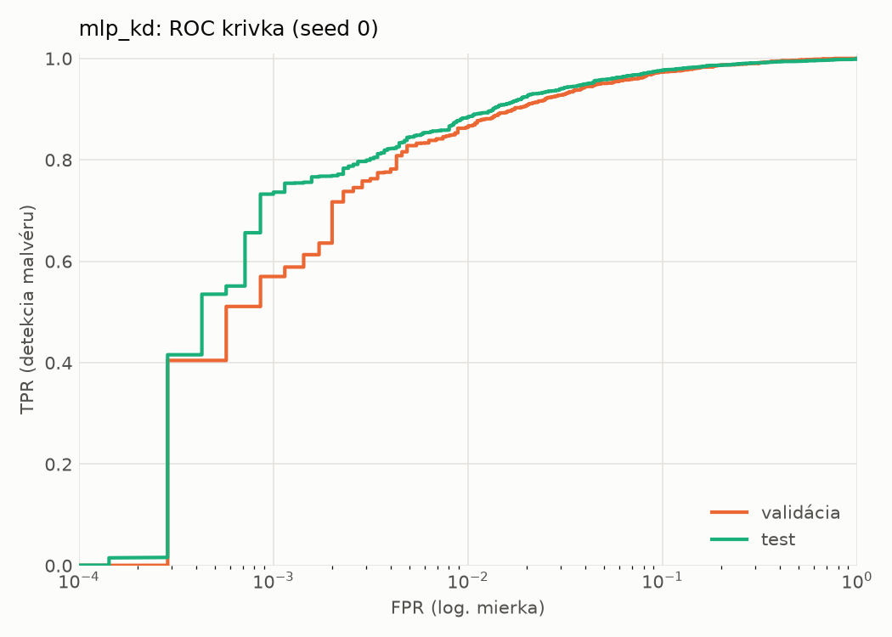
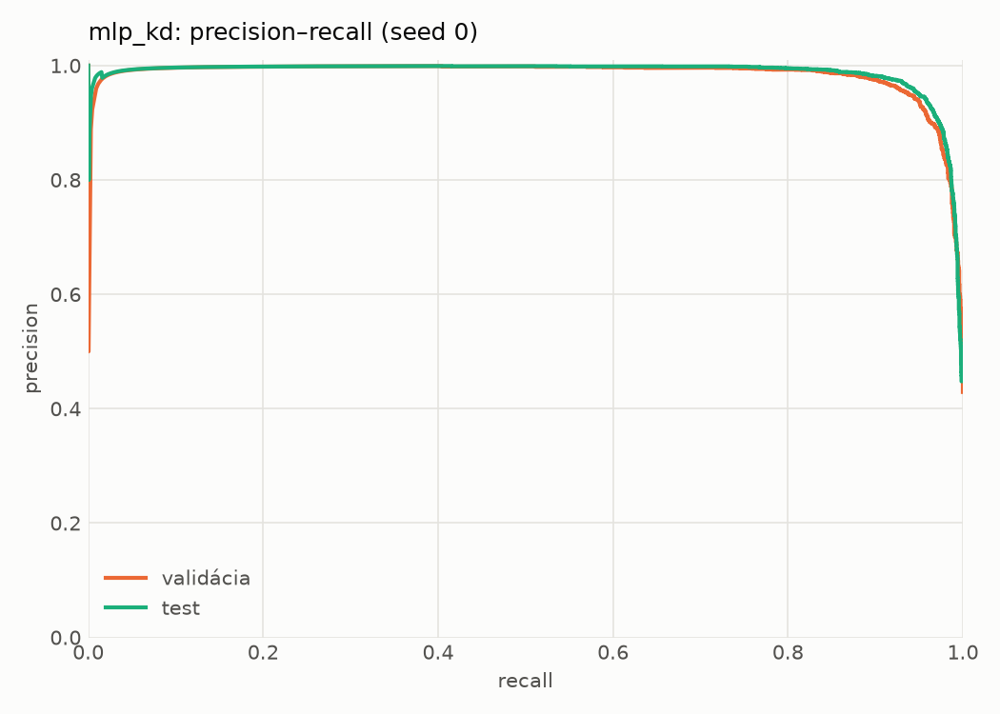
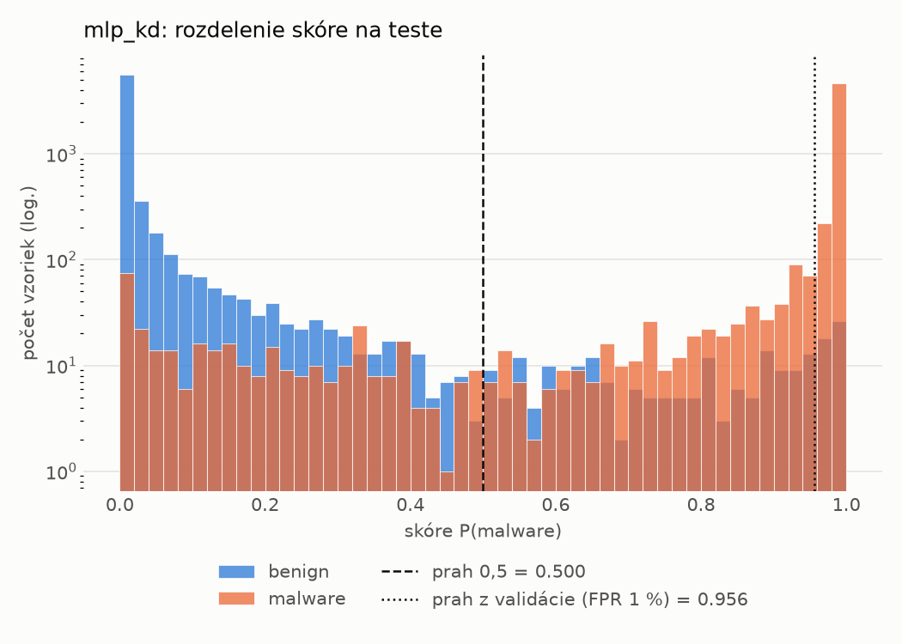
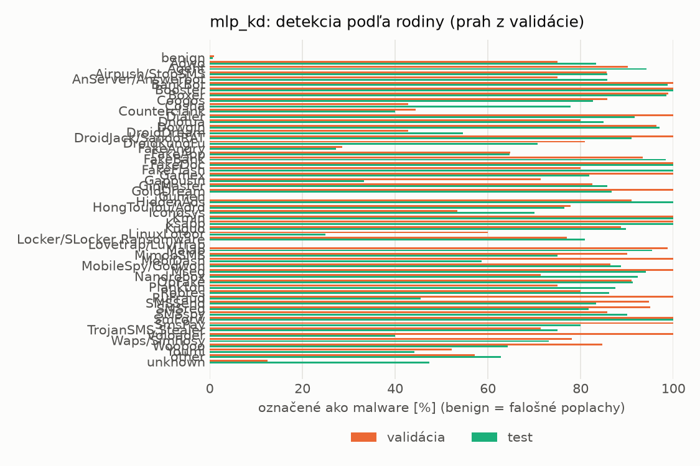
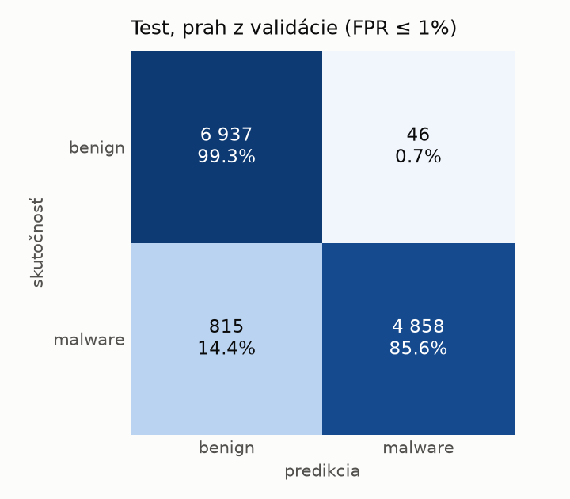
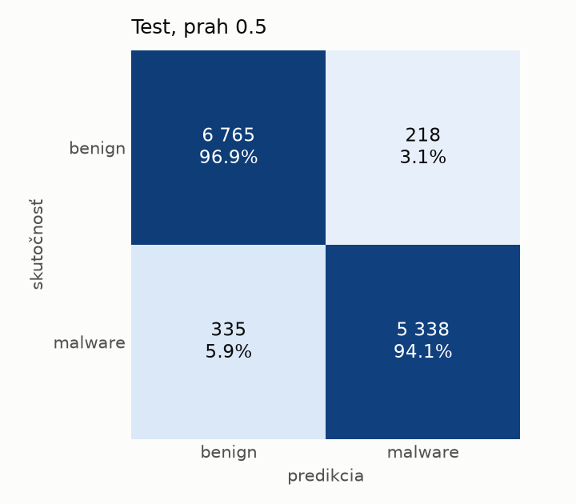
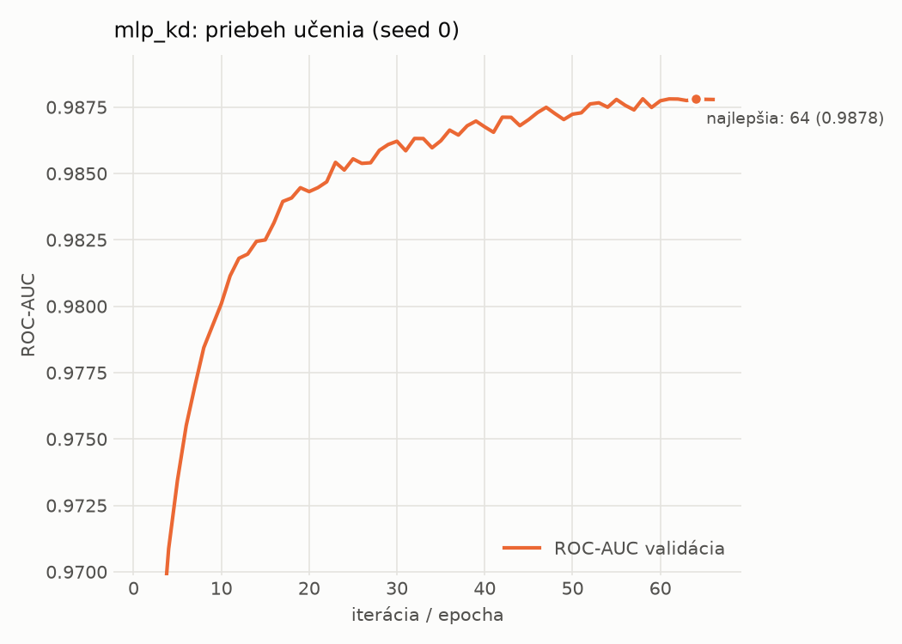

# static/mlp_kd – beh `20261123-215606`

> Automaticky generované (`src/training/run_tabular.py`). Konfigurácia: `config.yaml`, protokol: `protocol.yaml`.

- **Model:** `mlp` – študent – malé MLP učené destiláciou z hybridného učiteľa
- **Ladenie:** bez ladenia – hyperparametre prevzaté z `runs_v4/emu_p/full/students_static/mlp_kd/20261123-203204`
- **Finálne modely:** seedy [0, 1, 2]; hodnoty sú priemer ± smerodajná odchýlka cez seedy
- **Najlepšie hyperparametre:** `{"hidden_layers": 1, "max_epochs": 100, "patience": 8, "hidden_width": 64, "dropout": 0.0038513032258879476, "lr": 0.0011339137585789736, "weight_decay": 0.00026533084929296607, "batch_size": 1024, "kd_alpha": 0.3835611341536954, "kd_temperature": 1.7047486853284286}`

## Detekčná kvalita (bez prahu)
| metrika | train (podvzorka) | validácia | test |
|---|---|---|---|
| ROC-AUC | 0.9916 ± 0.0003 | 0.9875 ± 0.0007 | 0.9887 ± 0.0006 |
| PR-AUC | 0.9913 ± 0.0003 | 0.9837 ± 0.0017 | 0.9880 ± 0.0008 |
| TPR pri FPR 1 % | 0.9238 ± 0.0045 | 0.8621 ± 0.0063 | 0.8794 ± 0.0041 |
| TPR pri FPR 0,1 % | 0.7636 ± 0.0159 | 0.5275 ± 0.1535 | 0.6662 ± 0.0653 |
| log loss | 0.1039 ± 0.0029 | 0.1479 ± 0.0056 | 0.1343 ± 0.0042 |
| Brier skóre | 0.0272 ± 0.0008 | 0.0382 ± 0.0010 | 0.0342 ± 0.0002 |

Rozdiel ROC-AUC train − validácia: **0.0042** (veľký rozdiel = preučenie).

## Pri prahu z validácie (FPR ≤ 1% na validácii)
| metrika | train (podvzorka) | validácia | test |
|---|---|---|---|
| accuracy | 0.9457 ± 0.0026 | 0.9353 ± 0.0027 | 0.9317 ± 0.0021 |
| balanced accuracy | 0.9362 ± 0.0030 | 0.9262 ± 0.0031 | 0.9246 ± 0.0024 |
| precision | 0.9940 ± 0.0002 | 0.9852 ± 0.0001 | 0.9902 ± 0.0014 |
| recall (TPR) | 0.8762 ± 0.0060 | 0.8621 ± 0.0063 | 0.8561 ± 0.0058 |
| FPR | 0.0039 ± 0.0001 | 0.0097 ± 0.0000 | 0.0069 ± 0.0010 |
| F1 | 0.9314 ± 0.0035 | 0.9195 ± 0.0036 | 0.9183 ± 0.0028 |
| MCC | 0.8915 ± 0.0050 | 0.8712 ± 0.0052 | 0.8669 ± 0.0036 |

## Pri pevnom prahu 0.5
| metrika | train (podvzorka) | validácia | test |
|---|---|---|---|
| accuracy | 0.9639 ± 0.0011 | 0.9515 ± 0.0005 | 0.9565 ± 0.0004 |
| balanced accuracy | 0.9611 ± 0.0010 | 0.9498 ± 0.0006 | 0.9550 ± 0.0004 |
| precision | 0.9703 ± 0.0023 | 0.9486 ± 0.0006 | 0.9618 ± 0.0009 |
| recall (TPR) | 0.9432 ± 0.0006 | 0.9377 ± 0.0008 | 0.9404 ± 0.0010 |
| FPR | 0.0210 ± 0.0016 | 0.0382 ± 0.0004 | 0.0304 ± 0.0008 |
| F1 | 0.9566 ± 0.0013 | 0.9431 ± 0.0006 | 0.9509 ± 0.0004 |
| MCC | 0.9260 ± 0.0023 | 0.9008 ± 0.0011 | 0.9121 ± 0.0007 |

## Výpočtové nároky (seed 0, testovacia množina)
| meranie | hodnota |
|---|---|
| tréning finálneho modelu | 4.8 s (priemer cez seedy) |
| ladenie spolu | 0 s |
| počet parametrov / uzlov | 10 689 |
| veľkosť modelu na disku | 0.05 MB |
| transformácia vstupu – latencia (1 vlákno) | 0.015 ms |
| transformácia vstupu – priepustnosť | 730 577 vzoriek/s |
| CPU latencia modelu (batch 1, 1 vlákno) | 0.052 ms (p95 0.059) |
| CPU priepustnosť (24 vlákien) | 3 688 505 vzoriek/s |
| GPU latencia (batch 1) | 0.442 ms (p95 0.466) |
| GPU priepustnosť | 2 184 819 vzoriek/s |
| GPU špičková pamäť | 62 MB |

## Grafy
| | |
|---|---|
|  |  |
|  |  |
|  |  |
|  |  |

## Súbory
`metrics.json` (všetky metriky po seedoch vrátane rodín), `timing.json`, `hpo_trials.csv`,
`predictions/<časť>_seed<N>.parquet` (sha256, family, label, score), `model/seed_<N>/`, `log.txt`.
