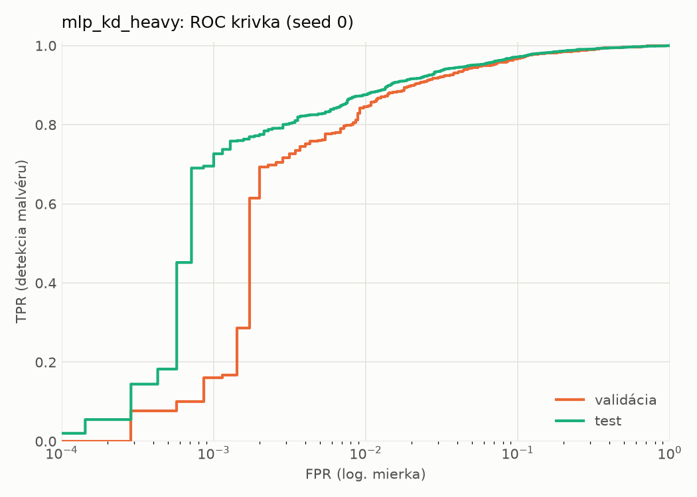
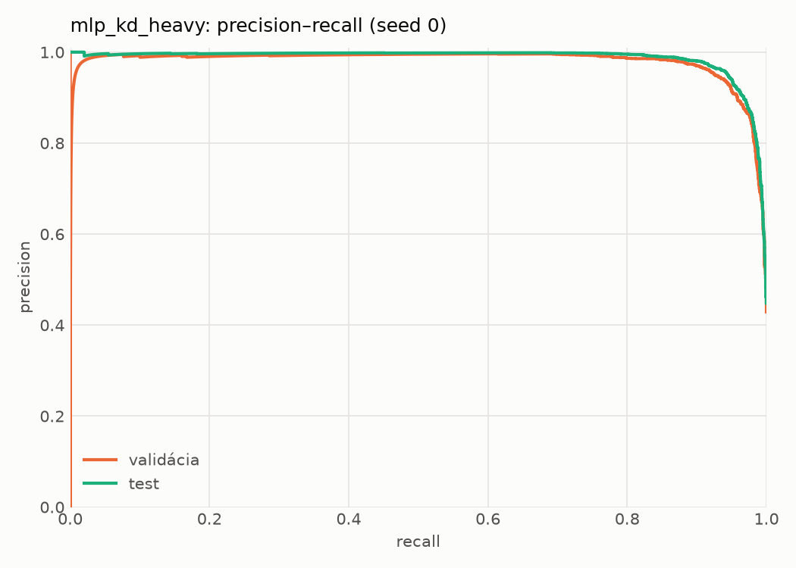
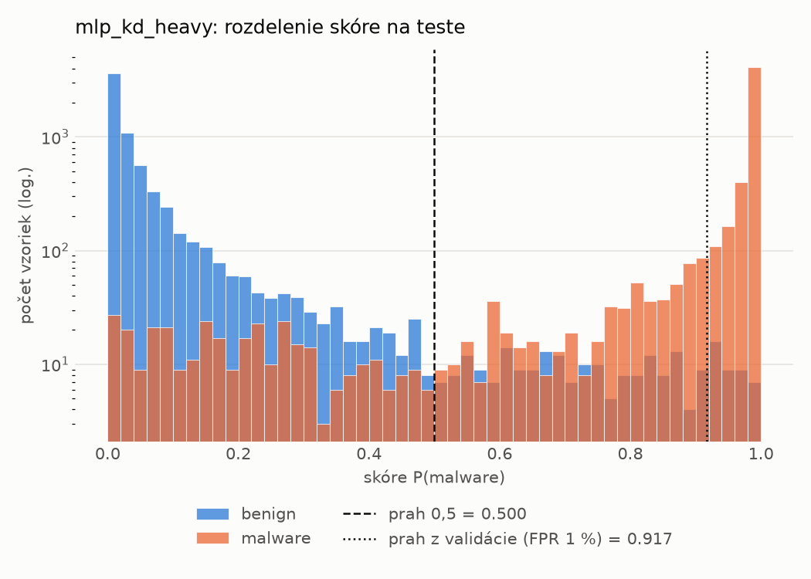
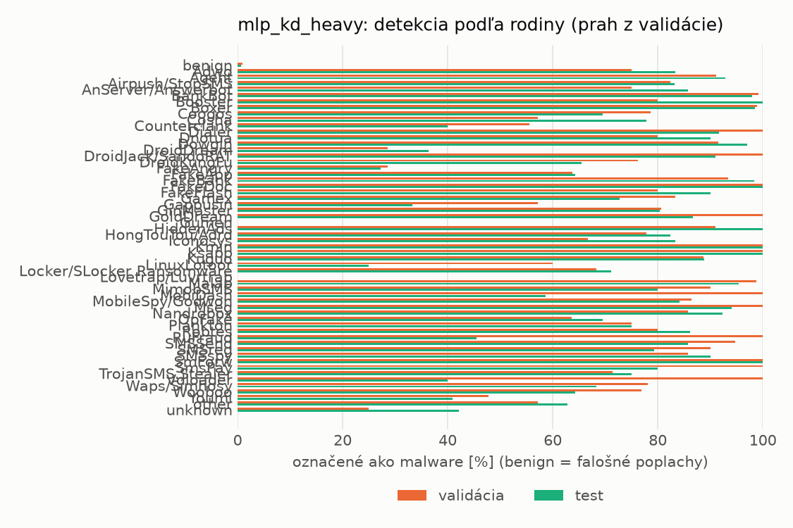
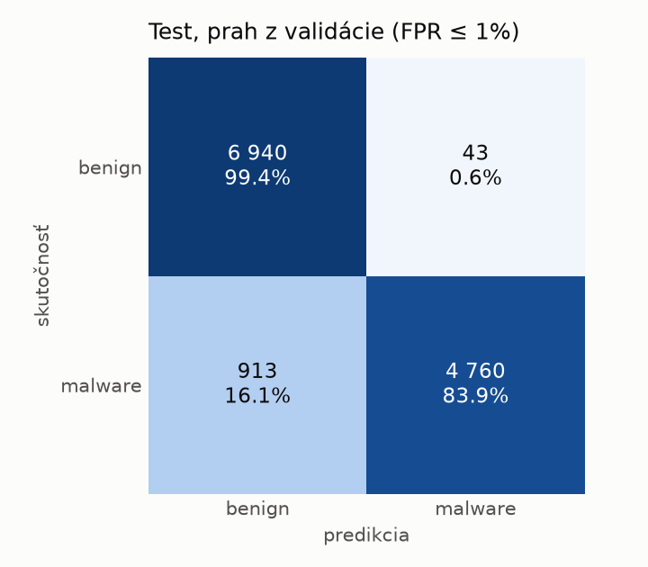
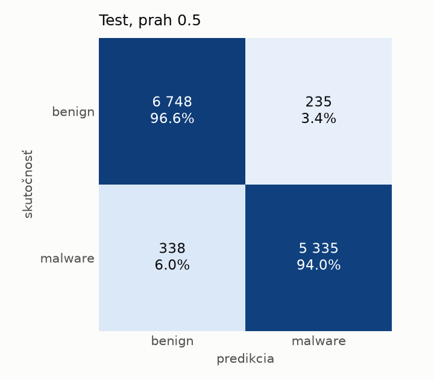
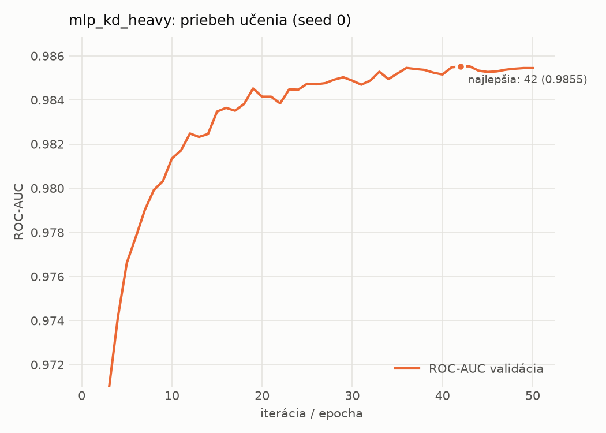

# static/mlp_kd_heavy – beh `20261123-215712`

> Automaticky generované (`src/training/run_tabular.py`). Konfigurácia: `config.yaml`, protokol: `protocol.yaml`.

- **Model:** `mlp` – študent – malé MLP učené destiláciou z mlp_large hybridu (V4)
- **Ladenie:** bez ladenia – hyperparametre prevzaté z `runs_v4/emu_p/full/students_static/mlp_kd_heavy/20261123-204329`
- **Finálne modely:** seedy [0, 1, 2]; hodnoty sú priemer ± smerodajná odchýlka cez seedy
- **Najlepšie hyperparametre:** `{"hidden_layers": 1, "max_epochs": 100, "patience": 8, "hidden_width": 64, "dropout": 0.1254973730751401, "lr": 0.0014439667191275393, "weight_decay": 1.2808340108243318e-06, "batch_size": 1024, "kd_alpha": 0.5142654341824873, "kd_temperature": 1.3883261824077338}`

## Detekčná kvalita (bez prahu)
| metrika | train (podvzorka) | validácia | test |
|---|---|---|---|
| ROC-AUC | 0.9911 ± 0.0003 | 0.9859 ± 0.0003 | 0.9882 ± 0.0004 |
| PR-AUC | 0.9902 ± 0.0004 | 0.9808 ± 0.0011 | 0.9877 ± 0.0008 |
| TPR pri FPR 1 % | 0.9132 ± 0.0018 | 0.8506 ± 0.0062 | 0.8806 ± 0.0078 |
| TPR pri FPR 0,1 % | 0.7748 ± 0.0094 | 0.4039 ± 0.2164 | 0.7000 ± 0.0164 |
| log loss | 0.1099 ± 0.0014 | 0.1434 ± 0.0020 | 0.1274 ± 0.0028 |
| Brier skóre | 0.0297 ± 0.0003 | 0.0396 ± 0.0006 | 0.0350 ± 0.0008 |

Rozdiel ROC-AUC train − validácia: **0.0052** (veľký rozdiel = preučenie).

## Pri prahu z validácie (FPR ≤ 1% na validácii)
| metrika | train (podvzorka) | validácia | test |
|---|---|---|---|
| accuracy | 0.9402 ± 0.0030 | 0.9303 ± 0.0027 | 0.9284 ± 0.0046 |
| balanced accuracy | 0.9298 ± 0.0036 | 0.9204 ± 0.0031 | 0.9209 ± 0.0051 |
| precision | 0.9936 ± 0.0007 | 0.9850 ± 0.0001 | 0.9912 ± 0.0002 |
| recall (TPR) | 0.8635 ± 0.0076 | 0.8506 ± 0.0062 | 0.8479 ± 0.0102 |
| FPR | 0.0040 ± 0.0005 | 0.0097 ± 0.0000 | 0.0061 ± 0.0001 |
| F1 | 0.9240 ± 0.0042 | 0.9128 ± 0.0036 | 0.9139 ± 0.0060 |
| MCC | 0.8810 ± 0.0057 | 0.8617 ± 0.0051 | 0.8610 ± 0.0086 |

## Pri pevnom prahu 0.5
| metrika | train (podvzorka) | validácia | test |
|---|---|---|---|
| accuracy | 0.9621 ± 0.0008 | 0.9482 ± 0.0005 | 0.9553 ± 0.0007 |
| balanced accuracy | 0.9601 ± 0.0008 | 0.9470 ± 0.0006 | 0.9540 ± 0.0009 |
| precision | 0.9624 ± 0.0015 | 0.9408 ± 0.0006 | 0.9575 ± 0.0006 |
| recall (TPR) | 0.9470 ± 0.0009 | 0.9385 ± 0.0015 | 0.9420 ± 0.0023 |
| FPR | 0.0269 ± 0.0011 | 0.0444 ± 0.0005 | 0.0340 ± 0.0006 |
| F1 | 0.9547 ± 0.0010 | 0.9396 ± 0.0006 | 0.9497 ± 0.0009 |
| MCC | 0.9222 ± 0.0017 | 0.8943 ± 0.0010 | 0.9095 ± 0.0014 |

## Výpočtové nároky (seed 0, testovacia množina)
| meranie | hodnota |
|---|---|
| tréning finálneho modelu | 3.5 s (priemer cez seedy) |
| ladenie spolu | 0 s |
| počet parametrov / uzlov | 10 689 |
| veľkosť modelu na disku | 0.05 MB |
| transformácia vstupu – latencia (1 vlákno) | 0.015 ms |
| transformácia vstupu – priepustnosť | 736 662 vzoriek/s |
| CPU latencia modelu (batch 1, 1 vlákno) | 0.067 ms (p95 0.077) |
| CPU priepustnosť (24 vlákien) | 6 312 534 vzoriek/s |
| GPU latencia (batch 1) | 0.451 ms (p95 0.484) |
| GPU priepustnosť | 2 223 667 vzoriek/s |
| GPU špičková pamäť | 93 MB |

## Grafy
| | |
|---|---|
|  |  |
|  |  |
|  |  |
|  |  |

## Súbory
`metrics.json` (všetky metriky po seedoch vrátane rodín), `timing.json`, `hpo_trials.csv`,
`predictions/<časť>_seed<N>.parquet` (sha256, family, label, score), `model/seed_<N>/`, `log.txt`.
