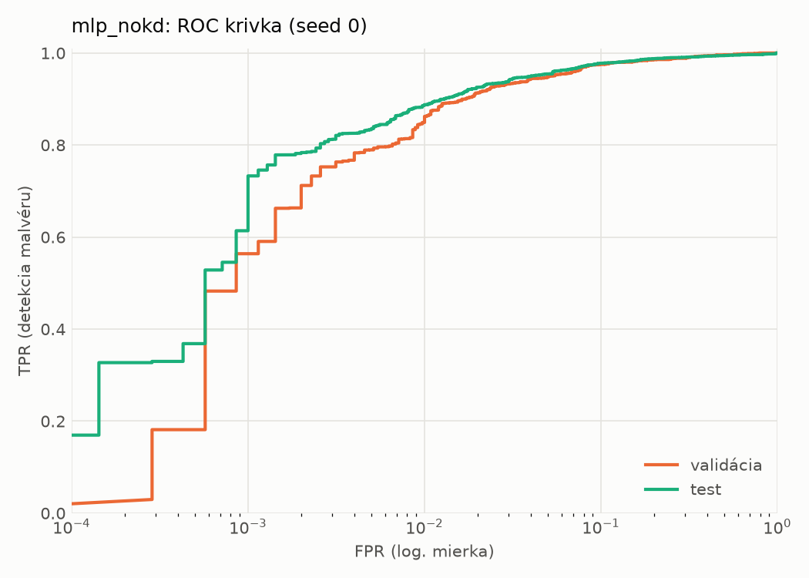
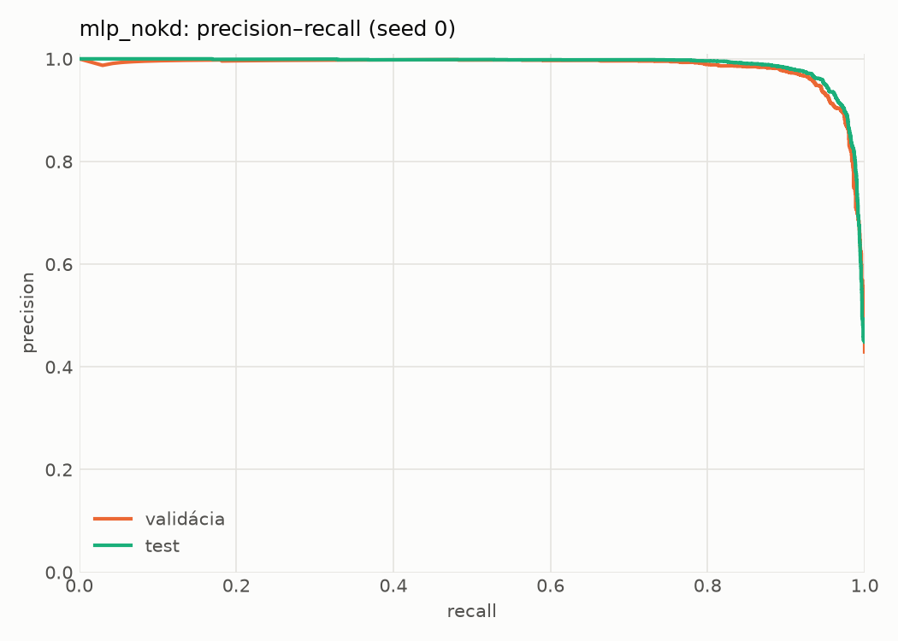
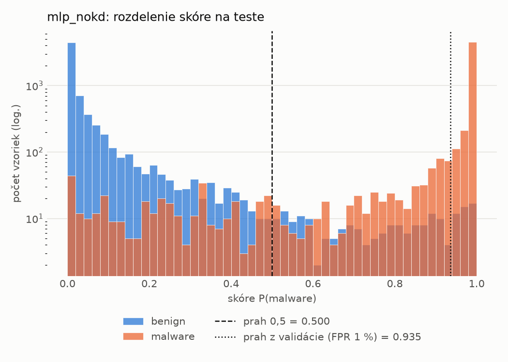
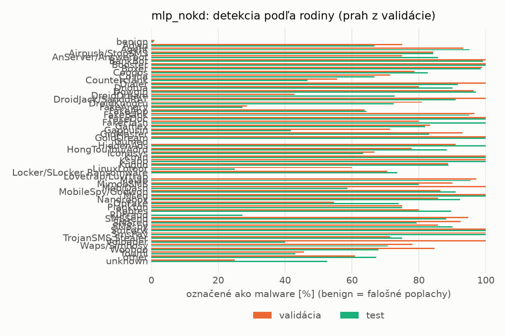
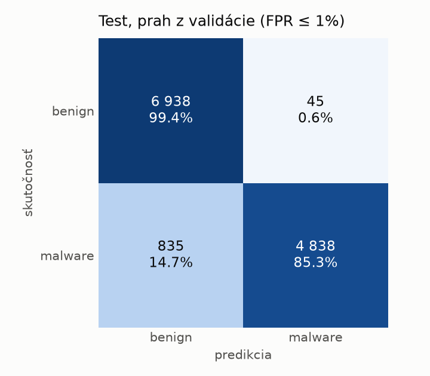
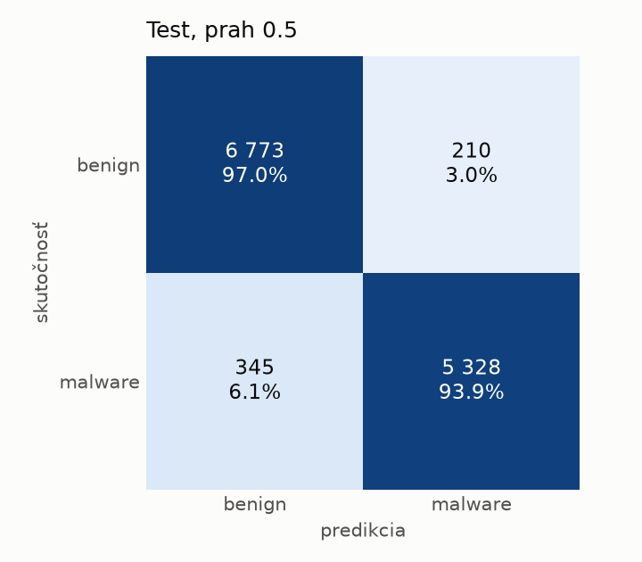
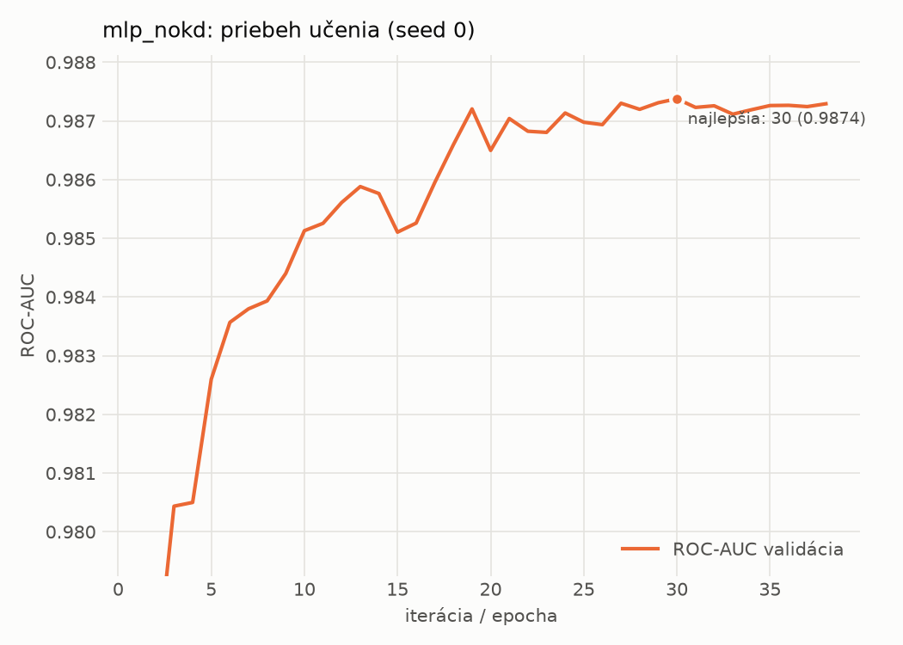

# static/mlp_nokd – beh `20261123-215622`

> Automaticky generované (`src/training/run_tabular.py`). Konfigurácia: `config.yaml`, protokol: `protocol.yaml`.

- **Model:** `mlp` – kontrola – rovnaké malé MLP bez destilácie (iba skutočné označenia)
- **Ladenie:** bez ladenia – hyperparametre prevzaté z `runs_v4/emu_p/full/students_static/mlp_nokd/20261123-203547`
- **Finálne modely:** seedy [0, 1, 2]; hodnoty sú priemer ± smerodajná odchýlka cez seedy
- **Najlepšie hyperparametre:** `{"hidden_layers": 1, "max_epochs": 100, "patience": 8, "hidden_width": 64, "dropout": 0.15022694447625398, "lr": 0.0027248227778296176, "weight_decay": 1.7062100113192703e-06, "batch_size": 256}`

## Detekčná kvalita (bez prahu)
| metrika | train (podvzorka) | validácia | test |
|---|---|---|---|
| ROC-AUC | 0.9934 ± 0.0004 | 0.9870 ± 0.0004 | 0.9885 ± 0.0005 |
| PR-AUC | 0.9929 ± 0.0004 | 0.9843 ± 0.0004 | 0.9882 ± 0.0003 |
| TPR pri FPR 1 % | 0.9374 ± 0.0037 | 0.8494 ± 0.0010 | 0.8827 ± 0.0097 |
| TPR pri FPR 0,1 % | 0.8085 ± 0.0105 | 0.5778 ± 0.0132 | 0.5650 ± 0.0424 |
| log loss | 0.0914 ± 0.0025 | 0.1398 ± 0.0023 | 0.1287 ± 0.0034 |
| Brier skóre | 0.0246 ± 0.0007 | 0.0371 ± 0.0005 | 0.0336 ± 0.0005 |

Rozdiel ROC-AUC train − validácia: **0.0064** (veľký rozdiel = preučenie).

## Pri prahu z validácie (FPR ≤ 1% na validácii)
| metrika | train (podvzorka) | validácia | test |
|---|---|---|---|
| accuracy | 0.9412 ± 0.0023 | 0.9299 ± 0.0004 | 0.9282 ± 0.0029 |
| balanced accuracy | 0.9307 ± 0.0029 | 0.9199 ± 0.0005 | 0.9206 ± 0.0034 |
| precision | 0.9954 ± 0.0016 | 0.9851 ± 0.0002 | 0.9908 ± 0.0015 |
| recall (TPR) | 0.8642 ± 0.0067 | 0.8494 ± 0.0010 | 0.8476 ± 0.0076 |
| FPR | 0.0029 ± 0.0011 | 0.0096 ± 0.0002 | 0.0064 ± 0.0011 |
| F1 | 0.9252 ± 0.0033 | 0.9122 ± 0.0005 | 0.9136 ± 0.0039 |
| MCC | 0.8831 ± 0.0043 | 0.8609 ± 0.0007 | 0.8604 ± 0.0052 |

## Pri pevnom prahu 0.5
| metrika | train (podvzorka) | validácia | test |
|---|---|---|---|
| accuracy | 0.9683 ± 0.0008 | 0.9521 ± 0.0011 | 0.9557 ± 0.0010 |
| balanced accuracy | 0.9661 ± 0.0007 | 0.9508 ± 0.0011 | 0.9542 ± 0.0010 |
| precision | 0.9719 ± 0.0018 | 0.9467 ± 0.0015 | 0.9605 ± 0.0015 |
| recall (TPR) | 0.9523 ± 0.0008 | 0.9414 ± 0.0010 | 0.9398 ± 0.0015 |
| FPR | 0.0200 ± 0.0013 | 0.0398 ± 0.0011 | 0.0314 ± 0.0012 |
| F1 | 0.9620 ± 0.0009 | 0.9441 ± 0.0012 | 0.9500 ± 0.0011 |
| MCC | 0.9350 ± 0.0016 | 0.9022 ± 0.0022 | 0.9104 ± 0.0020 |

## Výpočtové nároky (seed 0, testovacia množina)
| meranie | hodnota |
|---|---|
| tréning finálneho modelu | 7.5 s (priemer cez seedy) |
| ladenie spolu | 0 s |
| počet parametrov / uzlov | 10 689 |
| veľkosť modelu na disku | 0.05 MB |
| transformácia vstupu – latencia (1 vlákno) | 0.015 ms |
| transformácia vstupu – priepustnosť | 732 755 vzoriek/s |
| CPU latencia modelu (batch 1, 1 vlákno) | 0.155 ms (p95 0.165) |
| CPU priepustnosť (24 vlákien) | 4 867 318 vzoriek/s |
| GPU latencia (batch 1) | 0.442 ms (p95 0.468) |
| GPU priepustnosť | 2 506 883 vzoriek/s |
| GPU špičková pamäť | 93 MB |

## Grafy
| | |
|---|---|
|  |  |
|  |  |
|  |  |
|  |  |

## Súbory
`metrics.json` (všetky metriky po seedoch vrátane rodín), `timing.json`, `hpo_trials.csv`,
`predictions/<časť>_seed<N>.parquet` (sha256, family, label, score), `model/seed_<N>/`, `log.txt`.
