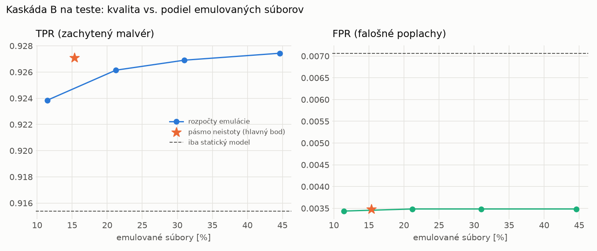

# Kaskáda B `b_baselines` – beh `20261123-221422`

> Generované `src/cascade/evaluate_b.py` (2026-11-23T22:14:22+01:00). Seedy: [0, 1, 2]; hodnoty = priemer ± sm. odchýlka.
> Všetky prahy a pásmo neistoty sú z validácie; test sa na nič nenastavuje. Postup: `docs/09_plan_v2.md`.

| rola | beh |
|---|---|
| static | `runs_v4/emu_p/lofo/Locker_SLocker_Ransomware/static/lightgbm/20261123-185406` |
| dynamic | `runs_v4/emu_p/lofo/Locker_SLocker_Ransomware/dynamic/lightgbm/20261123-220043` |
| hybrid | `runs_v4/emu_p/lofo/Locker_SLocker_Ransomware/hybrid/lightgbm/20261123-220356` |

Druhý stupeň: **dynamic**. Pásmo neistoty statického modelu: FPR ≤ 0.1% nad `hi`,
najviac 1% malvéru validácie pod `lo` (seed 0: lo = 0.0110, hi = 0.9951, seed 1: lo = 0.0110, hi = 0.9933, seed 2: lo = 0.0006, hi = 0.9998).

## Test
| prístup | accuracy | balanced_accuracy | precision | recall_tpr | fpr | f1 | mcc |
|---|---|---|---|---|---|---|---|
| kaskáda B | 0.9654 ± 0.0004 | 0.9618 ± 0.0005 | 0.9954 ± 0.0005 | 0.9271 ± 0.0011 | 0.0035 ± 0.0004 | 0.9600 ± 0.0005 | 0.9314 ± 0.0008 |
| statický | 0.9582 ± 0.0014 | 0.9542 ± 0.0015 | 0.9906 ± 0.0003 | 0.9154 ± 0.0028 | 0.0071 ± 0.0002 | 0.9515 ± 0.0017 | 0.9170 ± 0.0027 |
| dynamický | 0.9094 ± 0.0026 | 0.8999 ± 0.0029 | 0.9876 ± 0.0008 | 0.8079 ± 0.0061 | 0.0082 ± 0.0006 | 0.8888 ± 0.0035 | 0.8253 ± 0.0046 |
| hybrid (každá vzorka) | 0.9693 ± 0.0008 | 0.9665 ± 0.0009 | 0.9915 ± 0.0007 | 0.9395 ± 0.0023 | 0.0065 ± 0.0005 | 0.9648 ± 0.0009 | 0.9386 ± 0.0014 |

- **emulované súbory: 15.34%** (ostatné rozhodne iba statický model); na hybrid ide 3.24% súborov
- chyby pri istom rozhodnutí statického modelu (seed 0): 128
- validácia: emulované 13.63%, na hybrid 3.06%

## Validácia
| prístup | accuracy | balanced_accuracy | precision | recall_tpr | fpr | f1 | mcc |
|---|---|---|---|---|---|---|---|
| kaskáda B | 0.9767 ± 0.0005 | 0.9742 ± 0.0005 | 0.9904 ± 0.0002 | 0.9555 ± 0.0009 | 0.0071 ± 0.0002 | 0.9726 ± 0.0006 | 0.9528 ± 0.0009 |
| statický | 0.9707 ± 0.0014 | 0.9677 ± 0.0016 | 0.9867 ± 0.0000 | 0.9451 ± 0.0031 | 0.0097 ± 0.0000 | 0.9654 ± 0.0017 | 0.9407 ± 0.0027 |
| dynamický | 0.9275 ± 0.0010 | 0.9178 ± 0.0012 | 0.9851 ± 0.0000 | 0.8454 ± 0.0023 | 0.0097 ± 0.0000 | 0.9099 ± 0.0014 | 0.8569 ± 0.0019 |
| hybrid (každá vzorka) | 0.9778 ± 0.0005 | 0.9758 ± 0.0006 | 0.9872 ± 0.0002 | 0.9612 ± 0.0014 | 0.0096 ± 0.0002 | 0.9740 ± 0.0006 | 0.9549 ± 0.0010 |

## Januárové vzorky vynechanej rodiny (iba malvér → TPR)
| prístup | TPR |
|---|---|
| kaskáda B | 0.3219 ± 0.0017 |
| statický | 0.3239 ± 0.0049 |
| dynamický | 0.1861 ± 0.0078 |
| hybrid (každá vzorka) | 0.3545 ± 0.0041 |

Podiel emulovaných: 37.17%

## Krivka rozpočtu emulácie (test, priemer cez seedy)
| budget_val | emulation_rate | hybrid_rate | recall_tpr | fpr | f1 |
|---|---|---|---|---|---|
| 0.1000 | 0.1146 | 0.0372 | 0.9238 | 0.0034 | 0.9583 |
| 0.2000 | 0.2123 | 0.0508 | 0.9261 | 0.0035 | 0.9595 |
| 0.3000 | 0.3101 | 0.0585 | 0.9269 | 0.0035 | 0.9599 |
| 0.4000 | 0.4460 | 0.0680 | 0.9274 | 0.0035 | 0.9602 |

## Výpočtové nároky
Čas dynamickej analýzy (beh v emulátore alebo na zariadení) dataset neuvádza, preto sa neodhaduje. Úspora kaskády B = podiel súborov s dynamickou analýzou: **15.34%** (ostatné prístupy 100 %).

_Chýba benchmark niektorého komponentu (v zero-day behoch sa nemeria)._

