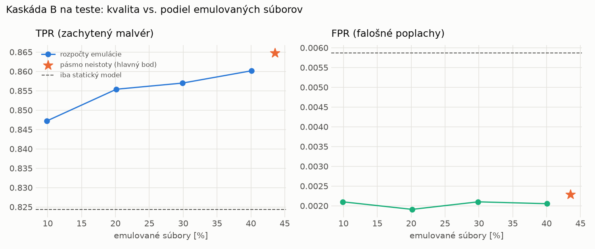

# Kaskáda B `b_heavyteacher` – beh `20261123-221426`

> Generované `src/cascade/evaluate_b.py` (2026-11-23T22:14:26+01:00). Seedy: [0, 1, 2]; hodnoty = priemer ± sm. odchýlka.
> Všetky prahy a pásmo neistoty sú z validácie; test sa na nič nenastavuje. Postup: `docs/09_plan_v2.md`.

| rola | beh |
|---|---|
| static | `runs_v4/emu_p/lofo/Locker_SLocker_Ransomware/students_static/mlp_kd_heavy/20261123-221149` |
| dynamic | `runs_v4/emu_p/lofo/Locker_SLocker_Ransomware/students_dynamic/mlp_kd_heavy/20261123-221338` |
| hybrid | `runs_v4/emu_p/lofo/Locker_SLocker_Ransomware/hybrid/lightgbm/20261123-220356` |

Druhý stupeň: **dynamic**. Pásmo neistoty statického modelu: FPR ≤ 0.1% nad `hi`,
najviac 1% malvéru validácie pod `lo` (seed 0: lo = 0.0427, hi = 0.9973, seed 1: lo = 0.0346, hi = 0.9955, seed 2: lo = 0.0395, hi = 0.9971).

## Test
| prístup | accuracy | balanced_accuracy | precision | recall_tpr | fpr | f1 | mcc |
|---|---|---|---|---|---|---|---|
| kaskáda B | 0.9381 ± 0.0026 | 0.9313 ± 0.0029 | 0.9967 ± 0.0004 | 0.8648 ± 0.0056 | 0.0023 ± 0.0003 | 0.9261 ± 0.0033 | 0.8799 ± 0.0049 |
| statický | 0.9180 ± 0.0044 | 0.9093 ± 0.0050 | 0.9913 ± 0.0014 | 0.8244 ± 0.0103 | 0.0059 ± 0.0010 | 0.9001 ± 0.0059 | 0.8418 ± 0.0080 |
| dynamický | 0.8093 ± 0.0005 | 0.7882 ± 0.0006 | 0.9829 ± 0.0012 | 0.5847 ± 0.0017 | 0.0083 ± 0.0006 | 0.7332 ± 0.0011 | 0.6483 ± 0.0008 |
| hybrid (každá vzorka) | 0.9693 ± 0.0008 | 0.9665 ± 0.0009 | 0.9915 ± 0.0007 | 0.9395 ± 0.0023 | 0.0065 ± 0.0005 | 0.9648 ± 0.0009 | 0.9386 ± 0.0014 |

- **emulované súbory: 43.52%** (ostatné rozhodne iba statický model); na hybrid ide 10.05% súborov
- chyby pri istom rozhodnutí statického modelu (seed 0): 131
- validácia: emulované 42.56%, na hybrid 9.93%

## Validácia
| prístup | accuracy | balanced_accuracy | precision | recall_tpr | fpr | f1 | mcc |
|---|---|---|---|---|---|---|---|
| kaskáda B | 0.9500 ± 0.0048 | 0.9430 ± 0.0055 | 0.9925 ± 0.0008 | 0.8912 ± 0.0106 | 0.0052 ± 0.0005 | 0.9391 ± 0.0062 | 0.9006 ± 0.0093 |
| statický | 0.9283 ± 0.0072 | 0.9188 ± 0.0082 | 0.9853 ± 0.0005 | 0.8472 ± 0.0163 | 0.0096 ± 0.0002 | 0.9110 ± 0.0096 | 0.8584 ± 0.0136 |
| dynamický | 0.8252 ± 0.0002 | 0.7996 ± 0.0002 | 0.9795 ± 0.0000 | 0.6090 ± 0.0004 | 0.0097 ± 0.0000 | 0.7510 ± 0.0003 | 0.6694 ± 0.0003 |
| hybrid (každá vzorka) | 0.9778 ± 0.0005 | 0.9758 ± 0.0006 | 0.9872 ± 0.0002 | 0.9612 ± 0.0014 | 0.0096 ± 0.0002 | 0.9740 ± 0.0006 | 0.9549 ± 0.0010 |

## Januárové vzorky vynechanej rodiny (iba malvér → TPR)
| prístup | TPR |
|---|---|
| kaskáda B | 0.2315 ± 0.0036 |
| statický | 0.1953 ± 0.0070 |
| dynamický | 0.3457 ± 0.0703 |
| hybrid (každá vzorka) | 0.3545 ± 0.0041 |

Podiel emulovaných: 50.36%

## Krivka rozpočtu emulácie (test, priemer cez seedy)
| budget_val | emulation_rate | hybrid_rate | recall_tpr | fpr | f1 |
|---|---|---|---|---|---|
| 0.1000 | 0.0990 | 0.0438 | 0.8472 | 0.0021 | 0.9160 |
| 0.2000 | 0.2014 | 0.0795 | 0.8554 | 0.0019 | 0.9209 |
| 0.3000 | 0.2989 | 0.1021 | 0.8570 | 0.0021 | 0.9217 |
| 0.4000 | 0.4007 | 0.1276 | 0.8602 | 0.0021 | 0.9236 |

## Výpočtové nároky
Čas dynamickej analýzy (beh v emulátore alebo na zariadení) dataset neuvádza, preto sa neodhaduje. Úspora kaskády B = podiel súborov s dynamickou analýzou: **43.52%** (ostatné prístupy 100 %).

_Chýba benchmark niektorého komponentu (v zero-day behoch sa nemeria)._

