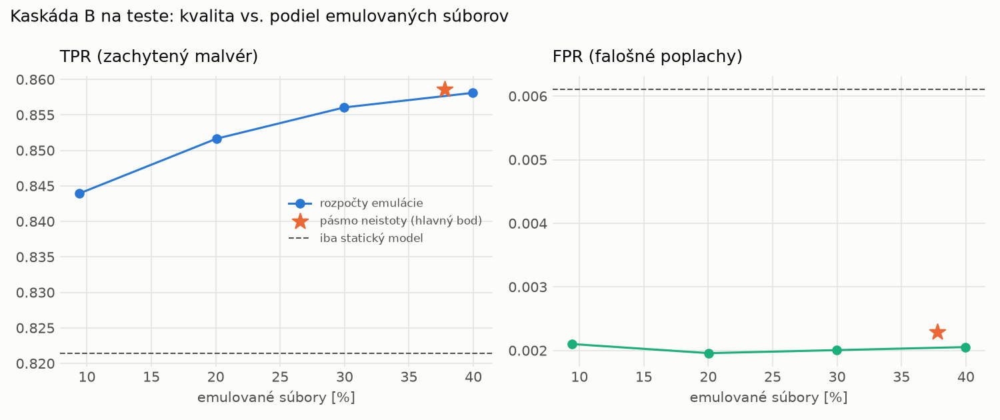

# Kaskáda B `b_main` – beh `20261123-221416`

> Generované `src/cascade/evaluate_b.py` (2026-11-23T22:14:17+01:00). Seedy: [0, 1, 2]; hodnoty = priemer ± sm. odchýlka.
> Všetky prahy a pásmo neistoty sú z validácie; test sa na nič nenastavuje. Postup: `docs/09_plan_v2.md`.

| rola | beh |
|---|---|
| static | `runs_v4/emu_p/lofo/Locker_SLocker_Ransomware/students_static/mlp_kd/20261123-221044` |
| dynamic | `runs_v4/emu_p/lofo/Locker_SLocker_Ransomware/students_dynamic/mlp_kd/20261123-221205` |
| hybrid | `runs_v4/emu_p/lofo/Locker_SLocker_Ransomware/hybrid/lightgbm/20261123-220356` |

Druhý stupeň: **dynamic**. Pásmo neistoty statického modelu: FPR ≤ 0.1% nad `hi`,
najviac 1% malvéru validácie pod `lo` (seed 0: lo = 0.0067, hi = 0.9999, seed 1: lo = 0.0067, hi = 0.9994, seed 2: lo = 0.0101, hi = 0.9996).

## Test
| prístup | accuracy | balanced_accuracy | precision | recall_tpr | fpr | f1 | mcc |
|---|---|---|---|---|---|---|---|
| kaskáda B | 0.9354 ± 0.0026 | 0.9282 ± 0.0029 | 0.9967 ± 0.0004 | 0.8586 ± 0.0057 | 0.0023 ± 0.0003 | 0.9225 ± 0.0034 | 0.8747 ± 0.0049 |
| statický | 0.9166 ± 0.0034 | 0.9077 ± 0.0038 | 0.9909 ± 0.0002 | 0.8214 ± 0.0076 | 0.0061 ± 0.0001 | 0.8982 ± 0.0046 | 0.8391 ± 0.0063 |
| dynamický | 0.8108 ± 0.0049 | 0.7898 ± 0.0056 | 0.9840 ± 0.0014 | 0.5875 ± 0.0117 | 0.0078 ± 0.0008 | 0.7356 ± 0.0089 | 0.6512 ± 0.0082 |
| hybrid (každá vzorka) | 0.9693 ± 0.0008 | 0.9665 ± 0.0009 | 0.9915 ± 0.0007 | 0.9395 ± 0.0023 | 0.0065 ± 0.0005 | 0.9648 ± 0.0009 | 0.9386 ± 0.0014 |

- **emulované súbory: 37.78%** (ostatné rozhodne iba statický model); na hybrid ide 8.99% súborov
- chyby pri istom rozhodnutí statického modelu (seed 0): 145
- validácia: emulované 37.02%, na hybrid 9.42%

## Validácia
| prístup | accuracy | balanced_accuracy | precision | recall_tpr | fpr | f1 | mcc |
|---|---|---|---|---|---|---|---|
| kaskáda B | 0.9500 ± 0.0039 | 0.9431 ± 0.0045 | 0.9923 ± 0.0009 | 0.8914 ± 0.0092 | 0.0053 ± 0.0007 | 0.9392 ± 0.0051 | 0.9007 ± 0.0075 |
| statický | 0.9295 ± 0.0075 | 0.9201 ± 0.0086 | 0.9852 ± 0.0003 | 0.8499 ± 0.0172 | 0.0097 ± 0.0000 | 0.9125 ± 0.0101 | 0.8606 ± 0.0141 |
| dynamický | 0.8278 ± 0.0073 | 0.8026 ± 0.0085 | 0.9797 ± 0.0005 | 0.6150 ± 0.0169 | 0.0097 ± 0.0000 | 0.7556 ± 0.0129 | 0.6741 ± 0.0132 |
| hybrid (každá vzorka) | 0.9778 ± 0.0005 | 0.9758 ± 0.0006 | 0.9872 ± 0.0002 | 0.9612 ± 0.0014 | 0.0096 ± 0.0002 | 0.9740 ± 0.0006 | 0.9549 ± 0.0010 |

## Januárové vzorky vynechanej rodiny (iba malvér → TPR)
| prístup | TPR |
|---|---|
| kaskáda B | 0.2301 ± 0.0101 |
| statický | 0.1934 ± 0.0085 |
| dynamický | 0.3899 ± 0.0101 |
| hybrid (každá vzorka) | 0.3545 ± 0.0041 |

Podiel emulovaných: 37.95%

## Krivka rozpočtu emulácie (test, priemer cez seedy)
| budget_val | emulation_rate | hybrid_rate | recall_tpr | fpr | f1 |
|---|---|---|---|---|---|
| 0.1000 | 0.0943 | 0.0425 | 0.8439 | 0.0021 | 0.9141 |
| 0.2000 | 0.2005 | 0.0775 | 0.8516 | 0.0020 | 0.9187 |
| 0.3000 | 0.2996 | 0.1090 | 0.8560 | 0.0020 | 0.9212 |
| 0.4000 | 0.3996 | 0.1251 | 0.8581 | 0.0021 | 0.9224 |

## Výpočtové nároky
Čas dynamickej analýzy (beh v emulátore alebo na zariadení) dataset neuvádza, preto sa neodhaduje. Úspora kaskády B = podiel súborov s dynamickou analýzou: **37.78%** (ostatné prístupy 100 %).

_Chýba benchmark niektorého komponentu (v zero-day behoch sa nemeria)._

