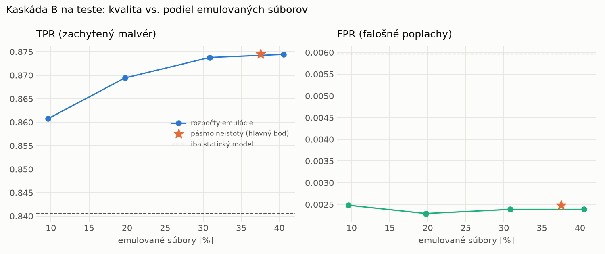

# Kaskáda B `b_nokd` – beh `20261123-221424`

> Generované `src/cascade/evaluate_b.py` (2026-11-23T22:14:24+01:00). Seedy: [0, 1, 2]; hodnoty = priemer ± sm. odchýlka.
> Všetky prahy a pásmo neistoty sú z validácie; test sa na nič nenastavuje. Postup: `docs/09_plan_v2.md`.

| rola | beh |
|---|---|
| static | `runs_v4/emu_p/lofo/Locker_SLocker_Ransomware/students_static/mlp_nokd/20261123-221100` |
| dynamic | `runs_v4/emu_p/lofo/Locker_SLocker_Ransomware/students_dynamic/mlp_nokd/20261123-221228` |
| hybrid | `runs_v4/emu_p/lofo/Locker_SLocker_Ransomware/hybrid/lightgbm/20261123-220356` |

Druhý stupeň: **dynamic**. Pásmo neistoty statického modelu: FPR ≤ 0.1% nad `hi`,
najviac 1% malvéru validácie pod `lo` (seed 0: lo = 0.0306, hi = 0.9988, seed 1: lo = 0.0322, hi = 0.9998, seed 2: lo = 0.0322, hi = 0.9994).

## Test
| prístup | accuracy | balanced_accuracy | precision | recall_tpr | fpr | f1 | mcc |
|---|---|---|---|---|---|---|---|
| kaskáda B | 0.9424 ± 0.0009 | 0.9360 ± 0.0010 | 0.9965 ± 0.0009 | 0.8746 ± 0.0027 | 0.0025 ± 0.0006 | 0.9316 ± 0.0012 | 0.8878 ± 0.0015 |
| statický | 0.9252 ± 0.0028 | 0.9173 ± 0.0032 | 0.9913 ± 0.0007 | 0.8405 ± 0.0070 | 0.0060 ± 0.0005 | 0.9097 ± 0.0038 | 0.8551 ± 0.0051 |
| dynamický | 0.8177 ± 0.0038 | 0.7977 ± 0.0043 | 0.9825 ± 0.0012 | 0.6041 ± 0.0092 | 0.0087 ± 0.0007 | 0.7481 ± 0.0068 | 0.6626 ± 0.0062 |
| hybrid (každá vzorka) | 0.9693 ± 0.0008 | 0.9665 ± 0.0009 | 0.9915 ± 0.0007 | 0.9395 ± 0.0023 | 0.0065 ± 0.0005 | 0.9648 ± 0.0009 | 0.9386 ± 0.0014 |

- **emulované súbory: 37.52%** (ostatné rozhodne iba statický model); na hybrid ide 8.26% súborov
- chyby pri istom rozhodnutí statického modelu (seed 0): 156
- validácia: emulované 37.15%, na hybrid 8.60%

## Validácia
| prístup | accuracy | balanced_accuracy | precision | recall_tpr | fpr | f1 | mcc |
|---|---|---|---|---|---|---|---|
| kaskáda B | 0.9557 ± 0.0021 | 0.9496 ± 0.0025 | 0.9931 ± 0.0004 | 0.9039 ± 0.0053 | 0.0048 ± 0.0003 | 0.9464 ± 0.0028 | 0.9117 ± 0.0041 |
| statický | 0.9338 ± 0.0061 | 0.9250 ± 0.0070 | 0.9855 ± 0.0005 | 0.8597 ± 0.0139 | 0.0096 ± 0.0002 | 0.9183 ± 0.0082 | 0.8687 ± 0.0117 |
| dynamický | 0.8383 ± 0.0050 | 0.8148 ± 0.0057 | 0.9804 ± 0.0003 | 0.6394 ± 0.0115 | 0.0097 ± 0.0000 | 0.7740 ± 0.0085 | 0.6930 ± 0.0089 |
| hybrid (každá vzorka) | 0.9778 ± 0.0005 | 0.9758 ± 0.0006 | 0.9872 ± 0.0002 | 0.9612 ± 0.0014 | 0.0096 ± 0.0002 | 0.9740 ± 0.0006 | 0.9549 ± 0.0010 |

## Januárové vzorky vynechanej rodiny (iba malvér → TPR)
| prístup | TPR |
|---|---|
| kaskáda B | 0.3081 ± 0.0143 |
| statický | 0.3197 ± 0.0089 |
| dynamický | 0.2966 ± 0.1464 |
| hybrid (každá vzorka) | 0.3545 ± 0.0041 |

Podiel emulovaných: 31.78%

## Krivka rozpočtu emulácie (test, priemer cez seedy)
| budget_val | emulation_rate | hybrid_rate | recall_tpr | fpr | f1 |
|---|---|---|---|---|---|
| 0.1000 | 0.0962 | 0.0419 | 0.8607 | 0.0025 | 0.9236 |
| 0.2000 | 0.1974 | 0.0687 | 0.8694 | 0.0023 | 0.9288 |
| 0.3000 | 0.3087 | 0.0852 | 0.8738 | 0.0024 | 0.9312 |
| 0.4000 | 0.4055 | 0.0982 | 0.8744 | 0.0024 | 0.9316 |

## Výpočtové nároky
Čas dynamickej analýzy (beh v emulátore alebo na zariadení) dataset neuvádza, preto sa neodhaduje. Úspora kaskády B = podiel súborov s dynamickou analýzou: **37.52%** (ostatné prístupy 100 %).

_Chýba benchmark niektorého komponentu (v zero-day behoch sa nemeria)._

