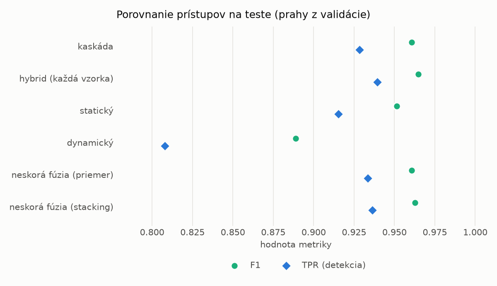
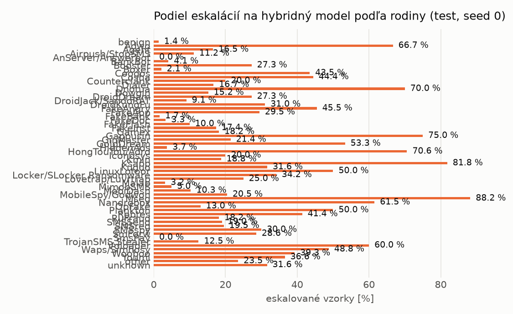

# Kaskáda `baselines` – beh `20261123-221412`

> Generované `src/cascade/evaluate.py` (2026-11-23T22:14:13+01:00). Seedy: [0, 1, 2]; hodnoty = priemer ± sm. odchýlka.
> Všetky prahy sú určené na validácii (FPR ≤ 1 %); test sa na nič nenastavuje.

| rola | beh |
|---|---|
| static | `runs_v4/emu_p/lofo/Locker_SLocker_Ransomware/static/lightgbm/20261123-185406` |
| dynamic | `runs_v4/emu_p/lofo/Locker_SLocker_Ransomware/dynamic/lightgbm/20261123-220043` |
| hybrid | `runs_v4/emu_p/lofo/Locker_SLocker_Ransomware/hybrid/lightgbm/20261123-220356` |

## Test
| prístup | accuracy | balanced_accuracy | precision | recall_tpr | fpr | f1 | mcc |
|---|---|---|---|---|---|---|---|
| kaskáda | 0.9659 ± 0.0004 | 0.9624 ± 0.0005 | 0.9954 ± 0.0005 | 0.9283 ± 0.0013 | 0.0035 ± 0.0004 | 0.9607 ± 0.0005 | 0.9325 ± 0.0008 |
| hybrid (každá vzorka) | 0.9693 ± 0.0008 | 0.9665 ± 0.0009 | 0.9915 ± 0.0007 | 0.9395 ± 0.0023 | 0.0065 ± 0.0005 | 0.9648 ± 0.0009 | 0.9386 ± 0.0014 |
| statický | 0.9582 ± 0.0014 | 0.9542 ± 0.0015 | 0.9906 ± 0.0003 | 0.9154 ± 0.0028 | 0.0071 ± 0.0002 | 0.9515 ± 0.0017 | 0.9170 ± 0.0027 |
| dynamický | 0.9094 ± 0.0026 | 0.8999 ± 0.0029 | 0.9876 ± 0.0008 | 0.8079 ± 0.0061 | 0.0082 ± 0.0006 | 0.8888 ± 0.0035 | 0.8253 ± 0.0046 |
| neskorá fúzia (priemer) | 0.9658 ± 0.0019 | 0.9627 ± 0.0022 | 0.9897 ± 0.0008 | 0.9334 ± 0.0050 | 0.0079 ± 0.0007 | 0.9607 ± 0.0023 | 0.9317 ± 0.0036 |
| neskorá fúzia (stacking) | 0.9675 ± 0.0002 | 0.9646 ± 0.0001 | 0.9906 ± 0.0012 | 0.9364 ± 0.0009 | 0.0073 ± 0.0010 | 0.9627 ± 0.0002 | 0.9351 ± 0.0004 |

## Validácia
| prístup | accuracy | balanced_accuracy | precision | recall_tpr | fpr | f1 | mcc |
|---|---|---|---|---|---|---|---|
| kaskáda | 0.9773 ± 0.0004 | 0.9748 ± 0.0005 | 0.9908 ± 0.0002 | 0.9563 ± 0.0008 | 0.0068 ± 0.0002 | 0.9733 ± 0.0005 | 0.9539 ± 0.0009 |
| hybrid (každá vzorka) | 0.9778 ± 0.0005 | 0.9758 ± 0.0006 | 0.9872 ± 0.0002 | 0.9612 ± 0.0014 | 0.0096 ± 0.0002 | 0.9740 ± 0.0006 | 0.9549 ± 0.0010 |
| statický | 0.9707 ± 0.0014 | 0.9677 ± 0.0016 | 0.9867 ± 0.0000 | 0.9451 ± 0.0031 | 0.0097 ± 0.0000 | 0.9654 ± 0.0017 | 0.9407 ± 0.0027 |
| dynamický | 0.9275 ± 0.0010 | 0.9178 ± 0.0012 | 0.9851 ± 0.0000 | 0.8454 ± 0.0023 | 0.0097 ± 0.0000 | 0.9099 ± 0.0014 | 0.8569 ± 0.0019 |
| neskorá fúzia (priemer) | 0.9806 ± 0.0027 | 0.9791 ± 0.0032 | 0.9870 ± 0.0001 | 0.9679 ± 0.0063 | 0.0097 ± 0.0000 | 0.9773 ± 0.0033 | 0.9605 ± 0.0055 |
| neskorá fúzia (stacking) | 0.9816 ± 0.0003 | 0.9802 ± 0.0004 | 0.9870 ± 0.0000 | 0.9702 ± 0.0008 | 0.0097 ± 0.0000 | 0.9786 ± 0.0004 | 0.9625 ± 0.0007 |

## Správanie kaskády (test, seed 0)
- podiel eskalácií na hybrid: **7.95%** (1006 vzoriek)
- chyby pri zhode študentov (kaskáda ich nemôže opraviť): **338**
  (2.901% zo zhôd; FP 3, FN 335)
- úspešnosť na eskalovaných vzorkách: hybrid 0.9125248508946322, statický 0.8101391650099403,
  dynamický 0.18986083499005965  → prínos hybridu pri nezhode

## Výpočtové nároky (odhad z benchmarkov komponentov)
_Chýba benchmark niektorého komponentu (`python -m src.evaluation.benchmark`)._

