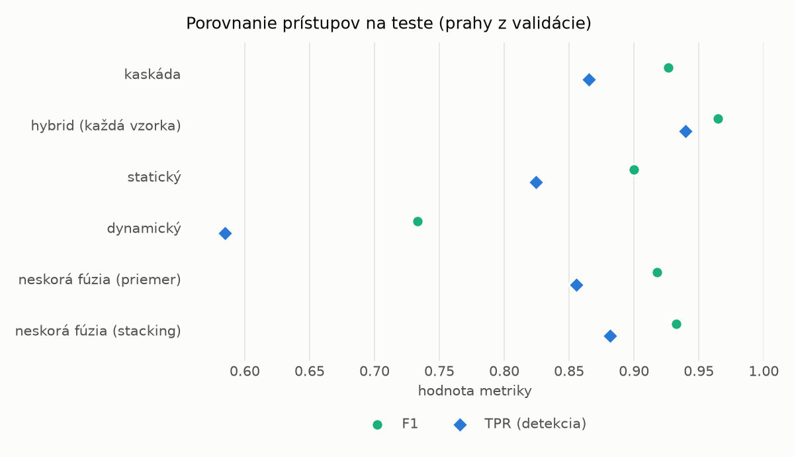
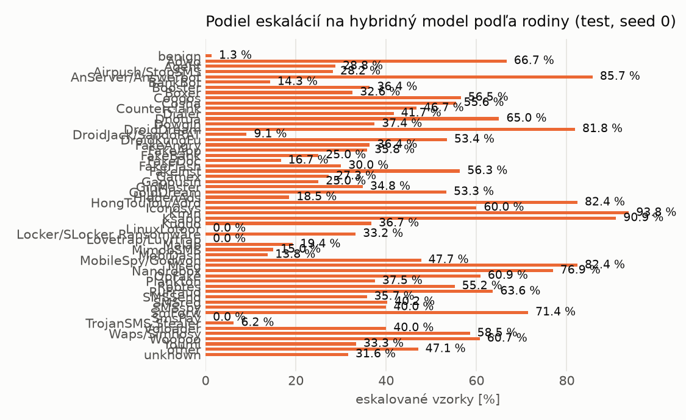

# Kaskáda `heavyteacher` – beh `20261123-221414`

> Generované `src/cascade/evaluate.py` (2026-11-23T22:14:15+01:00). Seedy: [0, 1, 2]; hodnoty = priemer ± sm. odchýlka.
> Všetky prahy sú určené na validácii (FPR ≤ 1 %); test sa na nič nenastavuje.

| rola | beh |
|---|---|
| static | `runs_v4/emu_p/lofo/Locker_SLocker_Ransomware/students_static/mlp_kd_heavy/20261123-221149` |
| dynamic | `runs_v4/emu_p/lofo/Locker_SLocker_Ransomware/students_dynamic/mlp_kd_heavy/20261123-221338` |
| hybrid | `runs_v4/emu_p/lofo/Locker_SLocker_Ransomware/hybrid/lightgbm/20261123-220356` |

## Test
| prístup | accuracy | balanced_accuracy | precision | recall_tpr | fpr | f1 | mcc |
|---|---|---|---|---|---|---|---|
| kaskáda | 0.9384 ± 0.0024 | 0.9315 ± 0.0026 | 0.9969 ± 0.0002 | 0.8652 ± 0.0051 | 0.0022 ± 0.0002 | 0.9264 ± 0.0030 | 0.8803 ± 0.0045 |
| hybrid (každá vzorka) | 0.9693 ± 0.0008 | 0.9665 ± 0.0009 | 0.9915 ± 0.0007 | 0.9395 ± 0.0023 | 0.0065 ± 0.0005 | 0.9648 ± 0.0009 | 0.9386 ± 0.0014 |
| statický | 0.9180 ± 0.0044 | 0.9093 ± 0.0050 | 0.9913 ± 0.0014 | 0.8244 ± 0.0103 | 0.0059 ± 0.0010 | 0.9001 ± 0.0059 | 0.8418 ± 0.0080 |
| dynamický | 0.8093 ± 0.0005 | 0.7882 ± 0.0006 | 0.9829 ± 0.0012 | 0.5847 ± 0.0017 | 0.0083 ± 0.0006 | 0.7332 ± 0.0011 | 0.6483 ± 0.0008 |
| neskorá fúzia (priemer) | 0.9313 ± 0.0026 | 0.9242 ± 0.0029 | 0.9899 ± 0.0015 | 0.8555 ± 0.0066 | 0.0071 ± 0.0011 | 0.9178 ± 0.0034 | 0.8661 ± 0.0046 |
| neskorá fúzia (stacking) | 0.9428 ± 0.0014 | 0.9371 ± 0.0016 | 0.9896 ± 0.0015 | 0.8817 ± 0.0035 | 0.0075 ± 0.0011 | 0.9326 ± 0.0018 | 0.8877 ± 0.0026 |

## Validácia
| prístup | accuracy | balanced_accuracy | precision | recall_tpr | fpr | f1 | mcc |
|---|---|---|---|---|---|---|---|
| kaskáda | 0.9502 ± 0.0048 | 0.9433 ± 0.0055 | 0.9930 ± 0.0009 | 0.8913 ± 0.0105 | 0.0048 ± 0.0006 | 0.9394 ± 0.0062 | 0.9012 ± 0.0094 |
| hybrid (každá vzorka) | 0.9778 ± 0.0005 | 0.9758 ± 0.0006 | 0.9872 ± 0.0002 | 0.9612 ± 0.0014 | 0.0096 ± 0.0002 | 0.9740 ± 0.0006 | 0.9549 ± 0.0010 |
| statický | 0.9283 ± 0.0072 | 0.9188 ± 0.0082 | 0.9853 ± 0.0005 | 0.8472 ± 0.0163 | 0.0096 ± 0.0002 | 0.9110 ± 0.0096 | 0.8584 ± 0.0136 |
| dynamický | 0.8252 ± 0.0002 | 0.7996 ± 0.0002 | 0.9795 ± 0.0000 | 0.6090 ± 0.0004 | 0.0097 ± 0.0000 | 0.7510 ± 0.0003 | 0.6694 ± 0.0003 |
| neskorá fúzia (priemer) | 0.9424 ± 0.0028 | 0.9350 ± 0.0032 | 0.9857 ± 0.0001 | 0.8797 ± 0.0065 | 0.0097 ± 0.0000 | 0.9297 ± 0.0037 | 0.8852 ± 0.0054 |
| neskorá fúzia (stacking) | 0.9546 ± 0.0009 | 0.9490 ± 0.0011 | 0.9861 ± 0.0000 | 0.9078 ± 0.0022 | 0.0097 ± 0.0000 | 0.9454 ± 0.0012 | 0.9089 ± 0.0018 |

## Správanie kaskády (test, seed 0)
- podiel eskalácií na hybrid: **15.96%** (2020 vzoriek)
- chyby pri zhode študentov (kaskáda ich nemôže opraviť): **743**
  (6.986% zo zhôd; FP 0, FN 743)
- úspešnosť na eskalovaných vzorkách: hybrid 0.9668316831683168, statický 0.8297029702970297,
  dynamický 0.1702970297029703  → prínos hybridu pri nezhode

## Výpočtové nároky (odhad z benchmarkov komponentov)
_Chýba benchmark niektorého komponentu (`python -m src.evaluation.benchmark`)._

