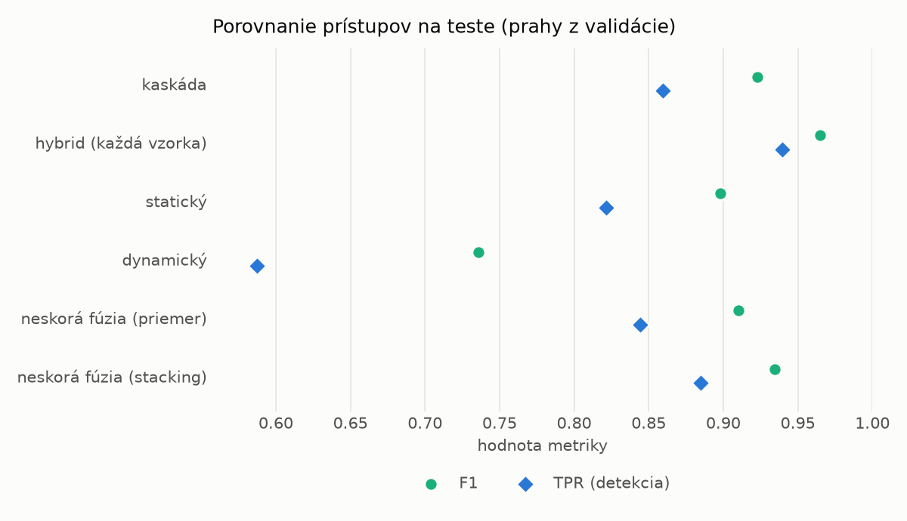
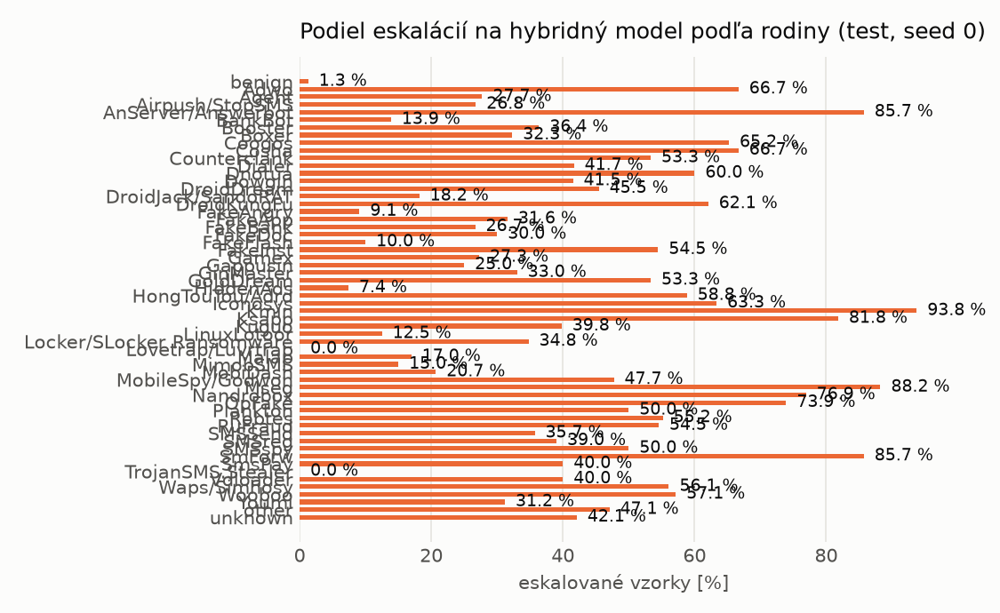

# Kaskáda `main` – beh `20261123-221403`

> Generované `src/cascade/evaluate.py` (2026-11-23T22:14:04+01:00). Seedy: [0, 1, 2]; hodnoty = priemer ± sm. odchýlka.
> Všetky prahy sú určené na validácii (FPR ≤ 1 %); test sa na nič nenastavuje.

| rola | beh |
|---|---|
| static | `runs_v4/emu_p/lofo/Locker_SLocker_Ransomware/students_static/mlp_kd/20261123-221044` |
| dynamic | `runs_v4/emu_p/lofo/Locker_SLocker_Ransomware/students_dynamic/mlp_kd/20261123-221205` |
| hybrid | `runs_v4/emu_p/lofo/Locker_SLocker_Ransomware/hybrid/lightgbm/20261123-220356` |

## Test
| prístup | accuracy | balanced_accuracy | precision | recall_tpr | fpr | f1 | mcc |
|---|---|---|---|---|---|---|---|
| kaskáda | 0.9358 ± 0.0026 | 0.9286 ± 0.0029 | 0.9970 ± 0.0006 | 0.8593 ± 0.0057 | 0.0021 ± 0.0004 | 0.9230 ± 0.0034 | 0.8755 ± 0.0050 |
| hybrid (každá vzorka) | 0.9693 ± 0.0008 | 0.9665 ± 0.0009 | 0.9915 ± 0.0007 | 0.9395 ± 0.0023 | 0.0065 ± 0.0005 | 0.9648 ± 0.0009 | 0.9386 ± 0.0014 |
| statický | 0.9166 ± 0.0034 | 0.9077 ± 0.0038 | 0.9909 ± 0.0002 | 0.8214 ± 0.0076 | 0.0061 ± 0.0001 | 0.8982 ± 0.0046 | 0.8391 ± 0.0063 |
| dynamický | 0.8108 ± 0.0049 | 0.7898 ± 0.0056 | 0.9840 ± 0.0014 | 0.5875 ± 0.0117 | 0.0078 ± 0.0008 | 0.7356 ± 0.0089 | 0.6512 ± 0.0082 |
| neskorá fúzia (priemer) | 0.9255 ± 0.0031 | 0.9179 ± 0.0035 | 0.9878 ± 0.0008 | 0.8442 ± 0.0071 | 0.0085 ± 0.0006 | 0.9104 ± 0.0041 | 0.8549 ± 0.0057 |
| neskorá fúzia (stacking) | 0.9444 ± 0.0032 | 0.9388 ± 0.0038 | 0.9903 ± 0.0020 | 0.8846 ± 0.0091 | 0.0071 ± 0.0015 | 0.9344 ± 0.0042 | 0.8907 ± 0.0059 |

## Validácia
| prístup | accuracy | balanced_accuracy | precision | recall_tpr | fpr | f1 | mcc |
|---|---|---|---|---|---|---|---|
| kaskáda | 0.9504 ± 0.0039 | 0.9435 ± 0.0046 | 0.9930 ± 0.0005 | 0.8918 ± 0.0092 | 0.0048 ± 0.0003 | 0.9397 ± 0.0051 | 0.9016 ± 0.0076 |
| hybrid (každá vzorka) | 0.9778 ± 0.0005 | 0.9758 ± 0.0006 | 0.9872 ± 0.0002 | 0.9612 ± 0.0014 | 0.0096 ± 0.0002 | 0.9740 ± 0.0006 | 0.9549 ± 0.0010 |
| statický | 0.9295 ± 0.0075 | 0.9201 ± 0.0086 | 0.9852 ± 0.0003 | 0.8499 ± 0.0172 | 0.0097 ± 0.0000 | 0.9125 ± 0.0101 | 0.8606 ± 0.0141 |
| dynamický | 0.8278 ± 0.0073 | 0.8026 ± 0.0085 | 0.9797 ± 0.0005 | 0.6150 ± 0.0169 | 0.0097 ± 0.0000 | 0.7556 ± 0.0129 | 0.6741 ± 0.0132 |
| neskorá fúzia (priemer) | 0.9401 ± 0.0027 | 0.9324 ± 0.0031 | 0.9856 ± 0.0001 | 0.8745 ± 0.0062 | 0.0097 ± 0.0000 | 0.9268 ± 0.0035 | 0.8810 ± 0.0052 |
| neskorá fúzia (stacking) | 0.9566 ± 0.0033 | 0.9514 ± 0.0038 | 0.9862 ± 0.0001 | 0.9124 ± 0.0075 | 0.0097 ± 0.0000 | 0.9479 ± 0.0041 | 0.9128 ± 0.0064 |

## Správanie kaskády (test, seed 0)
- podiel eskalácií na hybrid: **15.66%** (1982 vzoriek)
- chyby pri zhode študentov (kaskáda ich nemôže opraviť): **753**
  (7.055% zo zhôd; FP 0, FN 753)
- úspešnosť na eskalovaných vzorkách: hybrid 0.9692230070635721, statický 0.855196770938446,
  dynamický 0.144803229061554  → prínos hybridu pri nezhode

## Výpočtové nároky (odhad z benchmarkov komponentov)
_Chýba benchmark niektorého komponentu (`python -m src.evaluation.benchmark`)._

