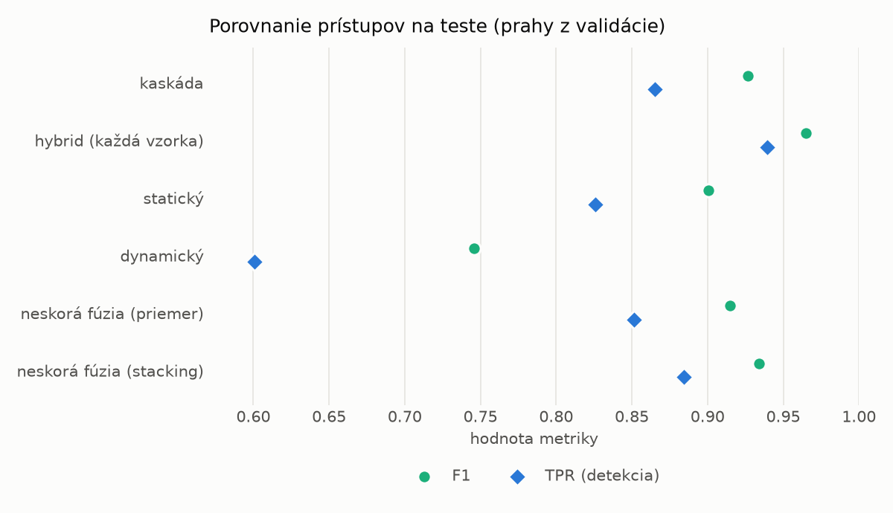
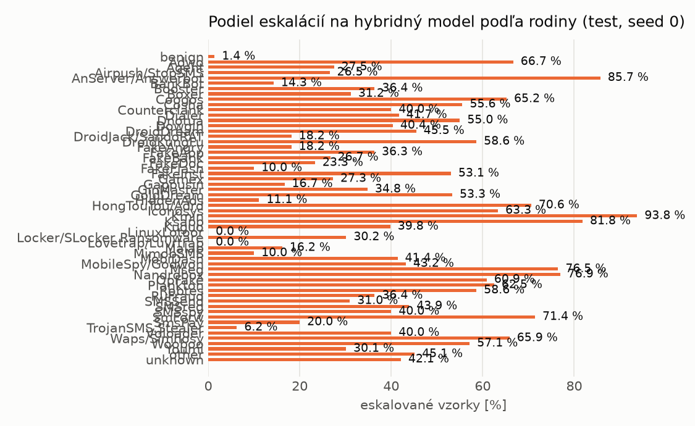

# Kaskáda `modal` – beh `20261123-221408`

> Generované `src/cascade/evaluate.py` (2026-11-23T22:14:08+01:00). Seedy: [0, 1, 2]; hodnoty = priemer ± sm. odchýlka.
> Všetky prahy sú určené na validácii (FPR ≤ 1 %); test sa na nič nenastavuje.

| rola | beh |
|---|---|
| static | `runs_v4/emu_p/lofo/Locker_SLocker_Ransomware/students_static/mlp_kd_modal/20261123-221125` |
| dynamic | `runs_v4/emu_p/lofo/Locker_SLocker_Ransomware/students_dynamic/mlp_kd_modal/20261123-221318` |
| hybrid | `runs_v4/emu_p/lofo/Locker_SLocker_Ransomware/hybrid/lightgbm/20261123-220356` |

## Test
| prístup | accuracy | balanced_accuracy | precision | recall_tpr | fpr | f1 | mcc |
|---|---|---|---|---|---|---|---|
| kaskáda | 0.9384 ± 0.0008 | 0.9315 ± 0.0009 | 0.9972 ± 0.0004 | 0.8651 ± 0.0017 | 0.0020 ± 0.0003 | 0.9264 ± 0.0010 | 0.8805 ± 0.0015 |
| hybrid (každá vzorka) | 0.9693 ± 0.0008 | 0.9665 ± 0.0009 | 0.9915 ± 0.0007 | 0.9395 ± 0.0023 | 0.0065 ± 0.0005 | 0.9648 ± 0.0009 | 0.9386 ± 0.0014 |
| statický | 0.9184 ± 0.0008 | 0.9097 ± 0.0009 | 0.9903 ± 0.0002 | 0.8260 ± 0.0019 | 0.0065 ± 0.0002 | 0.9007 ± 0.0011 | 0.8423 ± 0.0016 |
| dynamický | 0.8167 ± 0.0046 | 0.7964 ± 0.0053 | 0.9840 ± 0.0022 | 0.6008 ± 0.0119 | 0.0080 ± 0.0013 | 0.7460 ± 0.0085 | 0.6613 ± 0.0073 |
| neskorá fúzia (priemer) | 0.9291 ± 0.0010 | 0.9218 ± 0.0012 | 0.9887 ± 0.0009 | 0.8516 ± 0.0028 | 0.0079 ± 0.0006 | 0.9150 ± 0.0013 | 0.8618 ± 0.0018 |
| neskorá fúzia (stacking) | 0.9440 ± 0.0011 | 0.9384 ± 0.0013 | 0.9894 ± 0.0005 | 0.8845 ± 0.0027 | 0.0077 ± 0.0004 | 0.9340 ± 0.0014 | 0.8899 ± 0.0021 |

## Validácia
| prístup | accuracy | balanced_accuracy | precision | recall_tpr | fpr | f1 | mcc |
|---|---|---|---|---|---|---|---|
| kaskáda | 0.9531 ± 0.0011 | 0.9466 ± 0.0014 | 0.9931 ± 0.0014 | 0.8979 ± 0.0036 | 0.0048 ± 0.0010 | 0.9431 ± 0.0015 | 0.9067 ± 0.0021 |
| hybrid (každá vzorka) | 0.9778 ± 0.0005 | 0.9758 ± 0.0006 | 0.9872 ± 0.0002 | 0.9612 ± 0.0014 | 0.0096 ± 0.0002 | 0.9740 ± 0.0006 | 0.9549 ± 0.0010 |
| statický | 0.9317 ± 0.0043 | 0.9226 ± 0.0049 | 0.9853 ± 0.0002 | 0.8550 ± 0.0099 | 0.0097 ± 0.0000 | 0.9155 ± 0.0057 | 0.8648 ± 0.0081 |
| dynamický | 0.8342 ± 0.0056 | 0.8101 ± 0.0064 | 0.9801 ± 0.0004 | 0.6299 ± 0.0128 | 0.0097 ± 0.0000 | 0.7669 ± 0.0096 | 0.6857 ± 0.0100 |
| neskorá fúzia (priemer) | 0.9423 ± 0.0003 | 0.9348 ± 0.0004 | 0.9858 ± 0.0002 | 0.8793 ± 0.0006 | 0.0096 ± 0.0002 | 0.9295 ± 0.0004 | 0.8850 ± 0.0007 |
| neskorá fúzia (stacking) | 0.9568 ± 0.0014 | 0.9516 ± 0.0016 | 0.9862 ± 0.0000 | 0.9129 ± 0.0033 | 0.0097 ± 0.0000 | 0.9482 ± 0.0018 | 0.9132 ± 0.0028 |

## Správanie kaskády (test, seed 0)
- podiel eskalácií na hybrid: **15.42%** (1951 vzoriek)
- chyby pri zhode študentov (kaskáda ich nemôže opraviť): **715**
  (6.679% zo zhôd; FP 0, FN 715)
- úspešnosť na eskalovaných vzorkách: hybrid 0.9677088672475653, statický 0.8431573552024603,
  dynamický 0.15684264479753973  → prínos hybridu pri nezhode

## Výpočtové nároky (odhad z benchmarkov komponentov)
_Chýba benchmark niektorého komponentu (`python -m src.evaluation.benchmark`)._

