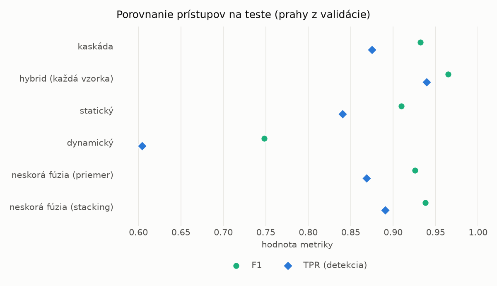
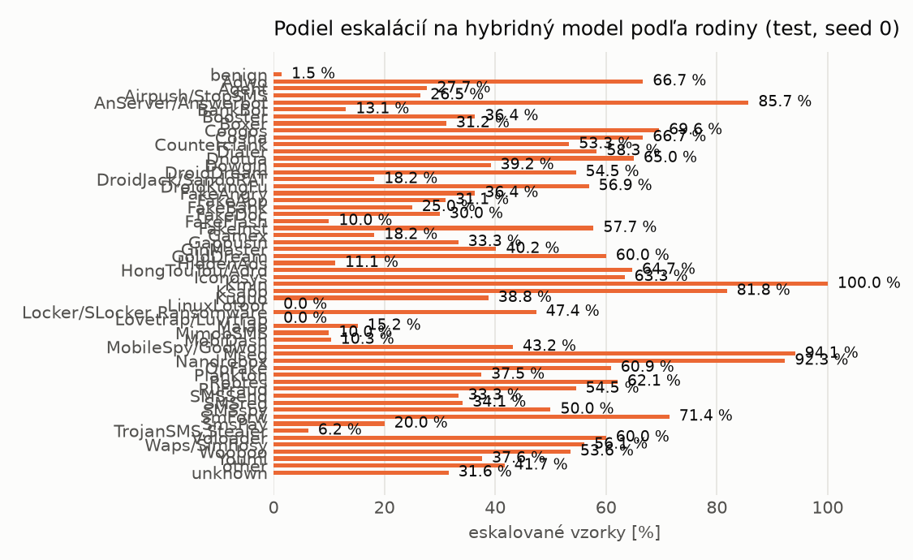

# Kaskáda `nokd` – beh `20261123-221406`

> Generované `src/cascade/evaluate.py` (2026-11-23T22:14:06+01:00). Seedy: [0, 1, 2]; hodnoty = priemer ± sm. odchýlka.
> Všetky prahy sú určené na validácii (FPR ≤ 1 %); test sa na nič nenastavuje.

| rola | beh |
|---|---|
| static | `runs_v4/emu_p/lofo/Locker_SLocker_Ransomware/students_static/mlp_nokd/20261123-221100` |
| dynamic | `runs_v4/emu_p/lofo/Locker_SLocker_Ransomware/students_dynamic/mlp_nokd/20261123-221228` |
| hybrid | `runs_v4/emu_p/lofo/Locker_SLocker_Ransomware/hybrid/lightgbm/20261123-220356` |

## Test
| prístup | accuracy | balanced_accuracy | precision | recall_tpr | fpr | f1 | mcc |
|---|---|---|---|---|---|---|---|
| kaskáda | 0.9428 ± 0.0008 | 0.9364 ± 0.0010 | 0.9968 ± 0.0009 | 0.8751 ± 0.0025 | 0.0023 ± 0.0006 | 0.9320 ± 0.0011 | 0.8885 ± 0.0014 |
| hybrid (každá vzorka) | 0.9693 ± 0.0008 | 0.9665 ± 0.0009 | 0.9915 ± 0.0007 | 0.9395 ± 0.0023 | 0.0065 ± 0.0005 | 0.9648 ± 0.0009 | 0.9386 ± 0.0014 |
| statický | 0.9252 ± 0.0028 | 0.9173 ± 0.0032 | 0.9913 ± 0.0007 | 0.8405 ± 0.0070 | 0.0060 ± 0.0005 | 0.9097 ± 0.0038 | 0.8551 ± 0.0051 |
| dynamický | 0.8177 ± 0.0038 | 0.7977 ± 0.0043 | 0.9825 ± 0.0012 | 0.6041 ± 0.0092 | 0.0087 ± 0.0007 | 0.7481 ± 0.0068 | 0.6626 ± 0.0062 |
| neskorá fúzia (priemer) | 0.9375 ± 0.0041 | 0.9310 ± 0.0046 | 0.9908 ± 0.0008 | 0.8686 ± 0.0099 | 0.0066 ± 0.0006 | 0.9257 ± 0.0053 | 0.8778 ± 0.0075 |
| neskorá fúzia (stacking) | 0.9474 ± 0.0011 | 0.9420 ± 0.0013 | 0.9911 ± 0.0018 | 0.8905 ± 0.0036 | 0.0065 ± 0.0013 | 0.9381 ± 0.0014 | 0.8964 ± 0.0019 |

## Validácia
| prístup | accuracy | balanced_accuracy | precision | recall_tpr | fpr | f1 | mcc |
|---|---|---|---|---|---|---|---|
| kaskáda | 0.9561 ± 0.0021 | 0.9499 ± 0.0024 | 0.9938 ± 0.0004 | 0.9042 ± 0.0051 | 0.0043 ± 0.0003 | 0.9469 ± 0.0026 | 0.9125 ± 0.0039 |
| hybrid (každá vzorka) | 0.9778 ± 0.0005 | 0.9758 ± 0.0006 | 0.9872 ± 0.0002 | 0.9612 ± 0.0014 | 0.0096 ± 0.0002 | 0.9740 ± 0.0006 | 0.9549 ± 0.0010 |
| statický | 0.9338 ± 0.0061 | 0.9250 ± 0.0070 | 0.9855 ± 0.0005 | 0.8597 ± 0.0139 | 0.0096 ± 0.0002 | 0.9183 ± 0.0082 | 0.8687 ± 0.0117 |
| dynamický | 0.8383 ± 0.0050 | 0.8148 ± 0.0057 | 0.9804 ± 0.0003 | 0.6394 ± 0.0115 | 0.0097 ± 0.0000 | 0.7740 ± 0.0085 | 0.6930 ± 0.0089 |
| neskorá fúzia (priemer) | 0.9491 ± 0.0043 | 0.9428 ± 0.0050 | 0.9859 ± 0.0002 | 0.8953 ± 0.0099 | 0.0097 ± 0.0000 | 0.9384 ± 0.0055 | 0.8983 ± 0.0084 |
| neskorá fúzia (stacking) | 0.9589 ± 0.0031 | 0.9541 ± 0.0036 | 0.9866 ± 0.0004 | 0.9177 ± 0.0073 | 0.0096 ± 0.0003 | 0.9509 ± 0.0038 | 0.9175 ± 0.0060 |

## Správanie kaskády (test, seed 0)
- podiel eskalácií na hybrid: **15.94%** (2017 vzoriek)
- chyby pri zhode študentov (kaskáda ich nemôže opraviť): **628**
  (5.903% zo zhôd; FP 0, FN 628)
- úspešnosť na eskalovaných vzorkách: hybrid 0.9568666336142786, statický 0.8596926127912742,
  dynamický 0.14030738720872582  → prínos hybridu pri nezhode

## Výpočtové nároky (odhad z benchmarkov komponentov)
_Chýba benchmark niektorého komponentu (`python -m src.evaluation.benchmark`)._

