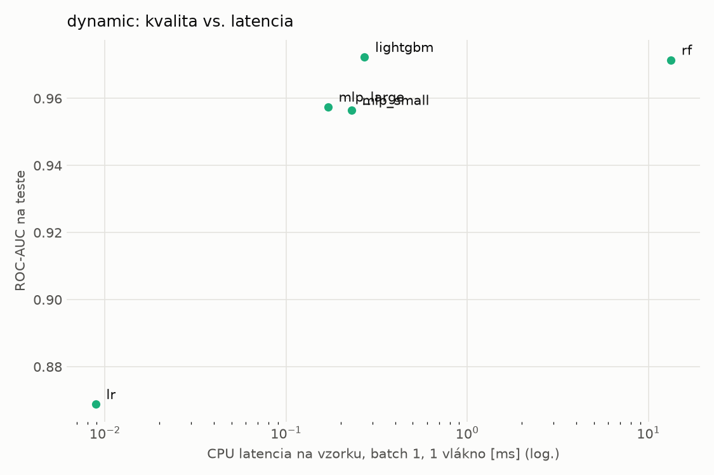
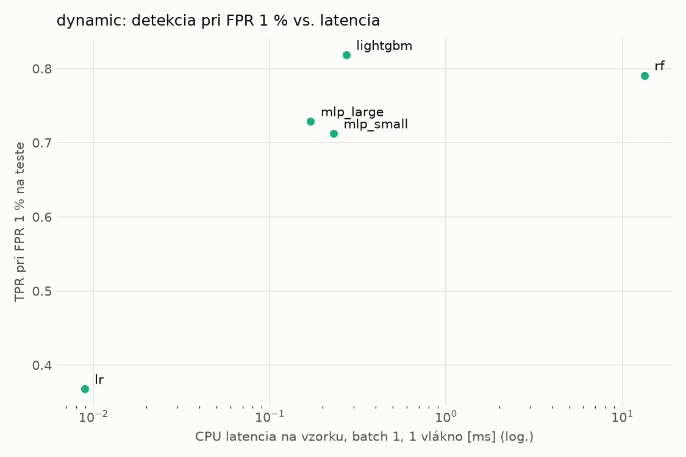
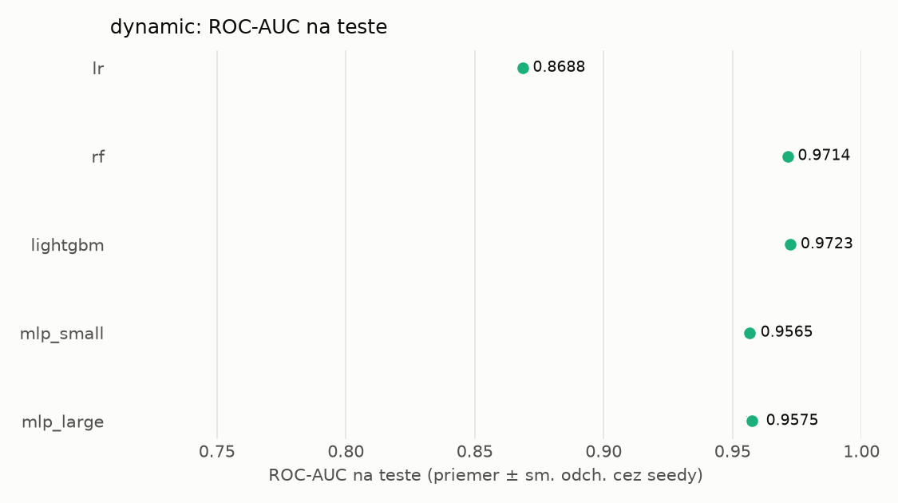
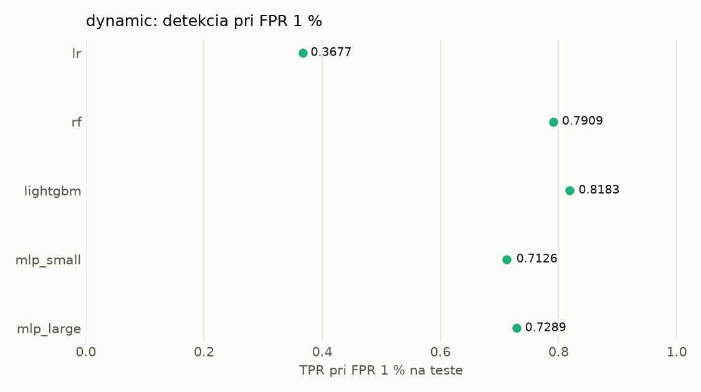

# Porovnanie modelov – dynamic

> Generované `src/evaluation/compare.py` (2026-11-23T22:03:41+01:00); použitý je posledný beh každého modelu.
> Metriky sú priemer cez seedy. \* = pri prahu určenom na validácii (FPR ≤ 1 %).
> CPU ms/vz. = medián latencie jednej vzorky na 1 vlákne vrátane transformácie vstupu (meranie hneď po tréningu,
> orientačné). Oficiálne merania spotreby sú v časti „Spotreba zdrojov pri inferencii“.

## Detekčná kvalita a orientačné časy
| model | ROC-AUC val | ROC-AUC test | TPR@FPR 1 % test | TPR@FPR 0,1 % test | F1 test* | FPR test* | gap train−val | CPU ms/vz. | CPU vz./s | GPU ms/vz. | parametre | MB | tréning s | ladenie min |
|---|---|---|---|---|---|---|---|---|---|---|---|---|---|---|
| [lr](../../dynamic/lr/20261123-220022/README.md) | 0.8764 | 0.8688 ± 0.0000 | 0.3677 | 0.1123 | 0.5260 | 0.0095 | -0.0032 | 0.009 | 4 486 034 | – | 124 | 0.01 | 0.4 | 0.0 |
| [rf](../../dynamic/rf/20261123-220025/README.md) | 0.9756 | 0.9714 ± 0.0001 | 0.7909 | 0.6537 | 0.8623 | 0.0057 | 0.0243 | 13.317 | 110 220 | – | 4 118 138 | 329.81 | 2.7 | 0.0 |
| [lightgbm](../../dynamic/lightgbm/20261123-220043/README.md) | 0.9796 | 0.9723 ± 0.0004 | 0.8183 | 0.6953 | 0.8888 | 0.0082 | 0.0204 | 0.271 | 42 672 | – | 768 327 | 42.62 | 24.0 | 0.0 |
| [mlp_small](../../dynamic/mlp_small/20261123-220218/README.md) | 0.9653 | 0.9565 ± 0.0006 | 0.7126 | 0.4242 | 0.8222 | 0.0092 | 0.0244 | 0.230 | 2 752 142 | 0.630 | 65 537 | 0.27 | 17.6 | 0.0 |
| [mlp_large](../../dynamic/mlp_large/20261123-220313/README.md) | 0.9672 | 0.9575 ± 0.0018 | 0.7289 | 0.4366 | 0.8379 | 0.0100 | 0.0275 | 0.171 | 363 026 | 0.432 | 786 945 | 3.17 | 8.5 | 0.0 |

## Nízka prevalencia malvéru (test, prah z validácie)
| model | TPR | FPR | precision @ 1 % | falošné na 1 skutočný poplach @ 1 % | precision @ 0.1 % | falošné na 1 skutočný poplach @ 0.1 % |
|---|---|---|---|---|---|---|
| lr | 0.3610 | 0.0095 | 0.278 | 2.59 | 0.037 | 26.15 |
| rf | 0.7633 | 0.0057 | 0.574 | 0.74 | 0.118 | 7.50 |
| lightgbm | 0.8079 | 0.0082 | 0.498 | 1.01 | 0.090 | 10.15 |
| mlp_small | 0.7060 | 0.0092 | 0.436 | 1.29 | 0.071 | 13.04 |
| mlp_large | 0.7301 | 0.0100 | 0.424 | 1.36 | 0.068 | 13.72 |

Prepočet: TPR a FPR nezávisia od podielu malvéru, preto sa dajú preniesť na nízku prevalenciu (v reálnej prevádzke je malvéru ~1 % alebo menej; v teste 54 %). „Falošné na 1 skutočný poplach“ = koľko neškodných súborov je označených na každý zachytený malvér.

## Spotreba zdrojov pri inferencii (benchmark, testovacia množina)
_Benchmark zatiaľ nebol spustený (`python -m src.evaluation.benchmark --approach dynamic`)._

## Grafy

