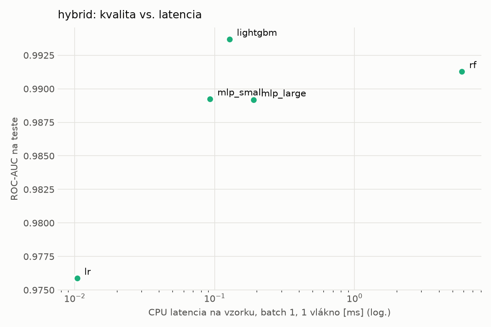
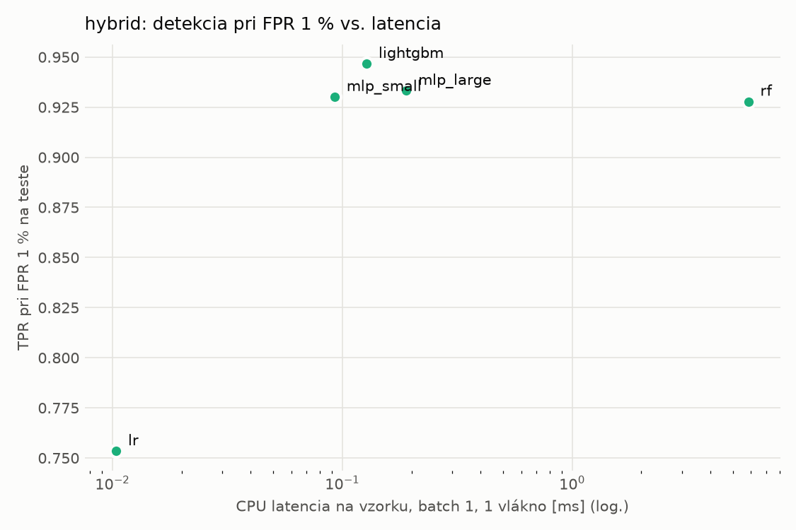
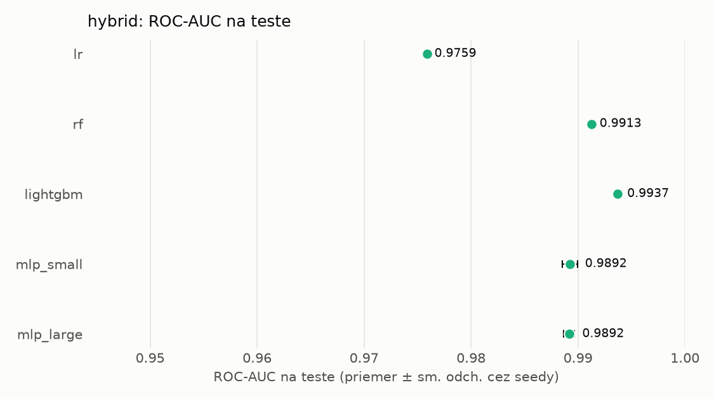
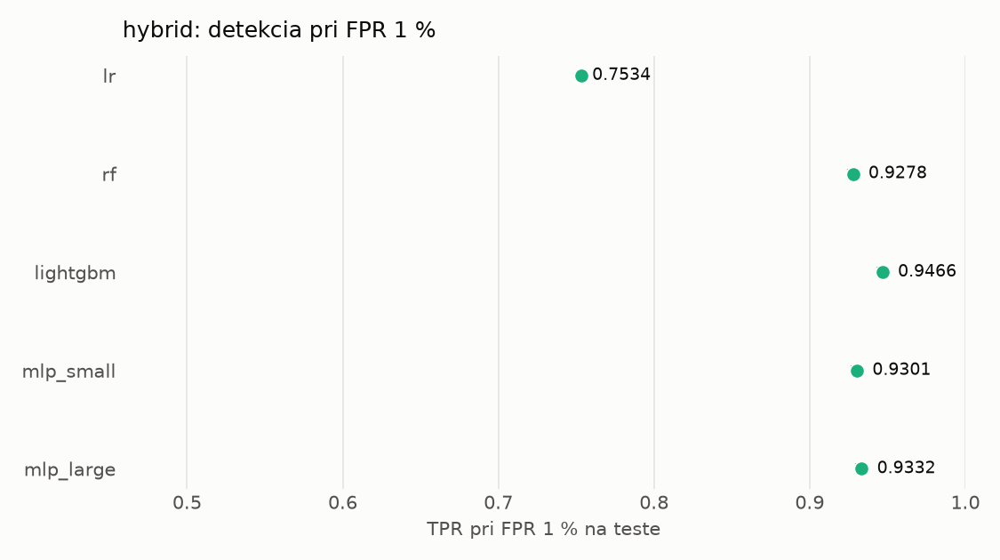

# Porovnanie modelov – hybrid

> Generované `src/evaluation/compare.py` (2026-11-23T22:05:36+01:00); použitý je posledný beh každého modelu.
> Metriky sú priemer cez seedy. \* = pri prahu určenom na validácii (FPR ≤ 1 %).
> CPU ms/vz. = medián latencie jednej vzorky na 1 vlákne vrátane transformácie vstupu (meranie hneď po tréningu,
> orientačné). Oficiálne merania spotreby sú v časti „Spotreba zdrojov pri inferencii“.

## Detekčná kvalita a orientačné časy
| model | ROC-AUC val | ROC-AUC test | TPR@FPR 1 % test | TPR@FPR 0,1 % test | F1 test* | FPR test* | gap train−val | CPU ms/vz. | CPU vz./s | GPU ms/vz. | parametre | MB | tréning s | ladenie min |
|---|---|---|---|---|---|---|---|---|---|---|---|---|---|---|
| [lr](../../hybrid/lr/20261123-220344/README.md) | 0.9794 | 0.9759 ± 0.0000 | 0.7534 | 0.4077 | 0.8267 | 0.0082 | 0.0026 | 0.010 | 2 339 545 | – | 287 | 0.01 | 0.5 | 0.0 |
| [rf](../../hybrid/rf/20261123-220347/README.md) | 0.9945 | 0.9913 ± 0.0000 | 0.9278 | 0.8552 | 0.9522 | 0.0065 | 0.0055 | 5.848 | 169 244 | – | 978 294 | 78.52 | 1.4 | 0.0 |
| [lightgbm](../../hybrid/lightgbm/20261123-220356/README.md) | 0.9959 | 0.9937 ± 0.0002 | 0.9466 | 0.8847 | 0.9648 | 0.0065 | 0.0041 | 0.128 | 104 288 | – | 324 093 | 18.11 | 15.4 | 0.0 |
| [mlp_small](../../hybrid/mlp_small/20261123-220451/README.md) | 0.9923 | 0.9892 ± 0.0007 | 0.9301 | 0.7280 | 0.9529 | 0.0076 | 0.0068 | 0.093 | 1 359 851 | 0.653 | 107 265 | 0.45 | 4.5 | 0.0 |
| [mlp_large](../../hybrid/mlp_large/20261123-220507/README.md) | 0.9928 | 0.9892 ± 0.0005 | 0.9332 | 0.7710 | 0.9543 | 0.0074 | 0.0058 | 0.190 | 742 353 | 0.584 | 323 521 | 1.32 | 8.5 | 0.0 |

## Nízka prevalencia malvéru (test, prah z validácie)
| model | TPR | FPR | precision @ 1 % | falošné na 1 skutočný poplach @ 1 % | precision @ 0.1 % | falošné na 1 skutočný poplach @ 0.1 % |
|---|---|---|---|---|---|---|
| lr | 0.7116 | 0.0082 | 0.468 | 1.14 | 0.080 | 11.46 |
| rf | 0.9162 | 0.0065 | 0.586 | 0.71 | 0.123 | 7.13 |
| lightgbm | 0.9395 | 0.0065 | 0.592 | 0.69 | 0.126 | 6.95 |
| mlp_small | 0.9186 | 0.0076 | 0.549 | 0.82 | 0.107 | 8.31 |
| mlp_large | 0.9209 | 0.0074 | 0.555 | 0.80 | 0.110 | 8.08 |

Prepočet: TPR a FPR nezávisia od podielu malvéru, preto sa dajú preniesť na nízku prevalenciu (v reálnej prevádzke je malvéru ~1 % alebo menej; v teste 54 %). „Falošné na 1 skutočný poplach“ = koľko neškodných súborov je označených na každý zachytený malvér.

## Spotreba zdrojov pri inferencii (benchmark, testovacia množina)
_Benchmark zatiaľ nebol spustený (`python -m src.evaluation.benchmark --approach hybrid`)._

## Grafy

