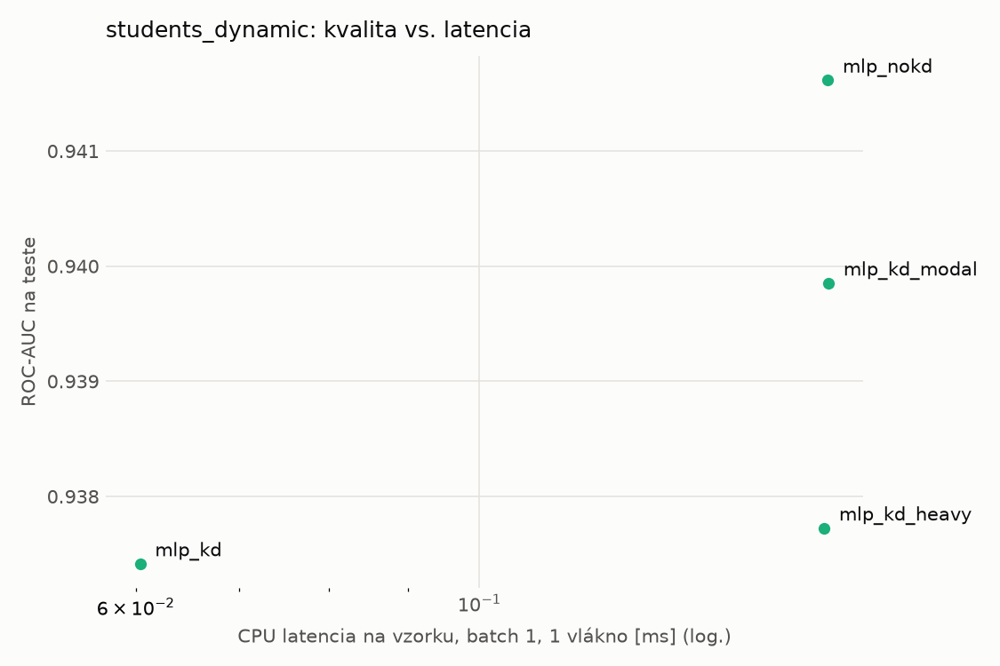
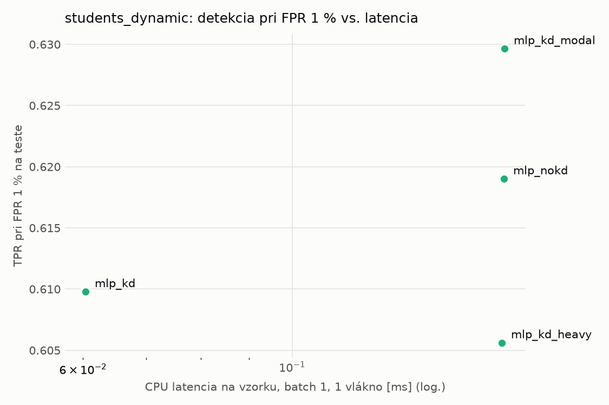
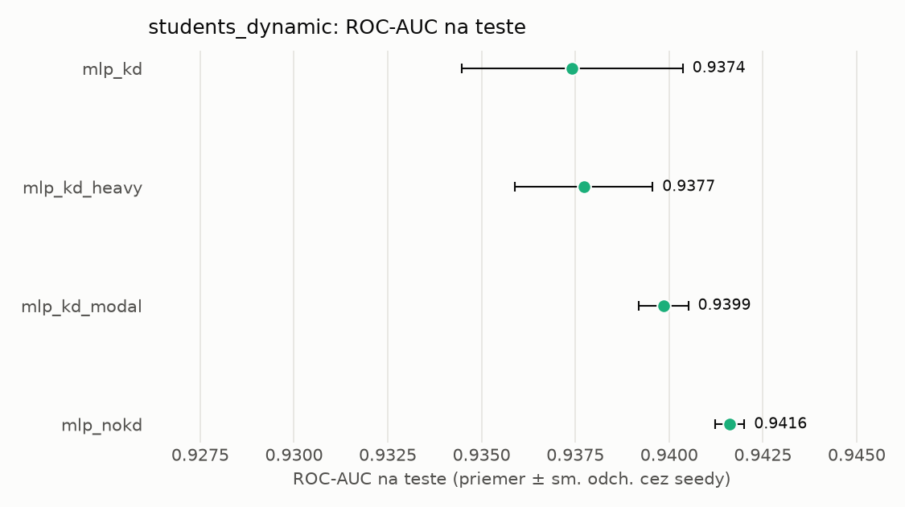
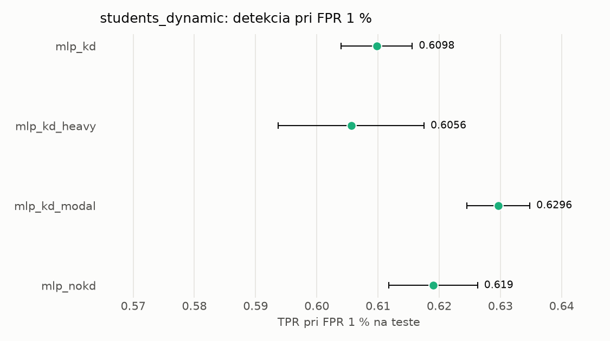

# Porovnanie modelov – students_dynamic

> Generované `src/evaluation/compare.py` (2026-11-23T22:14:01+01:00); použitý je posledný beh každého modelu.
> Metriky sú priemer cez seedy. \* = pri prahu určenom na validácii (FPR ≤ 1 %).
> CPU ms/vz. = medián latencie jednej vzorky na 1 vlákne vrátane transformácie vstupu (meranie hneď po tréningu,
> orientačné). Oficiálne merania spotreby sú v časti „Spotreba zdrojov pri inferencii“.

## Detekčná kvalita a orientačné časy
| model | ROC-AUC val | ROC-AUC test | TPR@FPR 1 % test | TPR@FPR 0,1 % test | F1 test* | FPR test* | gap train−val | CPU ms/vz. | CPU vz./s | GPU ms/vz. | parametre | MB | tréning s | ladenie min |
|---|---|---|---|---|---|---|---|---|---|---|---|---|---|---|
| [mlp_kd](../../students_dynamic/mlp_kd/20261123-221205/README.md) | 0.9456 | 0.9374 ± 0.0029 | 0.6098 | 0.3584 | 0.7356 | 0.0078 | 0.0082 | 0.060 | 7 540 066 | 0.286 | 8 129 | 0.04 | 6.8 | 0.0 |
| [mlp_kd_heavy](../../students_dynamic/mlp_kd_heavy/20261123-221338/README.md) | 0.9461 | 0.9377 ± 0.0018 | 0.6056 | 0.2701 | 0.7332 | 0.0083 | 0.0106 | 0.167 | 5 864 418 | 0.447 | 8 129 | 0.04 | 7.0 | 0.0 |
| [mlp_kd_modal](../../students_dynamic/mlp_kd_modal/20261123-221318/README.md) | 0.9475 | 0.9399 ± 0.0007 | 0.6296 | 0.3372 | 0.7460 | 0.0080 | 0.0090 | 0.168 | 5 283 681 | 0.447 | 8 129 | 0.04 | 5.9 | 0.0 |
| [mlp_nokd](../../students_dynamic/mlp_nokd/20261123-221228/README.md) | 0.9498 | 0.9416 ± 0.0004 | 0.6190 | 0.3206 | 0.7481 | 0.0087 | 0.0149 | 0.168 | 6 112 533 | 0.452 | 8 129 | 0.04 | 16.3 | 0.0 |

## Nízka prevalencia malvéru (test, prah z validácie)
| model | TPR | FPR | precision @ 1 % | falošné na 1 skutočný poplach @ 1 % | precision @ 0.1 % | falošné na 1 skutočný poplach @ 0.1 % |
|---|---|---|---|---|---|---|
| mlp_kd | 0.5875 | 0.0078 | 0.433 | 1.31 | 0.070 | 13.23 |
| mlp_kd_heavy | 0.5847 | 0.0083 | 0.417 | 1.40 | 0.066 | 14.11 |
| mlp_kd_modal | 0.6008 | 0.0080 | 0.432 | 1.31 | 0.070 | 13.26 |
| mlp_nokd | 0.6041 | 0.0087 | 0.411 | 1.43 | 0.065 | 14.45 |

Prepočet: TPR a FPR nezávisia od podielu malvéru, preto sa dajú preniesť na nízku prevalenciu (v reálnej prevádzke je malvéru ~1 % alebo menej; v teste 54 %). „Falošné na 1 skutočný poplach“ = koľko neškodných súborov je označených na každý zachytený malvér.

## Spotreba zdrojov pri inferencii (benchmark, testovacia množina)
_Benchmark zatiaľ nebol spustený (`python -m src.evaluation.benchmark --approach students_dynamic`)._

## Grafy

